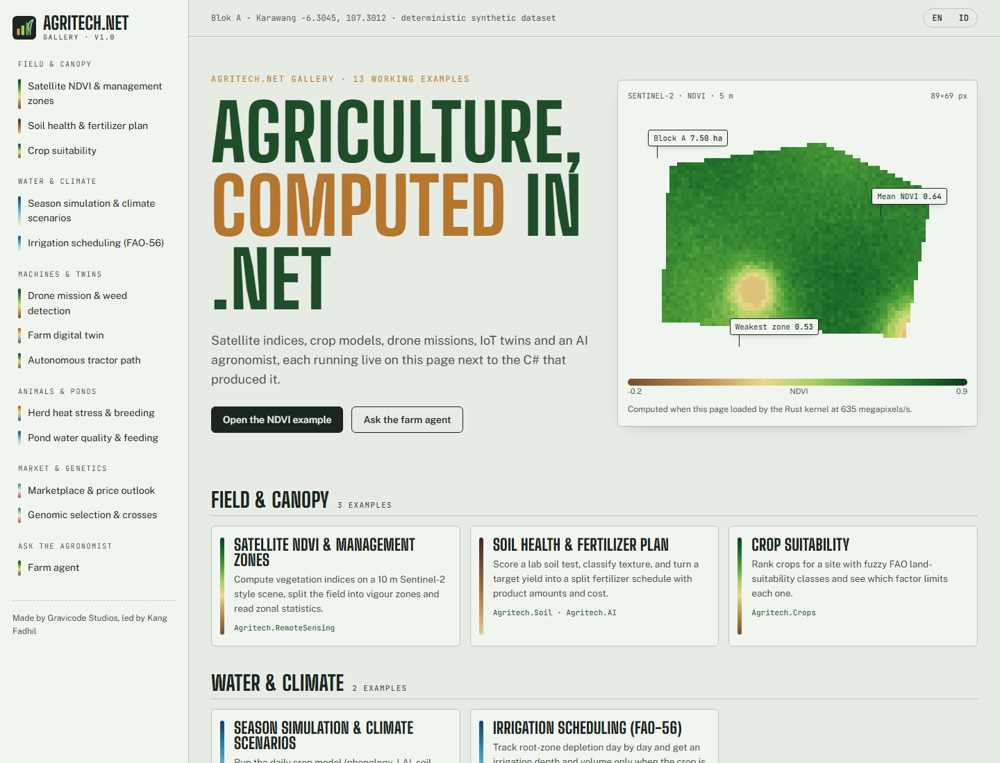

# Agritech.Net

**The Ultimate Open-Source Agriculture Technology Framework for .NET.** Made by Gravicode Studios, led by Kang Fadhil
(*Dibuat oleh Gravicode Studios dipimpin oleh Kang Fadhil*).



Building blocks for precision agriculture, smart farming, farm digital twins, climate-smart agriculture and agricultural AI on .NET 10:

- **Agritech.Core**: geo types, polygons, time series, SIMD statistics, farm model, DI (`services.AddAgritech(...)`)
- **Agritech.Crops / Soil / Weather**: FAO-56 crop catalog & phenology, soil health & fertilizer plans, Penman–Monteith ET0, Open-Meteo, SSP climate scenarios
- **Agritech.GIS / RemoteSensing**: UTM, GeoJSON, geohash, quadtree; Sentinel-2/Landsat/MODIS, NDVI/EVI/SAVI/NDWI, zonal stats, STAC search
- **Agritech.Drones / Robotics**: survey & spray missions (QGroundControl), weed detection, orthomosaic; A*, pure-pursuit tractor, harvest robot
- **Agritech.IoT / DigitalTwin**: MQTT, LoRaWAN Cayenne LPP, edge analytics; live farm twin with explained decisions
- **Agritech.AI / Simulation**: yield forecasting, disease & pest risk, FAO-56 irrigation advice, LLM farm agent (OpenAI, Azure OpenAI, Hugging Face, Ollama, offline); APSIM/DSSAT-inspired crop model
- **Agritech.Genomics / Livestock / Fisheries / SupplyChain / Marketplace**
- **Agritech.Native**: Rust kernels with automatic SIMD fallback · **Agritech.Visualization(.Blazor)** · **Agritech.Cli** · **Agritech.Templates**

```csharp
var agent = new FarmAgent(new FarmContext { CropId = "rice", PlantingDate = new(2026, 10, 20), AreaHa = 2 });
Console.WriteLine(agent.Ask("Berapa dosis pupuk terbaik minggu ini?"));
```

Documentation (English & Bahasa Indonesia), gallery apps and source: https://github.com/DotNetVibeCoderz/Vibe_Components/tree/main/Agritech.Net
