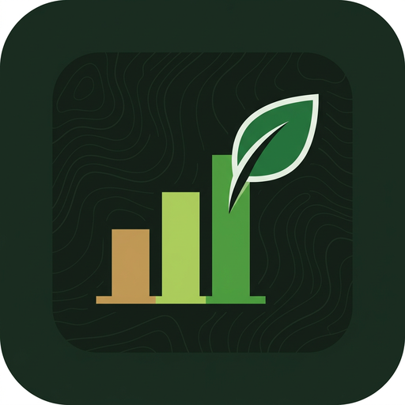
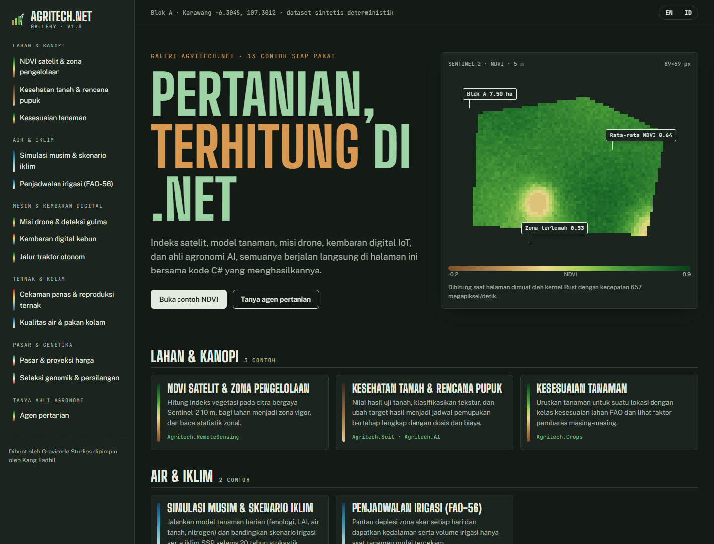
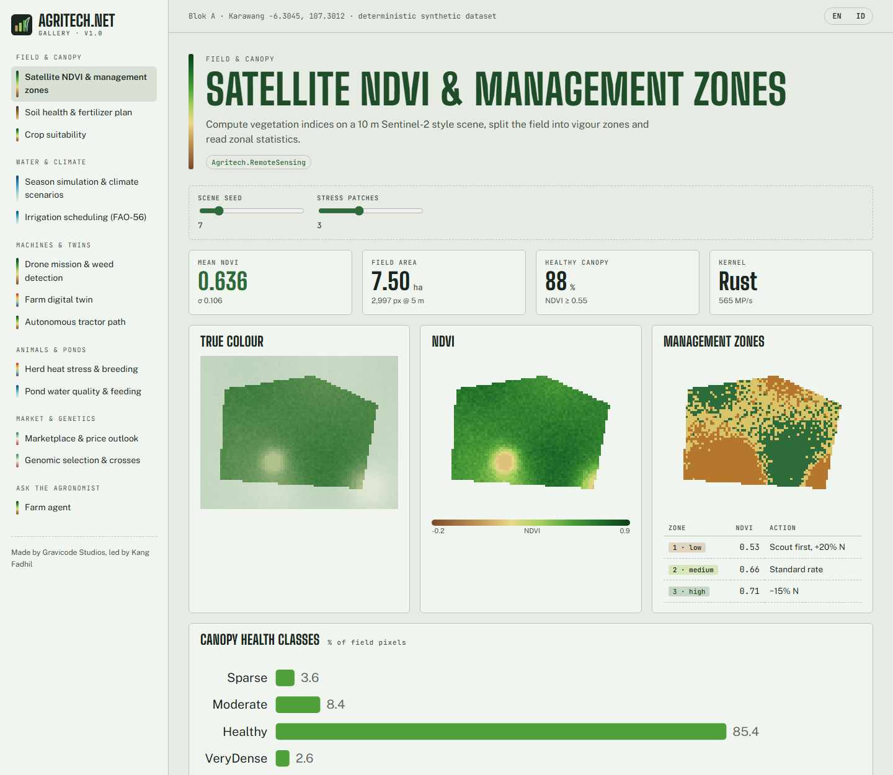
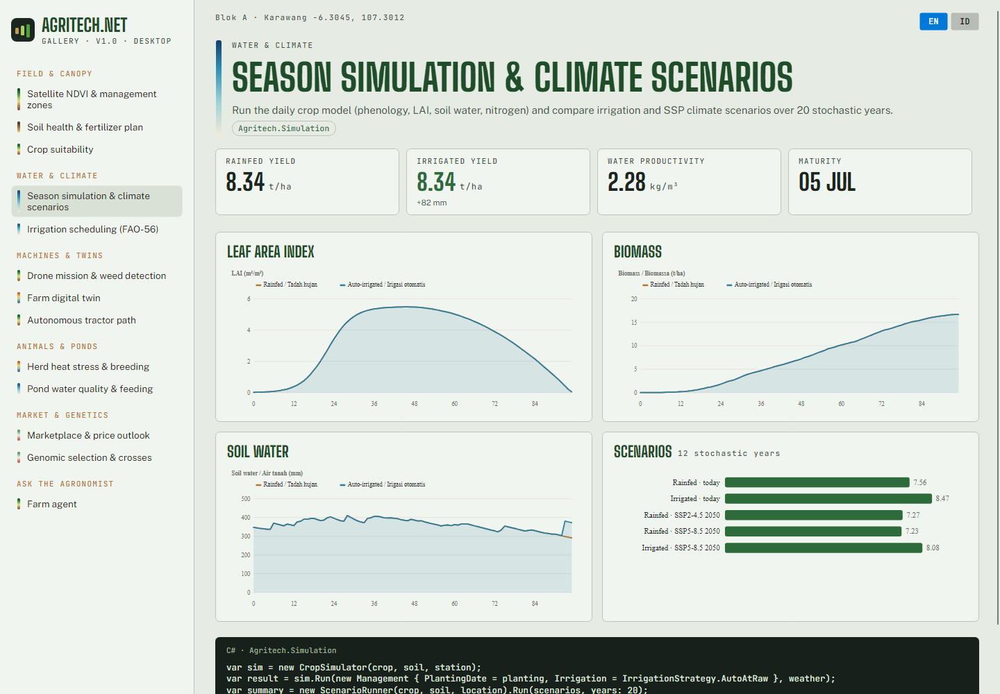
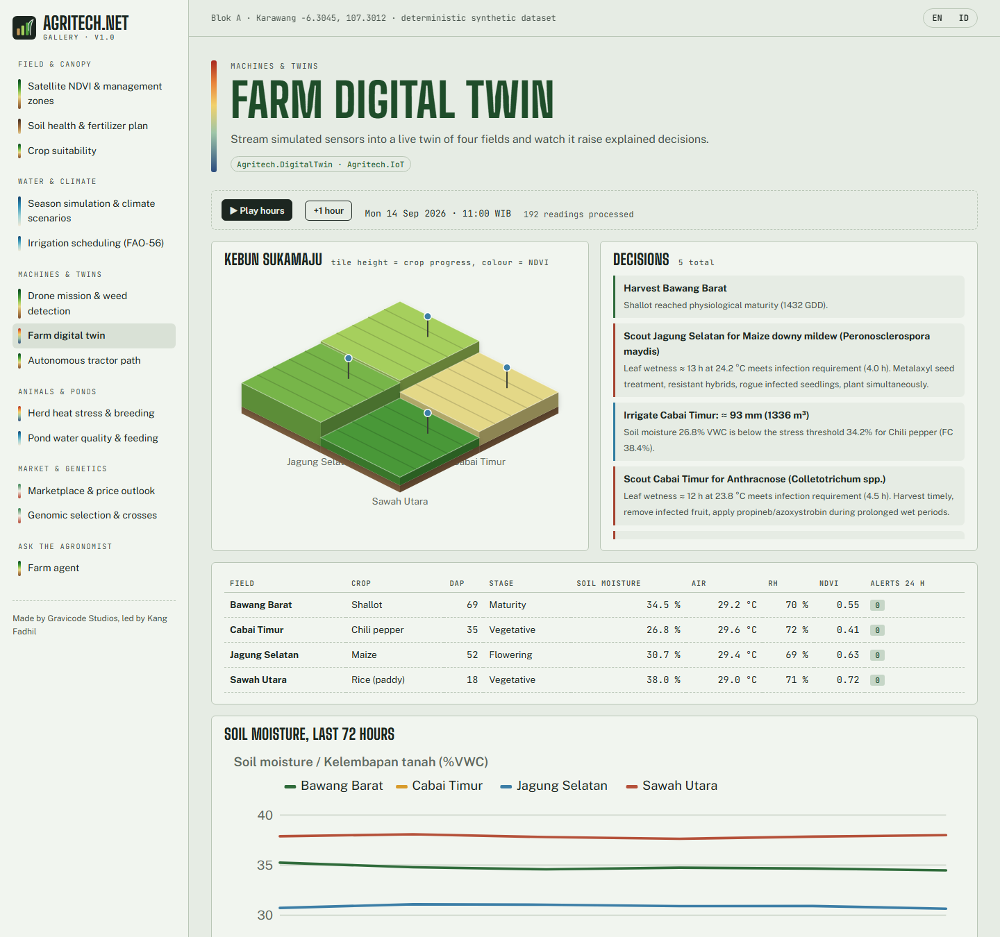
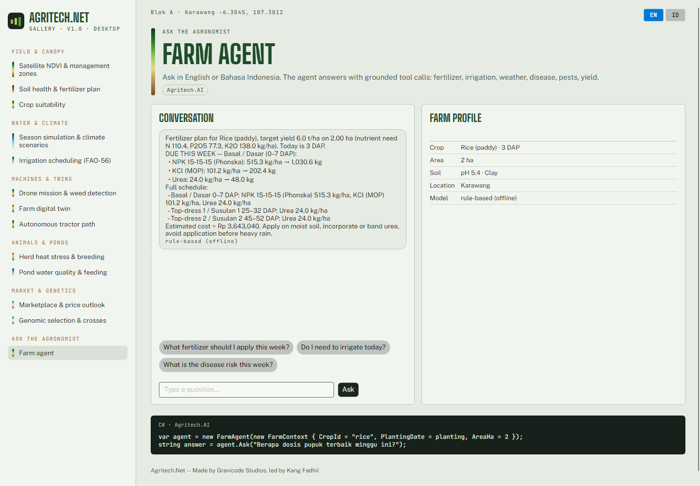

<p align="center"></p>

<h1 align="center">Agritech.Net</h1>
<p align="center"><b>Framework Teknologi Pertanian Open-Source Terlengkap untuk .NET</b><br/>
.NET 10 · Kernel native Rust · Blazor &amp; Avalonia · MIT<br/>
<i>Dibuat oleh Gravicode Studios dipimpin oleh Kang Fadhil</i></p>

<p align="center"><a href="README.md">🇬🇧 Read in English</a></p>



Agritech.Net menyediakan komponen dasar perangkat lunak pertanian modern bagi pengembang .NET: pertanian presisi, smart farming,
kembaran digital kebun, pertanian cerdas iklim, AI pertanian, GIS dan penginderaan jauh, simulasi tanaman, drone dan robotika,
peternakan, perikanan budidaya, genomika, rantai pasok, dan pasar, semuanya dalam satu framework yang konsisten dan minim dependensi.

```csharp
var agen = new FarmAgent(new FarmContext { CropId = "rice", PlantingDate = new(2026, 10, 20), AreaHa = 2 });
Console.WriteLine(agen.Ask("Berapa dosis pupuk terbaik minggu ini?"));
```

## Modul

| Paket | Kegunaan |
|---|---|
| **Agritech.Core** | Tipe geo & geodesi, poligon, deret waktu, statistik SIMD, matriks, satuan, model kebun/lahan, DI, event bus |
| **Agritech.Crops** | Katalog 16 tanaman (Kc FAO-56, Ky, GDD, RUE…), fenologi, estimasi hasil, rekomendasi kesesuaian lahan FAO |
| **Agritech.Soil** | Tekstur USDA, hidrolika Saxton–Rawls, indeks kesehatan tanah, kebutuhan kapur, kalkulator pupuk, neraca hara |
| **Agritech.Weather** | ET0 Penman–Monteith & Hargreaves FAO-56, prakiraan Open-Meteo, generator cuaca, proyeksi iklim SSP, indeks agroklimat |
| **Agritech.GIS** | UTM & Web Mercator, GeoJSON, geohash, indeks quadtree, Douglas–Peucker, convex hull |
| **Agritech.RemoteSensing** | Pita Sentinel-2 / Landsat / MODIS, NDVI · EVI · SAVI · NDWI · NDMI · NDRE · MSAVI2, statistik zonal, zona pengelolaan, fenometrik, pencarian citra STAC |
| **Agritech.Drones** | GSD, misi survei/penyemprotan, ekspor QGroundControl, deteksi gulma ExG+Otsu, keparahan lesi, ortomosaik |
| **Agritech.IoT** | Model sensor, MQTT, codec LoRaWAN Cayenne LPP, webhook TTN, analitik edge |
| **Agritech.AI** | Prakiraan hasil, risiko penyakit & hama, penasihat irigasi FAO-56, penasihat pupuk, **agen pertanian LLM** (OpenAI, Azure OpenAI, Hugging Face, Ollama, luring) |
| **Agritech.Simulation** | Model tanaman harian ala APSIM/DSSAT, skenario iklim Monte-Carlo |
| **Agritech.Genomics** | DNA/RNA, FASTA, ORF, alignment, QC SNP, GRM, prediksi genomik rrBLUP, inbreeding, rencana persilangan |
| **Agritech.Livestock** | Registri ternak, cekaman panas THI, peringatan tanda vital, kalender reproduksi, bobot lingkar dada |
| **Agritech.Fisheries** | Amonia tak terionisasi, saturasi DO, kualitas air, pertumbuhan TGC, optimasi pakan |
| **Agritech.Robotics** | Grid okupansi & A*, jalur traktor, kendali pure-pursuit, robot panen, robot rumah kaca |
| **Agritech.SupplyChain** | Ketertelusuran lot berantai hash, penarikan produk, GS1, umur simpan Q10, inventori FEFO |
| **Agritech.Marketplace** | Buku order dengan biaya angkut, proyeksi harga Holt, musiman, harga wajar di petani |
| **Agritech.DigitalTwin** | Kembaran digital kebun dengan keputusan beralasan |
| **Agritech.Visualization** (+ **.Blazor**) | Palet warna agronomi, PNG, grafik SVG, kebun isometrik 2.5D; komponen Blazor |
| **Agritech.Native** | Kernel Rust multithread dengan fallback SIMD terkelola |
| **Agritech.Cli** · **Agritech.Templates** | Alat CLI `agritech` dan templat `dotnet new` |

## Mulai cepat

```bash
dotnet add package Agritech.AI
dotnet new install Agritech.Templates
dotnet new agritech-console -n KebunSaya --crop rice
dotnet tool install -g Agritech.Cli
agritech ask "Apakah sawah perlu diairi hari ini?" --crop rice --dap 30
```

## Galeri Agritech.Net

13 contoh penggunaan dengan UI profesional, tersedia sebagai aplikasi web **Blazor** dan desktop **Avalonia**:

```bash
dotnet run --project gallery/Agritech.Gallery.Web
dotnet run --project gallery/Agritech.Gallery.Desktop
```

| Web | Desktop |
|---|---|
|  |  |
|  |  |

## Dokumentasi

- Bahasa Indonesia: [docs/id](docs/id/README.md)
- English: [docs/en](docs/en/README.md)
- Peta jalan: [PLAN.md](PLAN.md) · Progres: [Progress.md](Progress.md)

## Lisensi

MIT © 2026 Gravicode Studios. **Dibuat oleh Gravicode Studios dipimpin oleh Kang Fadhil.**
