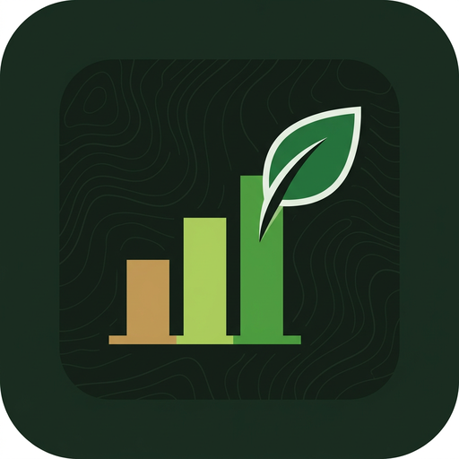
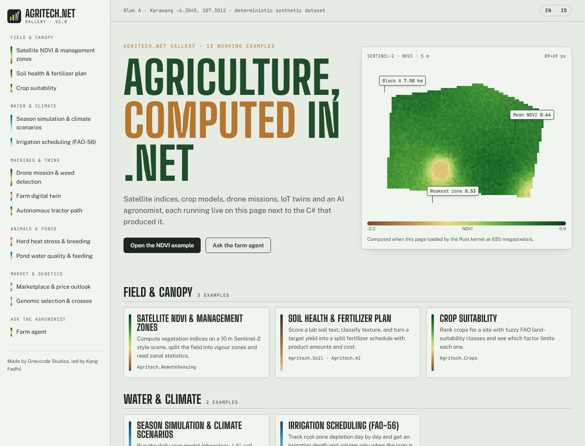
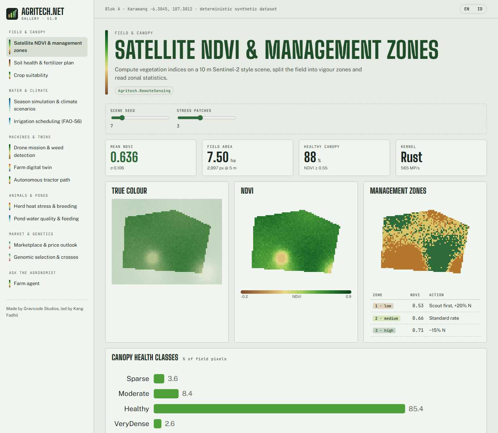
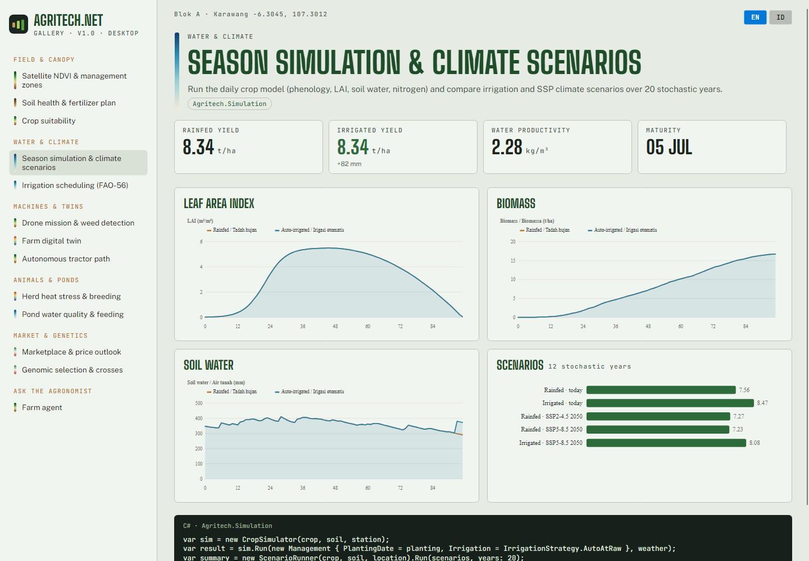
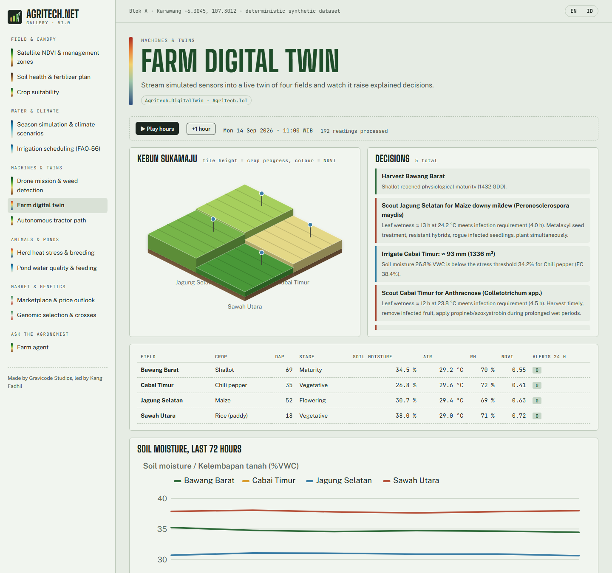
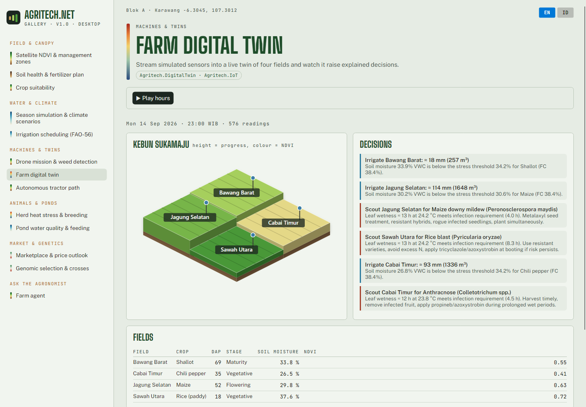
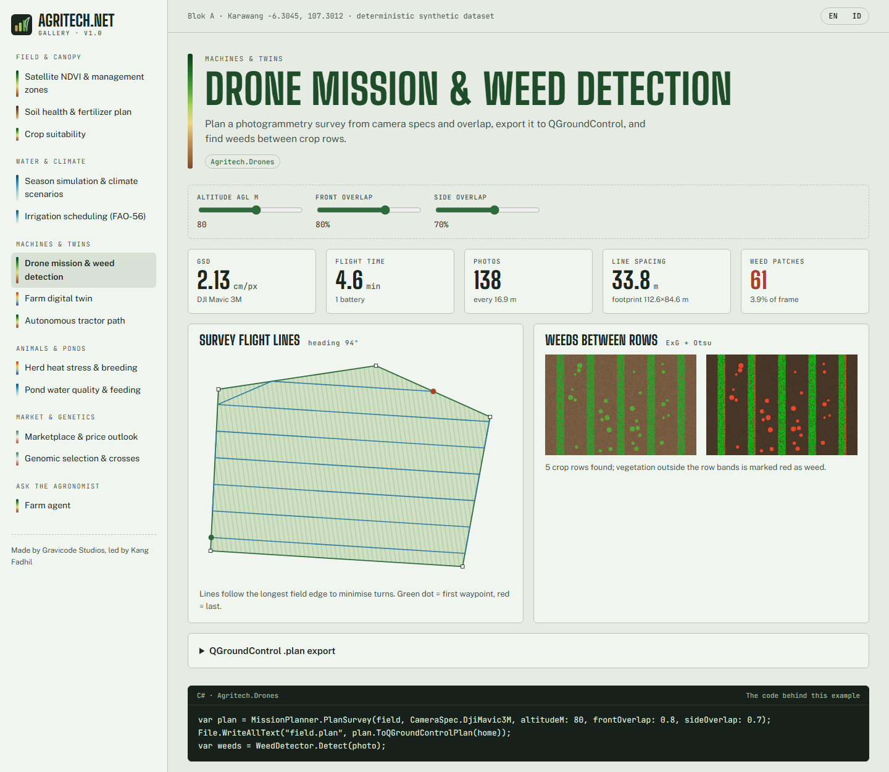
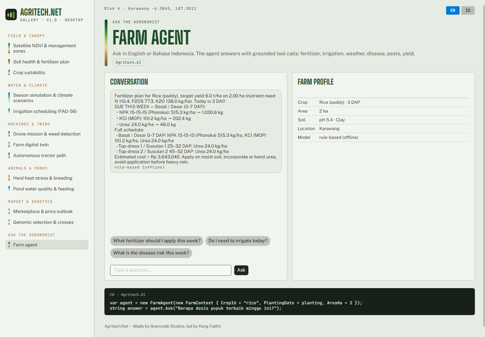

<p align="center"></p>

<h1 align="center">Agritech.Net</h1>
<p align="center"><b>The Ultimate Open-Source Agriculture Technology Framework for .NET</b><br/>
.NET 10 · Rust native kernels · Blazor &amp; Avalonia · MIT<br/>
<i>Made by Gravicode Studios, led by Kang Fadhil</i></p>

<p align="center"><a href="README.id.md">🇮🇩 Baca dalam Bahasa Indonesia</a></p>



Agritech.Net gives .NET developers the building blocks of modern agriculture software: precision agriculture, smart farming,
farm digital twins, climate-smart agriculture, agricultural AI, GIS and remote sensing, crop simulation, drones and robotics,
livestock, aquaculture, genomics, supply chain and marketplaces, all in one consistent, dependency-light framework.

```csharp
var agent = new FarmAgent(new FarmContext { CropId = "rice", PlantingDate = new(2026, 10, 20), AreaHa = 2 });
Console.WriteLine(agent.Ask("Berapa dosis pupuk terbaik minggu ini?"));
// JADWAL MINGGU INI — Top-dress 1 (25–32 HST): Urea 24 kg/ha → 48 kg …
```

## Modules

| Package | What it gives you |
|---|---|
| **Agritech.Core** | Geo types & geodesy, polygons, time series, SIMD statistics, matrices, units, farm/field model, DI builder, event bus |
| **Agritech.Crops** | 16-crop catalog (FAO-56 Kc, Ky, GDD, RUE…), lifecycle/phenology, yield estimation, FAO land-suitability recommender |
| **Agritech.Soil** | USDA texture, Saxton–Rawls hydraulics, soil health index, lime requirement, fertilizer calculator, nutrient ledger |
| **Agritech.Weather** | FAO-56 Penman–Monteith & Hargreaves ET0, Open-Meteo forecast/archive, WGEN-style generator, SSP climate projections, agro-climate indices |
| **Agritech.GIS** | UTM (Krüger) & Web Mercator, GeoJSON, geohash, quadtree index, Douglas–Peucker, convex hull |
| **Agritech.RemoteSensing** | Sentinel-2 / Landsat / MODIS band models, NDVI · EVI · SAVI · NDWI · NDMI · NDRE · MSAVI2, zonal stats, management zones, phenometrics, STAC scene search |
| **Agritech.Drones** | GSD & footprint, boustrophedon survey/spray missions, QGroundControl export, ExG+Otsu weed detection, lesion severity, orthomosaic |
| **Agritech.IoT** | Sensor model, MQTT (MQTTnet), LoRaWAN Cayenne LPP codec, TTN webhooks, edge analytics (rules, anomalies, deadband) |
| **Agritech.AI** | Ridge yield forecaster, disease (Magarey) & pest (degree-day) risk, FAO-56 irrigation advisor, fertilizer advisor, **LLM farm agent** (OpenAI, Azure OpenAI, Hugging Face, Ollama, offline) |
| **Agritech.Simulation** | APSIM/DSSAT-inspired daily crop model (phenology, LAI, RUE, 5-layer soil water, roots, nitrogen), Monte-Carlo climate scenarios |
| **Agritech.Genomics** | DNA/RNA, FASTA, ORFs, alignment, SNP QC & HWE, GRM, rrBLUP genomic prediction, pedigree inbreeding, cross planning |
| **Agritech.Livestock** | Herd registry, THI heat stress, vital-sign alerts, reproduction calendar, heart-girth weight, estrus detection |
| **Agritech.Fisheries** | Unionised ammonia & DO saturation, water-quality assessment, TGC growth, feed optimisation, stocking density |
| **Agritech.Robotics** | Occupancy grid & A*, tractor coverage paths, pure-pursuit control, harvest-robot TSP, greenhouse robot state machine |
| **Agritech.SupplyChain** | Hash-chained lot traceability, split/merge genealogy, recall tracing, GS1 check digits, Q10 shelf life, FEFO inventory |
| **Agritech.Marketplace** | Price-time order book with transport cost, Holt price forecasting, seasonality, fair farm-gate price |
| **Agritech.DigitalTwin** | Live farm twin: IoT state, phenology, explained decisions (irrigate, fertilize, scout, protect, harvest) |
| **Agritech.Visualization** (+ **.Blazor**) | Agronomic color ramps, PNG encoder, SVG charts, isometric 2.5D farm; Blazor components |
| **Agritech.Native** | Rust kernels (indices, raster stats, batch ET0), multi-threaded, with automatic managed SIMD fallback |
| **Agritech.Cli** | `agritech` dotnet tool |
| **Agritech.Templates** | `dotnet new agritech-console / agritech-blazor / agritech-iot-edge / agritech-avalonia` |

## Quick start

```bash
dotnet add package Agritech.AI            # pulls Core, Crops, Soil, Weather
dotnet add package Agritech.RemoteSensing # NDVI & friends (+ native kernels)
```

```csharp
using Agritech.Core.Geo; using Agritech.RemoteSensing; using Agritech.Soil; using Agritech.AI; using Agritech.Crops;

var field = GeoPolygon.Rectangle(new GeoCoordinate(-6.3045, 107.3012), 300, 220);
var ndvi  = VegetationIndices.Ndvi(SyntheticScene.Create(field.Bounds, pixelSizeM: 10));
Console.WriteLine($"NDVI {RasterAnalysis.Zonal(ndvi, field).Stats.Mean:0.00}");

var soil   = new SoilSample { Ph = 5.4, OrganicCarbonPct = 1.2, AvailablePMgKg = 9, ClayPct = 40, SandPct = 22, SiltPct = 38 };
var advice = FertilizerAdvisor.Advise(CropCatalog.Default.Get("rice"), soil, areaHa: 2.5, targetYieldTonHa: 6.5);
```

Or with dependency injection:

```csharp
services.AddAgritech(b => b.AddCrops().AddSoil().AddWeather().AddIoT().AddAI().AddRemoteSensing());
```

Templates and CLI:

```bash
dotnet new install Agritech.Templates
dotnet new agritech-blazor -n MyFarmDashboard
dotnet tool install -g Agritech.Cli
agritech crops recommend --temp 27 --rain 1800 --ph 5.5
agritech ask "Do I need to irrigate today?" --crop maize --dap 40
```

## Agritech.Net Gallery

13 working use cases with professional UI, as a **Blazor** web app and an **Avalonia** desktop app that share the same scenario code
(`gallery/Agritech.Gallery.Shared`).

```bash
dotnet run --project gallery/Agritech.Gallery.Web      # http://localhost:5000
dotnet run --project gallery/Agritech.Gallery.Desktop
```

| Web (Blazor) | Desktop (Avalonia) |
|---|---|
|  |  |
|  |  |
|  |  |

More screenshots: [docs/images](docs/images).

## Repository layout

```
src/            18 library packages (+ Agritech.Visualization.Blazor)
native/         Rust crate agritech-native (C ABI)
tools/          Agritech.Cli (dotnet tool "agritech")
templates/      Agritech.Templates (dotnet new pack)
gallery/        Shared scenarios, Blazor web gallery, Avalonia desktop gallery
tests/          xUnit test suite
docs/en, docs/id  Documentation (English / Bahasa Indonesia)
build/          build-native.ps1, pack.ps1, publish-nuget.ps1
```

## Build from source

```bash
pwsh build/build-native.ps1      # Rust kernels (optional; managed SIMD fallback otherwise)
dotnet build Agritech.Net.slnx
dotnet test tests/Agritech.Tests
pwsh build/pack.ps1              # NuGet packages → artifacts/packages
```

## Documentation

- English: [docs/en](docs/en/README.md): getting started, module guide, AI agent, native kernels, CLI, templates, gallery, architecture
- Bahasa Indonesia: [docs/id](docs/id/README.md)
- Roadmap: [PLAN.md](PLAN.md) · Progress: [Progress.md](Progress.md)

## Scientific basis

FAO-56 (Allen et al. 1998) ET0 & crop coefficients · FAO-33 yield response · FAO land-suitability framework ·
Saxton & Rawls (2006) · Magarey et al. (2005) infection model · Emerson et al. (1975) ammonia · NRC (1971) THI ·
VanRaden (2008) GRM · rrBLUP · Coulter (1992) pure pursuit · Cayenne LPP · IPCC AR6 SSPs.
Models are simplified for decision support; calibrate locally before operational use.

## License

MIT © 2026 Gravicode Studios. **Made by Gravicode Studios, led by Kang Fadhil.**
