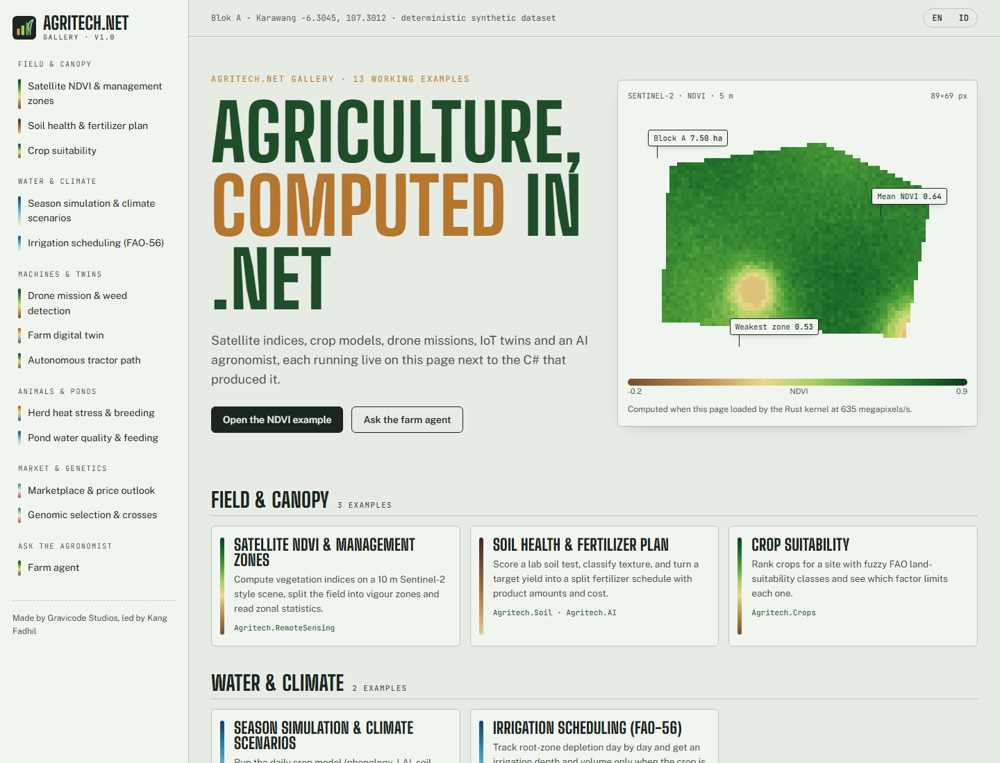

# Agritech.Net documentation (English)

> Made by Gravicode Studios, led by Kang Fadhil · [Bahasa Indonesia](../id/README.md)

| Guide | Contents |
|---|---|
| [Getting started](getting-started.md) | Install, first program, dependency injection, configuration |
| [Module guide](modules.md) | Every package with key APIs and examples |
| [AI farm agent](ai-agent.md) | `FarmAgent`, tools, LLM providers, offline mode |
| [Native kernels](native.md) | Rust `agritech-native`, ABI, performance, cross-compiling |
| [CLI](cli.md) | `agritech` command reference |
| [Templates](templates.md) | `dotnet new` templates |
| [Gallery](gallery.md) | Blazor and Avalonia showcase apps, adding a demo |
| [Architecture](architecture.md) | Dependency graph, design rules, performance |

