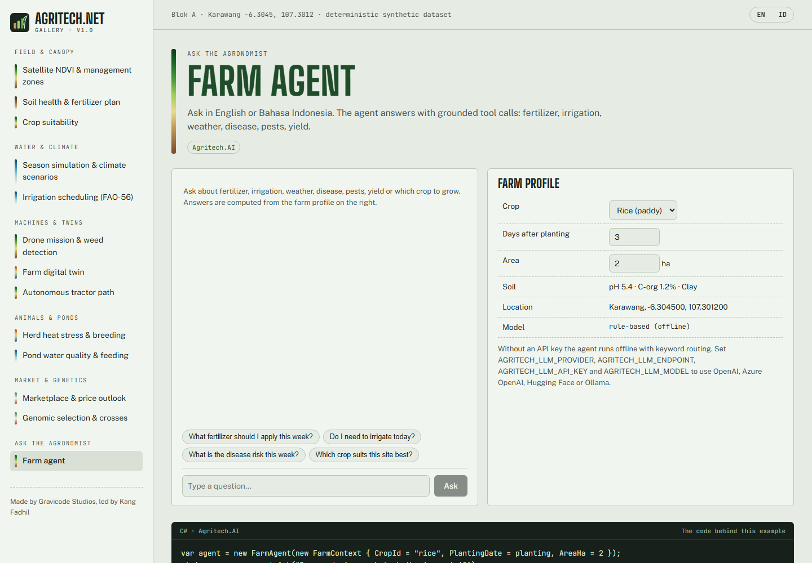

# AI farm agent

`FarmAgent` answers farmer questions in **English or Bahasa Indonesia**. It never invents numbers: the language model chooses tools,
and the tools compute grounded answers from the farm context with the other Agritech.Net modules.

```csharp
var agent = new FarmAgent(new FarmContext
{
    FarmName = "Kebun Sukamaju", CropId = "rice", PlantingDate = new(2026, 10, 20), AreaHa = 2,
    Soil = new SoilSample { Ph = 5.4, OrganicCarbonPct = 1.2 }, Location = new(-6.3045, 107.3012),
    Weather = new OpenMeteoWeatherProvider(),
});
string answer = agent.Ask("Berapa dosis pupuk terbaik minggu ini?");
AgentAnswer full = await agent.AskAsync("Should I irrigate today?");   // .Text, .ToolsUsed, .Model, .Language
```



## Tools

| Tool | Backed by |
|---|---|
| `farm_overview` | Crop stage, DAP, harvest date, soil score |
| `fertilizer_plan` | `FertilizerAdvisor`: what is due this week, kg/ha, total kg, cost |
| `irrigation_advice` | `IrrigationAdvisor`: FAO-56 water balance plus forecast |
| `weather_forecast` | `IWeatherProvider` + ET0 |
| `disease_risk` | `DiseaseRiskModel` for the crop's pathogens |
| `pest_risk` | Degree-day `PestModel` generations |
| `yield_estimate` | FAO-33 Ky from the season water balance |
| `soil_health` | `SoilHealth.Assess` |
| `crop_recommendation` | `CropRecommender` (accepts optional site arguments) |

Add your own tool by building `AgentTool(name, description, jsonSchema, invoke)` and including it in your own agent.

## LLM providers

Any OpenAI-compatible Chat Completions endpoint with tool calling works:

```csharp
new FarmAgent(ctx, new OpenAiCompatibleChatModel(LlmOptions.AzureOpenAI("https://my-res.openai.azure.com/", key, "gpt-5-mini")));
new FarmAgent(ctx, new OpenAiCompatibleChatModel(LlmOptions.OpenAI(key, "gpt-5-mini")));
new FarmAgent(ctx, new OpenAiCompatibleChatModel(LlmOptions.HuggingFace(hfToken, "Qwen/Qwen2.5-72B-Instruct")));
new FarmAgent(ctx, new OpenAiCompatibleChatModel(LlmOptions.Ollama("llama3.1")));
```

Or configure through environment variables, which `FarmAgent`, `AddAI()`, the CLI and the gallery all pick up:

| Variable | Example |
|---|---|
| `AGRITECH_LLM_PROVIDER` | `azure`, `openai`, `hf`, `ollama`, `custom` |
| `AGRITECH_LLM_ENDPOINT` | `https://my-res.openai.azure.com/` |
| `AGRITECH_LLM_API_KEY` | *(secret: never commit)* |
| `AGRITECH_LLM_MODEL` | `gpt-5-mini` |

`OPENAI_API_KEY` and `HF_TOKEN` are used as fallbacks.

## Offline mode

With nothing configured, `RuleBasedChatModel` routes the question to tools by bilingual keyword intent and returns their localized output.
This suits edge devices without internet, tests and demos.

## Verified

The agent was tested live against Azure OpenAI `gpt-5-mini`. It produced correct tool calls (`fertilizer_plan`; `irrigation_advice` + `disease_risk`) and
replied in the question's language.
