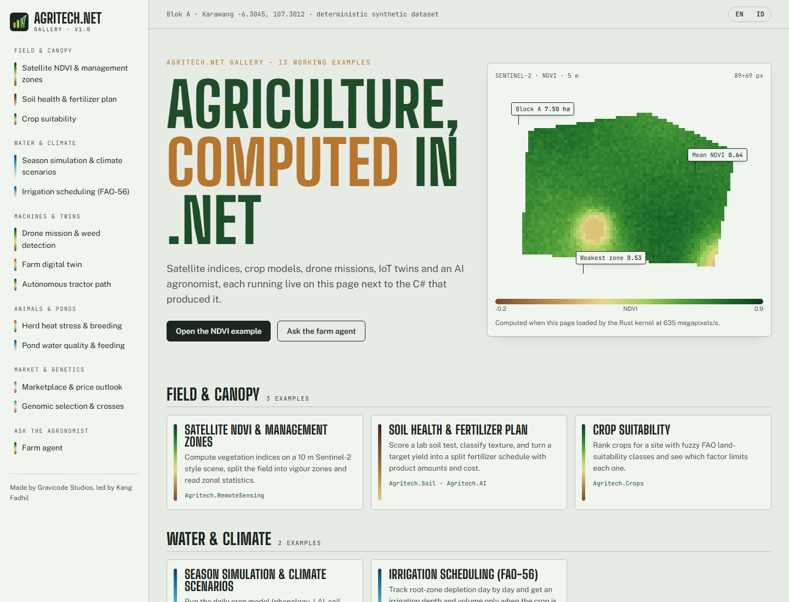
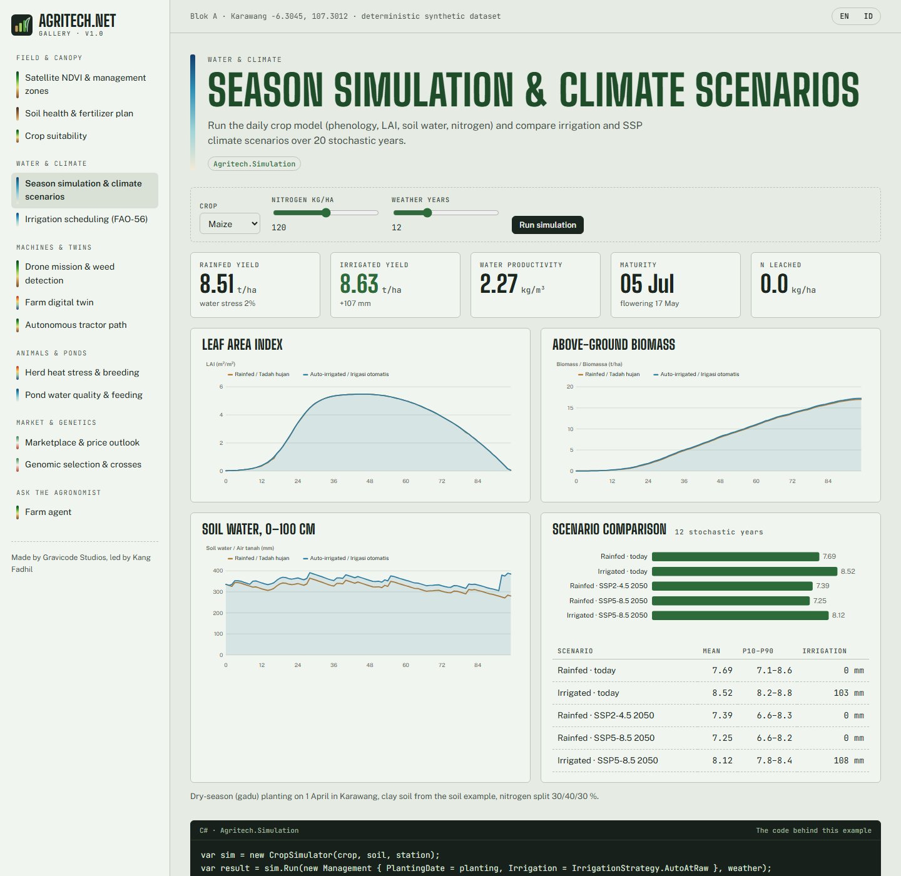
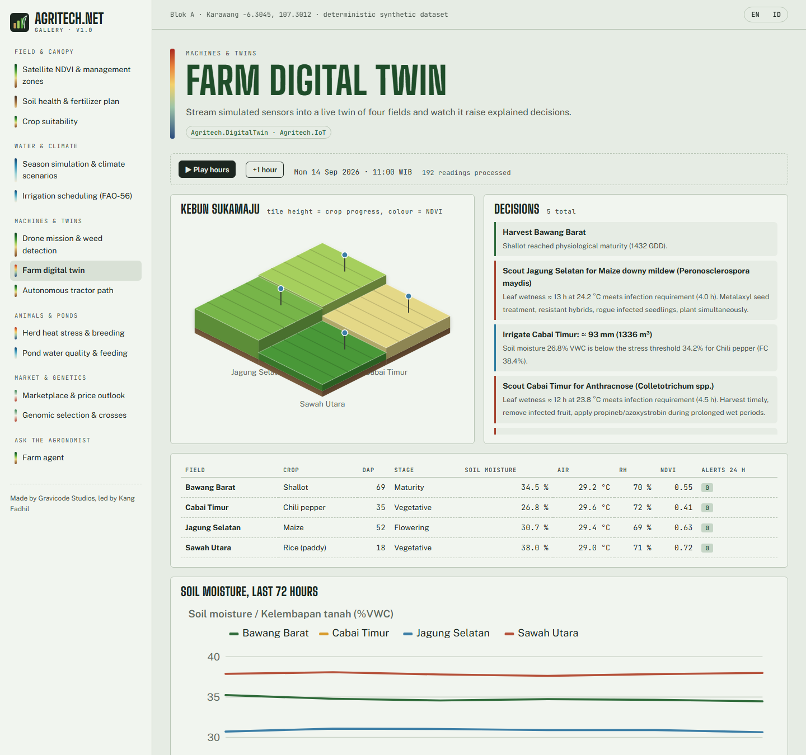
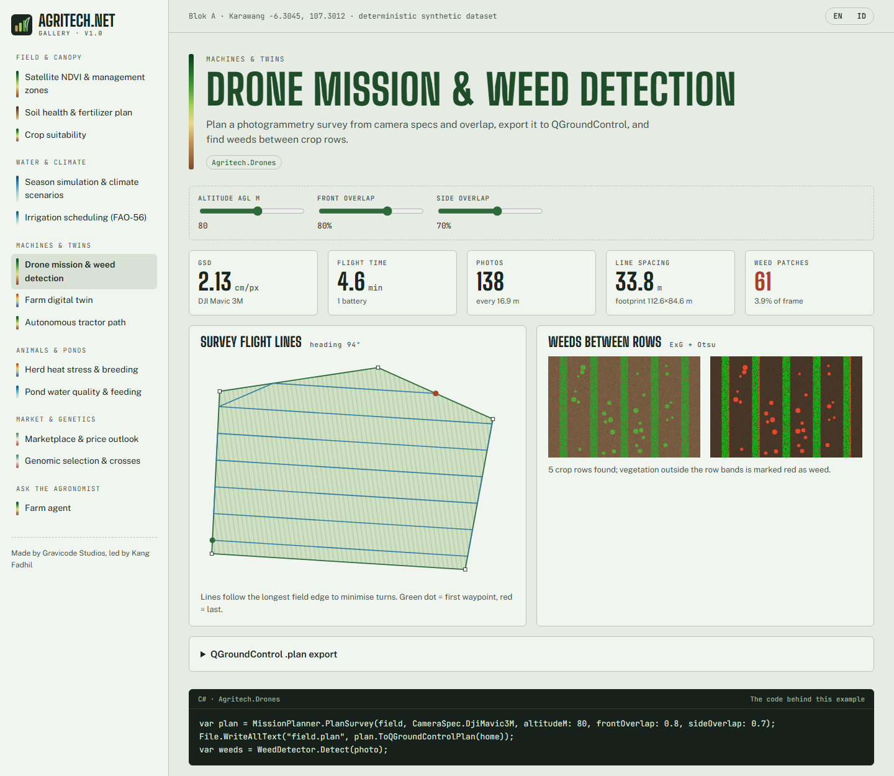
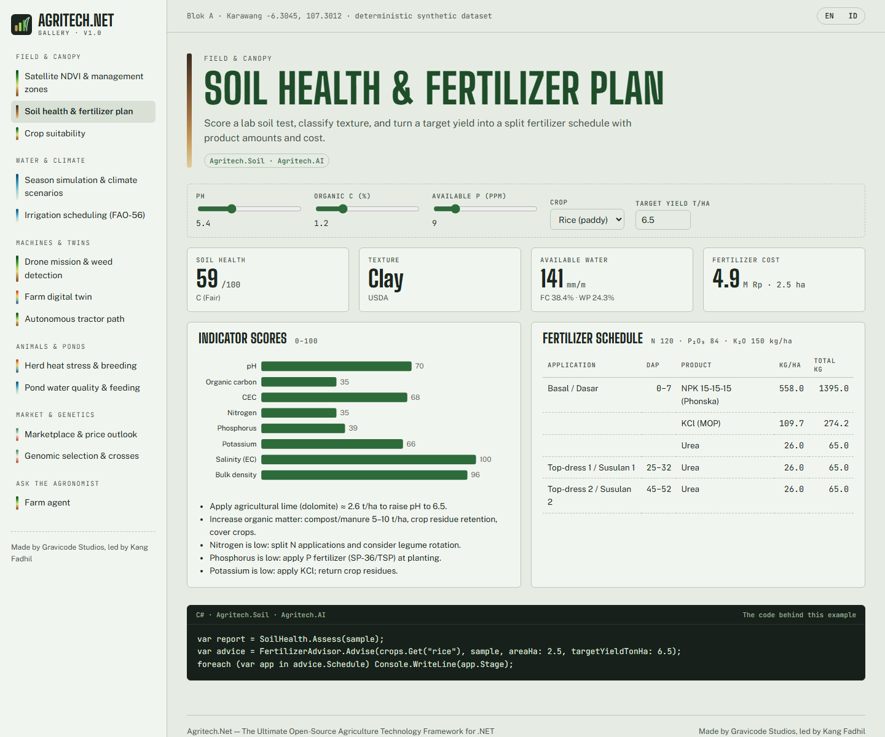
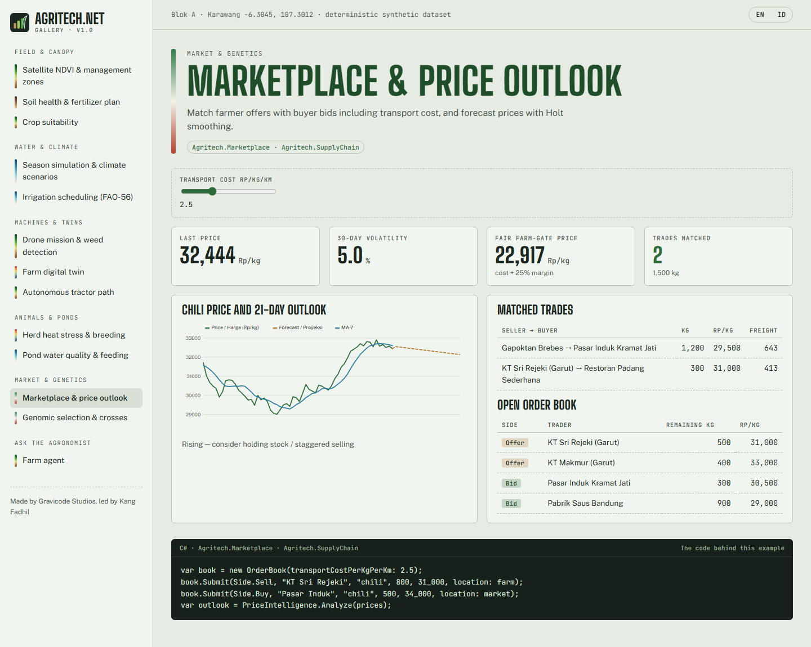
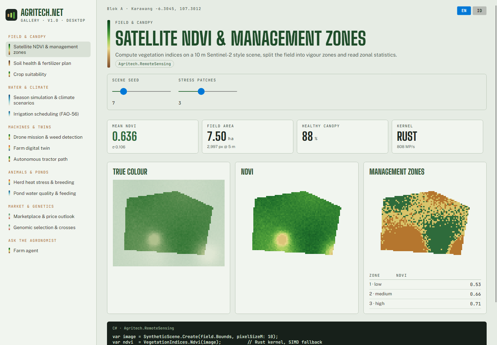

# Agritech.Net Gallery

The gallery shows 13 use cases running live with the C# behind each one. It ships as two apps that share scenario code
(`gallery/Agritech.Gallery.Shared`):

```bash
dotnet run --project gallery/Agritech.Gallery.Web        # Blazor Server
dotnet run --project gallery/Agritech.Gallery.Desktop    # Avalonia 12
dotnet run --project gallery/Agritech.Gallery.Desktop -- --screenshot docs/images [en|id]   # headless screenshots
```

| Group | Demos |
|---|---|
| Field & canopy | Satellite NDVI & management zones · Soil health & fertilizer plan · Crop suitability |
| Water & climate | Season simulation & SSP scenarios · FAO-56 irrigation scheduling |
| Machines & twins | Drone mission & weed detection · Farm digital twin (live) · Autonomous tractor path |
| Animals & ponds | Herd heat stress & breeding · Pond water quality & feeding |
| Market & genetics | Marketplace & price outlook · Genomic selection & crosses |
| Ask the agronomist | Farm agent chat (offline or LLM) |

Every page has an EN/ID toggle.

## Design

The look borrows from an agronomist's field survey sheet. The background is celadon "paddy paper" (`#E6ECE4`) with leaf-shadow ink (`#1C2620`), chlorophyll green,
Munsell soil ochre and irrigation blue, and lesion red is kept for alerts. Headings use *Big Shoulders Display*, a condensed face in the style of farm-machinery decals.
Body text uses *Public Sans* and readings and code use *JetBrains Mono*. The signature is the **spectral rail**: every demo carries a thin band painted with
its real data color ramp (NDVI, water, heat). The home page opens on an NDVI map computed live with survey-style pins. Light and dark themes are both supported.









## Adding a demo

1. Add the computation to `Agritech.Gallery.Shared/Scenarios.cs` (return a record with numbers, SVG strings or PNG bytes).
2. Register it in `GalleryCatalog.Demos` with bilingual title and summary, a ramp and a code snippet.
3. Add a Razor view in `Agritech.Gallery.Web/Components/Demos` and a case in `Pages/Demo.razor`.
4. Add a builder in `Agritech.Gallery.Desktop/Views.cs`.
