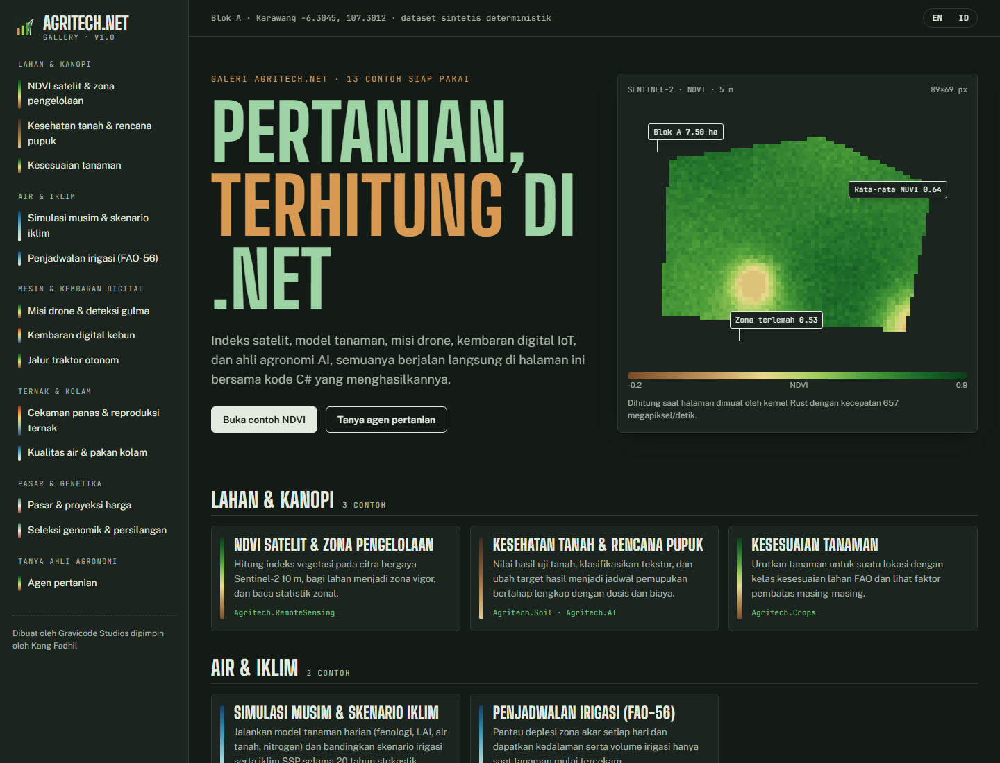

# Dokumentasi Agritech.Net (Bahasa Indonesia)

> Dibuat oleh Gravicode Studios dipimpin oleh Kang Fadhil · [English](../en/README.md)

| Panduan | Isi |
|---|---|
| [Memulai](memulai.md) | Instalasi, program pertama, dependency injection, konvensi |
| [Panduan modul](modul.md) | Semua paket beserta API utama dan contoh |
| [Agen pertanian AI](agen-ai.md) | `FarmAgent`, alat, penyedia LLM, mode luring |
| [Kernel native](native.md) | Rust `agritech-native`, ABI, performa, kompilasi lintas platform |
| [CLI](cli.md) | Referensi perintah `agritech` |
| [Templat](templat.md) | Templat `dotnet new` |
| [Galeri](galeri.md) | Aplikasi showcase Blazor dan Avalonia |
| [Arsitektur](arsitektur.md) | Grafik dependensi, prinsip desain, performa |

