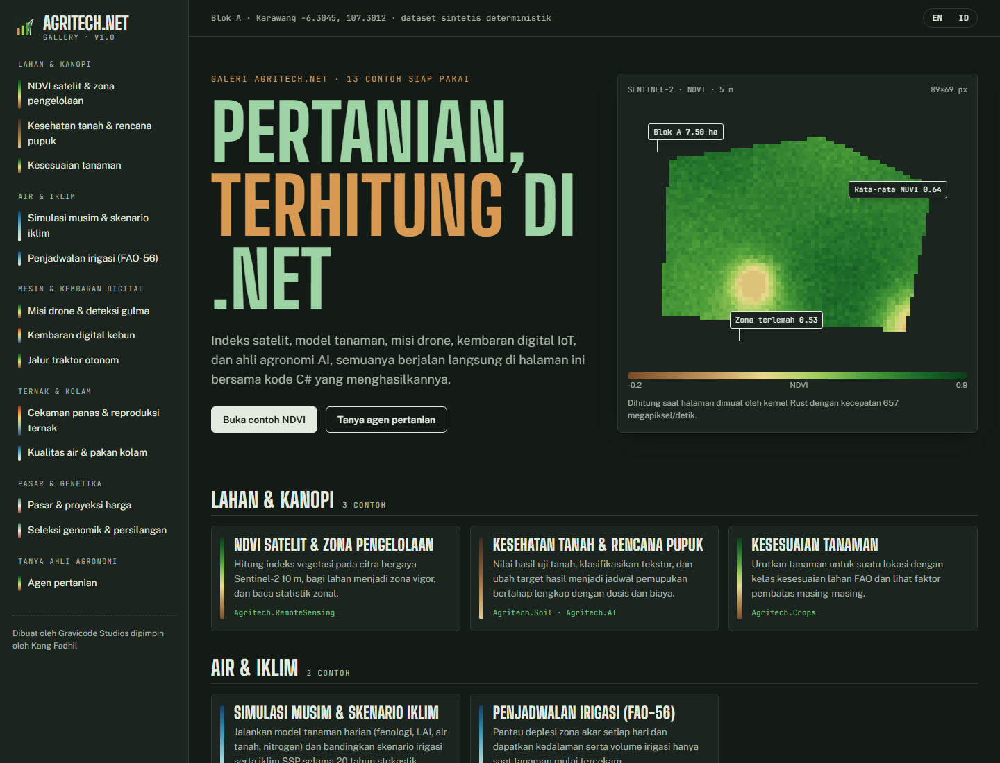
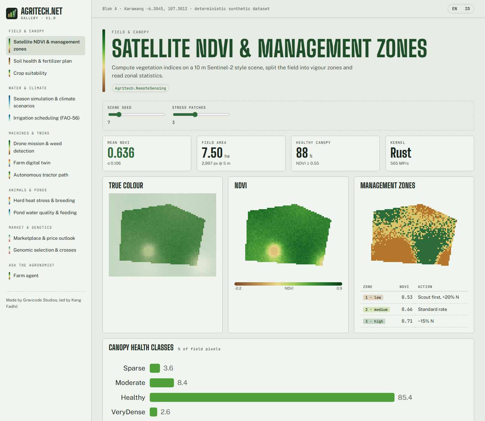
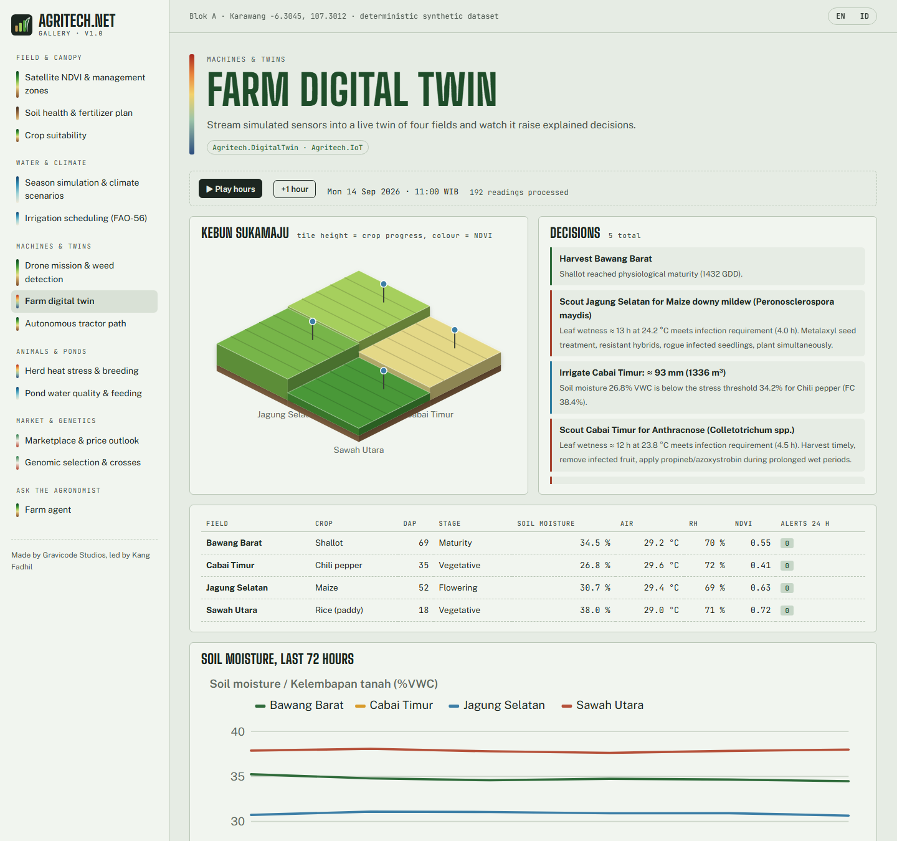
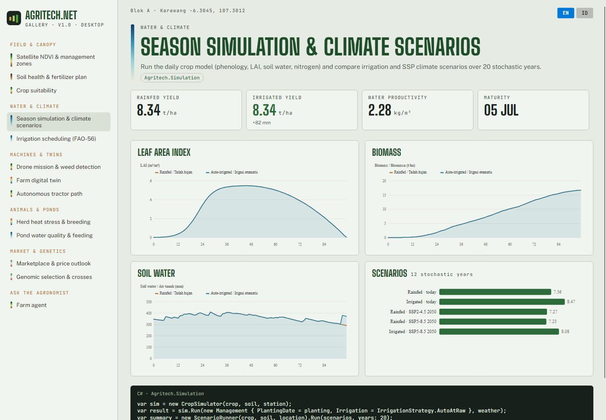

# Galeri Agritech.Net

Galeri berisi 13 contoh penggunaan yang berjalan langsung bersama kode C#-nya, dalam dua aplikasi yang berbagi logika yang sama:

```bash
dotnet run --project gallery/Agritech.Gallery.Web        # web Blazor
dotnet run --project gallery/Agritech.Gallery.Desktop    # desktop Avalonia
```

Kelompok contoh: **Lahan & kanopi** (NDVI satelit, kesehatan tanah & pupuk, kesesuaian tanaman), **Air & iklim** (simulasi musim & skenario SSP, irigasi FAO-56),
**Mesin & kembaran digital** (misi drone & gulma, kembaran digital kebun, traktor otonom), **Ternak & kolam** (cekaman panas & reproduksi, kualitas air & pakan),
**Pasar & genetika** (pasar & proyeksi harga, seleksi genomik), dan **Tanya ahli agronomi** (agen AI). Setiap halaman memiliki tombol EN/ID.

Gaya visualnya mengikuti lembar survei lapangan seorang agronom: kertas sawah seladon, tinta hijau tua, hijau klorofil, oker tanah Munsell, dan biru irigasi.
Setiap contoh memiliki **spectral rail**, yaitu garis tipis berwarna sesuai palet data aslinya (NDVI, air, panas).





