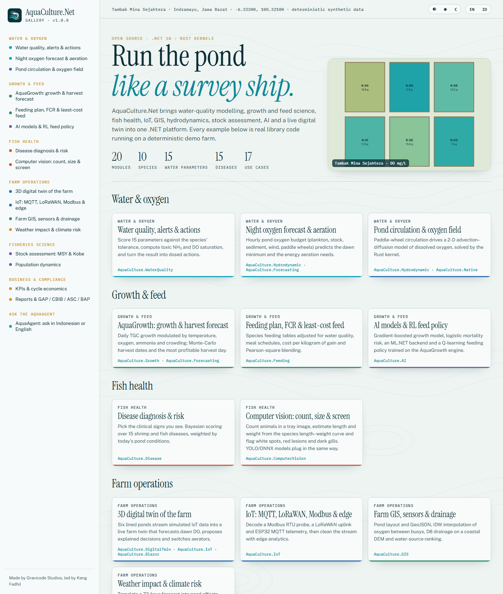

# AquaCulture.Net

**The Ultimate Open Source Aquaculture Platform for .NET.** Made by Gravicode Studios, led by Kang Fadhil
(*Dibuat oleh Gravicode Studios dipimpin oleh Kang Fadhil*).



Water-quality modelling, fisheries science, farm management, AI, IoT, GIS and a live digital twin for fish and shrimp farms on .NET 10:

- **AquaCulture.Core**: species database (nila, lele, gurame, patin, koi, bandeng, kerapu, kakap, vaname, windu), farm/pond/cycle model, statistics, geo, DI (`services.AddAquaCulture(...)`)
- **AquaCulture.WaterQuality**: 15 parameters, un-ionised NH₃, DO saturation, species-aware WQI and CCME, alert engine, dosed recommendations
- **AquaCulture.Growth / Feeding / Analytics**: AquaGrowth engine (TGC, von Bertalanffy, harvest optimum), feeding tables, FCR, least-cost feed, KPIs and economics
- **AquaCulture.Disease / ComputerVision**: Bayesian diagnosis of WSSV, AHPND/EMS, EHP, IMNV, columnaris, MAS, streptococcosis, TiLV, KHV…; YOLO/ONNX detection, counting and sizing
- **AquaCulture.StockAssessment / Population**: Schaefer/Fox, Beverton–Holt, YPR, Kobe status, length-based methods; age-structured dynamics and predation
- **AquaCulture.Environment / Hydrodynamic / Forecasting**: Open-Meteo, BMKG, NASA POWER and marine forecasts, weather impact, climate risk; 2-D advection–diffusion (Rust kernel), pond oxygen budget, RAS mass balance; dawn-DO and Monte-Carlo harvest forecasts
- **AquaCulture.IoT / GIS / DigitalTwin**: MQTT, LoRaWAN, ChirpStack, Modbus RTU/TCP and serial, OPC-UA mapping, edge analytics; GeoJSON, IDW, D8 drainage, NetTopologySuite/ProjNet; live pond and farm twin with explained decisions
- **AquaCulture.Data / IoT.OpcUa / GIS.Gdal** (v1.1): EF Core / SQLite store and Parquet/CSV export; OPC UA client and pond simulator; GeoTIFF via GDAL.Net and Sentinel-2 water colour (NDWI, NDCI chlorophyll-a, turbidity)
- **AquaCulture.AI**: growth/mortality/disease models, RL feeding policy, ML.NET and ONNX backends, LLM **AquaAgent** (Azure OpenAI, OpenAI, Claude, DeepSeek, Hugging Face, Ollama or offline)
- **AquaCulture.Reporting / Visualization / Blazor / Native**: XLSX/PDF/DOCX/CSV/JSON/HTML reports, GAP/CBIB/ASC/BAP audits; SVG/PNG charts; Blazor components with a Three.js 3D pond; Rust kernels with managed fallback
- **AquaCulture.Cli** (`aqua`) · **AquaCulture.Templates** (`dotnet new aqua-console | aqua-blazor | aqua-iot-edge | aqua-avalonia`)

```csharp
var a = WaterQualityIndex.Assess(new WaterSample { TemperatureC = 30, DissolvedOxygen = 3.8, Ph = 8.4, Ammonia = 1.6 }, SpeciesCatalog.Vaname);
var agent = new AquaAgent(new AquaContext { Species = SpeciesCatalog.Vaname, AbwG = 12, Population = 200_000 });
Console.WriteLine(agent.Ask("Berapa pakan udang hari ini?"));
```

Documentation (English & Bahasa Indonesia), gallery apps and source: https://github.com/DotNetVibeCoderz/Vibe_Components/tree/main/AquaCulture.Net
