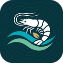
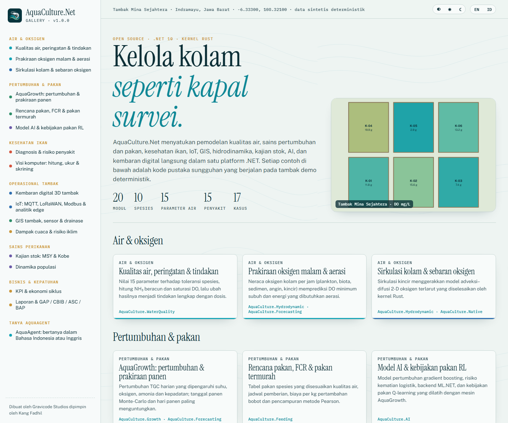
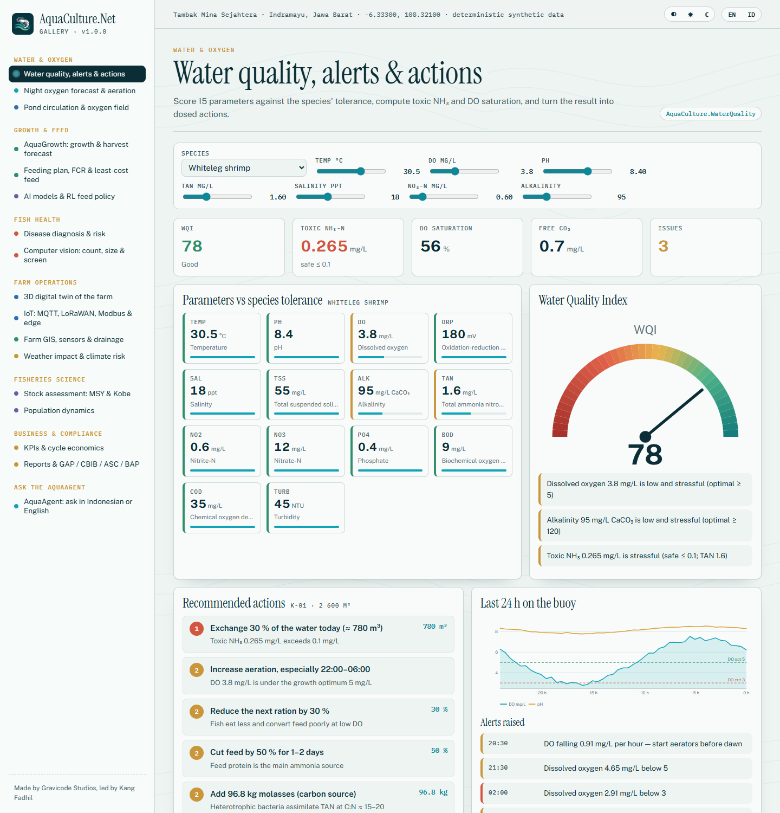
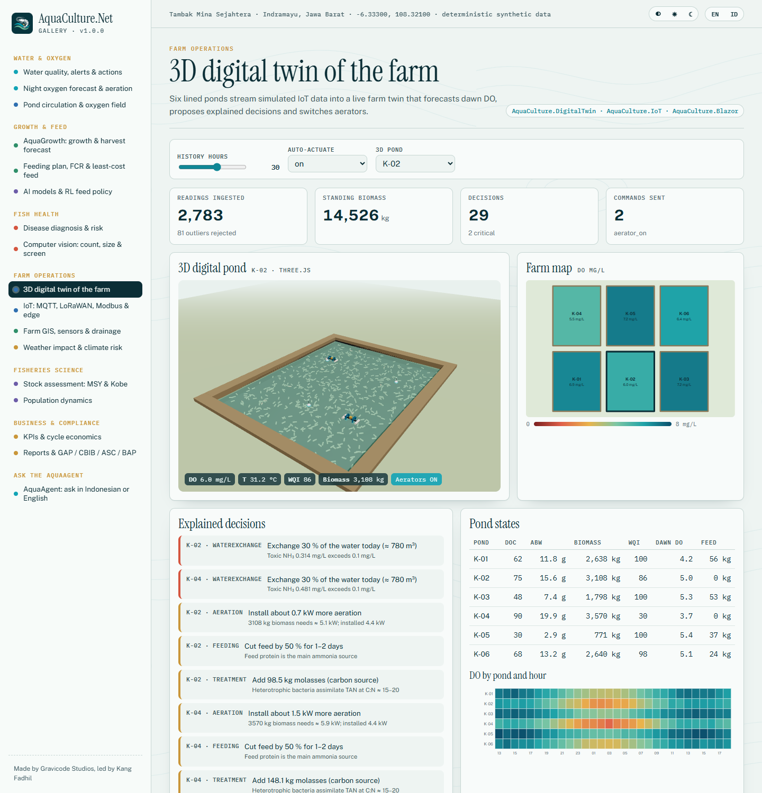
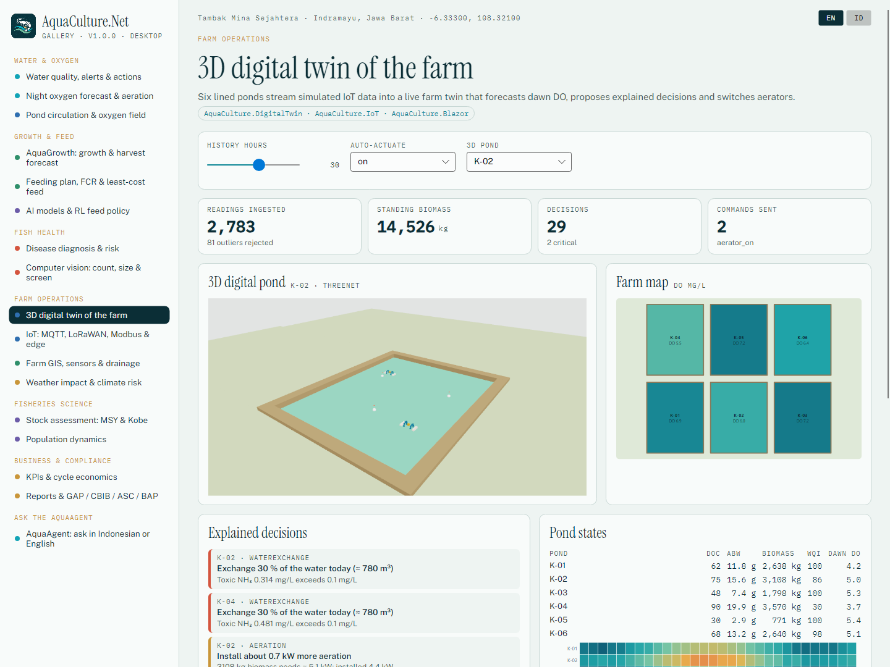
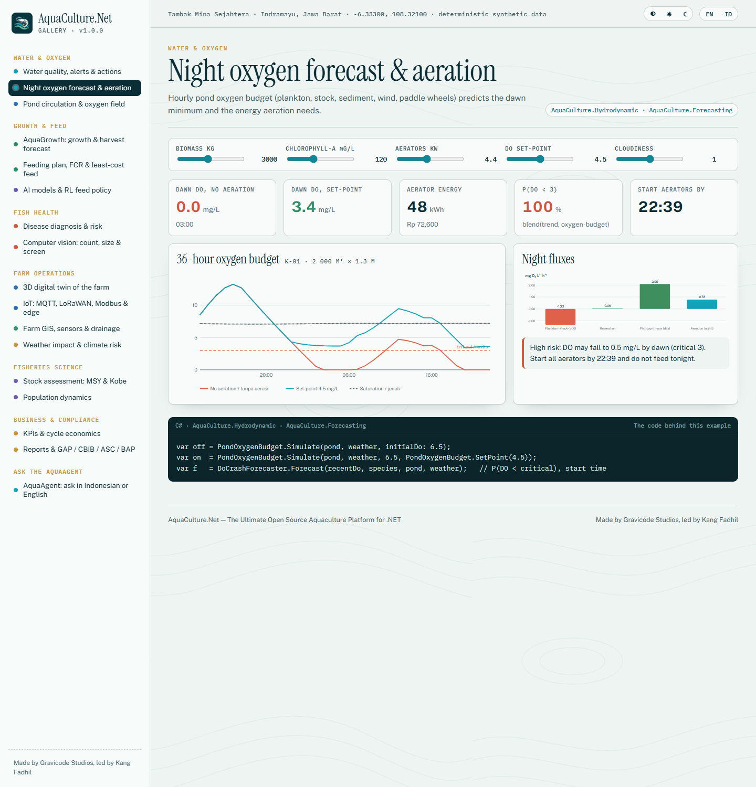

<p align="center"></p>

# AquaCulture.Net

**Platform Akuakultur Open Source Terlengkap untuk .NET** — pemodelan kualitas air, sains pertumbuhan dan pakan, kesehatan ikan,
kajian stok perikanan, IoT, GIS, hidrodinamika, AI, dan kembaran digital langsung dalam satu ekosistem .NET 10, dengan kernel Rust untuk bagian yang menuntut performa.

Dibuat oleh **Gravicode Studios** dipimpin oleh **Kang Fadhil**. · [English](README.md)



## Mengapa

Tambak ikan dan udang kehilangan biota saat oksigen anjlok menjelang subuh, kehilangan uang saat FCR membengkak, dan kehilangan satu siklus penuh karena WSSV atau AHPND.
AquaCulture.Net mengubah data sensor, sampling dan cuaca menjadi angka yang dibutuhkan pengelola tambak — DO subuh, ransum hari ini, amonia beracun,
hari panen paling menguntungkan — dan menjelaskan setiap rekomendasi. Cocok untuk tambak ikan dan udang pintar, pembenihan, keramba jaring apung (KJA),
RAS indoor, akuaponik, riset perikanan dan kelautan, pemantauan pemerintah, dan perguruan tinggi.

## Modul

| Paket | Fungsi |
|---|---|
| `AquaCulture.Core` | Basis data spesies (nila, lele, gurame, patin, koi, bandeng, kerapu, kakap, vaname, windu), model tambak / kolam / siklus, statistik SIMD, deret waktu, geo, RNG deterministik, DI dan event bus |
| `AquaCulture.WaterQuality` | 15 parameter, NH₃ tak terionisasi, saturasi DO, WQI berbasis spesies dan indeks CCME, mesin peringatan dengan histeresis dan aturan tren DO, rekomendasi lengkap dengan dosis |
| `AquaCulture.Growth` | Mesin AquaGrowth: TGC, von Bertalanffy, Gompertz; pengaruh suhu / DO / NH₃ / salinitas / kepadatan / ransum; mortalitas; biomassa, tanggal panen, hasil, hari panen dengan margin terbaik |
| `AquaCulture.Feeding` | FCR, tabel pakan, jadwal pemberian, analisis biaya pakan, pakan termurah dan pencampuran metode Pearson, pemberi pakan otomatis |
| `AquaCulture.Disease` | 15 penyakit (WSSV, AHPND/EMS, EHP, IMNV, vibriosis, kotoran putih, insang hitam, kolumnaris, busuk sirip, borok MAS, streptokokosis, TiLV, Ich, KHV, saprolegniasis); diagnosis Bayesian; risiko lingkungan |
| `AquaCulture.StockAssessment` | Schaefer dan Fox (keseimbangan dan dinamis), Beverton–Holt dan Ricker, yield per recruit (Fmax, F0.1, F40 %), M Pauly/Then, Powell–Wetherall, kurva tangkapan berbasis panjang, status Kobe |
| `AquaCulture.Population` | Model berstruktur umur: rekrutmen, musim pemijahan, migrasi, predasi (Holling II), aturan panen; matriks Leslie; mangsa–pemangsa |
| `AquaCulture.Environment` | Klien Open-Meteo, BMKG, NASA POWER, dan Open-Meteo Marine; generator cuaca tropis, dampak cuaca pada kolam, matriks risiko iklim |
| `AquaCulture.Hydrodynamic` | Adveksi–difusi–reaksi 2-D (kernel Rust), arus kincir/sungai/pasang surut, sedimentasi dan sebaran limbah KJA, neraca oksigen kolam per jam, neraca massa RAS |
| `AquaCulture.IoT` | Perangkat ESP32 / ESP8266 / Arduino / Raspberry Pi / PLC; MQTT, LoRaWAN, Modbus RTU/TCP dan RTU serial, webhook ChirpStack v4, REST, pemetaan OPC-UA; analitik edge; simulator |
| `AquaCulture.GIS` | Tata letak kolam, GeoJSON, interpolasi IDW, analisis sumber air, drainase D8; NetTopologySuite + ProjNet |
| `AquaCulture.Data` | Penyimpanan EF Core / SQLite untuk tambak, siklus, pembacaan sensor, dan keputusan kembaran; transport perekam; ekspor deret waktu CSV dan Apache Parquet |
| `AquaCulture.IoT.OpcUa` | Klien OPC UA untuk PLC/SCADA (stack OPC Foundation) dan simulator kolam OPC UA |
| `AquaCulture.GIS.Gdal` | GeoTIFF dan 200+ format raster lewat GDAL.Net; warna air Sentinel-2: NDWI, MNDWI, klorofil-a NDCI, kekeruhan, status trofik |
| `AquaCulture.AI` | Model pertumbuhan gradient boosting, risiko kematian, prakiraan penyakit dan panen, kebijakan pakan Q-learning, backend ML.NET dan ONNX, **AquaAgent** LLM |
| `AquaCulture.ComputerVision` | Detektor YOLO/ONNX, penghitungan / pengukuran / skrining bintik putih, luka dan insang hitam, interop OpenCvSharp |
| `AquaCulture.Forecasting` | Holt, Holt–Winters, AR, prakiraan DO subuh, prakiraan panen Monte-Carlo P10/P50/P90 |
| `AquaCulture.DigitalTwin` | Kembaran digital kolam dan tambak dengan keputusan beralasan, perintah aktuator, what-if |
| `AquaCulture.Analytics` | FCR, SR, ABW, ADG, SGR, biomassa, produktivitas, struktur biaya, laba, harga impas, B/C, Indeks Kesehatan Air |
| `AquaCulture.Reporting` | Excel, PDF, Word, CSV, JSON, HTML, Markdown tanpa pustaka pihak ketiga; penilaian mandiri GAP, CBIB, ASC, BAP |
| `AquaCulture.Visualization` / `AquaCulture.Blazor` | Grafik SVG/PNG; komponen `PondMap`, `WaterChart`, `FeedScheduler`, `SensorGrid`, `GISViewer`, `DigitalTwinViewer` (Three.js) |
| `AquaCulture.Native` | Kernel Rust dengan fallback managed yang identik |
| `AquaCulture.Cli` / `AquaCulture.Templates` | Perintah `aqua` dan templat `dotnet new` |

## Mulai cepat

```csharp
var sampel = new WaterSample { TemperatureC = 30.5, DissolvedOxygen = 3.8, Ph = 8.4, Ammonia = 1.6, SalinityPpt = 18 };
var kualitas = WaterQualityIndex.Assess(sampel, SpeciesCatalog.Vaname);
foreach (var t in RecommendationEngine.Recommend(kualitas, new PondContext(2600, 2000, 3000))) Console.WriteLine(t.Action.Id);

var agen = new AquaAgent(new AquaContext());
Console.WriteLine(agen.Ask("Berapa pakan udang hari ini dan apakah DO aman malam ini?"));
```

Panduan lengkap: [docs/id/memulai.md](docs/id/memulai.md).

## Galeri

17 kasus penggunaan interaktif dalam aplikasi web **Blazor** dan desktop **Avalonia** (dengan kolam 3D **ThreeNet**).

```bash
dotnet run --project gallery/AquaCulture.Gallery.Web --urls http://localhost:5390
dotnet run --project gallery/AquaCulture.Gallery.Desktop
```

| Kualitas air & tindakan | Kembaran digital 3D |
|---|---|
|  |  |
| **Desktop (Avalonia + ThreeNet)** | **Prakiraan oksigen malam** |
|  |  |

## CLI dan templat

```bash
dotnet tool install -g AquaCulture.Cli
aqua wq --species vaname --temp 30 --do 3.8 --ph 8.4 --tan 1.6 --sal 18 --lang id
aqua ask "Kapan bisa panen di 20 g?"

dotnet new install AquaCulture.Templates
dotnet new aqua-iot-edge -n GatewayTambak --species vaname
```

## Dokumentasi

[Bahasa Indonesia](docs/id/README.md) · [English](docs/en/README.md) · [Peta jalan](PLAN.md) · [Progres](Progress.md)

## Lisensi

MIT. AquaCulture.Net — Dibuat oleh Gravicode Studios dipimpin oleh Kang Fadhil.
Parameter spesies, panduan penyakit, dan daftar periksa kepatuhan adalah nilai acuan untuk pendukung keputusan; pastikan diagnosis di laboratorium dan ikuti regulasi nasional.
