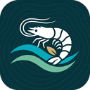
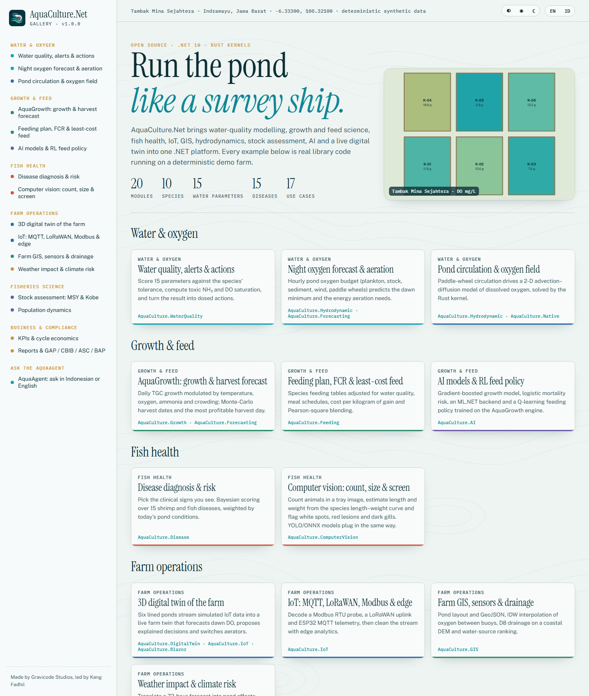
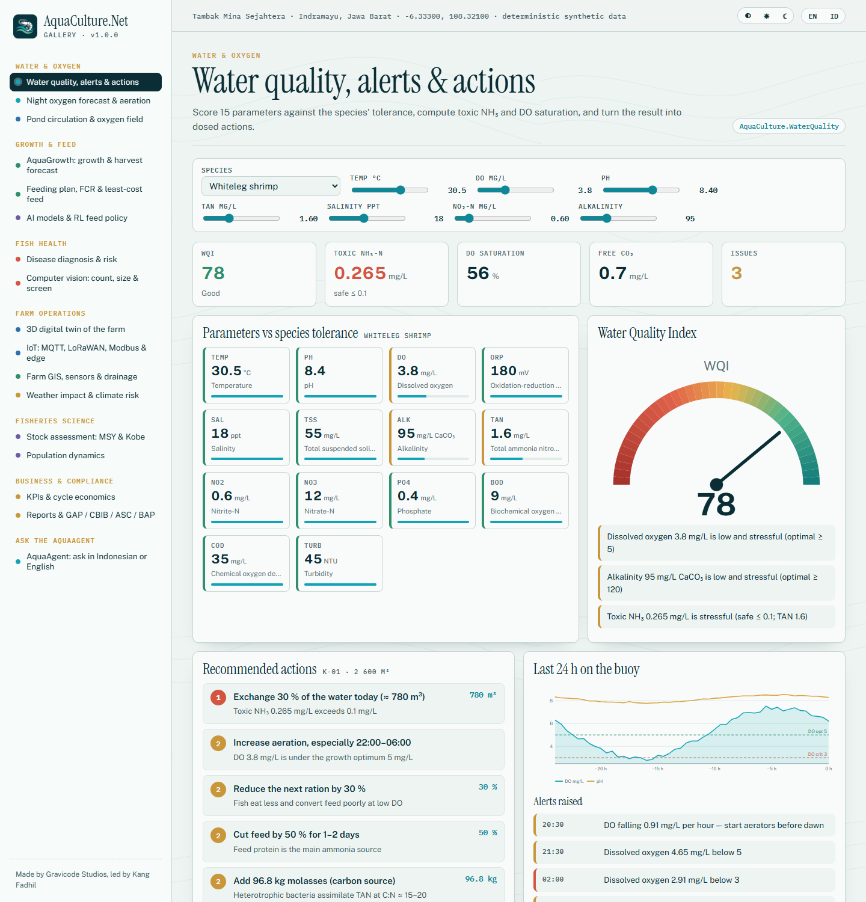
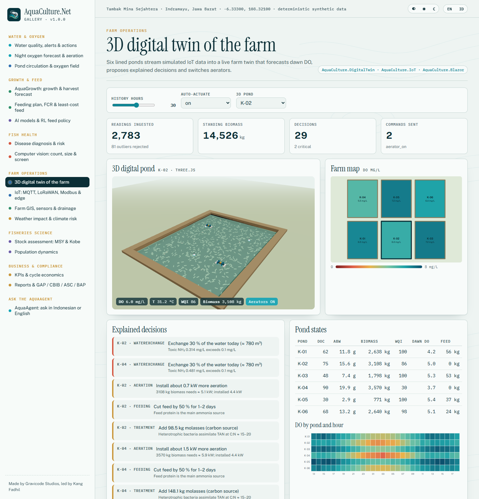
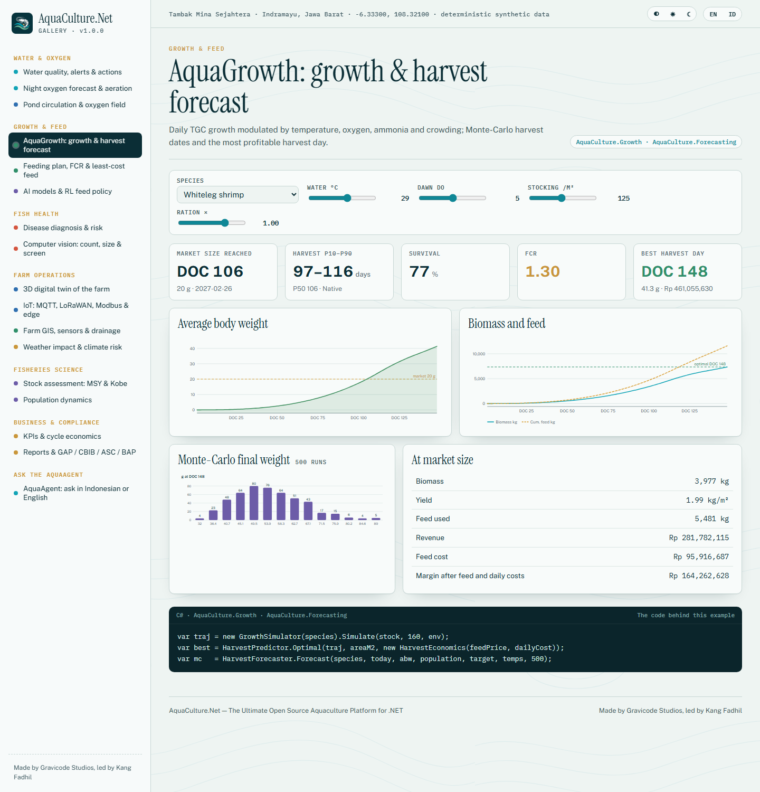
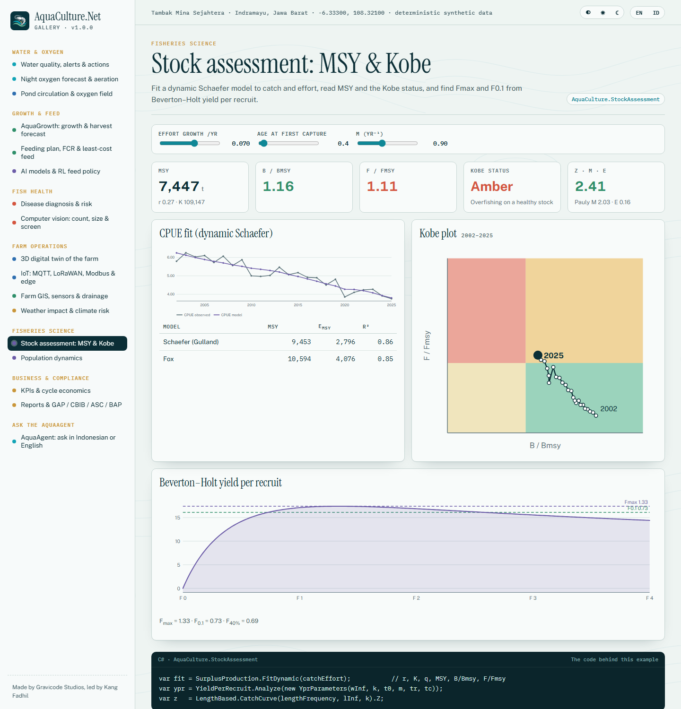
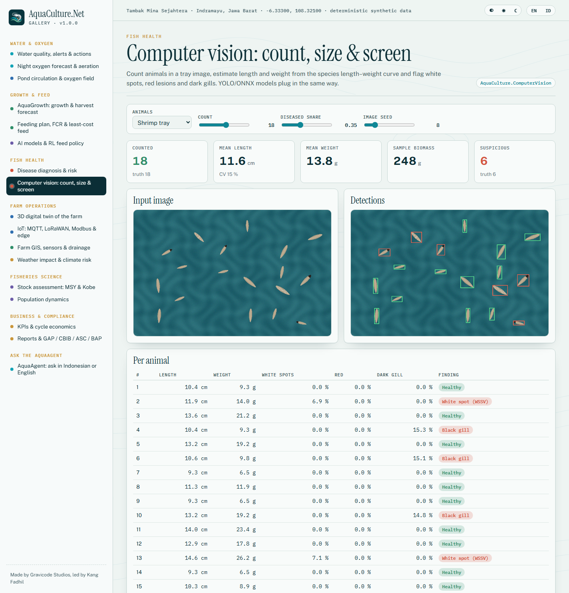
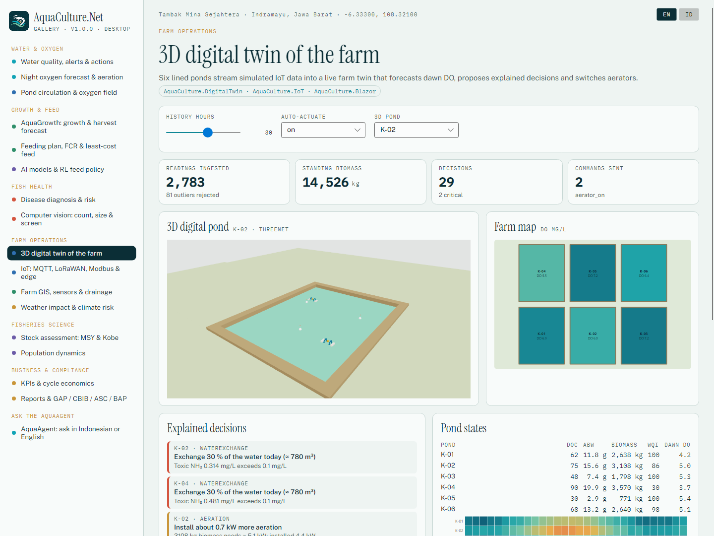

<p align="center"></p>

# AquaCulture.Net

**The Ultimate Open Source Aquaculture Platform for .NET** — water-quality modelling, growth and feed science, fish health,
fisheries stock assessment, IoT, GIS, hydrodynamics, AI and a live digital twin in one .NET 10 ecosystem, with Rust kernels for the hot paths.

Made by **Gravicode Studios**, led by **Kang Fadhil**. · [Bahasa Indonesia](README.id.md)



## Why

Fish and shrimp farms lose stock at dawn when oxygen crashes, lose money on feed when FCR drifts, and lose whole cycles to WSSV or AHPND.
AquaCulture.Net turns sensor readings, sampling and weather into the numbers a farm manager needs — dawn DO, today's ration, toxic ammonia,
the most profitable harvest day — and explains every recommendation. It serves smart fish and shrimp farms, hatcheries, floating net cages (KJA),
indoor RAS, aquaponics, fisheries and marine research, government monitoring and universities.

## Modules

| Package | What it does |
|---|---|
| `AquaCulture.Core` | Species database (nila, lele, gurame, patin, koi, bandeng, kerapu, kakap, vaname, windu), farm / pond / culture-cycle model, SIMD statistics, time series, geo, deterministic RNG, DI and event bus |
| `AquaCulture.WaterQuality` | 15 parameters (temperature, pH, DO, ORP, salinity, TDS, TSS, alkalinity, TAN, nitrite, nitrate, phosphate, BOD, COD, turbidity), un-ionised NH₃, DO saturation, species-aware WQI and CCME index, alert engine with hysteresis and DO-trend rule, dosed recommendations |
| `AquaCulture.Growth` | AquaGrowth engine: TGC, von Bertalanffy, Gompertz; temperature / DO / NH₃ / salinity / crowding / ration modifiers; mortality; biomass, harvest date, yield and the margin-optimal harvest day |
| `AquaCulture.Feeding` | FCR (simple, biological, economic), feeding tables, meal schedules, feed-cost analysis, least-cost feed and Pearson-square blending, closed-loop auto-feeder |
| `AquaCulture.Disease` | 15 diseases (WSSV, AHPND/EMS, EHP, IMNV, vibriosis, white feces, black gill, columnaris, fin rot, MAS ulcer, streptococcosis, TiLV, Ich, KHV, saprolegniasis); Bayesian diagnosis; environmental risk |
| `AquaCulture.StockAssessment` | Schaefer and Fox (equilibrium and dynamic), Beverton–Holt and Ricker S-R, yield per recruit (Fmax, F0.1, F40 %), Pauly/Then M, Powell–Wetherall, length-converted catch curve, Kobe status |
| `AquaCulture.Population` | Age-structured model with recruitment, spawning season, migration, predation (Holling II) and harvest control rules; Leslie matrix; predator–prey |
| `AquaCulture.Environment` | Open-Meteo, BMKG village forecasts, NASA POWER history and Open-Meteo Marine clients, deterministic tropical weather generator, weather impact on ponds (temperature, dilution, pH, plankton/DO, stratification, storms), climate risk matrix |
| `AquaCulture.Hydrodynamic` | 2-D advection–diffusion–reaction (Rust kernel) for DO, temperature and waste; paddle-wheel, river and tidal flows; sedimentation and cage plumes; hourly pond oxygen budget; RAS mass balance |
| `AquaCulture.IoT` | ESP32 / ESP8266 / Arduino / Raspberry Pi / PLC devices; MQTT (MQTTnet), LoRaWAN (Cayenne LPP, TTN webhook, 12-byte pond codec), Modbus RTU/TCP and RTU over serial, ChirpStack v4 webhook, REST polling, OPC-UA node mapping; edge analytics (Hampel, stuck sensor, calibration); simulator |
| `AquaCulture.GIS` | Pond layout, GeoJSON, IDW interpolation, water-source analysis, D8 drainage; NetTopologySuite + ProjNet (UTM, buffers, unions) |
| `AquaCulture.Data` | EF Core / SQLite store for farms, cycles, readings and twin decisions; recording transport; CSV and Apache Parquet time-series export |
| `AquaCulture.IoT.OpcUa` | OPC UA client for PLC/SCADA (OPC Foundation stack) and a pond OPC UA simulator |
| `AquaCulture.IoT.IoTCom` (preview) | IoTCom.Net adapters: Modbus TCP/RTU/ASCII transport, SenML, NMEA 0183 cage sensors and mooring drift, AIS vessel watch around KJA zones, Sparkplug B to SCADA |
| `AquaCulture.GIS.Gdal` | GeoTIFF and 200+ raster formats via GDAL.Net; Sentinel-2 water colour: NDWI, MNDWI, NDCI chlorophyll-a, turbidity, trophic state |
| `AquaCulture.AI` | Gradient-boosted growth model, logistic mortality risk, disease outlook, harvest outlook, Q-learning feed policy, ML.NET and ONNX Runtime backends, **AquaAgent** LLM with grounded tools |
| `AquaCulture.AI.Torch` | LSTM dissolved-oxygen forecaster on TorchSharp (bring a libtorch backend such as TorchSharp-cpu) |
| `AquaCulture.ComputerVision` | YOLO/ONNX detector with letterbox and NMS, model-free counting / sizing / white-spot, lesion and black-gill screening, OpenCvSharp interop |
| `AquaCulture.Forecasting` | Holt, Holt–Winters, AR (Yule–Walker), auto selection; dawn DO-crash forecast; Monte-Carlo harvest P10/P50/P90 |
| `AquaCulture.DigitalTwin` | Pond and farm twins: sensor fusion, growth soft-sensor, explained decisions, actuator commands, what-if |
| `AquaCulture.Analytics` | FCR, SR, ABW, ADG, SGR, biomass, productivity, cost breakdown, profit, break-even price, B/C, Water Health Index, benchmarks |
| `AquaCulture.Reporting` | Excel, PDF, Word, CSV, JSON, HTML, Markdown writers (no third-party libraries); GAP, CBIB, ASC and BAP self-assessment |
| `AquaCulture.Visualization` | Colour ramps, PNG encoder, SVG line/bar/gauge/heatmap/map charts |
| `AquaCulture.Blazor` | `PondMap`, `WaterChart`, `FeedScheduler`, `SensorGrid`, `GISViewer`, `DigitalTwinViewer` (Three.js 3D pond), `Gauge`, `KpiCard` |
| `AquaCulture.Native` | Rust kernels (`native/aqua-native`) for transport, chemistry batches, statistics and Monte-Carlo growth, with bit-compatible managed fallback |
| `AquaCulture.Cli` | `aqua` dotnet tool |
| `AquaCulture.Templates` | `dotnet new aqua-console`, `aqua-blazor`, `aqua-iot-edge`, `aqua-avalonia` |

## Quick start

```bash
dotnet add package AquaCulture.WaterQuality
dotnet add package AquaCulture.AI
```

```csharp
using AquaCulture.Core.Species;
using AquaCulture.WaterQuality;
using AquaCulture.Feeding;
using AquaCulture.AI.Agent;

var sample = new WaterSample { TemperatureC = 30.5, DissolvedOxygen = 3.8, Ph = 8.4, Ammonia = 1.6, SalinityPpt = 18 };
var wq = WaterQualityIndex.Assess(sample, SpeciesCatalog.Vaname);            // WQI 71, NH₃ 0.26 mg/L, issues
foreach (var a in RecommendationEngine.Recommend(wq, new PondContext(VolumeM3: 2600, AreaM2: 2000, BiomassKg: 3000)))
    Console.WriteLine($"{a.Priority}. {a.Action.En}");                     // exchange 30 % (780 m³), aerate, cut feed, molasses 97 kg…

var plan = FeedingCalculator.Plan(SpeciesCatalog.Vaname, abwG: 12, population: 220_000, tempC: 30, dawnDo: 4.2);
var agent = new AquaAgent(new AquaContext());                               // LLM from AQUA_LLM_* or offline
Console.WriteLine(agent.Ask("Apakah oksigen aman malam ini?"));
```

More in [docs/en/getting-started.md](docs/en/getting-started.md).

## Gallery

Seventeen interactive use cases, each in a **Blazor** web app and an **Avalonia** desktop app (with a **ThreeNet** 3D pond), sharing one scenario library.

```bash
dotnet run --project gallery/AquaCulture.Gallery.Web --urls http://localhost:5390
dotnet run --project gallery/AquaCulture.Gallery.Desktop
```

| Water quality & actions | 3D digital twin (web, Three.js) |
|---|---|
|  |  |
| **Growth & harvest forecast** | **Stock assessment: MSY & Kobe** |
|  |  |
| **Computer vision** | **Desktop (Avalonia + ThreeNet)** |
|  |  |

All screenshots: [docs/en/gallery.md](docs/en/gallery.md).

## CLI and templates

```bash
dotnet tool install -g AquaCulture.Cli
aqua wq --species vaname --temp 30 --do 3.8 --ph 8.4 --tan 1.6 --sal 18
aqua grow --species nila --target 400
aqua ask "Berapa pakan hari ini?"

dotnet new install AquaCulture.Templates
dotnet new aqua-blazor -n MyFarm --species vaname
```

## Build from source

```bash
dotnet build AquaCulture.Net.slnx
dotnet test tests/AquaCulture.Tests                  # 128 tests
cd native/aqua-native && cargo test --release        # Rust kernels
pwsh build/build-native.ps1                          # copy kernel into AquaCulture.Native/runtimes/<rid>/native
pwsh build/pack.ps1                                  # NuGet packages → artifacts/packages
```

## Documentation

[English](docs/en/README.md) · [Bahasa Indonesia](docs/id/README.md) · [Roadmap](PLAN.md) · [Progress](Progress.md)

## License

MIT. AquaCulture.Net — Made by Gravicode Studios, led by Kang Fadhil.
Species parameters, disease guidance and compliance checklists are reference defaults for decision support; confirm diagnoses in a laboratory and follow your national regulations.
