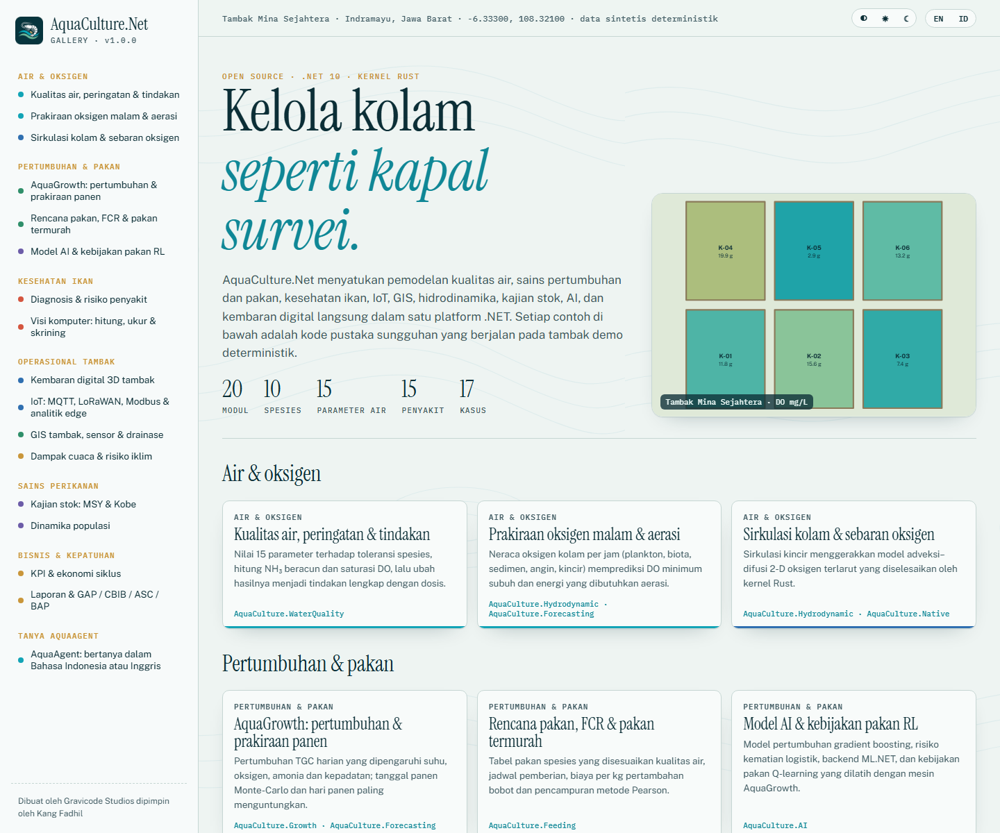
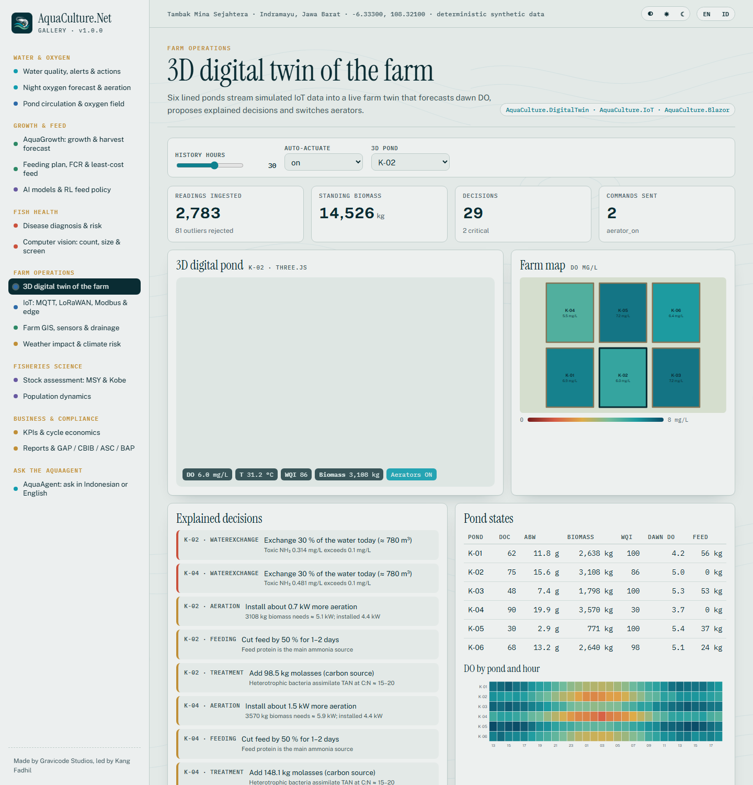
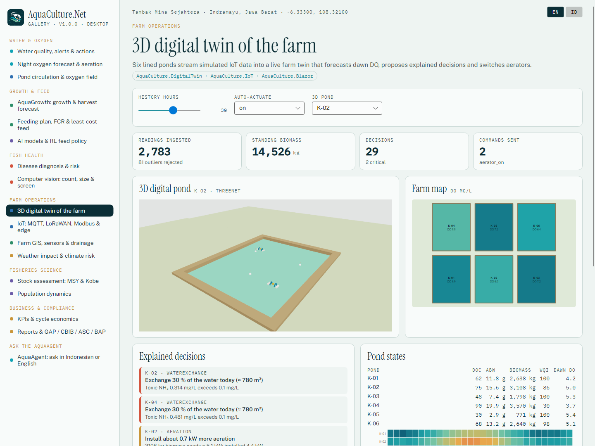
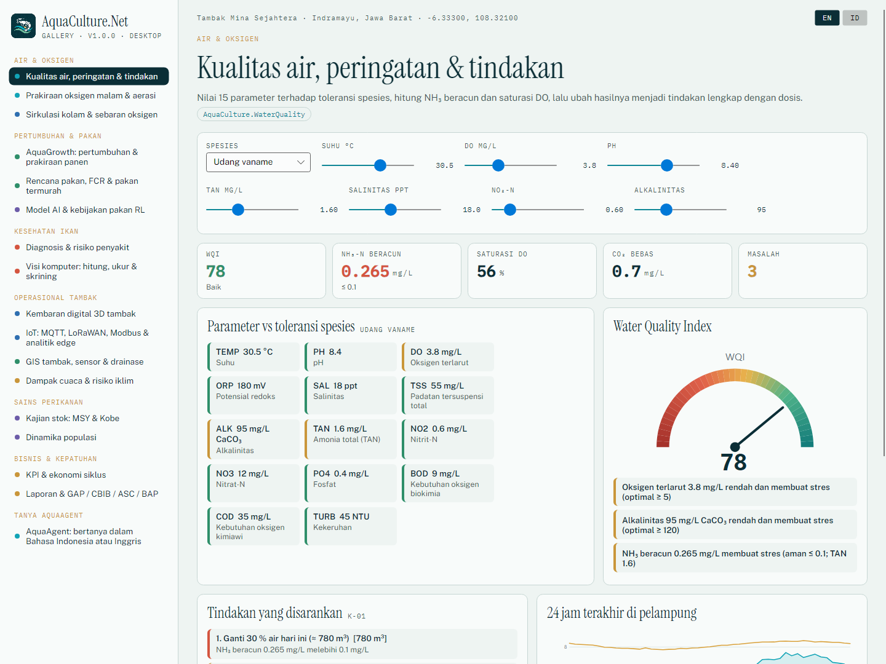

# Galeri AquaCulture.Net

```bash
dotnet run --project gallery/AquaCulture.Gallery.Web --urls http://localhost:5390     # Blazor (terang/gelap, EN/ID)
dotnet run --project gallery/AquaCulture.Gallery.Desktop                              # Avalonia + ThreeNet 3D
```

Semua perhitungan ada di `gallery/AquaCulture.Gallery.Shared` dan berjalan pada tambak demo deterministik *Tambak Mina Sejahtera* —
enam kolam HDPE udang vaname di Indramayu, Jawa Barat.

| # | Kasus | Modul |
|---|---|---|
| 1 | Kualitas air, peringatan & tindakan | WaterQuality |
| 2 | Prakiraan oksigen malam & aerasi | Hydrodynamic, Forecasting |
| 3 | Sirkulasi kolam & sebaran oksigen | Hydrodynamic, Native |
| 4 | AquaGrowth: pertumbuhan & prakiraan panen | Growth, Forecasting |
| 5 | Rencana pakan, FCR & pakan termurah | Feeding |
| 6 | Model AI & kebijakan pakan RL | AI |
| 7 | Diagnosis & risiko penyakit | Disease |
| 8 | Visi komputer: hitung, ukur & skrining | ComputerVision |
| 9 | Kembaran digital 3D tambak | DigitalTwin, IoT, Blazor |
| 10 | IoT: MQTT, LoRaWAN, Modbus & analitik edge | IoT |
| 11 | GIS tambak, sensor & drainase | GIS |
| 12 | Dampak cuaca & risiko iklim | Environment |
| 13 | Kajian stok: MSY & Kobe | StockAssessment |
| 14 | Dinamika populasi | Population |
| 15 | KPI & ekonomi siklus | Analytics |
| 16 | Laporan & GAP / CBIB / ASC / BAP | Reporting |
| 17 | AquaAgent | AI.Agent |

| | |
|---|---|
|  |  |
|  |  |

Semua tangkapan layar: [docs/en/gallery.md](../en/gallery.md).
