# Component catalogue

*Dibuat oleh Gravicode Studios dipimpin oleh Kang Fadhil.* · [Bahasa Indonesia](../id/components.md)

This page lists every Razor component in Blazor.AI, grouped by NuGet package. Most AI components inherit a common base class that adds a `Provider` parameter, so each component can use a different model from the ones you registered. Numbers, statistics, ML training, rules and biology run in .NET; the model is only asked to interpret, write or extract. The gallery app (`samples/Blazor.AI.Gallery`) shows every component with live demos and copyable code.

## Contents

- [Common parameters](#common-parameters)
- [Blazor.AI.Components](#blazoraicomponents)
- [Blazor.AI.Visualization](#blazoraivisualization)
- [Blazor.AI.RAG](#blazorairag)
- [Blazor.AI.Agents](#blazoraiagents)
- [Blazor.AI.Decision](#blazoraidecision)
- [Blazor.AI.Analytics](#blazoraianalytics)
- [Blazor.AI.LocalModels](#blazorailocalmodels)
- [Blazor.AI.Bio](#blazoraibio)
- [Blazor.AI.ThreeD](#blazoraithreed)
- [Blazor.AI.MediaPipe](#blazoraimediapipe)

## Common parameters

Components that inherit `AiComponentBase` (namespace `Blazor.AI.Components.Infrastructure`) share these parameters. The tables below do not repeat them; each component says which base it uses.

| Parameter | Type | Default | Purpose |
|---|---|---|---|
| `Provider` | `string?` | `null` | Name of the registered provider to use. `null` uses the application default. |
| `Class` | `string?` | `null` | Extra CSS classes for the root element. |
| `OnError` | `EventCallback<Exception>` | | Raised when a request fails, in addition to the inline error message. |
| *(any other attribute)* | `IReadOnlyDictionary<string, object>?` | `null` | Unmatched attributes are captured in `AdditionalAttributes` and applied to the root element. |

The base also tracks busy and error state, cancels the previous request when a new one starts, and throttles re-rendering while tokens stream in.

Three packages add a specialised base on top of `AiComponentBase`:

| Base class | Package | Extra parameters |
|---|---|---|
| `AnalyticsComponentBase` | Blazor.AI.Analytics | `Dataset` (`AnalyticsDataset?`, default `null`): use this dataset instead of the shared workspace dataset. |
| `HfComponentBase` | Blazor.AI.LocalModels | `Engine` (`InferenceEngine`, default `InferenceEngine.Local`): run on this server's CPU or on the Hugging Face Inference API (`HostedApi`). `Model` (`string?`, default `null`): Hugging Face model id; each component falls back to a default from `LocalModelOptions`. |
| `BioComponentBase` | Blazor.AI.Bio | `Audience` (`string`, default `"a molecular biologist"`): who the AI explanation is written for. `Language` (`string?`, default `null`): language of the explanation. |

Some components do not inherit a base but declare `Provider` and `Class` themselves (they have no `OnError`). Components marked "No AI calls" render data only and have no `Provider`.

---

## Blazor.AI.Components

Package: `Blazor.AI.Components` · Namespace: `Blazor.AI.Components`

```csharp
builder.Services.AddBlazorAI(builder.Configuration).AddSimulated();
builder.Services.AddBlazorAIComponents();
```

`AddBlazorAIComponents()` registers the JS interop and theme state the components need. Call it after `AddBlazorAI()`. Every other package depends on this one.

### Primitives

Building blocks used by the other components. You can use them directly in your own pages.

### AiCard

A glass card with a title, icon, optional header actions, body and footer.

| Parameter | Type | Default | Purpose |
|---|---|---|---|
| `Title` | `string?` | `null` | Card title. |
| `Subtitle` | `string?` | `null` | Line under the title. |
| `Icon` | `string?` | `null` | Bootstrap Icons class, for example `bi-stars`. |
| `BodyClass` | `string?` | `null` | Extra CSS classes for the body. |
| `Header` | `RenderFragment?` | `null` | Replaces the default header. |
| `Actions` | `RenderFragment?` | `null` | Buttons shown on the right of the header. |
| `ChildContent` | `RenderFragment?` | `null` | Card body. |
| `Footer` | `RenderFragment?` | `null` | Card footer. |

No AI calls. Also accepts `Class` and unmatched attributes.

```razor
<AiCard Title="Orders" Subtitle="Last 30 days" Icon="bi-bag">
    <Actions><button class="bai-btn-ghost">Export</button></Actions>
    <ChildContent>…</ChildContent>
</AiCard>
```

### AiMarkdown

Renders markdown text (model output) as HTML.

| Parameter | Type | Default | Purpose |
|---|---|---|---|
| `Text` | `string?` | `null` | Markdown to render. |

No AI calls.

```razor
<AiMarkdown Text="@answer" />
```

### AiThinking

An animated "thinking" indicator.

| Parameter | Type | Default | Purpose |
|---|---|---|---|
| `Label` | `string?` | `"Thinking…"` | Text next to the animation. |

```razor
@if (busy) { <AiThinking Label="Reading the document…" /> }
```

### AiError

An inline error message with an optional retry button.

| Parameter | Type | Default | Purpose |
|---|---|---|---|
| `Message` | `string?` | `null` | Error text. Nothing renders when it is empty. |
| `OnRetry` | `EventCallback` | | Shows a retry button when set. |

```razor
<AiError Message="@error" OnRetry="RunAgain" />
```

### AiOutput

The result panel used by generators: a placeholder, a busy state, rendered markdown, copy and optional download.

| Parameter | Type | Default | Purpose |
|---|---|---|---|
| `Text` | `string?` | `null` | Output text. |
| `IsBusy` | `bool` | `false` | Shows the thinking state. |
| `Markdown` | `bool` | `true` | Render as markdown instead of plain text. |
| `Placeholder` | `string` | `"The result will appear here."` | Shown while there is no output. |
| `BusyLabel` | `string` | `"Thinking…"` | Label of the busy indicator. |
| `DownloadName` | `string?` | `null` | When set, shows a download button that saves the text with this file name. |
| `Actions` | `RenderFragment?` | `null` | Extra toolbar buttons. |

```razor
<AiOutput Text="@draft" IsBusy="@busy" DownloadName="draft.md" />
```

### AiProviderPicker

A drop-down of the registered providers with a local, hybrid or cloud badge. Bind it to a value, or leave it unbound to change the application default.

| Parameter | Type | Default | Purpose |
|---|---|---|---|
| `Value` | `string?` | `null` | Selected provider name. Supports `@bind-Value`. |
| `ValueChanged` | `EventCallback<string?>` | | Raised when the selection changes. |
| `ShowLabel` | `bool` | `false` | Shows a "Model" label. |

```razor
<AiProviderPicker @bind-Value="provider" ShowLabel="true" />
<AiChat Provider="@provider" />
```

### AiThemeToggle

A button that switches between light and dark mode and remembers the choice.

Parameters: `Class` only.

```razor
<AiThemeToggle />
```

### AiCredit

The "Made by Gravicode Studios" credit line.

| Parameter | Type | Default | Purpose |
|---|---|---|---|
| `Indonesian` | `bool` | `false` | Shows the credit in Bahasa Indonesia. |

```razor
<AiCredit Indonesian="true" />
```

### AiTabs

Segmented tabs.

| Parameter | Type | Default | Purpose |
|---|---|---|---|
| `Tabs` | `IReadOnlyList<string>` | `[]` | Tab labels. Required. |
| `Selected` | `string?` | `null` | Selected tab. Supports `@bind-Selected`. |
| `SelectedChanged` | `EventCallback<string>` | | Raised when a tab is clicked. |

```razor
<AiTabs Tabs="@(["Summary", "Details"])" @bind-Selected="tab" />
```

### AiCodeBlock

A monospaced code block with a copy button.

| Parameter | Type | Default | Purpose |
|---|---|---|---|
| `Code` | `string?` | `null` | Code to show. |
| `Language` | `string?` | `null` | Language name, used as the accessible label, for example `csharp`. |

```razor
<AiCodeBlock Code="@snippet" Language="csharp" />
```

### AiDockPanel

A panel that docks left or right, floats, or collapses. `AiCopilot` uses it.

| Parameter | Type | Default | Purpose |
|---|---|---|---|
| `Title` | `string` | `"Copilot"` | Panel title. |
| `Icon` | `string?` | `"bi-stars"` | Bootstrap Icons class. |
| `Mode` | `DockMode` | `DockMode.Right` | `Right`, `Left` or `Floating`. Supports `@bind-Mode`. |
| `ModeChanged` | `EventCallback<DockMode>` | | Raised when the user changes the dock mode. |
| `Collapsed` | `bool` | `false` | Collapsed state. Supports `@bind-Collapsed`. |
| `CollapsedChanged` | `EventCallback<bool>` | | Raised when the panel is collapsed or expanded. |
| `Width` | `int` | `400` | Width in pixels. |
| `AllowModeChange` | `bool` | `true` | Shows the dock mode buttons. |
| `HeaderActions` | `RenderFragment?` | `null` | Extra header buttons. |
| `ChildContent` | `RenderFragment?` | `null` | Panel body. |

```razor
<AiDockPanel Title="Notes" Icon="bi-journal" @bind-Mode="mode" @bind-Collapsed="collapsed">
    …
</AiDockPanel>
```

### AiScoreBars

Horizontal bars for label probabilities, similarity scores and feature importances.

| Parameter | Type | Default | Purpose |
|---|---|---|---|
| `Values` | `IEnumerable<KeyValuePair<string, double>>` | `[]` | Label and score pairs. Required. |
| `Highlight` | `string?` | `null` | Label to emphasise, for example the winning class. |
| `Sort` | `bool` | `true` | Sort by score, highest first. |
| `AsPercent` | `bool` | `true` | Format scores as percentages. |
| `Max` | `int` | `20` | Maximum number of bars. |

```razor
<AiScoreBars Values="@result.Scores" Highlight="@result.Label" />
```

### Conversational

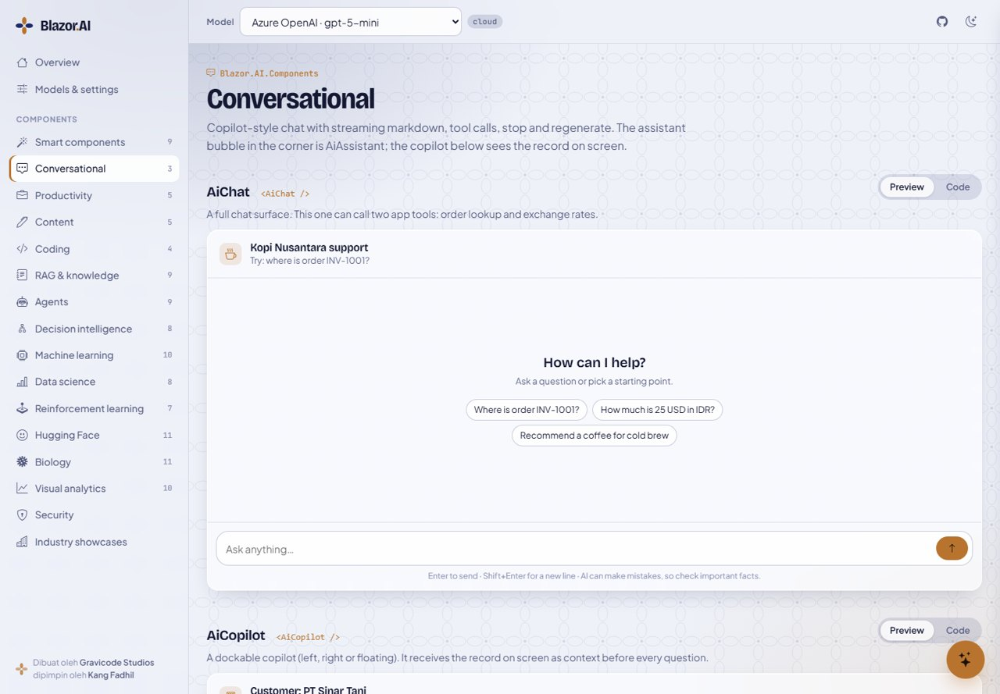

### AiChat

A full chat surface with streaming replies, suggestions, markdown, and optional tool calling.

Base: `AiComponentBase`.

| Parameter | Type | Default | Purpose |
|---|---|---|---|
| `Title` | `string` | `"Assistant"` | Header title. |
| `Subtitle` | `string?` | `null` | Header subtitle. |
| `Icon` | `string` | `"bi-stars"` | Header icon. |
| `SystemPrompt` | `string?` | `null` | System prompt for every request. |
| `Placeholder` | `string` | `"Ask anything…"` | Input placeholder. |
| `AssistantName` | `string` | `"Assistant"` | Name shown on assistant messages. |
| `UserName` | `string` | `"You"` | Name shown on user messages. |
| `EmptyTitle` | `string` | `"How can I help?"` | Title of the empty state. |
| `EmptyText` | `string` | `"Ask a question or pick a starting point."` | Text of the empty state. |
| `Suggestions` | `IReadOnlyList<string>?` | `null` | Starter prompts. |
| `ShowHeader` | `bool` | `true` | Shows the header. |
| `ShowHint` | `bool` | `true` | Shows the keyboard hint under the input. |
| `Disabled` | `bool` | `false` | Disables input. |
| `Height` | `string?` | `"560px"` | CSS height, for example `"100%"`. |
| `Tools` | `IList<AITool>?` | `null` | Tools the model may call. Enables automatic function invocation. |
| `Options` | `ChatOptions?` | `null` | Base chat options (temperature, max tokens). |
| `Task` | `string` | `AiTasks.Chat` | Task tag used by guardrails and audit. |
| `ContextProvider` | `Func<Task<string?>>?` | `null` | Called before each request to add fresh context to the system prompt. |
| `OnResponse` | `EventCallback<string>` | | Raised with the full assistant reply. |
| `OnToolCall` | `EventCallback<ToolCallInfo>` | | Raised for every tool call, after it ran. |
| `HeaderActions` | `RenderFragment?` | `null` | Extra header buttons. |
| `EmptyContent` | `RenderFragment?` | `null` | Replaces the default empty state. |

```razor
<AiChat Title="Support" SystemPrompt="You are a support assistant."
        Tools="@tools" Suggestions="@(["Where is my order?"])" />

@code {
    IList<AITool> tools = [AIFunctionFactory.Create(LookupOrder, "lookup_order", "Order status by number")];
}
```

### AiAssistant

A floating help button that opens a small chat. Put it in your `MainLayout`.

Declares `Provider` itself (no base class).

| Parameter | Type | Default | Purpose |
|---|---|---|---|
| `Title` | `string` | `"Assistant"` | Panel title. |
| `Subtitle` | `string?` | `"Ask about this page"` | Panel subtitle. |
| `Provider` | `string?` | `null` | Provider name. |
| `SystemPrompt` | `string?` | `"You are a concise, helpful assistant embedded in a web application."` | System prompt. |
| `Suggestions` | `IReadOnlyList<string>?` | `null` | Starter prompts. |
| `Tools` | `IList<AITool>?` | `null` | Tools the model may call. |
| `ContextProvider` | `Func<Task<string?>>?` | `null` | Adds page context before each request. |
| `EmptyTitle` | `string` | `"Hi! What do you need?"` | Empty state title. |
| `EmptyText` | `string` | `"I can explain, summarise or draft things for you."` | Empty state text. |
| `StartOpen` | `bool` | `false` | Opens the panel on first render. |

```razor
<AiAssistant Title="Help" Suggestions="@(["How do I export?"])" />
```

### AiCopilot

A dockable copilot (left, right or floating) that receives what is on screen as context before every question.

Declares `Provider` itself (no base class).

| Parameter | Type | Default | Purpose |
|---|---|---|---|
| `Title` | `string` | `"Copilot"` | Panel title. |
| `Open` | `bool` | `true` | Whether the panel is open. Supports `@bind-Open`. |
| `OpenChanged` | `EventCallback<bool>` | | Raised when the panel opens or closes. |
| `Mode` | `DockMode` | `DockMode.Right` | `Right`, `Left` or `Floating`. |
| `Width` | `int` | `400` | Width in pixels. |
| `Provider` | `string?` | `null` | Provider name. |
| `SystemPrompt` | `string` | copilot prompt | System prompt; the default asks the model to use the context and list proposed changes. |
| `Context` | `string?` | `null` | Text describing what the user is looking at. Re-read before every request. |
| `ContextProvider` | `Func<Task<string?>>?` | `null` | Alternative to `Context` for context that must be fetched. |
| `QuickActions` | `IReadOnlyList<string>?` | `null` | One-click prompts shown above the chat. |
| `Suggestions` | `IReadOnlyList<string>?` | `null` | Starter prompts. |
| `Tools` | `IList<AITool>?` | `null` | Tools the model may call. |
| `EmptyTitle` | `string` | `"Your copilot is ready"` | Empty state title. |
| `EmptyText` | `string` | `"It can see the record on screen. Ask it to explain, summarise or draft."` | Empty state text. |

```razor
<AiCopilot @bind-Open="open" Context="@customer.ToSummary()"
           QuickActions="@(["Summarise this customer", "Draft a renewal email"])" />
```

### Smart components

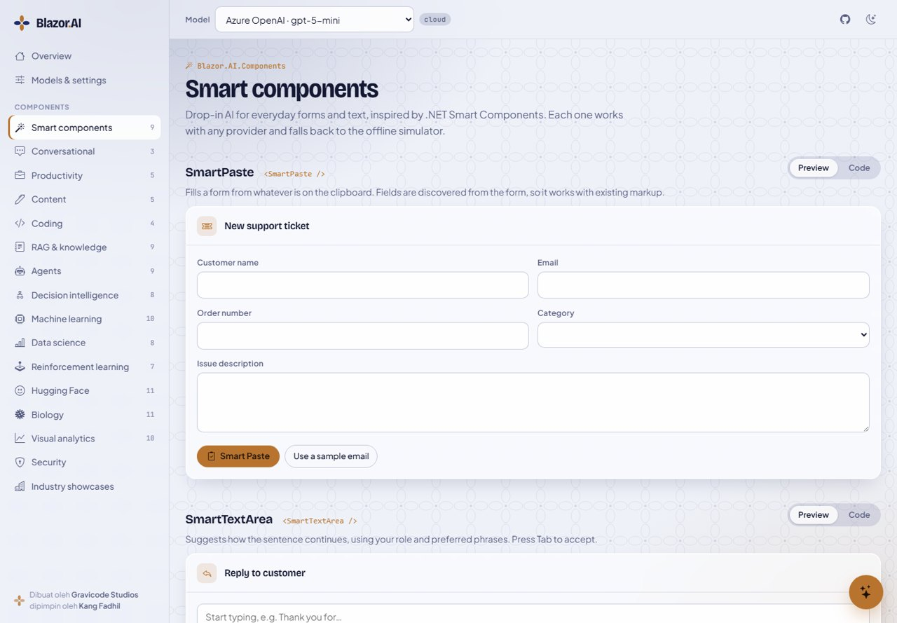

### SmartPaste

A button that fills a form from whatever is on the clipboard. Fields are discovered from the surrounding form, so it works with existing markup.

Base: `AiComponentBase`.

| Parameter | Type | Default | Purpose |
|---|---|---|---|
| `Label` | `string` | `"Smart Paste"` | Button text. |
| `ButtonClass` | `string` | `"bai-btn bai-btn-ai"` | Button CSS classes. |
| `Fields` | `IReadOnlyList<SmartPasteField>?` | `null` | Explicit field list. When `null`, fields are discovered from the form. |
| `ApplyToForm` | `bool` | `true` | Write values into the DOM form. Disable when you apply `OnPasted` results yourself. |
| `OnPasted` | `EventCallback<SmartPasteResult>` | | Raised with the extracted values. |

```razor
<form>
    <input name="customerName" />
    <input name="email" type="email" />
    <select name="category"><option>Billing</option><option>Shipping</option></select>
    <textarea name="issueDescription"></textarea>
    <SmartPaste />
</form>
```

### SmartTextArea

A text area that suggests how the sentence continues, using the writer's role and preferred phrases. Press Tab to accept.

Base: `AiComponentBase`.

| Parameter | Type | Default | Purpose |
|---|---|---|---|
| `Value` | `string?` | `null` | Text. Supports `@bind-Value`. |
| `ValueChanged` | `EventCallback<string?>` | | Raised when the text changes. |
| `Id` | `string?` | `null` | Element id. |
| `Rows` | `int` | `6` | Visible rows. |
| `Placeholder` | `string?` | `null` | Placeholder text. |
| `UserRole` | `string?` | `null` | Who is typing, for example "Support agent for an e-commerce store". Improves suggestions a lot. |
| `UserPhrases` | `IReadOnlyList<string>?` | `null` | Phrases this user often writes; preferred when relevant. |
| `Tone` | `string?` | `null` | Desired tone. |
| `DebounceMs` | `int` | `450` | Pause after typing before asking for a suggestion. |

```razor
<SmartTextArea @bind-Value="reply"
               UserRole="Customer support agent"
               UserPhrases="@(["Thank you for your patience."])" />
```

### SmartComboBox

A combo box whose suggestions are ranked by meaning, using embeddings. Typing "flight to Bali" suggests "Travel & accommodation".

Base: `AiComponentBase`.

| Parameter | Type | Default | Purpose |
|---|---|---|---|
| `Value` | `string?` | `null` | Selected value. Supports `@bind-Value`. |
| `ValueChanged` | `EventCallback<string?>` | | Raised when the value changes. |
| `Items` | `IEnumerable<string>` | `[]` | Allowed values. Required. |
| `Id` | `string?` | `null` | Element id. |
| `Placeholder` | `string?` | `null` | Placeholder text. |
| `MaxSuggestions` | `int` | `6` | Maximum suggestions shown. |
| `MinScore` | `double` | `0.05` | Hides suggestions below this cosine similarity. |
| `ShowScores` | `bool` | `true` | Shows the similarity next to each suggestion. |
| `DebounceMs` | `int` | `250` | Pause after typing before searching. |

```razor
<SmartComboBox @bind-Value="category" Items="@categories" />
```

### SmartSemanticSearch\<TItem\>

Searches any collection by meaning and renders results with your own template.

Base: `AiComponentBase`. Generic: `TItem`.

| Parameter | Type | Default | Purpose |
|---|---|---|---|
| `Items` | `IEnumerable<TItem>` | `[]` | Items to search. Required. |
| `TextSelector` | `Func<TItem, string>` | `ToString()` | Text embedded for each item (title plus description works well). Required. |
| `ItemTemplate` | `RenderFragment<TItem>?` | `null` | How to render a result. |
| `Placeholder` | `string` | `"Describe what you are looking for…"` | Input placeholder. |
| `Top` | `int` | `8` | Maximum results. |
| `MinScore` | `double` | `0.08` | Minimum similarity. |
| `InitialQuery` | `string?` | `null` | Query to run on first render. |
| `OnResults` | `EventCallback<IReadOnlyList<SemanticMatch<TItem>>>` | | Raised with the ranked matches. |

```razor
<SmartSemanticSearch TItem="Product" Items="@products" TextSelector="@(p => p.Name + ". " + p.Description)">
    <ItemTemplate>@context.Name</ItemTemplate>
</SmartSemanticSearch>
```

### SmartRecommendations\<TItem\>

Shows items similar to what the user liked, viewed or bought, each with an optional one-line reason.

Base: `AiComponentBase`. Generic: `TItem`.

| Parameter | Type | Default | Purpose |
|---|---|---|---|
| `Title` | `string` | `"Recommended for you"` | Card title. |
| `Subtitle` | `string?` | `"Based on what you viewed"` | Card subtitle. |
| `Items` | `IEnumerable<TItem>` | `[]` | Candidate items. Required. |
| `Seeds` | `IEnumerable<TItem>` | `[]` | Items the user engaged with. They are excluded from the results. Required. |
| `TextSelector` | `Func<TItem, string>` | `ToString()` | Text embedded for each item. Required. |
| `ItemTemplate` | `RenderFragment<TItem>?` | `null` | How to render a recommendation. |
| `Count` | `int` | `4` | Number of recommendations. |
| `ExplainWithAI` | `bool` | `true` | Ask the model to explain each recommendation in one line. |

```razor
<SmartRecommendations TItem="Product" Items="@products" Seeds="@viewed" TextSelector="@(p => p.Description)" />
```

### SmartSummarizer

Summarises long text as a paragraph, bullets, a TL;DR or an executive summary, in any language.

Base: `AiComponentBase`.

| Parameter | Type | Default | Purpose |
|---|---|---|---|
| `Title` | `string` | `"Summariser"` | Card title. |
| `Subtitle` | `string?` | `"Long text in, key points out"` | Card subtitle. |
| `Text` | `string?` | `null` | Text to summarise. |
| `ShowInput` | `bool` | `true` | Shows the input box. Hide it to summarise `Text` only. |
| `Style` | `SummaryStyle` | `SummaryStyle.Bullets` | `Paragraph`, `Bullets`, `TlDr` or `Executive`. |
| `MaxWords` | `int` | `120` | Target length. |
| `Language` | `string?` | `null` | Output language. |
| `OnSummarized` | `EventCallback<string>` | | Raised with the summary. |

```razor
<SmartSummarizer Text="@longText" Style="SummaryStyle.Bullets" MaxWords="120" />
```

### SmartTranslator

Translates text while keeping tone and formatting, including regional languages such as Javanese and Sundanese.

Base: `AiComponentBase`.

| Parameter | Type | Default | Purpose |
|---|---|---|---|
| `Title` | `string` | `"Translator"` | Card title. |
| `Subtitle` | `string?` | `"Keeps tone and formatting"` | Card subtitle. |
| `Text` | `string?` | `null` | Text to translate. |
| `Source` | `string?` | `null` | Source language. `null` detects it. |
| `Target` | `string` | `"Bahasa Indonesia"` | Target language. |
| `Languages` | `IReadOnlyList<string>` | 17 languages | Languages offered in the pickers. |
| `OnTranslated` | `EventCallback<string>` | | Raised with the translation. |

```razor
<SmartTranslator Text="@text" Target="Bahasa Indonesia" />
```

### SmartClassifier

Zero-shot classification of text into your own labels, with per-label confidence.

Base: `AiComponentBase`.

| Parameter | Type | Default | Purpose |
|---|---|---|---|
| `Title` | `string` | `"Classifier"` | Card title. |
| `Subtitle` | `string?` | `"Sort text into your own categories"` | Card subtitle. |
| `Text` | `string?` | `null` | Text to classify. |
| `Labels` | `IReadOnlyList<string>` | `["Positive", "Negative", "Neutral"]` | Categories. |
| `EditableLabels` | `bool` | `true` | Lets the user edit the labels. |
| `ShowInput` | `bool` | `true` | Shows the input box. |
| `Instructions` | `string?` | `null` | Extra guidance, for example "Classify by the customer's main intent". |
| `Placeholder` | `string` | `"Paste a review, ticket, email or message…"` | Input placeholder. |
| `OnClassified` | `EventCallback<ClassificationResult>` | | Raised with the label, confidence and per-label scores. |

```razor
<SmartClassifier Text="@message" Labels="@(["Billing", "Shipping", "Technical"])" OnClassified="Route" />
```

### SmartEmailComposer

Turns bullet points into a ready-to-send email, then offers one-click refinements.

Base: `AiComponentBase`.

| Parameter | Type | Default | Purpose |
|---|---|---|---|
| `Title` | `string` | `"Email composer"` | Card title. |
| `Subtitle` | `string?` | `"From bullet points to a ready-to-send email"` | Card subtitle. |
| `OnDrafted` | `EventCallback<string>` | | Raised with the drafted email. |

```razor
<SmartEmailComposer OnDrafted="SaveDraft" />
```

### Generators

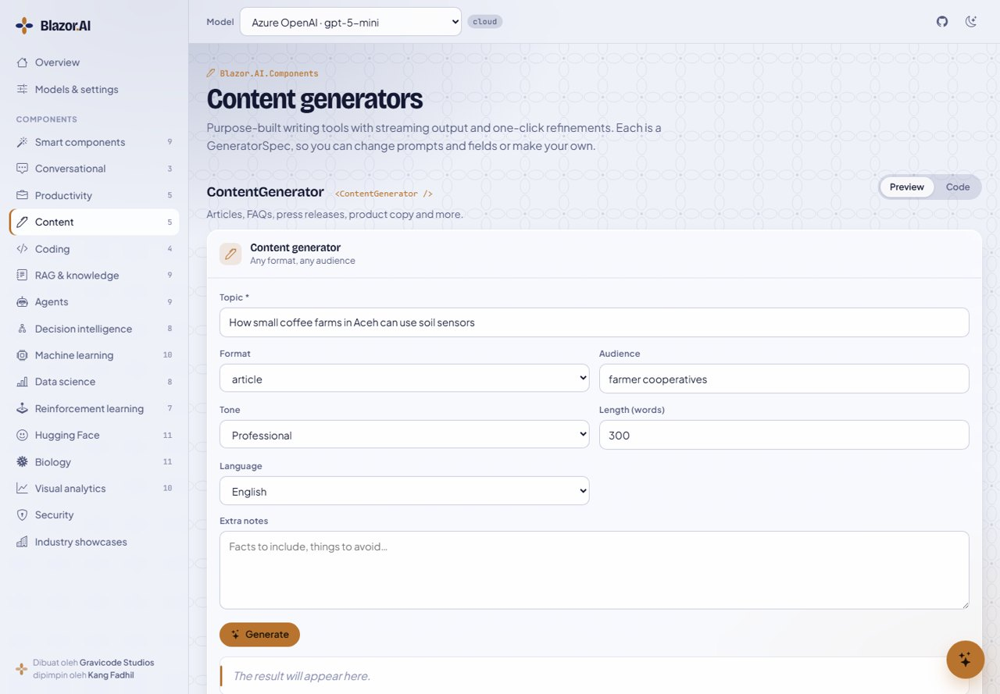

All generators are driven by a `GeneratorSpec`: a declarative form (`GeneratorField` list), a system prompt, a template with `{{field}}` placeholders, a temperature and follow-up refinements. The ready-made generators wrap `AiGenerator` with a spec from `GeneratorSpecs`.

### AiGenerator

A form-to-output generator for any `GeneratorSpec` you define.

Base: `AiComponentBase`.

| Parameter | Type | Default | Purpose |
|---|---|---|---|
| `Spec` | `GeneratorSpec` | | Form, prompts and output settings. Required. |
| `Values` | `IReadOnlyDictionary<string, string>?` | `null` | Initial form values, keyed by field name. |
| `OnGenerated` | `EventCallback<string>` | | Raised with the generated text. |

```razor
<AiGenerator Spec="@releaseNotes" />

@code {
    GeneratorSpec releaseNotes = new()
    {
        Title = "Release notes",
        SystemPrompt = "You write concise release notes for developers.",
        Template = "Write release notes for version {{version}} from these changes:\n{{changes}}",
        Fields =
        [
            new("version", "Version", Required: true),
            new("changes", "Changes", GeneratorFieldKind.TextArea, Wide: true),
        ],
    };
}
```

### ContentGenerator, BlogWriter, StoryGenerator, MarketingGenerator, SocialMediaGenerator

Ready-made generators for marketing and editorial content.

| Component | What it writes | Default `Spec` |
|---|---|---|
| `ContentGenerator` | Articles, FAQs, press releases, product copy and more. | `GeneratorSpecs.Content` |
| `BlogWriter` | Structured, SEO-aware posts with meta description and keywords. | `GeneratorSpecs.Blog` |
| `StoryGenerator` | Short fiction with genre, setting, characters and reader age. | `GeneratorSpecs.Story` |
| `MarketingGenerator` | Value proposition, headlines, ads, email subject lines and a CTA in one go. | `GeneratorSpecs.Marketing` |
| `SocialMediaGenerator` | Platform-native posts in several variants. | `GeneratorSpecs.SocialMedia` |

They all take the same parameters and declare `Provider` and `Class` themselves:

| Parameter | Type | Default | Purpose |
|---|---|---|---|
| `Spec` | `GeneratorSpec` | see table above | The generator definition. Override it to change prompts or fields. |
| `Provider` | `string?` | `null` | Provider name. |
| `Values` | `IReadOnlyDictionary<string, string>?` | `null` | Initial form values, keyed by field name. |
| `OnGenerated` | `EventCallback<string>` | | Raised with the generated text. |

```razor
<ContentGenerator Values="@(new Dictionary<string, string> { ["topic"] = "..." })" OnGenerated="Save" />
<BlogWriter Provider="anthropic" />
<StoryGenerator Spec="@(GeneratorSpecs.Story with { Temperature = 1.0f })" />
<MarketingGenerator />
<SocialMediaGenerator OnGenerated="Schedule" />
```

### Coding

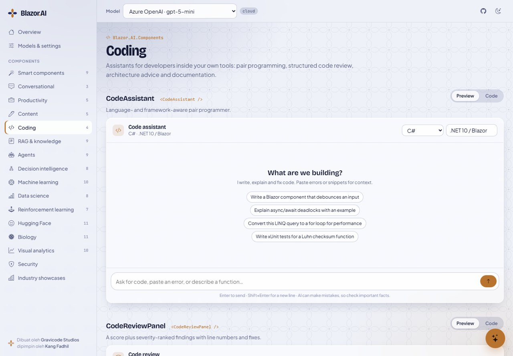

### CodeAssistant

A language- and framework-aware pair programmer in a chat layout.

Declares `Provider` itself (no base class).

| Parameter | Type | Default | Purpose |
|---|---|---|---|
| `Title` | `string` | `"Code assistant"` | Header title. |
| `Provider` | `string?` | `null` | Provider name. |
| `Height` | `string?` | `"600px"` | CSS height. |
| `Languages` | `IReadOnlyList<string>` | `["C#", "Razor", "TypeScript", "JavaScript", "Python", "SQL", "Go", "Rust", "Java", "Kotlin", "Bash"]` | Languages offered in the picker. |
| `Suggestions` | `IReadOnlyList<string>` | coding starter prompts | Starter prompts. |

```razor
<CodeAssistant Languages="@(["C#", "TypeScript"])" />
```

### CodeReviewPanel

Reviews code and returns a score plus severity-ranked findings (bugs, security, performance) with line numbers and fixes.

Base: `AiComponentBase`.

| Parameter | Type | Default | Purpose |
|---|---|---|---|
| `Title` | `string` | `"Code review"` | Card title. |
| `Subtitle` | `string?` | `"Bugs, security and performance, ranked"` | Card subtitle. |
| `Code` | `string?` | `null` | Code or diff to review. |
| `OnReviewed` | `EventCallback<ReviewResult>` | | Raised with the review. |

```razor
<CodeReviewPanel Code="@diff" OnReviewed="PostToPullRequest" />
```

### ArchitectureAdvisor

A generator that recommends an architecture with trade-offs, risks, milestones and a mermaid diagram.

Same parameters as the content generators (`Spec`, `Provider`, `Class`, `Values`, `OnGenerated`). Default `Spec`: `GeneratorSpecs.Architecture`.

```razor
<ArchitectureAdvisor />
```

### DocumentationGenerator

A generator that writes README sections, API references or XML doc comments from code.

Same parameters as the content generators. Default `Spec`: `GeneratorSpecs.Documentation`.

```razor
<DocumentationGenerator Values="@(new Dictionary<string, string> { ["code"] = source })" />
```

### Productivity

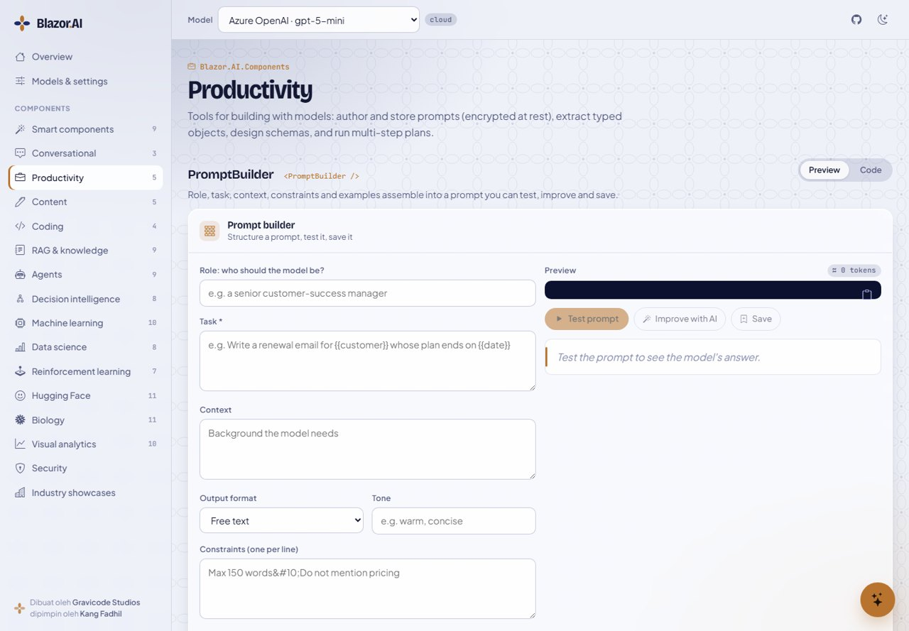

### PromptBuilder

Assembles a prompt from role, task, context, constraints and examples, then lets you test, improve and save it.

Base: `AiComponentBase`.

| Parameter | Type | Default | Purpose |
|---|---|---|---|
| `Title` | `string` | `"Prompt builder"` | Card title. |
| `Subtitle` | `string?` | `"Structure a prompt, test it, save it"` | Card subtitle. |
| `Category` | `string` | `"Custom"` | Category assigned to saved prompts. |
| `OnSaved` | `EventCallback<PromptTemplate>` | | Raised when a prompt is saved. |

```razor
<PromptBuilder Category="Support" OnSaved="Notify" />
```

### PromptLibrary

Search, favourite and run saved prompts. Template variables become a form. Prompts are stored through `IPromptStore` (AES-GCM encrypted).

Base: `AiComponentBase`.

| Parameter | Type | Default | Purpose |
|---|---|---|---|
| `Title` | `string` | `"Prompt library"` | Card title. |
| `OnRun` | `EventCallback<string>` | | Raised with the output of a run. |

```razor
<PromptLibrary />
```

### JsonSchemaGenerator

Infers a JSON Schema from sample JSON (locally, without AI) or from a description in words, and also produces C# records and TypeScript types.

Base: `AiComponentBase`.

| Parameter | Type | Default | Purpose |
|---|---|---|---|
| `Title` | `string` | `"JSON Schema generator"` | Card title. |
| `Subtitle` | `string?` | `"Schema, C# records and TypeScript types"` | Card subtitle. |
| `OnGenerated` | `EventCallback<JsonObject>` | | Raised with the schema. |

```razor
<JsonSchemaGenerator OnGenerated="UseSchema" />
```

### StructuredOutputForm\<TModel\>

Extracts a strongly typed C# object from free text. The JSON Schema comes from the type.

Base: `AiComponentBase`. Generic: `TModel` (`class, new()`).

| Parameter | Type | Default | Purpose |
|---|---|---|---|
| `Model` | `TModel` | `new()` | The extracted object. Supports `@bind-Model`. |
| `ModelChanged` | `EventCallback<TModel>` | | Raised after extraction. |
| `Title` | `string` | `"Structured output"` | Card title. |
| `SourceLabel` | `string` | `"Source text"` | Label of the input. |
| `SourceText` | `string?` | `null` | Text to extract from. |
| `Placeholder` | `string` | `"Paste an email, document or note to extract from…"` | Input placeholder. |
| `Instructions` | `string?` | `null` | Extra guidance for the extraction. |

```razor
<StructuredOutputForm TModel="Invoice" @bind-Model="invoice" SourceText="@pastedText" />

@code {
    Invoice invoice = new();

    public sealed class Invoice
    {
        public string? InvoiceNumber { get; set; }
        public decimal? Total { get; set; }
        public DateOnly? IssueDate { get; set; }
    }
}
```

### WorkflowAssistant

Turns a goal into editable steps and runs them in order; each step's output feeds the next.

Base: `AiComponentBase`.

| Parameter | Type | Default | Purpose |
|---|---|---|---|
| `Title` | `string` | `"Workflow assistant"` | Card title. |
| `Subtitle` | `string?` | `"Plan, edit, then execute step by step"` | Card subtitle. |
| `MaxSteps` | `int` | `6` | Maximum steps in the plan. |
| `OnCompleted` | `EventCallback<IReadOnlyList<WorkflowStep>>` | | Raised with all steps and outputs. |

```razor
<WorkflowAssistant MaxSteps="6" OnCompleted="Archive" />
```

---

## Blazor.AI.Visualization

Package: `Blazor.AI.Visualization` · Namespace: `Blazor.AI.Visualization`

No extra registration. The charts render SVG in .NET; `AiDashboard` needs the `AddBlazorAI()` and `AddBlazorAIComponents()` setup above for its insights.

```razor
@using Blazor.AI.Visualization
```


### AiDashboard

A dashboard with KPI tiles (with sparklines), a 12-column grid for your charts, and AI insights written from the numbers.

Base: `AiComponentBase`.

| Parameter | Type | Default | Purpose |
|---|---|---|---|
| `Title` | `string` | `"Dashboard"` | Dashboard title. |
| `Subtitle` | `string?` | `null` | Dashboard subtitle. |
| `Metrics` | `IReadOnlyList<DashboardMetric>` | `[]` | KPI tiles (`Label`, `Value`, `Format`, `Change` in percent, `Icon`, optional `Trend` and `LowerIsBetter`). |
| `DataSummary` | `string?` | `null` | Extra facts for the insight prompt, as plain text. |
| `EnableInsights` | `bool` | `true` | Shows the AI insights panel. |
| `Audience` | `string?` | `"a business manager"` | Who the insights are written for. |
| `HeaderContent` | `RenderFragment?` | `null` | Extra header content. |
| `ChildContent` | `RenderFragment?` | `null` | Panels. Wrap each in a `div` with `bai-span-4`, `-6`, `-8` or `-12`. |

```razor
<AiDashboard Title="Q3" Metrics="@metrics" DataSummary="@extraFacts">
    <div class="bai-span-8"><LineChart Series="@series" /></div>
    <div class="bai-span-4"><BarChart Values="@regions" Horizontal="true" /></div>
</AiDashboard>

@code {
    DashboardMetric[] metrics =
    [
        new("Revenue", 1_250_000, "C0", Change: 12) { Trend = [9, 10, 12, 11, 13] },
        new("Churn", 0.041, "P1", Change: -0.4) { LowerIsBetter = true },
    ];
}
```

### LineChart

A line chart with multiple series, confidence bands, highlighted points and a vertical marker.

No AI calls.

| Parameter | Type | Default | Purpose |
|---|---|---|---|
| `Series` | `IReadOnlyList<ChartSeries>` | `[]` | Series to draw. Required. |
| `Bands` | `IReadOnlyList<ChartBand>?` | `null` | Shaded bands (confidence intervals). |
| `Highlights` | `IReadOnlyList<ChartPoint>?` | `null` | Points to mark. |
| `Title` | `string?` | `null` | Chart title. |
| `XLabel` / `YLabel` | `string?` | `null` | Axis labels. |
| `Width` / `Height` | `int` | `640` / `280` | SVG view size. |
| `ShowLegend` | `bool` | `true` | Shows the legend. |
| `ShowMarkers` | `bool` | `false` | Draws a dot on every point. |
| `ZeroBased` | `bool` | `false` | Starts the y axis at zero. |
| `YMin` / `YMax` | `double?` | `null` | Fixed y range. |
| `MarkerX` / `MarkerLabel` | `double?` / `string?` | `null` | Vertical marker line, for example "now". |
| `XFormatter` / `YFormatter` | `Func<double, string>?` | `null` | Tick label formatters. |

```razor
<LineChart Series="@([ChartSeries.FromValues("Sales", sales), ChartSeries.FromValues("Target", target) with { Dashed = true }])"
           YLabel="Units" ShowMarkers="true" />
```

### BarChart

A vertical or horizontal bar chart, optionally grouped or coloured by sign.

No AI calls.

| Parameter | Type | Default | Purpose |
|---|---|---|---|
| `Values` | `IEnumerable<BarValue>` | `[]` | Bars (`Category`, `Value`, optional `Group`). Required. |
| `Title` | `string?` | `null` | Chart title. |
| `Horizontal` | `bool` | `false` | Draws horizontal bars. |
| `ShowValues` | `bool` | `true` | Prints the value on each bar. |
| `Width` / `Height` | `int` | `640` / `260` | SVG view size. |
| `ColorBySign` | `bool` | `false` | Colours positive and negative bars differently; useful for coefficients and deltas. |

```razor
<BarChart Values="@([new BarValue("Java", 420), new BarValue("Bali", 310)])" Horizontal="true" />
```

### ScatterChart

A scatter plot with optional identity and trend lines.

No AI calls.

| Parameter | Type | Default | Purpose |
|---|---|---|---|
| `Series` | `IReadOnlyList<ChartSeries>` | `[]` | Point series. Required. |
| `Title` | `string?` | `null` | Chart title. |
| `XLabel` / `YLabel` | `string?` | `null` | Axis labels. |
| `IdentityLine` | `bool` | `false` | Draws y = x. |
| `TrendLine` | `bool` | `false` | Draws a fitted trend line. |
| `PointRadius` | `double` | `3.5` | Point size. |
| `Width` / `Height` | `int` | `640` / `300` | SVG view size. |

```razor
<ScatterChart Series="@([new ChartSeries("Houses", points)])" XLabel="m²" YLabel="Price" TrendLine="true" />
```

### Sparkline

A tiny inline trend line for tables and KPI tiles.

No AI calls. No `Class` parameter.

| Parameter | Type | Default | Purpose |
|---|---|---|---|
| `Values` | `IReadOnlyList<double>` | `[]` | Values. Required. |
| `Width` / `Height` | `int` | `96` / `28` | Size in pixels. |
| `Color` | `string` | `"var(--bai-soga)"` | Line colour. |

```razor
<Sparkline Values="@last30Days" />
```

### ChartLegend

A legend row of coloured swatches, used by the charts and reusable in your own layouts.

No AI calls.

| Parameter | Type | Default | Purpose |
|---|---|---|---|
| `Items` | `IReadOnlyList<(string Name, string Color)>` | `[]` | Legend entries. Required. |

```razor
<ChartLegend Items="@([("Actual", "var(--bai-soga)"), ("Forecast", "var(--bai-nila)")])" />
```

### Heatmap

Renders any matrix with a Visual.Net colormap.

No AI calls.

| Parameter | Type | Default | Purpose |
|---|---|---|---|
| `Values` | `double[,]?` | | Matrix to draw. Required. |
| `RowLabels` / `ColumnLabels` | `IReadOnlyList<string>?` | `null` | Axis labels. |
| `Title` | `string?` | `null` | Chart title. |
| `Colormap` | `string` | `"viridis"` | Visual.Net colormap name, for example `magma`, `coolwarm`, `RdBu`. |
| `ShowValues` | `bool` | `true` | Prints values in the cells. |
| `Min` / `Max` | `double?` | `null` | Fixed colour range. |
| `Width` | `int` | `640` | SVG view width. |
| `LabelWidth` | `int` | `110` | Space for row labels. |
| `TopLabelHeight` | `int` | `70` | Space for column labels. |

```razor
<Heatmap Values="@matrix" RowLabels="@days" ColumnLabels="@hours" Colormap="magma" />
```

### SankeyDiagram

Shows flows between stages, for example where visitors come from and where they drop off.

No AI calls.

| Parameter | Type | Default | Purpose |
|---|---|---|---|
| `Links` | `IReadOnlyList<SankeyLink>` | `[]` | Flows (`Source`, `Target`, `Value`). Required. |
| `Title` | `string?` | `null` | Chart title. |
| `Width` / `Height` | `int` | `760` / `360` | SVG view size. |
| `NodeWidth` | `int` | `14` | Width of node bars. |

```razor
<SankeyDiagram Links="@(new[] { new SankeyLink("Ads", "Landing", 4200), new SankeyLink("Landing", "Checkout", 900) })" />
```

### Treemap

A two-level squarified treemap.

No AI calls.

| Parameter | Type | Default | Purpose |
|---|---|---|---|
| `Items` | `IReadOnlyList<TreemapItem>` | `[]` | Rectangles; set `Children` for the second level. Required. |
| `Title` | `string?` | `null` | Chart title. |
| `Width` / `Height` | `int` | `720` / `380` | SVG view size. |

```razor
<Treemap Items="@budget" />
```

### GeoAnalyticsMap

A map on OpenStreetMap tiles with bubbles sized by value. Drag to pan.

No AI calls.

| Parameter | Type | Default | Purpose |
|---|---|---|---|
| `Points` | `IReadOnlyList<GeoPoint>` | `[]` | Locations (`Latitude`, `Longitude`, `Label`, `Value`, `Group`). Required. |
| `Title` | `string?` | `null` | Map title. |
| `Height` | `int` | `420` | Height in pixels. |
| `ViewportWidth` | `int` | `960` | Width used for tile math. The map stretches to its container. |
| `MaxRadius` | `double` | `26` | Radius of the largest bubble. |
| `TileUrl` | `string` | `"https://tile.openstreetmap.org/{z}/{x}/{y}.png"` | XYZ tile URL template. |
| `Attribution` | `string` | OpenStreetMap credit | Attribution HTML. |
| `OnPointSelected` | `EventCallback<GeoPoint>` | | Raised when a bubble is clicked. |

```razor
<GeoAnalyticsMap Points="@cities" OnPointSelected="ShowCity" />
```

### NetworkGraph

A force-directed graph. Drag nodes, click to focus on a node and its neighbours.

No AI calls.

| Parameter | Type | Default | Purpose |
|---|---|---|---|
| `Nodes` | `IReadOnlyList<GraphNode>` | `[]` | Nodes. Required. |
| `Edges` | `IReadOnlyList<GraphEdge>` | `[]` | Edges. Required. |
| `Title` | `string?` | `null` | Chart title. |
| `Directed` | `bool` | `true` | Draws arrowheads. |
| `ShowEdgeLabels` | `bool` | `false` | Prints edge labels. |
| `Width` / `Height` | `int` | `720` / `440` | SVG view size. |
| `OnNodeSelected` | `EventCallback<GraphNode>` | | Raised when a node is clicked. |
| `SelectedNodeId` | `string?` | `null` | Highlights a node and its neighbours, for example from a search box. |

```razor
<NetworkGraph Nodes="@nodes" Edges="@edges" OnNodeSelected="Show" />
```

### KnowledgeGraph

Typed entities and labelled relations with search and a details panel.

No AI calls.

| Parameter | Type | Default | Purpose |
|---|---|---|---|
| `Nodes` | `IReadOnlyList<GraphNode>` | `[]` | Entities; `Group` is the entity type. Required. |
| `Edges` | `IReadOnlyList<GraphEdge>` | `[]` | Relations; `Label` is the relation name. Required. |
| `Width` / `Height` | `int` | `760` / `460` | SVG view size. |

```razor
<KnowledgeGraph Nodes="@entities" Edges="@relations" />
```

### ForecastCharts

History, forecast and confidence band with a "now" marker.

No AI calls.

| Parameter | Type | Default | Purpose |
|---|---|---|---|
| `History` | `IReadOnlyList<double>` | `[]` | Observed values. Required. |
| `Forecast` | `IReadOnlyList<double>` | `[]` | Forecast values. Required. |
| `Lower` / `Upper` | `IReadOnlyList<double>?` | `null` | Confidence band. |
| `Title` | `string` | `"Forecast"` | Card title. |
| `Subtitle` | `string?` | `null` | Card subtitle. |
| `YLabel` | `string?` | `null` | Y axis label. |
| `XFormatter` | `Func<double, string>?` | `null` | Formats the x index, for example as a date. |
| `Height` | `int` | `280` | Chart height. |

```razor
<ForecastCharts History="@history" Forecast="@f.Forecast" Lower="@f.Lower" Upper="@f.Upper" />
```

### PredictionCharts

Actual versus predicted values and residuals, with R², RMSE and MAE.

No AI calls.

| Parameter | Type | Default | Purpose |
|---|---|---|---|
| `Actual` | `IReadOnlyList<double>` | `[]` | True values. Required. |
| `Predicted` | `IReadOnlyList<double>` | `[]` | Model predictions. Required. |
| `Title` | `string` | `"Prediction quality"` | Card title. |
| `Subtitle` | `string?` | `"Points on the dashed line are perfect predictions"` | Card subtitle. |

```razor
<PredictionCharts Actual="@y" Predicted="@yHat" />
```

### RealtimeCharts

A live chart that reads from an `IAsyncEnumerable<double>` and flags rolling anomalies.

No AI calls.

| Parameter | Type | Default | Purpose |
|---|---|---|---|
| `Source` | `IAsyncEnumerable<double>?` | `null` | Stream of values. |
| `Title` | `string` | `"Live signal"` | Card title. |
| `SeriesName` | `string` | `"Value"` | Series name. |
| `WindowSize` | `int` | `120` | Number of points kept on screen. |
| `AnomalyZ` | `double` | `3` | Flags points further than this many standard deviations from the rolling mean. |
| `Height` | `int` | `240` | Chart height. |
| `OnAnomaly` | `EventCallback<ChartPoint>` | | Raised for each flagged point. |

```razor
<RealtimeCharts Source="@telemetry.ReadAllAsync()" AnomalyZ="3" OnAnomaly="Alert" />
```

---

## Blazor.AI.RAG

Package: `Blazor.AI.RAG` · Namespace: `Blazor.AI.RAG`

```csharp
builder.Services.AddBlazorAIRag();   // KnowledgeBase over the registered IVectorIndex
```

`AddBlazorAIRag()` registers a scoped `KnowledgeBase` (one per user circuit), the knowledge-graph extractor and the spreadsheet analyst. The components on a page share the same knowledge base.

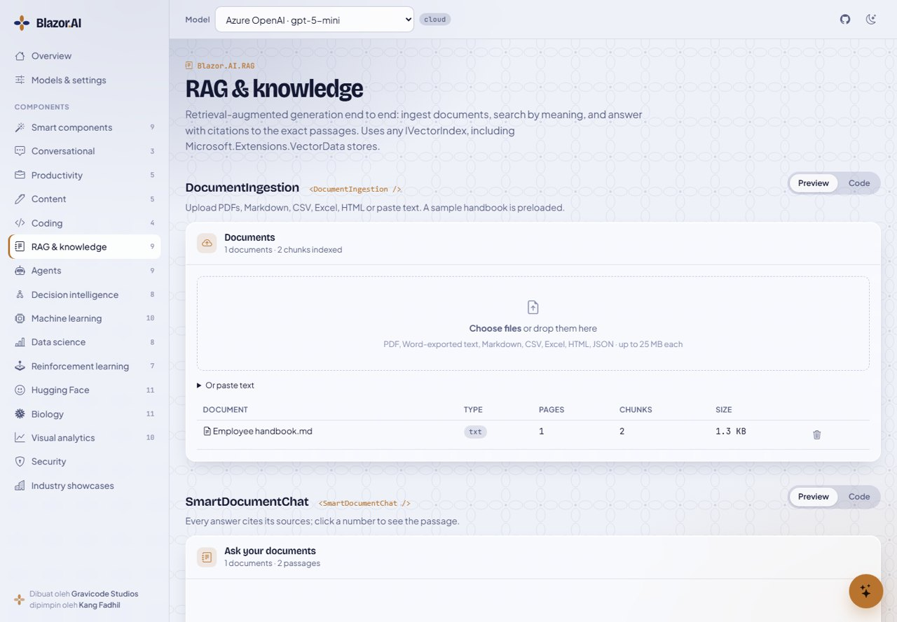

### DocumentIngestion

Uploads PDFs, Markdown, CSV, Excel, HTML or pasted text, then chunks, embeds and indexes them.

No `Provider` parameter.

| Parameter | Type | Default | Purpose |
|---|---|---|---|
| `Title` | `string` | `"Documents"` | Card title. |
| `MaxFileSizeMb` | `int` | `25` | Maximum file size. |
| `MaxFiles` | `int` | `10` | Maximum files per upload. |
| `AllowPaste` | `bool` | `true` | Shows the paste-text option. |
| `Accept` | `string` | supported extensions | File input `accept` list (from `DocumentLoader.SupportedExtensions`). |
| `OnIngested` | `EventCallback<KnowledgeDocument>` | | Raised for each indexed document. |

```razor
<DocumentIngestion MaxFileSizeMb="25" OnIngested="Notify" />
```

### SmartDocumentChat

Chat over the knowledge base. Every answer cites its sources; click a number to see the passage.

Base: `AiComponentBase`.

| Parameter | Type | Default | Purpose |
|---|---|---|---|
| `Title` | `string` | `"Ask your documents"` | Header title. |
| `Icon` | `string` | `"bi-journal-text"` | Header icon. |
| `EmptyTitle` | `string` | `"Ask anything about your documents"` | Empty state title. |
| `Placeholder` | `string` | `"Ask a question…"` | Input placeholder. |
| `Height` | `string` | `"560px"` | CSS height. |
| `Suggestions` | `IReadOnlyList<string>?` | `null` | Starter questions. |
| `DocumentId` | `string?` | `null` | Restricts answers to one document. |
| `TopK` | `int` | `5` | Passages retrieved per question. |
| `HeaderActions` | `RenderFragment?` | `null` | Extra header buttons. |
| `OnAnswer` | `EventCallback<RagAnswer>` | | Raised with the answer and its citations. |

```razor
<SmartDocumentChat Suggestions="@questions" TopK="5" />
```

### VectorSearchBox

Semantic passage search over the knowledge base, with highlighted terms.

Base: `AiComponentBase`.

| Parameter | Type | Default | Purpose |
|---|---|---|---|
| `Query` | `string?` | `null` | Initial query. |
| `Placeholder` | `string` | `"Ask in your own words, e.g. how long do refunds take?"` | Input placeholder. |
| `DocumentId` | `string?` | `null` | Restricts the search to one document. |
| `ShowGrid` | `bool` | `false` | Shows results in a sortable grid instead of cards. |
| `OnResults` | `EventCallback<IReadOnlyList<KnowledgeHit>>` | | Raised with the hits. |

```razor
<VectorSearchBox Query="@query" OnResults="Show" />
```

### SemanticResultGrid

Shows search hits as a sortable table with CSV export.

No AI calls.

| Parameter | Type | Default | Purpose |
|---|---|---|---|
| `Hits` | `IReadOnlyList<KnowledgeHit>` | `[]` | Hits to show. Required. |
| `MetadataColumns` | `IReadOnlyList<string>` | `[]` | Metadata keys to show as extra columns, for example tags added on ingestion. |

```razor
<SemanticResultGrid Hits="@hits" MetadataColumns="@(["department"])" />
```

### CitationViewer

Renders a grounded answer: `[n]` markers become numbered, expandable citations.

No AI calls.

| Parameter | Type | Default | Purpose |
|---|---|---|---|
| `Answer` | `string?` | `null` | Answer text with `[n]` markers. |
| `Citations` | `IReadOnlyList<KnowledgeHit>` | `[]` | Sources, in marker order. |
| `ShowSources` | `bool` | `true` | Shows the source list under the answer. |

```razor
<CitationViewer Answer="@answer.Answer" Citations="@answer.Citations" />
```

### KnowledgeExplorer

Shows exactly what was indexed: documents, chunks and vectors.

No `Provider` parameter.

| Parameter | Type | Default | Purpose |
|---|---|---|---|
| `Title` | `string` | `"Knowledge explorer"` | Card title. |

```razor
<KnowledgeExplorer />
```

### PdfChat

Drop a PDF and chat with it; answers cite page numbers.

Declares `Provider` itself (no base class).

| Parameter | Type | Default | Purpose |
|---|---|---|---|
| `Title` | `string` | `"PDF chat"` | Card title. |
| `Provider` | `string?` | `null` | Provider name. |
| `Height` | `string` | `"600px"` | CSS height. |
| `MaxFileSizeMb` | `int` | `40` | Maximum PDF size. |
| `Suggestions` | `IReadOnlyList<string>` | 4 document questions | Starter questions. |

```razor
<PdfChat Provider="azure" />
```

### SpreadsheetChat

Answers questions about CSV or Excel data. The model plans the query and GraviFrame computes the numbers exactly.

Base: `AiComponentBase`.

| Parameter | Type | Default | Purpose |
|---|---|---|---|
| `Title` | `string` | `"Spreadsheet chat"` | Card title. |
| `PreviewRows` | `int` | `8` | Rows shown in the preview table. |
| `MaxFileSizeMb` | `int` | `20` | Maximum upload size. |
| `SampleCsv` | `string?` | `null` | Optional CSV offered as "Use the sample data". |
| `Frame` | `DataFrame?` | `null` | Loads a table directly instead of asking for an upload. |

```razor
<SpreadsheetChat Frame="@dataFrame" />
```

### KnowledgeGraphViewer

Extracts entities and relations from a document and lets you explore them as a graph.

Base: `AiComponentBase`.

| Parameter | Type | Default | Purpose |
|---|---|---|---|
| `Title` | `string` | `"Knowledge graph"` | Card title. |
| `Text` | `string?` | `null` | Source text. |
| `MaxEntities` | `int` | `30` | Maximum entities to extract. |
| `OnExtracted` | `EventCallback<(IReadOnlyList<GraphNode> Nodes, IReadOnlyList<GraphEdge> Edges)>` | | Raised with the extracted graph. |

```razor
<KnowledgeGraphViewer Text="@article" MaxEntities="30" />
```

---

## Blazor.AI.Agents

Package: `Blazor.AI.Agents` · Namespace: `Blazor.AI.Agents`

```csharp
builder.Services.AddBlazorAIAgents(tools =>
    tools.Register(LookupOrder, "lookup_order", "Order status by number"));
```

`AddBlazorAIAgents()` registers the agent catalog, tool registry, memory, runtime, multi-agent orchestrator, workflow executor, task board state and MCP connector, all scoped per user circuit. Agents choose their model in their `AgentDefinition`, so most agent components have no `Provider` parameter.

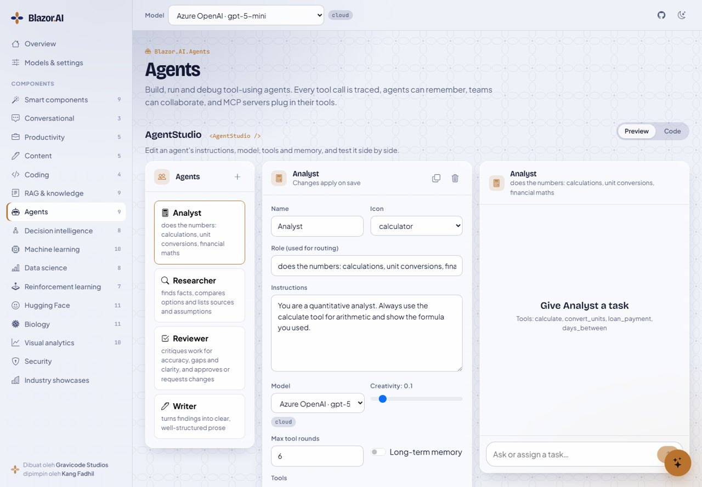

### AgentStudio

Edit an agent's instructions, model, tools and memory, and test it side by side.

Parameters: `Class` only.

```razor
<AgentStudio />
```

### AiAgentChat

Chat with an agent; tool calls appear inline with results and timings.

| Parameter | Type | Default | Purpose |
|---|---|---|---|
| `Agent` | `AgentDefinition?` | `null` | The agent to chat with. Defaults to the first agent in the catalog. |
| `AllowAgentSwitch` | `bool` | `true` | Shows the agent picker. |
| `ShowHeader` | `bool` | `true` | Shows the header. |
| `Height` | `string` | `"560px"` | CSS height. |
| `Suggestions` | `IReadOnlyList<string>?` | `null` | Starter prompts. |
| `OnRunCompleted` | `EventCallback<AgentRun>` | | Raised with the full run trace. |

```razor
<AiAgentChat Agent="@catalog.Get("analyst")" OnRunCompleted="Log" />
```

### AiMultiAgentPanel

Runs a team of specialist agents on one task, as a pipeline, a round table or supervisor-routed.

Declares `Provider` itself.

| Parameter | Type | Default | Purpose |
|---|---|---|---|
| `Title` | `string` | `"Multi-agent panel"` | Card title. |
| `Task` | `string?` | `null` | Initial task. |
| `Provider` | `string?` | `null` | Provider name. |

```razor
<AiMultiAgentPanel Task="@task" />
```

### AgentTaskBoard

Plans a goal into tasks assigned to agents, runs them, and lets you review and approve. Drag cards between columns.

Declares `Provider` itself.

| Parameter | Type | Default | Purpose |
|---|---|---|---|
| `Provider` | `string?` | `null` | Provider used for planning. |

```razor
<AgentTaskBoard />
```

### AgentWorkflowDesigner

A node editor for agent workflows: drag nodes, connect ports, branch on conditions, then run and watch nodes light up.

| Parameter | Type | Default | Purpose |
|---|---|---|---|
| `Workflow` | `AgentWorkflow` | `AgentWorkflow.Sample()` | The workflow to edit and run. |
| `Width` / `Height` | `int` | `1080` / `380` | Canvas size. |
| `OnCompleted` | `EventCallback<string>` | | Raised with the final output of a run. |

```razor
<AgentWorkflowDesigner Workflow="@AgentWorkflow.Sample()" OnCompleted="Publish" />
```

### AgentDebugger

The full trace of every agent run in the circuit: inputs, tool calls, results, tokens and errors.

| Parameter | Type | Default | Purpose |
|---|---|---|---|
| `Title` | `string` | `"Agent debugger"` | Card title. |

```razor
<AgentDebugger />
```

### ToolExecutionPanel

Call any registered tool by hand; the form is generated from its JSON schema.

| Parameter | Type | Default | Purpose |
|---|---|---|---|
| `Title` | `string` | `"Tool execution"` | Card title. |

```razor
<ToolExecutionPanel />
```

### AgentMemoryViewer

Browse and search agents' long-term memories by meaning.

| Parameter | Type | Default | Purpose |
|---|---|---|---|
| `Title` | `string` | `"Agent memory"` | Card title. |

```razor
<AgentMemoryViewer />
```

### MCPServerExplorer

Connects Model Context Protocol servers; their tools are added to the `ToolRegistry` and become available to every agent.

| Parameter | Type | Default | Purpose |
|---|---|---|---|
| `Title` | `string` | `"MCP server explorer"` | Card title. |

```razor
<MCPServerExplorer />
```

---

## Blazor.AI.Decision

Package: `Blazor.AI.Decision` · Namespace: `Blazor.AI.Decision`

```csharp
builder.Services.AddBlazorAIDecision(o => o.ApiKey = config["TypeSafe:ApiKey"]);
```

`AddBlazorAIDecision()` registers the rule engine and the TypeSafe decision service. Without an API key, TypeSafe judgements use a local simulator. Rules, decision tables, trees, scorecards and pricing are computed in .NET; the model writes rules from policy text and explains results.

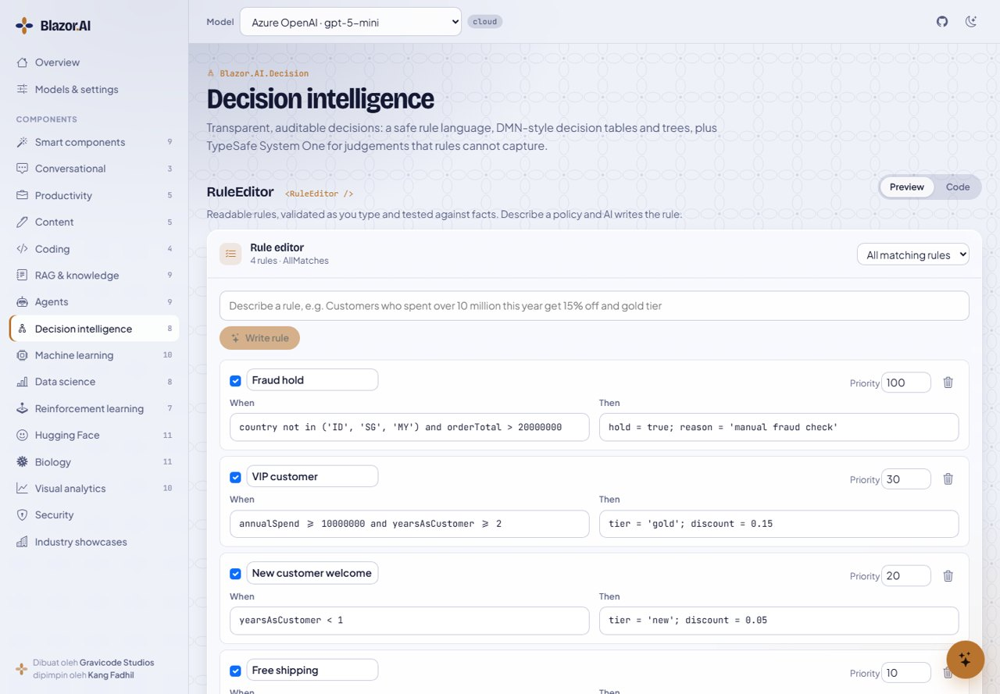

### RuleEditor

Readable business rules, validated as you type and tested against facts. Describe a policy and AI writes the rule.

Base: `AiComponentBase`.

| Parameter | Type | Default | Purpose |
|---|---|---|---|
| `Title` | `string` | `"Rule editor"` | Card title. |
| `Rules` | `List<BusinessRule>` | sample rules | Rules to edit. |
| `Facts` | `IDictionary<string, object?>` | sample facts | Facts to test against. |
| `Mode` | `RuleMode` | `RuleMode.AllMatches` | `AllMatches` fires every matching rule in priority order; `FirstMatch` fires only the highest-priority one. |
| `OnEvaluated` | `EventCallback<RuleEvaluation>` | | Raised with the evaluation trace. |

```razor
<RuleEditor Rules="@rules" Facts="@facts" OnEvaluated="Apply" />

@code {
    // The same engine in code:
    // var result = new RuleEngine().Evaluate(rules, facts);
}
```

### DecisionTableEditor

DMN-style decision tables with hit policies and FEEL-like cells.

No AI calls.

| Parameter | Type | Default | Purpose |
|---|---|---|---|
| `Table` | `DecisionTable` | `DecisionTable.LoanSample()` | Table to edit. |
| `Facts` | `IDictionary<string, object?>` | sample loan facts | Input values to test. |
| `OnEvaluated` | `EventCallback<DecisionTableResult>` | | Raised with the matched rows and outputs. |

```razor
<DecisionTableEditor Table="@DecisionTable.LoanSample()" />
```

### DecisionTreeViewer

Shows a decision tree and the path a case takes through it.

No AI calls.

| Parameter | Type | Default | Purpose |
|---|---|---|---|
| `Root` | `DecisionTreeNode` | `DecisionTreeNode.ChurnSample()` | Tree to show. |
| `Title` | `string` | `"Decision tree"` | Card title. |
| `Subtitle` | `string?` | `"Follow the path a case takes"` | Card subtitle. |
| `ShowTester` | `bool` | `true` | Shows the facts editor for testing a case. |
| `Facts` | `IDictionary<string, object?>` | sample facts | Case to trace. |

```razor
<DecisionTreeViewer Root="@tree" Facts="@caseFacts" />
```

### BusinessPolicyDesigner

Turns policy text into executable rules, with conflict checks, versions and a plain-language explanation.

Base: `AiComponentBase`.

| Parameter | Type | Default | Purpose |
|---|---|---|---|
| `PolicyText` | `string?` | `null` | Policy in plain language. |
| `Facts` | `IDictionary<string, object?>` | sample facts | Facts to test the generated rules. |
| `OnPublished` | `EventCallback<IReadOnlyList<BusinessRule>>` | | Raised when a rule set is published. |

```razor
<BusinessPolicyDesigner PolicyText="@policy" OnPublished="Deploy" />
```

### RiskAssessmentPanel

A weighted scorecard combined with TypeSafe judgements on qualitative questions, followed by AI-proposed mitigations.

Base: `AiComponentBase`.

| Parameter | Type | Default | Purpose |
|---|---|---|---|
| `Title` | `string` | `"Risk assessment"` | Card title. |
| `CaseDescription` | `string` | sample SME loan | Case to assess. |
| `Factors` | `List<RiskFactor>` | sample factors | Scorecard factors: `Value` from 0 (no risk) to 10, multiplied by `Weight`. |
| `Questions` | `IReadOnlyDictionary<string, string>` | 3 sample questions | Qualitative questions answered by TypeSafe (key to question), each scored 0 to 1. |
| `JudgementWeight` | `double` | `0.4` | Share of the overall score taken from TypeSafe judgements; the rest is the scorecard. |
| `OnAssessed` | `EventCallback<double>` | | Raised with the overall score. |

```razor
<RiskAssessmentPanel CaseDescription="@application"
                     Factors="@([new RiskFactor("Financial leverage", 6, 2), new RiskFactor("Payment history", 4, 2.5)])" />
```

### EligibilityEngineUI

Checks an applicant against required and optional criteria and writes a friendly explanation for the applicant.

Base: `AiComponentBase`.

| Parameter | Type | Default | Purpose |
|---|---|---|---|
| `Title` | `string` | `"Eligibility engine"` | Card title. |
| `ProgramName` | `string` | `"KUR micro-business loan (sample)"` | Name of the programme. |
| `Language` | `string?` | `null` | Language of the explanation. |
| `Criteria` | `List<EligibilityCriterion>` | sample criteria | Criteria (`Name`, `Expression`, `Required`, `HowToMeet`). |
| `Applicant` | `IDictionary<string, object?>` | sample applicant | Applicant facts. |
| `OnChecked` | `EventCallback<bool>` | | Raised with whether the applicant is eligible. |

```razor
<EligibilityEngineUI Criteria="@criteria" Applicant="@applicant" Language="Bahasa Indonesia" />
```

### IntelligentApprovalWorkflow

Rules decide clear cases, AI judges the rest, and humans review low-confidence decisions. Every decision is logged to the audit trail.

Base: `AiComponentBase`.

| Parameter | Type | Default | Purpose |
|---|---|---|---|
| `Title` | `string` | `"Intelligent approval workflow"` | Card title. |
| `AutoApproveLimit` | `double` | `2_000_000` | Requests up to this amount are approved by rule. |
| `AutoRejectAbove` | `double` | `500_000_000` | Requests above this amount are rejected by rule. |
| `ConfidenceThreshold` | `double` | `0.75` | AI decisions below this confidence go to human review. |
| `OnDecided` | `EventCallback<string>` | | Raised with the decision. |

```razor
<IntelligentApprovalWorkflow AutoApproveLimit="2000000" ConfidenceThreshold="0.75" />
```

### DynamicPricingEngine

Finds the profit-optimal price under constant price elasticity, then applies margin, competitor and inventory guardrails.

Base: `AiComponentBase`.

| Parameter | Type | Default | Purpose |
|---|---|---|---|
| `Title` | `string` | `"Dynamic pricing"` | Card title. |
| `Inputs` | `PricingInputs` | `new()` | Unit cost, reference price and demand, competitor price, elasticity, inventory weeks, minimum margin and maximum premium over the competitor. |
| `OnPriced` | `EventCallback<PricingResult>` | | Raised with the optimal price, final price, units, profit and adjustments. |

```razor
<DynamicPricingEngine Inputs="@(new PricingInputs { UnitCost = 42_000, Elasticity = -2.2 })" OnPriced="UpdateCatalog" />
```

### FactsEditor

Edits a set of facts (name to value). Numbers and true/false are typed automatically. The other decision components use it.

No AI calls.

| Parameter | Type | Default | Purpose |
|---|---|---|---|
| `Facts` | `IDictionary<string, object?>` | empty | Facts to edit. Supports `@bind-Facts`. Required. |
| `FactsChanged` | `EventCallback<IDictionary<string, object?>>` | | Raised after every change. |
| `Label` | `string` | `"Facts"` | Label above the list. |

```razor
<FactsEditor @bind-Facts="facts" Label="Applicant" />
```

---

## Blazor.AI.Analytics

Package: `Blazor.AI.Analytics` · Namespace: `Blazor.AI.Analytics`

```csharp
builder.Services.AddBlazorAIAnalytics();
```

`AddBlazorAIAnalytics()` registers the per-user `AnalyticsWorkspace` and `RlWorkspace`. Components that inherit `AnalyticsComponentBase` share the workspace dataset (chosen with `DatasetPicker`) unless you pass `Dataset`. Training, statistics and reinforcement learning run in .NET with Gravicode.Science and GraviFrame; the model writes briefings and names segments.

### Machine learning

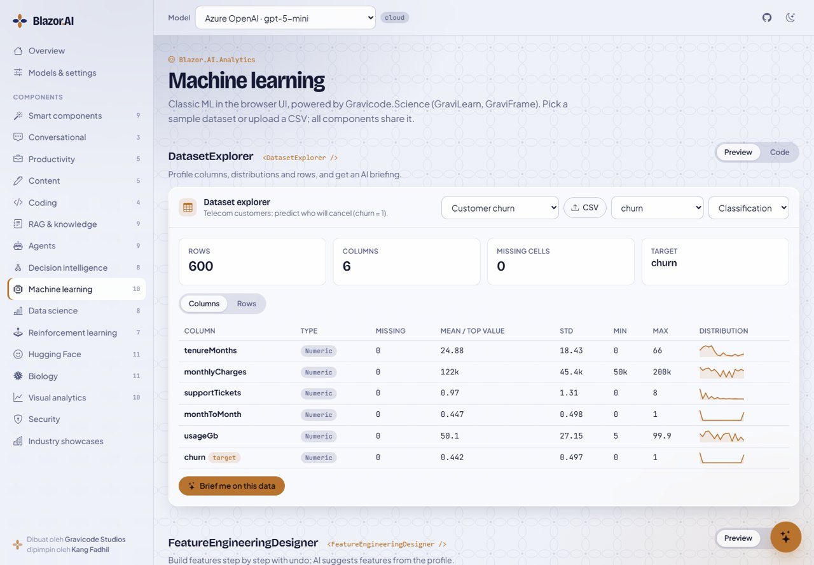

### DatasetPicker

Chooses the workspace dataset: a built-in sample or an uploaded CSV, plus the target column and task. All workspace-bound analytics components react to the change.

| Parameter | Type | Default | Purpose |
|---|---|---|---|
| `ShowTarget` | `bool` | `true` | Shows the target column and task pickers. |

```razor
<DatasetPicker />
<ModelTrainer />
```

### DatasetExplorer

Profiles columns, distributions and rows, and writes an AI briefing about the dataset.

Base: `AnalyticsComponentBase`.

| Parameter | Type | Default | Purpose |
|---|---|---|---|
| `Title` | `string` | `"Dataset explorer"` | Card title. |

```razor
<DatasetExplorer />   @* shares AnalyticsWorkspace.Dataset with the other components *@
```

### FeatureEngineeringDesigner

Builds features step by step with undo; AI suggests features from the column profile.

Base: `AnalyticsComponentBase`.

| Parameter | Type | Default | Purpose |
|---|---|---|---|
| `Title` | `string` | `"Feature engineering"` | Card title. |

```razor
<FeatureEngineeringDesigner />
```

### AutoMLStudio

Cross-validates every suitable algorithm on the dataset and ranks them.

Base: `AnalyticsComponentBase`.

| Parameter | Type | Default | Purpose |
|---|---|---|---|
| `Title` | `string` | `"AutoML studio"` | Card title. |
| `Folds` | `int` | `5` | Cross-validation folds. |
| `OnBestModel` | `EventCallback<ModelSpec>` | | Raised with the best model. |

```razor
<AutoMLStudio Folds="5" OnBestModel="Train" />
```

### ModelTrainer

Trains a model with your choice of algorithm, hyperparameters and features, and shows metrics, feature importance and live predictions.

Base: `AnalyticsComponentBase`.

| Parameter | Type | Default | Purpose |
|---|---|---|---|
| `Title` | `string` | `"Model trainer"` | Card title. |
| `Task` | `MlTask?` | `null` | Forces a task (`Classification`, `Regression`, `Clustering`, `TimeSeries`); otherwise the dataset's task is used. |
| `Algorithm` | `string?` | `null` | Algorithm selected initially. |
| `OnTrained` | `EventCallback<TrainingResult>` | | Raised with the trained model and metrics. |

```razor
<ModelTrainer Task="MlTask.Classification" Algorithm="Random forest" OnTrained="Save" />
```

### ClassificationWorkbench

Trains a classifier and shows the confusion matrix, ROC curve and classification report.

Declares `Provider` itself (no base class).

| Parameter | Type | Default | Purpose |
|---|---|---|---|
| `Title` | `string` | `"Classification workbench"` | Card title. |
| `Dataset` | `AnalyticsDataset?` | `null` | Dataset; `null` uses the workspace dataset. |
| `Provider` | `string?` | `null` | Provider name. |

```razor
<ClassificationWorkbench Dataset="@(new AnalyticsDataset("Churn", frame, "churn"))" />
```

### RegressionWorkbench

Trains a regressor and shows actual versus predicted values and residuals on held-out data.

Declares `Provider` itself (no base class).

| Parameter | Type | Default | Purpose |
|---|---|---|---|
| `Title` | `string` | `"Regression workbench"` | Card title. |
| `Dataset` | `AnalyticsDataset?` | `null` | Dataset; `null` uses the workspace dataset. |
| `Provider` | `string?` | `null` | Provider name. |

```razor
<RegressionWorkbench Dataset="@dataset" />
```

### ClusteringWorkbench

Clusters rows with K-Means, GMM, hierarchical clustering or DBSCAN; AI names the segments.

Base: `AnalyticsComponentBase`.

| Parameter | Type | Default | Purpose |
|---|---|---|---|
| `Title` | `string` | `"Clustering workbench"` | Card title. |
| `OnClustered` | `EventCallback<ClusteringResult>` | | Raised with the cluster assignments. |

```razor
<ClusteringWorkbench Dataset="@segments" OnClustered="Tag" />
```

### ForecastingWorkbench

Forecasts a series with Holt-Winters and related methods, with confidence bands and a method comparison.

Base: `AnalyticsComponentBase`.

| Parameter | Type | Default | Purpose |
|---|---|---|---|
| `Title` | `string` | `"Forecasting workbench"` | Card title. |

```razor
<ForecastingWorkbench Dataset="@sales" />
```

### AnomalyDetectionWorkbench

Finds outliers with robust z-scores, IQR fences or a one-class SVM.

Base: `AnalyticsComponentBase`.

| Parameter | Type | Default | Purpose |
|---|---|---|---|
| `Title` | `string` | `"Anomaly detection"` | Card title. |
| `OnDetected` | `EventCallback<IReadOnlyList<int>>` | | Raised with the row indexes of the anomalies. |

```razor
<AnomalyDetectionWorkbench Dataset="@telemetry" OnDetected="Alert" />
```

### RecommendationWorkbench

Item-based collaborative filtering on a ratings matrix you can edit live.

No `Provider` parameter.

| Parameter | Type | Default | Purpose |
|---|---|---|---|
| `Title` | `string` | `"Recommendation workbench"` | Card title. |
| `Users` | `IReadOnlyList<string>` | sample users | Row labels. |
| `Items` | `IReadOnlyList<string>` | sample items | Column labels. |
| `Ratings` | `double[,]` | sample ratings | Users × items matrix. |
| `Top` | `int` | `4` | Recommendations per user. |

```razor
<RecommendationWorkbench Users="@users" Items="@items" Ratings="@ratings" />
```

### Data science

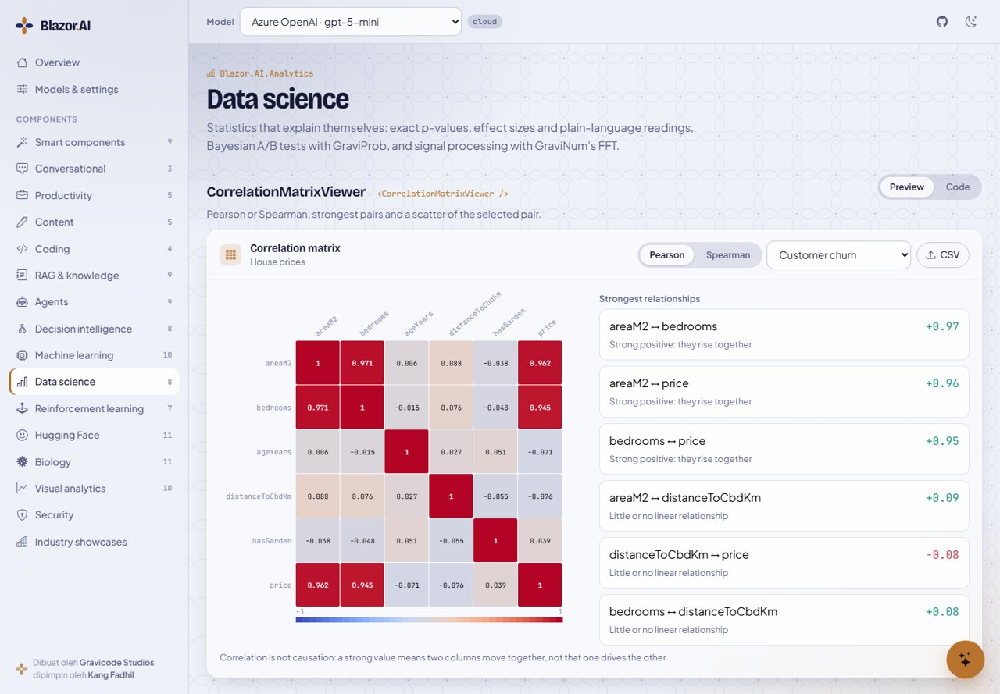

### CorrelationMatrixViewer

Pearson or Spearman correlations, the strongest pairs, and a scatter plot of the selected pair.

Base: `AnalyticsComponentBase`.

| Parameter | Type | Default | Purpose |
|---|---|---|---|
| `Title` | `string` | `"Correlation matrix"` | Card title. |

```razor
<CorrelationMatrixViewer Dataset="@dataset" />
```

### StatisticalAnalysisPanel

Descriptive statistics: centre, spread, shape, bootstrap confidence interval, KDE and box plot, and grouped summaries.

Base: `AnalyticsComponentBase`.

| Parameter | Type | Default | Purpose |
|---|---|---|---|
| `Title` | `string` | `"Statistical analysis"` | Card title. |

```razor
<StatisticalAnalysisPanel Dataset="@dataset" />
```

### HypothesisTestingPanel

Runs t-tests, ANOVA and chi-square tests on dataset columns.

Base: `AnalyticsComponentBase`.

| Parameter | Type | Default | Purpose |
|---|---|---|---|
| `Title` | `string` | `"Hypothesis testing"` | Card title. |

```razor
<HypothesisTestingPanel Dataset="@dataset" />
```

### BayesianAnalysisPanel

Bayesian A/B analysis with Beta posteriors, the probability that B beats A, expected lift and expected loss.

Base: `AiComponentBase`.

| Parameter | Type | Default | Purpose |
|---|---|---|---|
| `Title` | `string` | `"Bayesian A/B analysis"` | Card title. |
| `SuccessA` / `TotalA` | `int` | `120` / `1_000` | Conversions and trials for variant A. |
| `SuccessB` / `TotalB` | `int` | `151` / `1_000` | Conversions and trials for variant B. |
| `PriorAlpha` / `PriorBeta` | `double` | `1` / `1` | Beta prior. |
| `DecisionThreshold` | `double` | `0.95` | Recommends B only when P(B > A) exceeds this. |

```razor
<BayesianAnalysisPanel SuccessA="120" TotalA="1000" SuccessB="151" TotalB="1000" />
```

### PCAVisualizer

Principal component analysis with a scree plot, projection and loadings.

Base: `AnalyticsComponentBase`.

| Parameter | Type | Default | Purpose |
|---|---|---|---|
| `Title` | `string` | `"PCA visualizer"` | Card title. |

```razor
<PCAVisualizer Dataset="@dataset" />
```

### DimensionReductionStudio

Compares PCA, LDA and t-SNE projections side by side.

Base: `AnalyticsComponentBase`.

| Parameter | Type | Default | Purpose |
|---|---|---|---|
| `Title` | `string` | `"Dimension reduction studio"` | Card title. |

```razor
<DimensionReductionStudio Dataset="@dataset" />
```

### TimeSeriesAnalyzer

Moving averages, seasonal decomposition and autocorrelation for a time series.

Base: `AnalyticsComponentBase`.

| Parameter | Type | Default | Purpose |
|---|---|---|---|
| `Title` | `string` | `"Time series analyzer"` | Card title. |

```razor
<TimeSeriesAnalyzer Dataset="@sales" />
```

### SignalProcessingStudio

Compose a signal, inspect its spectrum and filter it.

No `Provider` parameter.

| Parameter | Type | Default | Purpose |
|---|---|---|---|
| `Title` | `string` | `"Signal processing studio"` | Card title. |
| `Input` | `IReadOnlyList<double>?` | `null` | Analyses this signal instead of the synthetic one. |

```razor
<SignalProcessingStudio Input="@vibrationSamples" />
```

### Reinforcement learning

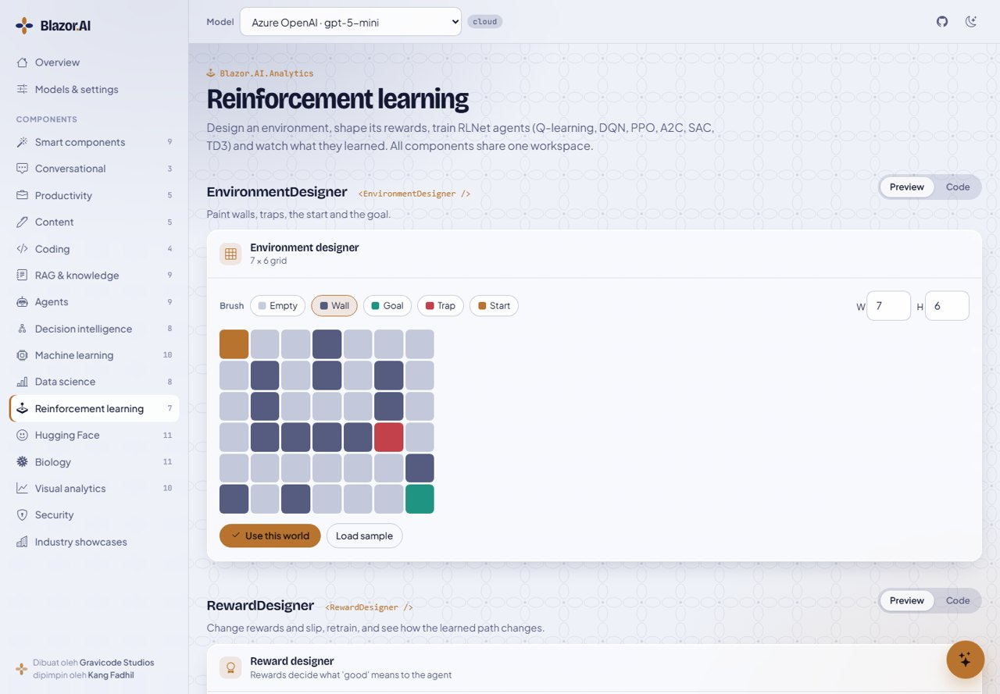

The RL components share the `RlWorkspace`, so an environment designed in one is trained and replayed in the others.

### EnvironmentDesigner

Paint a grid world: walls, traps, the start and the goal.

| Parameter | Type | Default | Purpose |
|---|---|---|---|
| `Title` | `string` | `"Environment designer"` | Card title. |

```razor
<EnvironmentDesigner />
```

### RewardDesigner

Change rewards and slip probability, retrain, and see how the learned path changes.

| Parameter | Type | Default | Purpose |
|---|---|---|---|
| `Title` | `string` | `"Reward designer"` | Card title. |
| `Episodes` | `int` | `400` | Training episodes per retrain. |

```razor
<RewardDesigner Episodes="400" />
```

### RLTrainingStudio

Trains agents on your grid world or classic environments: CartPole, MountainCar, LunarLander, Pendulum, trading and supply chain.

| Parameter | Type | Default | Purpose |
|---|---|---|---|
| `Title` | `string` | `"RL training studio"` | Card title. |
| `OnTrained` | `EventCallback<TrainingSession>` | | Raised when a training run finishes. |

```razor
<RLTrainingStudio OnTrained="Save" />
```

### PolicyVisualizer

Shows the best action and the value of each cell for Q-learning agents.

| Parameter | Type | Default | Purpose |
|---|---|---|---|
| `Title` | `string` | `"Policy visualizer"` | Card title. |

```razor
<PolicyVisualizer />
```

### SimulationRunner

Replays any trained agent step by step.

| Parameter | Type | Default | Purpose |
|---|---|---|---|
| `Title` | `string` | `"Simulation runner"` | Card title. |

```razor
<SimulationRunner />
```

### AgentPerformanceTracker

Compares learning curves, stability and training time across training runs.

| Parameter | Type | Default | Purpose |
|---|---|---|---|
| `Title` | `string` | `"Agent performance tracker"` | Card title. |

```razor
<AgentPerformanceTracker />
```

### StrategyOptimizer

Multi-armed bandits for live strategy choice: ε-greedy, UCB1 and Thompson sampling compared with a plain A/B split.

| Parameter | Type | Default | Purpose |
|---|---|---|---|
| `Title` | `string` | `"Strategy optimizer"` | Card title. |

```razor
<StrategyOptimizer />
```

### RlScene

Renders one simulation frame for the classic environments (CartPole, MountainCar, LunarLander, Pendulum) and grid worlds. `SimulationRunner` and `RewardDesigner` use it.

No AI calls. No `Class` parameter.

| Parameter | Type | Default | Purpose |
|---|---|---|---|
| `State` | `IReadOnlyDictionary<string, double>` | empty | Environment state, for example `x` and `angle` for CartPole. Required. |
| `Environment` | `string` | `""` | Environment name. |
| `Tiles` | `Func<int, int, GridTile>?` | `null` | Tile layout for grid worlds. |
| `Trail` | `IReadOnlyList<(int X, int Y)>?` | `null` | Cells visited so far, drawn as a trail. |

```razor
<RlScene Environment="CartPole" State="@frame.State" />
```

---

## Blazor.AI.LocalModels

Package: `Blazor.AI.LocalModels` · Namespace: `Blazor.AI.LocalModels`

```csharp
builder.Services.AddBlazorAILocalModels(o => o.HuggingFaceToken = config["HuggingFace:Token"]);

// Optional: use local models as a provider everywhere (chat, RAG, semantic search).
builder.Services.AddBlazorAI().AddLocalTransformers(embeddingModel: "sentence-transformers/all-MiniLM-L6-v2");
```

`AddBlazorAILocalModels()` registers the Hugging Face Hub service, the hosted Inference API client and the shared local model registry. Components that inherit `HfComponentBase` run models locally on CPU with HF.Net (downloaded once, private and offline afterwards) or on the Hugging Face Inference API, selected with `Engine`. Default model ids come from `LocalModelOptions`.

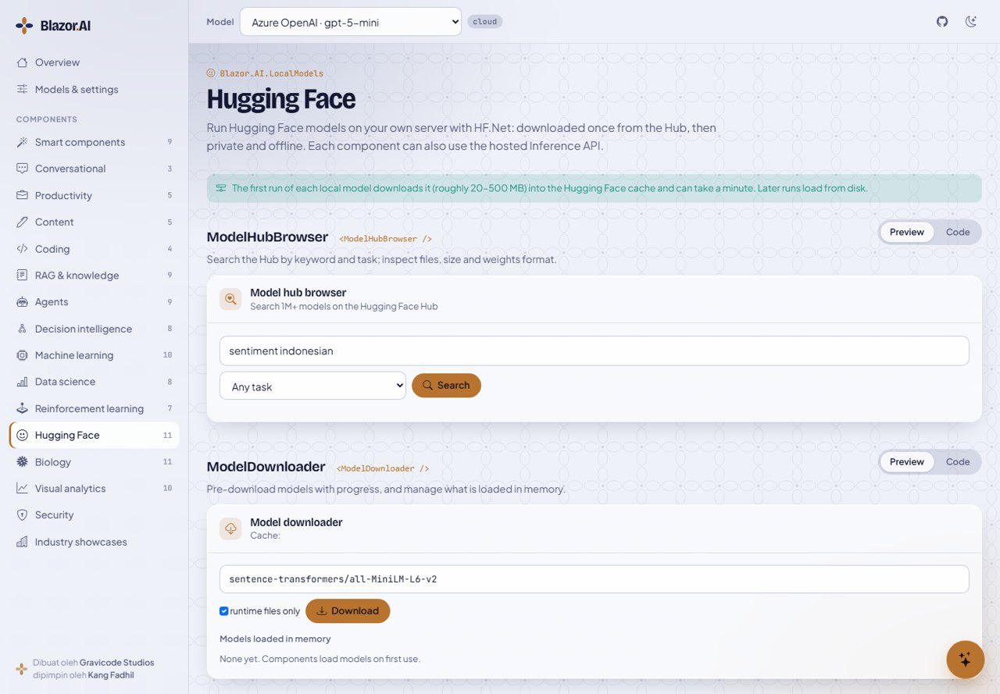

### ModelHubBrowser

Searches the Hugging Face Hub by keyword and task, and shows each model's files, size and weights format.

Base: `AiComponentBase`.

| Parameter | Type | Default | Purpose |
|---|---|---|---|
| `Title` | `string` | `"Model hub browser"` | Card title. |
| `OnModelSelected` | `EventCallback<string>` | | Raised with the selected model id. |

```razor
<ModelHubBrowser OnModelSelected="Use" />
```

### ModelDownloader

Pre-downloads models with progress, and manages which models are loaded in memory.

Base: `AiComponentBase`.

| Parameter | Type | Default | Purpose |
|---|---|---|---|
| `Title` | `string` | `"Model downloader"` | Card title. |
| `RepoId` | `string?` | `"sentence-transformers/all-MiniLM-L6-v2"` | Model to download. |
| `OnDownloaded` | `EventCallback<string>` | | Raised with the model id when the download finishes. |

```razor
<ModelDownloader RepoId="sentence-transformers/all-MiniLM-L6-v2" />
```

### InferencePlayground

Tries classification, NER, fill-mask, question answering, similarity, embeddings and local text generation in one place.

Base: `HfComponentBase`.

| Parameter | Type | Default | Purpose |
|---|---|---|---|
| `Title` | `string` | `"Inference playground"` | Card title. |

```razor
<InferencePlayground />
```

### SentimentAnalysisPanel

Sentiment for one text or a batch (one per line), with an overall distribution.

Base: `HfComponentBase`.

| Parameter | Type | Default | Purpose |
|---|---|---|---|
| `Title` | `string` | `"Sentiment analysis"` | Card title. |
| `Text` | `string?` | 3 sample reviews | Input text, one item per line. |
| `OnAnalysed` | `EventCallback<IReadOnlyList<(string Text, string Label, double Score)>>` | | Raised with one result per line. |

```razor
<SentimentAnalysisPanel Model="w11wo/indonesian-roberta-base-sentiment-classifier" />
```

### TextClassificationPanel

Classifies text with a fine-tuned model's labels, or zero-shot with your own labels.

Base: `HfComponentBase`.

| Parameter | Type | Default | Purpose |
|---|---|---|---|
| `Title` | `string` | `"Text classification"` | Card title. |
| `Text` | `string?` | sample support message | Input text. |
| `OnClassified` | `EventCallback<IReadOnlyList<LabelScore>>` | | Raised with the label scores. |

```razor
<TextClassificationPanel Engine="InferenceEngine.Local" />
```

### NERViewer

Named entity recognition with people, organisations and places highlighted inline.

Base: `HfComponentBase`.

| Parameter | Type | Default | Purpose |
|---|---|---|---|
| `Title` | `string` | `"Named entity recognition"` | Card title. |
| `Text` | `string?` | sample sentence | Input text. |
| `OnExtracted` | `EventCallback<IReadOnlyList<EntitySpan>>` | | Raised with the entities. |

```razor
<NERViewer Model="cahya/bert-base-indonesian-NER" />
```

### TextEmbeddingStudio

Embeds sentences and shows a similarity heatmap and a 2-D map.

Base: `HfComponentBase`.

| Parameter | Type | Default | Purpose |
|---|---|---|---|
| `Title` | `string` | `"Text embedding studio"` | Card title. |
| `Text` | `string?` | 5 sample sentences | Sentences, one per line. |

```razor
<TextEmbeddingStudio />
```

### ImageClassificationPanel

Classifies an image into ImageNet classes (ViT) or your own labels (CLIP zero-shot).

Base: `HfComponentBase`.

| Parameter | Type | Default | Purpose |
|---|---|---|---|
| `Title` | `string` | `"Image classification"` | Card title. |
| `MaxImageMb` | `int` | `8` | Maximum image size. |
| `OnClassified` | `EventCallback<IReadOnlyList<LabelScore>>` | | Raised with the label scores. |

```razor
<ImageClassificationPanel />
```

### OCRPanel

Reads text from an image with local TrOCR (text lines), or with a vision LLM for full documents and tables.

Base: `HfComponentBase`.

| Parameter | Type | Default | Purpose |
|---|---|---|---|
| `Title` | `string` | `"OCR"` | Card title. |
| `MaxImageMb` | `int` | `10` | Maximum image size. |
| `OnRecognized` | `EventCallback<string>` | | Raised with the recognised text. |

```razor
<OCRPanel Provider="azure" OnRecognized="Save" />
```

### SpeechRecognitionPanel

Live dictation with the browser's speech recognition, or Whisper on an uploaded audio file.

Base: `HfComponentBase`.

| Parameter | Type | Default | Purpose |
|---|---|---|---|
| `Title` | `string` | `"Speech recognition"` | Card title. |
| `OnTranscribed` | `EventCallback<string>` | | Raised with the transcript. |

```razor
<SpeechRecognitionPanel OnTranscribed="Fill" />
```

### TextToSpeechPanel

Reads text aloud with browser voices (offline) or a neural TTS model.

Base: `HfComponentBase`.

| Parameter | Type | Default | Purpose |
|---|---|---|---|
| `Title` | `string` | `"Text to speech"` | Card title. |
| `Text` | `string?` | sample Indonesian greeting | Text to speak. |

```razor
<TextToSpeechPanel Text="@announcement" />
```

### EngineSelector

The engine and model id picker shared by the Hugging Face components.

No AI calls. No `Class` parameter.

| Parameter | Type | Default | Purpose |
|---|---|---|---|
| `Engine` | `InferenceEngine` | `InferenceEngine.Local` | `Local` or `HostedApi`. Supports `@bind-Engine`. |
| `EngineChanged` | `EventCallback<InferenceEngine>` | | Raised when the engine changes. |
| `Model` | `string?` | `null` | Model id. Supports `@bind-Model`. |
| `ModelChanged` | `EventCallback<string?>` | | Raised when the model id changes. |
| `Suggestions` | `IReadOnlyList<string>?` | `null` | Model ids offered in the drop-down. |

```razor
<EngineSelector @bind-Engine="engine" @bind-Model="model" Suggestions="@(["dslim/distilbert-NER"])" />
```

---

## Blazor.AI.Bio

Package: `Blazor.AI.Bio` · Namespace: `Blazor.AI.Bio`

```csharp
builder.Services.AddBlazorAIAgents();
builder.Services.AddBlazorAIBio();
```

`AddBlazorAIBio()` requires `AddBlazorAIAgents()`: it adds the Biotech.Net tools to every user's `ToolRegistry`, so agents and `BioCopilot` can call them. Analysis runs locally with Biotech.Net. The optional "Explain with AI" step sends only the computed results, never the raw input, to the model. Components that inherit `BioComponentBase` take `Audience` and `Language` for that explanation.

```razor
@using Blazor.AI.Bio
```

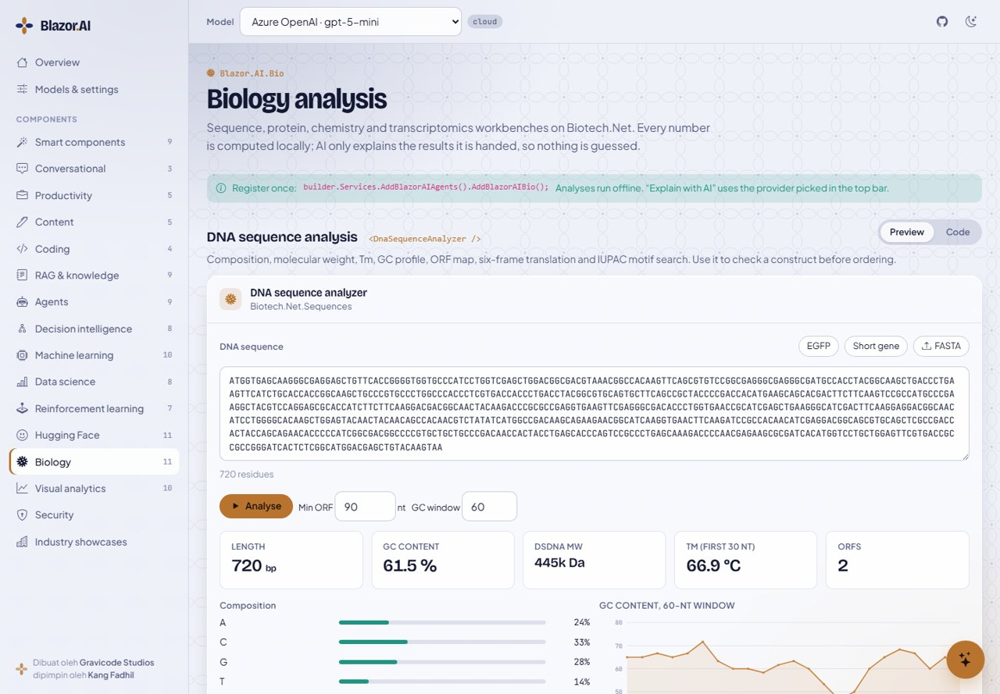

### DnaSequenceAnalyzer

DNA composition, molecular weight, Tm, GC profile, ORF map, six-frame translation and IUPAC motif search.

Base: `BioComponentBase`.

| Parameter | Type | Default | Purpose |
|---|---|---|---|
| `Title` | `string` | `"DNA sequence analyzer"` | Card title. |
| `Sequence` | `string?` | `BioSamples.Egfp` | Raw residues or FASTA. |
| `OnAnalysed` | `EventCallback<Sequence>` | | Raised with the parsed sequence. |

```razor
<DnaSequenceAnalyzer Sequence="@construct"
                     Audience="an undergraduate lab class"
                     Language="Bahasa Indonesia"
                     OnAnalysed="seq => lastLength = seq.Length" />
```

### RestrictionMapper

Finds single cutters, draws a cut-site map and simulates the bands on a 1% agarose gel.

Base: `BioComponentBase`.

| Parameter | Type | Default | Purpose |
|---|---|---|---|
| `Title` | `string` | `"Restriction mapper"` | Card title. |
| `Sequence` | `string?` | `BioSamples.Egfp` | DNA sequence or FASTA. |

```razor
<RestrictionMapper Sequence="@plasmid" Title="pUC19 digest" />
```

### SequenceAligner

Global, local or semi-global pairwise alignment with BLOSUM or PAM scoring.

Base: `BioComponentBase`.

| Parameter | Type | Default | Purpose |
|---|---|---|---|
| `Title` | `string` | `"Pairwise sequence aligner"` | Card title. |
| `Target` | `string?` | `BioSamples.HemoglobinBeta` | Reference sequence. |
| `Query` | `string?` | human haemoglobin α | Sequence to align. |

```razor
<SequenceAligner Target="@reference" Query="@variant" />
```

### MultipleAlignmentViewer

Progressive multiple sequence alignment with a conservation track, an identity heatmap and a neighbour-joining tree.

Base: `BioComponentBase`.

| Parameter | Type | Default | Purpose |
|---|---|---|---|
| `Title` | `string` | `"Multiple alignment & phylogeny"` | Card title. |
| `Fasta` | `string?` | `BioSamples.CytochromeC` | Multi-record FASTA. |

```razor
<MultipleAlignmentViewer Fasta="@orthologues" />
```

### PhyloTree

Draws a phylogenetic tree. `MultipleAlignmentViewer` uses it; you can pass any parsed Newick tree.

No AI calls. No `Class` parameter.

| Parameter | Type | Default | Purpose |
|---|---|---|---|
| `Tree` | `PhylogeneticTree` | | Tree to draw. Required. |
| `Width` | `int` | `480` | Drawing width. |
| `RowHeight` | `int` | `28` | Height per leaf. |

```razor
<PhyloTree Tree="@(PhylogeneticTree.ParseNewick("((A:0.1,B:0.2):0.05,C:0.3);"))" />
```

### ProteinAnalyzer

ProtParam-style protein properties, hydropathy and charge curves, signal peptide and transmembrane hints, and tryptic peptides for mass spectrometry.

Base: `BioComponentBase`.

| Parameter | Type | Default | Purpose |
|---|---|---|---|
| `Title` | `string` | `"Protein analyzer"` | Card title. |
| `Sequence` | `string?` | `BioSamples.Insulin` | Protein sequence or FASTA. |

```razor
<ProteinAnalyzer Sequence="@BioSamples.Insulin" Audience="a protein purification scientist" />
```

### MoleculeExplorer

From SMILES to a 2-D structure, descriptors, Lipinski, Veber, Ghose and Egan rules, QED, ADMET estimates and PAINS/Brenk alerts.

Base: `BioComponentBase`.

| Parameter | Type | Default | Purpose |
|---|---|---|---|
| `Title` | `string` | `"Molecule explorer"` | Card title. |
| `Smiles` | `string?` | first sample molecule | SMILES string. |

```razor
<MoleculeExplorer Smiles="CC(=O)Oc1ccccc1C(=O)O" Title="Aspirin" />
```

### CrisprGuideDesigner

Searches both strands for PAM sites (SpCas9 and variants), scores on-target activity, checks poly-T runs and prints U6 cloning oligos.

Base: `BioComponentBase`.

| Parameter | Type | Default | Purpose |
|---|---|---|---|
| `Title` | `string` | `"CRISPR guide designer"` | Card title. |
| `Target` | `string?` | `BioSamples.Egfp` | Target DNA. |

```razor
<CrisprGuideDesigner Target="@exon2" Audience="a gene-editing core facility" />
```

### PrimerDesigner

Designs PCR primer pairs ranked by Tm match, GC clamp, hairpins and dimers, within your product size.

Base: `BioComponentBase`.

| Parameter | Type | Default | Purpose |
|---|---|---|---|
| `Title` | `string` | `"PCR primer designer"` | Card title. |
| `Template` | `string?` | `BioSamples.Egfp` | Template DNA. |

```razor
<PrimerDesigner Template="@amplicon" />
```

### CodonOptimizer

Back-translates a protein or recodes a CDS for E. coli, yeast, CHO, Pichia or human cells, tracking CAI and GC content.

Base: `BioComponentBase`.

| Parameter | Type | Default | Purpose |
|---|---|---|---|
| `Title` | `string` | `"Codon optimizer"` | Card title. |
| `Input` | `string?` | `BioSamples.Egfp` | Protein or coding DNA sequence. |

```razor
<CodonOptimizer Input="@protein" />
```

### DifferentialExpressionExplorer

DESeq2-style negative-binomial testing of RNA-seq counts, with volcano and MA plots.

Base: `BioComponentBase`.

| Parameter | Type | Default | Purpose |
|---|---|---|---|
| `Title` | `string` | `"Differential expression explorer"` | Card title. |
| `Counts` | `Dataset?` | `null` | Counts as genes × samples with a `condition` annotation. `null` uses a synthetic experiment. |
| `Reference` | `string` | `"control"` | Reference condition. |
| `Treatment` | `string` | `"treated"` | Treatment condition. |

```razor
<DifferentialExpressionExplorer Counts="@counts" Reference="control" Treatment="treated" />
```

### BioCopilot

A chat that calls the Biotech.Net tools (DNA statistics, ProtParam, ADMET, CRISPR, primers, restriction sites) and cites which tool produced each number.

Declares `Provider` itself (no base class).

| Parameter | Type | Default | Purpose |
|---|---|---|---|
| `Height` | `string` | `"520px"` | CSS height. |
| `Provider` | `string?` | `null` | Provider name. |
| `Suggestions` | `IReadOnlyList<string>` | biology starter prompts | Starter prompts. |

```razor
<BioCopilot Height="480px" Provider="anthropic" />
```

### SequenceInput

A sequence text box that accepts raw residues or FASTA, loads FASTA files and offers sample presets. The Bio components use it.

No AI calls. No `Class` parameter.

| Parameter | Type | Default | Purpose |
|---|---|---|---|
| `Value` | `string?` | `null` | Sequence text. Supports `@bind-Value`. |
| `ValueChanged` | `EventCallback<string?>` | | Raised when the text changes. |
| `Label` | `string` | `"Sequence"` | Field label. |
| `Rows` | `int` | `6` | Visible rows. |
| `Placeholder` | `string` | `"Paste residues or FASTA (>id on the first line)"` | Placeholder text. |
| `Samples` | `IReadOnlyList<(string Name, string Value)>` | `[]` | Preset sequences offered as buttons. |

```razor
<SequenceInput @bind-Value="dna" Samples="@([("EGFP", BioSamples.Egfp)])" />
```

---

## Blazor.AI.ThreeD

Package: `Blazor.AI.ThreeD` · Namespace: `Blazor.AI.ThreeD`

```csharp
builder.Services.AddBlazorAIThreeD();
```

```html
<link rel="stylesheet" href="_content/Blazor.AI.ThreeD/blazor-ai-3d.css" />
```

`AddBlazorAIThreeD()` registers the per-user `CompanionMemoryStore` used by `AICompanion3D`. The components build on `AddBlazorAIComponents()`. Components that reuse other packages need those registered too; `AgentStudio3D` and `MultiAgentArena` inject agent services and need `AddBlazorAIAgents()`. Three.js is bundled in the package. See [3D components](threed.md) for the scene model, assets and setup.

```razor
@using Blazor.AI.ThreeD
```

### Common 3D parameters

Most components inherit `ThreeDComponentBase`, which inherits `AiComponentBase`. They take the [common parameters](#common-parameters) (`Provider`, `Class`, `OnError`, unmatched attributes) plus:

| Parameter | Type | Default | Purpose |
|---|---|---|---|
| `Height` | `string` | `"520px"` | CSS height of the 3D viewport. |
| `Language` | `string?` | `null` | Language of the AI narration. `null` follows the model's default. |

The digital twins inherit `TwinComponentBase`, which adds:

| Parameter | Type | Default | Purpose |
|---|---|---|---|
| `UpdatesPerSecond` | `double` | `2` | Simulation steps per second, clamped to 0.5–5. |
| `AutoStart` | `bool` | `true` | Starts the live simulation after the first render. |

Geometry, physics, statistics and training run in .NET; the model only plans or narrates from computed facts. Each component has a local fallback, so it works with the offline simulated model.

### Core

### Scene3D

The Three.js host every 3D component builds on: declarative objects, picking, camera moves and an HTML overlay. See [The scene model](threed.md#the-scene-model) for its methods.

No AI calls. Does not inherit a base class.

| Parameter | Type | Default | Purpose |
|---|---|---|---|
| `Objects` | `IReadOnlyList<Object3D>` | `[]` | Objects to show. Assign a new list to update; objects are diffed by `Id`. |
| `Options` | `Scene3DOptions` | `new()` | Background, camera, controls, lights, shadows, ground, grid and fog. |
| `Height` | `string` | `"480px"` | CSS height. |
| `Class` | `string?` | `null` | Extra CSS classes for the root element. |
| `ChildContent` | `RenderFragment?` | `null` | HTML overlay (HUD) drawn on top of the scene. |
| `OnPick` | `EventCallback<PickEvent>` | | Raised when a pickable object is clicked. |
| `OnModelLoaded` | `EventCallback<ModelInfo>` | | Raised when a glTF model loads, with its clips, morphs and triangle count. |
| `OnSpeechEnded` | `EventCallback<string>` | | Raised with the object id when `SpeakAsync` finishes. |
| `OnReady` | `EventCallback` | | Raised when the scene is initialised. |

Also accepts unmatched attributes.

```razor
<Scene3D @ref="scene" Objects="@objects" Options="@options" Height="420px" OnPick="Picked">
    <div class="bai3d-panel">Overlay HTML</div>
</Scene3D>
```

### ModelViewer3D

A glTF/GLB viewer with orbit, animation clips, morph targets, wireframe, triangle count and screenshot.

No AI calls. Does not inherit a base class.

| Parameter | Type | Default | Purpose |
|---|---|---|---|
| `Title` | `string` | `"Model viewer"` | Card title. |
| `Url` | `string` | `ThreeDAssets.GuideBot` | Model URL. |
| `FitHeight` | `double` | `1.7` | Scales the model to this height in scene units. |
| `Height` | `string` | `"420px"` | CSS height. |
| `AutoRotate` | `bool` | `false` | Rotates the camera around the model. |
| `Class` | `string?` | `null` | Extra CSS classes. |

```razor
<ModelViewer3D Url="@ThreeDAssets.GuideBot" FitHeight="1.7" AutoRotate="true" />
```

### Assistants

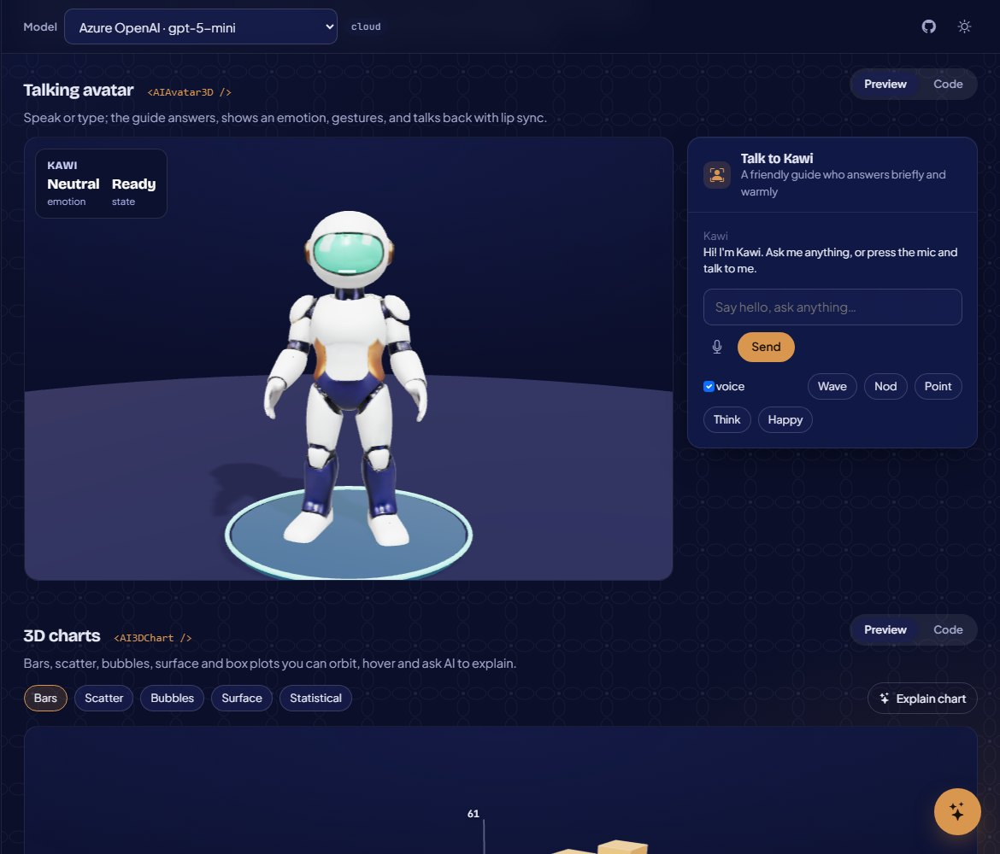

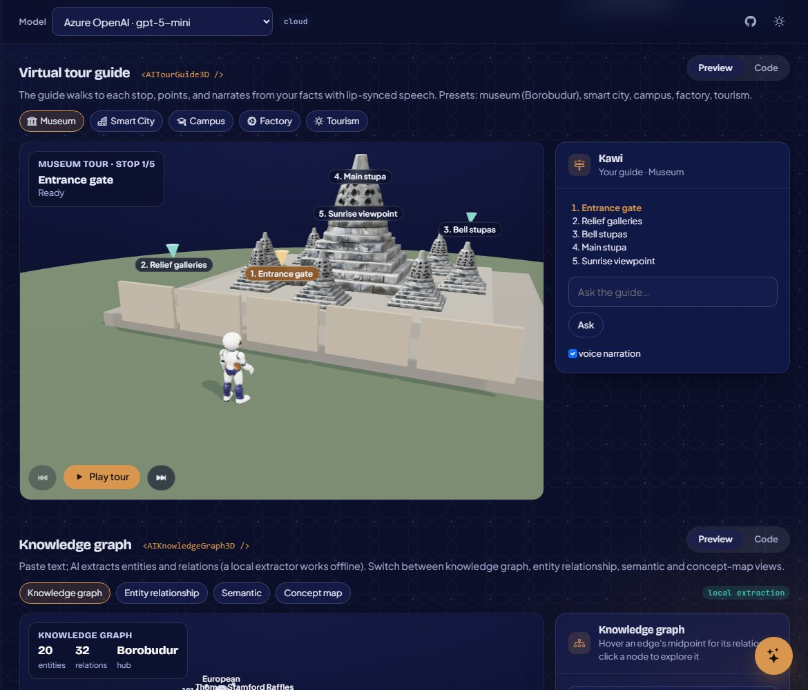

### AIAvatar3D

A talking 3D avatar: speech or text in, an AI reply with an emotion and gesture, and speech out with lip sync.

Base: `ThreeDComponentBase`.

| Parameter | Type | Default | Purpose |
|---|---|---|---|
| `Name` | `string` | `"Kawi"` | Avatar name. |
| `Persona` | `string` | `"A friendly guide who answers briefly and warmly"` | Personality used in the default system prompt. |
| `SystemPrompt` | `string?` | `null` | Replaces the default system prompt built from `Name` and `Persona`. |
| `Placeholder` | `string` | `"Say hello, ask anything…"` | Input placeholder. |
| `Greeting` | `string?` | `"Hi! I'm Kawi. Ask me anything, or press the mic and talk to me."` | First message. `null` shows none. |
| `SpeechLanguage` | `string` | `"en-US"` | BCP-47 language for speech in and out, for example `"id-ID"`. |
| `ModelUrl` | `string` | `ThreeDAssets.GuideBot` | Avatar model. |
| `OnReply` | `EventCallback<string>` | | Raised with each reply. |

```razor
<AIAvatar3D Name="Kawi" Persona="a museum guide for Borobudur" SpeechLanguage="id-ID" />
```

### AICompanion3D

An AI companion with memory, personality, goals and a visible emotional state; memories orbit the robot.

Base: `ThreeDComponentBase`. Uses `CompanionMemoryStore`, registered by `AddBlazorAIThreeD()`.

| Parameter | Type | Default | Purpose |
|---|---|---|---|
| `Name` | `string` | `"Sekar"` | Companion name. |
| `SpeechLanguage` | `string` | `"en-US"` | BCP-47 language for speech. |
| `Greeting` | `string` | `"Hi, I'm Sekar. I remember what you tell me and help with your goals. What should I call you?"` | First message. |

```razor
<AICompanion3D Name="Sekar" SpeechLanguage="id-ID" Greeting="Halo! Aku Sekar. Siapa namamu?" />
```

### AITourGuide3D

A robot guide walks between points of interest, points at each one and narrates it with lip-synced speech.

Base: `ThreeDComponentBase`.

| Parameter | Type | Default | Purpose |
|---|---|---|---|
| `Name` | `string` | `"Kawi"` | Guide name. |
| `Tour` | `string` | `"Museum"` | Preset tour: `Museum`, `Smart City`, `Campus`, `Factory` or `Tourism`. |
| `Preset` | `TourPreset?` | `null` | A custom tour (scenery and stops) used instead of `Tour`. |
| `SpeechLanguage` | `string` | `"en-US"` | BCP-47 language for speech. |
| `OnStopReached` | `EventCallback<TourStop>` | | Raised when the guide reaches a stop. |

```razor
<AITourGuide3D Tour="Museum" SpeechLanguage="id-ID" OnStopReached="stop => Log(stop.Name)" />
```

### Visualization

### AI3DChart

3D bar, scatter, bubble, surface and box charts with an AI-written insight.

Base: `ThreeDComponentBase`.

| Parameter | Type | Default | Purpose |
|---|---|---|---|
| `Title` | `string` | `"Regional sales"` | Card title. |
| `Mode` | `string` | `"Bars"` | `Bars`, `Scatter`, `Bubbles`, `Surface` or `Statistical`. |
| `Categories` | `IReadOnlyList<string>` | `["Q1", "Q2", "Q3", "Q4"]` | Bar categories (X axis). |
| `Series` | `IReadOnlyList<string>` | four island names | Bar series (Z axis). |
| `Values` | `double[][]` | sample sales | Bar values as `[series][category]`. |
| `Points` | `IReadOnlyList<(double X, double Y, double Z, double Size, int Group)>?` | `null` | Points for scatter and bubbles. `null` uses sample points. |
| `Surface` | `Func<double, double, double>?` | `null` | Surface function z = f(x, y) sampled on [-1, 1]². `null` uses a sample function. |
| `OnSelect` | `EventCallback<PickEvent>` | | Raised when a bar or point is clicked. |

```razor
<AI3DChart Title="Sales by island" Mode="Bars"
           Categories="@(["Q1","Q2","Q3","Q4"])" Series="@islands" Values="@sales" />
```

### AIClusterExplorer

Runs KMeans, DBSCAN, HDBSCAN or hierarchical clustering, shows the clusters in 3D and asks AI to name them.

Base: `ThreeDComponentBase`. Uses `AnalyticsDataset` from Blazor.AI.Analytics.

| Parameter | Type | Default | Purpose |
|---|---|---|---|
| `Title` | `string` | `"Cluster explorer"` | Card title. |
| `Algorithm` | `ClusterAlgorithm` | `ClusterAlgorithm.KMeans` | `KMeans`, `Dbscan`, `Hdbscan` or `Hierarchical`. |
| `K` | `int` | `4` | Number of clusters for KMeans and hierarchical. |
| `Epsilon` | `double` | `0.8` | Neighbourhood radius for DBSCAN. |
| `MinClusterSize` | `int` | `15` | Minimum cluster size for HDBSCAN. |
| `Dataset` | `AnalyticsDataset?` | `null` | Your own data; numeric columns are clustered. `null` uses the built-in samples. |
| `OnClustered` | `EventCallback<ClusterLayout>` | | Raised with labels, positions and the silhouette score. |

```razor
<AIClusterExplorer Algorithm="ClusterAlgorithm.Hdbscan" MinClusterSize="15"
                   Dataset="@SampleDatasets.Segments()" OnClustered="r => silhouette = r.Silhouette" />
```

### AIKnowledgeGraph3D

Extracts entities and relations from text and shows them as a 3D graph, in four views.

Base: `ThreeDComponentBase`.

| Parameter | Type | Default | Purpose |
|---|---|---|---|
| `Title` | `string` | `"Knowledge graph"` | Card title. |
| `Mode` | `string` | `"Knowledge graph"` | `Knowledge graph`, `Entity relationship`, `Semantic` or `Concept map`. |
| `Text` | `string` | a short text about Borobudur and Prambanan | Text to extract the graph from. |
| `Graph` | `ExtractedGraph?` | `null` | A graph to show instead of extracting one from `Text`. |
| `OnEntitySelected` | `EventCallback<GraphEntity>` | | Raised when an entity is clicked. |

```razor
<AIKnowledgeGraph3D Mode="Concept map" Text="@article" OnEntitySelected="e => selected = e.Name" />
```

### AIVectorSpaceViewer

Projects document, question and answer embeddings to 3D with PCA; a query shows its nearest neighbours.

Base: `ThreeDComponentBase`. Uses the provider's embedding model and falls back to offline hashing embeddings.

| Parameter | Type | Default | Purpose |
|---|---|---|---|
| `Title` | `string` | `"Vector space viewer"` | Card title. |
| `Source` | `IReadOnlyList<AIVectorSpaceViewer.VectorItem>?` | `null` | Items as `(Kind, Text)`. `null` uses samples. |
| `TopK` | `int` | `5` | Neighbours shown for a query. |

```razor
<AIVectorSpaceViewer Source="@items" TopK="5" />
```

### Agents

### AgentStudio3D

The agent ecosystem in 3D: agents as nodes and tools as satellites; edit agents in the side panel and run a task to watch the flow.

Base: `ThreeDComponentBase`. Requires `AddBlazorAIAgents()`.

| Parameter | Type | Default | Purpose |
|---|---|---|---|
| `OnAgentSaved` | `EventCallback<AgentDefinition>` | | Raised when an agent is saved. |

```razor
<AgentStudio3D OnAgentSaved="a => Console.WriteLine(a.Name)" />
```

### MultiAgentArena

Agents sit on a round arena and pass messages to each other as glowing packets while they work on a goal.

Base: `ThreeDComponentBase`. Requires `AddBlazorAIAgents()`.

| Parameter | Type | Default | Purpose |
|---|---|---|---|
| `Goal` | `string` | a sample goal | Task for the team. |
| `Mode` | `OrchestrationMode` | `OrchestrationMode.Sequential` | `Sequential`, `RoundRobin` or `Supervisor`. |
| `Team` | `IReadOnlyList<AgentDefinition>` | `MultiAgentArena.DefaultTeam` | Agents in speaking order. The default is research, planning, coding and evaluation agents. |
| `OnCompleted` | `EventCallback<IReadOnlyList<AgentMessage>>` | | Raised with the transcript. |

```razor
<MultiAgentArena Goal="Rancang aplikasi antrean puskesmas" Mode="OrchestrationMode.RoundRobin"
                 OnCompleted="msgs => transcript = msgs" />
```

### AgentMindMap3D

Shows an agent's plan for a goal as a reasoning tree, a planning graph with dependencies, or a simulated execution graph.

Base: `ThreeDComponentBase`.

| Parameter | Type | Default | Purpose |
|---|---|---|---|
| `Goal` | `string` | a sample goal | Goal to plan. |
| `View` | `string` | `"Reasoning tree"` | `Reasoning tree`, `Planning graph` or `Execution graph`. |
| `StepDelayMs` | `int` | `650` | Delay between steps when simulating execution. |
| `OnStepSelected` | `EventCallback<MindStep>` | | Raised when a step is clicked. |

```razor
<AgentMindMap3D Goal="Digitalise 120 village cooperatives in NTT" View="Execution graph" StepDelayMs="500" />
```

### Decision

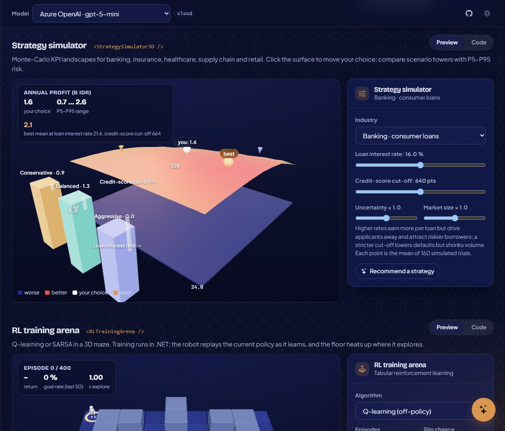

### DecisionTree3D

An interactive 3D decision tree: edit the case, watch it travel down the tree, and ask AI to explain the outcome.

Base: `ThreeDComponentBase`. Uses `DecisionTreeNode` from Blazor.AI.Decision.

| Parameter | Type | Default | Purpose |
|---|---|---|---|
| `Title` | `string` | `"Decision tree"` | Card title. |
| `Subtitle` | `string` | `"Customer churn risk"` | Card subtitle. |
| `Tree` | `DecisionTreeNode` | `DecisionTreeNode.ChurnSample()` | The tree. Conditions use the Blazor.AI.Decision expression language. |
| `Facts` | `IDictionary<string, object?>` | a sample customer | Input facts. |
| `OnDecided` | `EventCallback<DecisionTreeNode>` | | Raised with the leaf that was reached. |

```razor
<DecisionTree3D Tree="@loanTree" Facts="@applicant" Subtitle="Loan approval"
                OnDecided="leaf => outcome = leaf.Outcome" />
```

### RuleGraph3D

Business rules as a 3D graph: facts feed rules, rules write outcomes, fired rules glow, and variables written by several rules are flagged as conflicts.

Base: `ThreeDComponentBase`. Uses the Blazor.AI.Decision rule engine.

| Parameter | Type | Default | Purpose |
|---|---|---|---|
| `Title` | `string` | `"Rule graph"` | Card title. |
| `Rules` | `List<BusinessRule>` | `RuleGraph3DSamples.Rules()` | Rules to evaluate. |
| `Facts` | `IDictionary<string, object?>` | `RuleEditor.SampleFacts()` | Input facts. |
| `Mode` | `RuleMode` | `RuleMode.AllMatches` | `AllMatches` or `FirstMatch`. |
| `OnEvaluated` | `EventCallback<RuleEvaluation>` | | Raised after evaluation. |

```razor
<RuleGraph3D Rules="@rules" Facts="@order" OnEvaluated="r => fired = r.Fired.Count()" />
```

### StrategySimulator3D

Monte-Carlo simulation of a KPI over two levers, shown as a 3D landscape with your chosen point, the best point and scenario towers with P5–P95 risk.

Base: `ThreeDComponentBase`.

| Parameter | Type | Default | Purpose |
|---|---|---|---|
| `Title` | `string` | `"Strategy simulator"` | Card title. |
| `Preset` | `string` | `"banking"` | `banking`, `insurance`, `healthcare`, `supply` or `retail`. |
| `Model` | `StrategyPreset?` | `null` | A custom model used instead of the presets. |
| `Trials` | `int` | `160` | Monte-Carlo trials per grid point. |

```razor
<StrategySimulator3D Preset="supply" Trials="200" Language="Bahasa Indonesia" />
```

### Reinforcement learning

### RLTrainingArena

A robot learns a 3D grid world by Q-learning or SARSA; training runs in .NET and the current policy is replayed every few episodes.

Base: `ThreeDComponentBase`.

| Parameter | Type | Default | Purpose |
|---|---|---|---|
| `Title` | `string` | `"RL training arena"` | Card title. |
| `World` | `DesignedGridWorld?` | `null` | The grid. `null` uses a 9×7 maze with two traps. |
| `Algorithm` | `GridAlgorithm` | `GridAlgorithm.QLearning` | `QLearning` or `Sarsa`. |
| `Episodes` | `int` | `400` | Training episodes (clamped to 20–2000). |
| `Slip` | `double` | `0` | Probability that a move slips sideways. Applies to the built-in grid only. |
| `OnEpisode` | `EventCallback<GridEpisode>` | | Raised after each episode. |

```razor
<RLTrainingArena Algorithm="GridAlgorithm.Sarsa" Episodes="600" Slip="0.1"
                 OnEpisode="e => returns.Add(e.Return)" />
```

### RLPolicyViewer

Shows a learned policy as value columns and greedy-action arrows per cell, with a slider across training snapshots.

Base: `ThreeDComponentBase`.

| Parameter | Type | Default | Purpose |
|---|---|---|---|
| `Title` | `string` | `"Policy evolution"` | Card title. |
| `World` | `DesignedGridWorld?` | `null` | The grid. `null` uses the built-in maze. |
| `Algorithm` | `GridAlgorithm` | `GridAlgorithm.QLearning` | `QLearning` or `Sarsa`. |
| `Episodes` | `int` | `360` | Training episodes (clamped to 40–3000). |
| `Snapshots` | `int` | `24` | Snapshots kept across training (clamped to 4–60). |

```razor
<RLPolicyViewer Episodes="500" Snapshots="30" Algorithm="GridAlgorithm.QLearning" />
```

### RLBattleArena

A hunter and a runner learn against each other in a pursuit–evasion game, with a live scoreboard and match replay.

Base: `ThreeDComponentBase`.

| Parameter | Type | Default | Purpose |
|---|---|---|---|
| `Title` | `string` | `"RL battle arena"` | Card title. |
| `HunterPolicy` | `BattlePolicy` | `BattlePolicy.Learning` | `Learning`, `Heuristic` or `Random`. |
| `RunnerPolicy` | `BattlePolicy` | `BattlePolicy.Learning` | `Learning`, `Heuristic` or `Random`. |
| `Matches` | `int` | `4000` | Training matches (clamped to 200–20000). |

```razor
<RLBattleArena HunterPolicy="BattlePolicy.Learning" RunnerPolicy="BattlePolicy.Heuristic" Matches="6000" />
```

### RLEvolutionViewer

Evolves cart-pole controllers and shows generations as stacked rings, fitness as size and colour, the champion's lineage, and the champion balancing live.

Base: `ThreeDComponentBase`.

| Parameter | Type | Default | Purpose |
|---|---|---|---|
| `Title` | `string` | `"Evolution viewer"` | Card title. |
| `GenerationCount` | `int` | `18` | Generations to evolve (clamped to 2–60). |
| `Population` | `int` | `24` | Controllers per generation (clamped to 8–60). |
| `Mutation` | `double` | `0.35` | Mutation sigma (clamped to 0.01–2). |

```razor
<RLEvolutionViewer GenerationCount="25" Population="32" Mutation="0.3" />
```

### ResourceOptimizationArena

An RL policy allocates units to zones (towers show expected demand, stacked cubes show units) and is compared with baselines.

Base: `ThreeDComponentBase`.

| Parameter | Type | Default | Purpose |
|---|---|---|---|
| `Title` | `string` | `"Resource optimisation arena"` | Card title. |
| `Scenario` | `AllocationScenario?` | `null` | A custom scenario used instead of the built-in presets. |
| `TrainingDays` | `int` | `3000` | Simulated training days. |

```razor
<ResourceOptimizationArena Scenario="@depots" TrainingDays="4000" />
```

### Digital twins

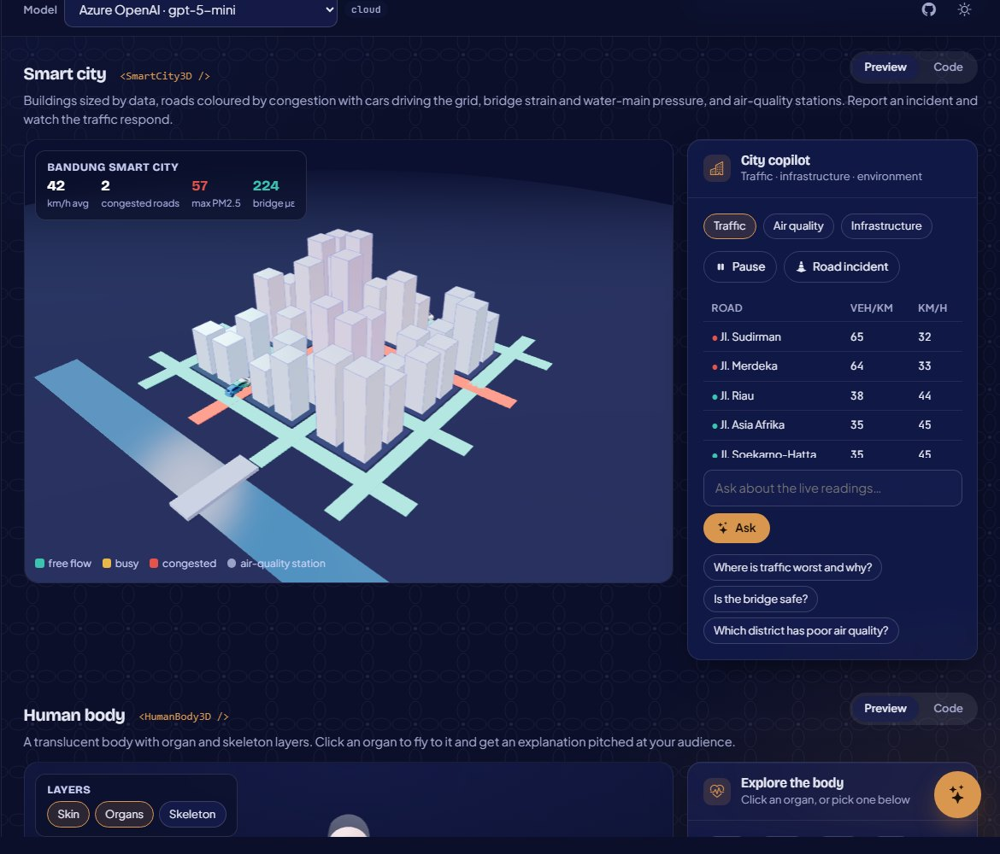

Each twin runs a `TwinSimulator` on a timer, colours the scene from the live readings and includes a `TwinCopilot`. The base is `TwinComponentBase`, so they also take `UpdatesPerSecond` and `AutoStart`.

### SmartFactory3D

A factory with production lines and robot cells, live OEE, predictive maintenance (remaining useful life) and an AI copilot.

Base: `TwinComponentBase`.

| Parameter | Type | Default | Purpose |
|---|---|---|---|
| `Title` | `string` | `"Plant Cikarang · Assembly"` | Card title. |
| `Lines` | `int` | `2` | Production lines (1–3). |
| `StationsPerLine` | `int` | `3` | Robot cells per line (2–4). |
| `IdealCycleSeconds` | `double` | `42` | Ideal cycle time per station in seconds, the OEE performance baseline. |

```razor
<SmartFactory3D Title="Plant Karawang · Line A/B" Lines="2" StationsPerLine="3"
                IdealCycleSeconds="40" Language="Bahasa Indonesia" />
```

### SmartBuilding3D

A building with floors and rooms coloured by energy, temperature or occupancy, people dots, security alerts and an AI copilot.

Base: `TwinComponentBase`.

| Parameter | Type | Default | Purpose |
|---|---|---|---|
| `Title` | `string` | `"Menara Kawung · HQ"` | Card title. |
| `Floors` | `int` | `4` | Number of floors (1–8). |
| `RoomArea` | `double` | `120` | Room footprint in square metres, used for energy intensity. |

```razor
<SmartBuilding3D Floors="5" RoomArea="140" UpdatesPerSecond="1" />
```

### SmartFarm3D

A farm with irrigation zones, soil-moisture tiles, growing maize, disease detection, yield prediction and an AI agronomist.

Base: `TwinComponentBase`.

| Parameter | Type | Default | Purpose |
|---|---|---|---|
| `Title` | `string` | `"Kebun Jagung Sleman"` | Card title. |
| `SeasonDays` | `int` | `110` | Length of the growing season in days. |
| `PotentialYield` | `double` | `9.5` | Attainable yield in t/ha under ideal conditions. |

```razor
<SmartFarm3D SeasonDays="110" PotentialYield="9.5" />
```

### SmartAquaculture3D

Net cages with swimming fish, water quality, growth prediction and feeding optimisation.

Base: `TwinComponentBase`.

| Parameter | Type | Default | Purpose |
|---|---|---|---|
| `Title` | `string` | `"Waduk Jatiluhur"` | Card title. |
| `FishPerCage` | `int` | `6000` | Fish stocked per cage. |
| `HarvestWeight` | `double` | `500` | Harvest weight in grams. |
| `VisibleFish` | `int` | `9` | Fish models drawn per cage, as a visual sample of the stock. |

```razor
<SmartAquaculture3D Title="Keramba Waduk Jatiluhur" FishPerCage="6000" HarvestWeight="500" />
```

### SmartCity3D

A city with data-driven building heights, traffic per road, moving cars, bridge and utility health, air-quality bubbles and an AI copilot.

Base: `TwinComponentBase`.

| Parameter | Type | Default | Purpose |
|---|---|---|---|
| `Title` | `string` | `"Bandung Smart City"` | Card title. |
| `BlockValues` | `IReadOnlyList<double>?` | `null` | One value per city block, row-major (for example population density), which sets building heights. The city has 9 blocks; fewer than 9 values uses the sample. |

```razor
<SmartCity3D BlockValues="@densityIndex" />
```

### TwinCopilot

Answers questions about a live digital twin from a snapshot of its readings, trends and events; offline, a local diagnosis answers. The twins above include it; use it directly with your own `TwinSimulator`.

Base: `AiComponentBase`.

| Parameter | Type | Default | Purpose |
|---|---|---|---|
| `Simulator` | `TwinSimulator` | | Required. The simulator to read. |
| `Role` | `string` | `"an operations engineer for this digital twin"` | Who the copilot is. |
| `Context` | `Func<string>?` | `null` | Extra facts appended to the snapshot, such as KPIs computed by the host. |
| `Placeholder` | `string` | `"Ask about the live readings…"` | Input placeholder. |
| `Suggestions` | `IReadOnlyList<string>` | `[]` | Starter questions. |
| `Language` | `string?` | `null` | Language of the answer. |

```razor
<TwinCopilot Simulator="@sim" Role="a plant reliability engineer" Context="@Kpis" />
```

### Health & biotech

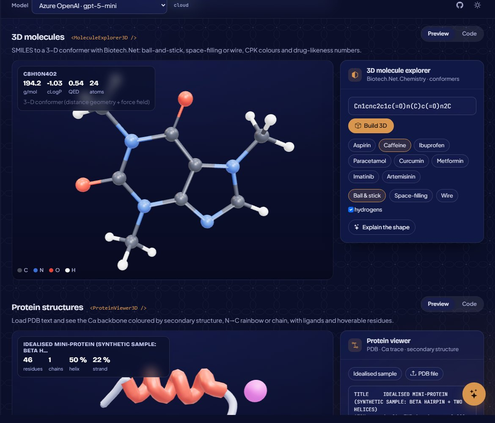

### HumanBody3D

An anatomy viewer with a translucent body, organ and skeleton layers; click an organ to focus on it and learn about it.

Base: `ThreeDComponentBase`.

| Parameter | Type | Default | Purpose |
|---|---|---|---|
| `Audience` | `string` | `"a high-school student"` | Who the explanations are written for. |
| `OnOrganSelected` | `EventCallback<HumanBody3D.Organ>` | | Raised when an organ is selected. |

```razor
<HumanBody3D Audience="a nursing student" Language="Bahasa Indonesia" OnOrganSelected="o => selected = o.Name" />
```

### MoleculeExplorer3D

Builds a 3D molecule from SMILES (conformer embedding) and shows it as ball-and-stick, space-filling or wire with CPK colours, descriptors and an AI explanation.

Base: `ThreeDComponentBase`. Uses Biotech.Net through Blazor.AI.Bio.

| Parameter | Type | Default | Purpose |
|---|---|---|---|
| `Title` | `string` | `"3D molecule explorer"` | Card title. |
| `Smiles` | `string?` | `BioSamples.Molecules[1].Smiles` (caffeine) | Molecule as SMILES. |

```razor
<MoleculeExplorer3D Smiles="CC(=O)Oc1ccccc1C(=O)O" />
```

### ProteinViewer3D

Shows a PDB structure as a Cα trace tube coloured by chain, N→C rainbow or secondary structure; residues show a tooltip on hover.

Base: `ThreeDComponentBase`.

| Parameter | Type | Default | Purpose |
|---|---|---|---|
| `Title` | `string` | `"Protein viewer"` | Card title. |
| `Pdb` | `string?` | `null` | PDB text. `null` uses a synthetic sample. |
| `MaxMarkers` | `int` | `350` | Maximum residues drawn as pickable markers. |

```razor
<ProteinViewer3D Pdb="@pdbText" MaxMarkers="300" />
```

### GeneNetwork3D

A gene co-expression network: Pearson correlation of log expression for the most variable genes, laid out in 3D and coloured by fold change.

Base: `ThreeDComponentBase`. Uses Blazor.AI.Bio.

| Parameter | Type | Default | Purpose |
|---|---|---|---|
| `Title` | `string` | `"Gene network explorer"` | Card title. |
| `Counts` | `Dataset?` | `null` | Counts as genes × samples with a `condition` annotation. `null` uses a synthetic stress experiment. |
| `Reference` | `string` | `"control"` | Reference condition. |
| `Treatment` | `string` | `"treated"` | Treatment condition. |

```razor
<GeneNetwork3D Counts="@counts" Reference="control" Treatment="treated" />
```

### MedicalTrainingSimulator

Resuscitation training with a 3D patient, a vitals monitor driven by a BLS state machine, scoring and an AI debrief.

Base: `ThreeDComponentBase`.

| Parameter | Type | Default | Purpose |
|---|---|---|---|
| `Title` | `string` | `"Resuscitation trainer"` | Card title. |
| `Briefing` | `string` | a collapsed-patient scenario | Scenario text shown at the start. |
| `Audience` | `string` | `"a nursing student"` | Who the debrief is written for. |
| `OnFinished` | `EventCallback<CprScenario>` | | Raised when the scenario ends, with the score and log. |

```razor
<MedicalTrainingSimulator Audience="a first-year medical student" OnFinished="s => SaveScore(s.Score, s.Log)" />
```

### Engineering

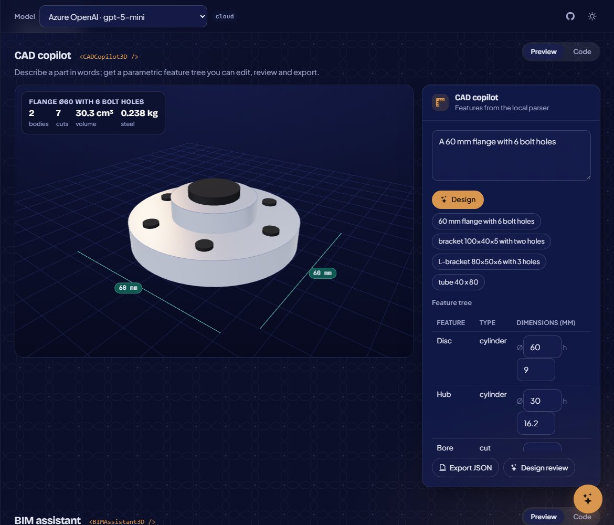

### CADCopilot3D

Turns a description into a parametric part: AI (or a local parser) writes a feature list, you edit the dimensions, and you can export JSON.

Base: `ThreeDComponentBase`.

| Parameter | Type | Default | Purpose |
|---|---|---|---|
| `OnPartChanged` | `EventCallback<CadPart>` | | Raised when the part changes. |

```razor
<CADCopilot3D OnPartChanged="part => Save(part.ToJson())" />
```

### BIMAssistant3D

Ask questions about a building model: AI maps the question to a query, .NET computes the answer over the elements and highlights them.

Base: `ThreeDComponentBase`.

| Parameter | Type | Default | Purpose |
|---|---|---|---|
| `Elements` | `IReadOnlyList<BimElement>?` | `null` | Building elements. `null` uses a two-storey sample with a deliberate duct clash. |

```razor
<BIMAssistant3D Elements="@myElements" Language="Bahasa Indonesia" />
```

### EngineeringSimulation3D

CFD, FEM, thermal and structural analysis computed in C# and shown in 3D, with an AI explanation of the results.

Base: `ThreeDComponentBase`.

| Parameter | Type | Default | Purpose |
|---|---|---|---|
| `InitialMode` | `string` | `"CFD"` | Mode to open first: `CFD`, `FEM`, `Thermal` or `Structural`. |

```razor
<EngineeringSimulation3D InitialMode="FEM" />
```

### MeshOptimizationStudio

Mesh decimation shown side by side (original and optimised), with triangle budgets, LOD measurement and AI recommendations.

Base: `ThreeDComponentBase`.

| Parameter | Type | Default | Purpose |
|---|---|---|---|
| `Url` | `string?` | `null` | glTF/GLB model to open. `null` uses `ThreeDAssets.Stupa`. |

```razor
<MeshOptimizationStudio Url="@ThreeDAssets.Stupa" />
```

### Education

### AIClassroom3D

A virtual classroom: AI writes a lesson and quiz, and the robot teacher presents each point at the board with lip sync.

Base: `ThreeDComponentBase`.

| Parameter | Type | Default | Purpose |
|---|---|---|---|
| `SpeechLanguage` | `string` | `"en-US"` | BCP-47 language for the teacher's voice. |

```razor
<AIClassroom3D SpeechLanguage="id-ID" Language="Bahasa Indonesia" />
```

### SolarSystemExplorer

The Sun and eight planets with orbits at relative speeds, readable or true-ratio distances, facts and AI questions and answers per planet.

Base: `ThreeDComponentBase`.

| Parameter | Type | Default | Purpose |
|---|---|---|---|
| `Focus` | `string?` | `null` | Planet to select first. |

```razor
<SolarSystemExplorer Focus="Jupiter" Height="560px" />
```

### HistoryExplorer3D

Historical sites in 3D (Borobudur, Prambanan) with story hotspots, a timeline that rebuilds the site per era, and an AI narrator.

Base: `ThreeDComponentBase`.

| Parameter | Type | Default | Purpose |
|---|---|---|---|
| `InitialSite` | `string` | `"Borobudur"` | Site to open first: `Borobudur` or `Prambanan`. |

```razor
<HistoryExplorer3D InitialSite="Prambanan" Language="Bahasa Indonesia" />
```

### ScienceLab3D

A virtual lab with a pendulum (RK4), projectile motion and an Ohm's-law circuit, computed in C#, animated in 3D, plotted and explained.

Base: `ThreeDComponentBase`.

| Parameter | Type | Default | Purpose |
|---|---|---|---|
| `InitialExperiment` | `string` | `"Pendulum"` | Experiment to open first: `Pendulum`, `Projectile` or `Ohm's law`. |

```razor
<ScienceLab3D InitialExperiment="Pendulum" />
```

### Gaming

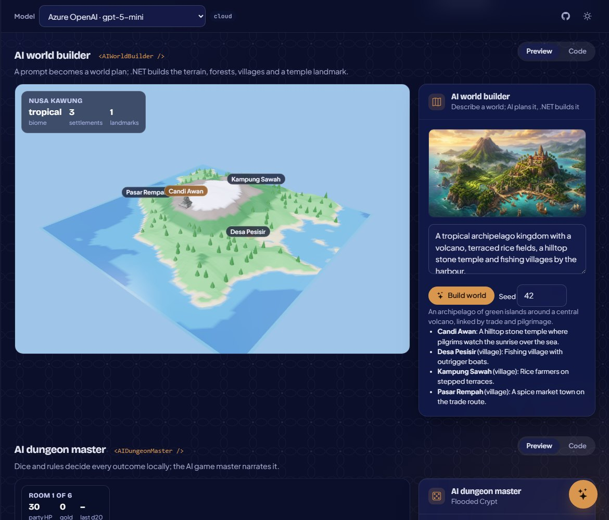

### NPCStudio

Generates NPCs with personality, backstory, dialogue and stats, shows a 3D preview with emotes, and lets you chat with them in character.

Base: `ThreeDComponentBase`.

| Parameter | Type | Default | Purpose |
|---|---|---|---|
| `OnGenerated` | `EventCallback<NPCStudio.Npc>` | | Raised with each generated NPC. |

```razor
<NPCStudio OnGenerated="npc => SaveNpc(npc)" />
```

### AIQuestGenerator

Generates a quest chain (steps, objectives, rewards, branches) from a theme and lays it out as waypoints on a 3D map.

Base: `ThreeDComponentBase`.

| Parameter | Type | Default | Purpose |
|---|---|---|---|
| `OnGenerated` | `EventCallback<AIQuestGenerator.Quest>` | | Raised with each generated quest. |

```razor
<AIQuestGenerator OnGenerated="quest => questLog.Add(quest)" />
```

### AIWorldBuilder

Turns a prompt into a world plan (biome, landmarks, settlements) and builds a procedural 3D world with forests, villages and a temple.

Base: `ThreeDComponentBase`. No other parameters.

```razor
<AIWorldBuilder Height="600px" />
```

### AIDungeonMaster

An AI game master on a 3D tabletop dungeon: dice are rolled locally, rules decide outcomes, and the model narrates.

Base: `ThreeDComponentBase`.

| Parameter | Type | Default | Purpose |
|---|---|---|---|
| `Party` | `IReadOnlyList<string>` | `["Arjuna the archer", "Sinta the healer", "Bima the warrior"]` | Party members shown as tokens. |

```razor
<AIDungeonMaster Party="@(["Arjuna the archer", "Sinta the healer"])" />
```

### ProceduralWorldStudio

Seeded procedural terrain (fBm noise, island falloff, ridges, thermal erosion); AI turns a description into generator settings.

Base: `ThreeDComponentBase`.

| Parameter | Type | Default | Purpose |
|---|---|---|---|
| `Seed` | `int` | `1337` | Initial random seed. |
| `OnGenerated` | `EventCallback<Terrain>` | | Raised with each generated terrain. |

```razor
<ProceduralWorldStudio Seed="2026" OnGenerated="terrain => heightmap = terrain" />
```

### Enterprise

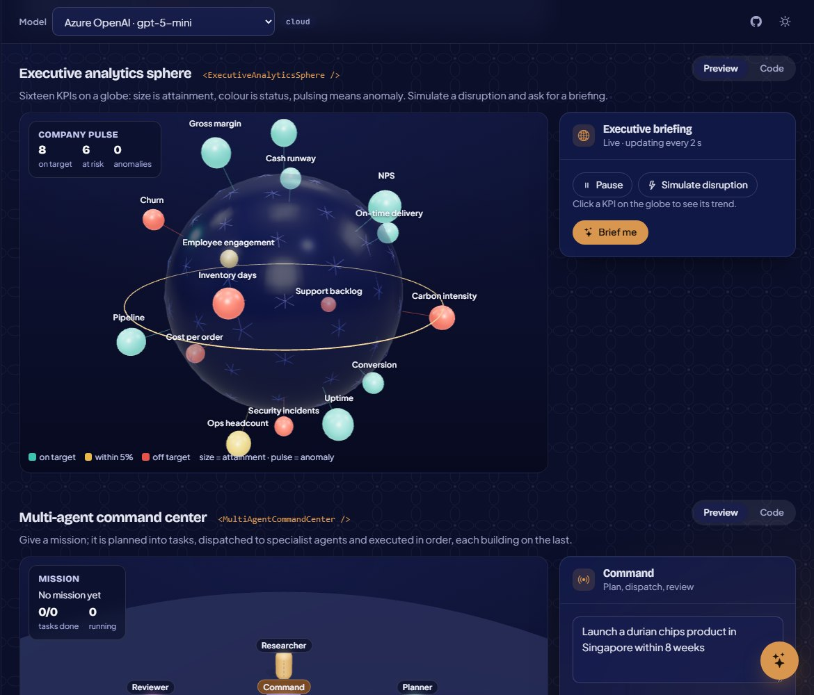

### DigitalTwinPlatform

A multi-site digital twin (site, area, asset) with live health and temperature, alarms, remaining useful life and an AI maintenance copilot.

Base: `ThreeDComponentBase`.

| Parameter | Type | Default | Purpose |
|---|---|---|---|
| `IntervalMs` | `int` | `1500` | Update interval in milliseconds (minimum 500). |

```razor
<DigitalTwinPlatform IntervalMs="1500" Height="560px" />
```

### EnterpriseKnowledgeGraph3D

An enterprise knowledge graph of teams, systems, datasets, documents and people, with search, domain filters and graph questions and answers.

Base: `ThreeDComponentBase`.

| Parameter | Type | Default | Purpose |
|---|---|---|---|
| `Nodes` | `IReadOnlyList<EnterpriseKnowledgeGraph3D.EnterpriseNode>` | a sample company | Nodes as `(Name, Type, Domain)`. |
| `Edges` | `IReadOnlyList<EnterpriseKnowledgeGraph3D.EnterpriseLink>` | a sample company | Links as `(From, Relation, To)`. |

```razor
<EnterpriseKnowledgeGraph3D Nodes="@nodes" Edges="@edges" />
```

### EnterpriseAgentOperationsCenter

A fleet of AI agents shown as towers (height is throughput, colour is error rate, ring is the latency SLO), with incidents and an AI operations summary.

Base: `ThreeDComponentBase`.

| Parameter | Type | Default | Purpose |
|---|---|---|---|
| `LatencySloMs` | `double` | `2500` | Latency service-level objective in milliseconds. |

```razor
<EnterpriseAgentOperationsCenter LatencySloMs="2000" />
```

### ExecutiveAnalyticsSphere

Executive KPIs on a globe: position is the domain, size is attainment, colour is on or off target, and a pulse marks an anomaly.

Base: `ThreeDComponentBase`.

| Parameter | Type | Default | Purpose |
|---|---|---|---|
| `Title` | `string` | `"Company pulse"` | Card title. |
| `Kpis` | `IReadOnlyList<LiveMetric>?` | `null` | Your own KPIs. `null` uses a simulated company. |
| `IntervalMs` | `int` | `2000` | Update interval in milliseconds (minimum 500). |

```razor
<ExecutiveAnalyticsSphere Title="Board pulse" Kpis="@kpis" IntervalMs="5000" />
```

### MultiAgentCommandCenter

Mission control for agent teams: plans a mission into tasks, dispatches them to specialist agents and shows the execution in 3D.

Base: `ThreeDComponentBase`.

| Parameter | Type | Default | Purpose |
|---|---|---|---|
| `Agents` | `IReadOnlyList<string>` | `["Researcher", "Planner", "Analyst", "Writer", "Reviewer"]` | Specialist roles on the team. |

```razor
<MultiAgentCommandCenter Language="Bahasa Indonesia" />
```

### AutonomousOperationsDashboard

A closed loop of sense, analyse, decide and act: decisions at or above the confidence threshold execute automatically, the rest wait for a human.

Base: `ThreeDComponentBase`.

| Parameter | Type | Default | Purpose |
|---|---|---|---|
| `Threshold` | `double` | `0.85` | Confidence at or above which a decision executes automatically. |
| `IntervalMs` | `int` | `3500` | Length of one loop cycle in milliseconds (minimum 1000). |

```razor
<AutonomousOperationsDashboard Threshold="0.9" IntervalMs="3000" />
```

---

## Blazor.AI.MediaPipe

Package: `Blazor.AI.MediaPipe` · Namespace: `Blazor.AI.MediaPipe`

```csharp
builder.Services.AddBlazorAIMediaPipe(o => o.PreloadModels = true);
```

```html
<link rel="stylesheet" href="_content/Blazor.AI.MediaPipe/blazor-ai-vision.css" />
```

`AddBlazorAIMediaPipe()` registers `VisionModelManager`, the per-user `FaceGallery` and `VisionEventStream`, the default `IFaceEmbedder`, a model preloader, and raises the Blazor Server hub message limit so JPEG frames fit. The components build on `AddBlazorAIComponents()`. Use Interactive Server render mode: inference runs on the server with MediaPipe.NET on ONNX Runtime, which does not run in browser WebAssembly. Components that show a 3D view (`FaceMeshViewer`, the avatar and motion components, and the 3D group) also need `_content/Blazor.AI.ThreeD/blazor-ai-3d.css`. See [Computer vision](vision.md) for how frames flow and how to build your own vision component.

```razor
@using Blazor.AI.MediaPipe
```

`MediaPipeVisionOptions`, set in the `AddBlazorAIMediaPipe` callback:

| Option | Type | Default | Purpose |
|---|---|---|---|
| `Provider` | `ExecutionProvider` | `ExecutionProvider.Auto` | ONNX Runtime execution provider: `Auto`, `Cpu`, `Cuda`, `DirectML` or `CoreML`. |
| `ModelDirectory` | `string?` | `null` | Folder with pre-downloaded models for offline and edge sites. `null` uses the MediaPipeNet cache. |
| `AllowModelDownload` | `bool` | `true` | Downloads missing models on first use. Turn off for air-gapped sites. |
| `PreloadModels` | `bool` | `false` | Downloads the common models at startup instead of on first use. |
| `MaxFrameMessageBytes` | `long` | `2 * 1024 * 1024` | Largest frame message the hub accepts. Frames are usually 15–60 KB. |

### Common vision parameters

Most components inherit `VisionComponentBase`, which inherits `AiComponentBase`. They take the [common parameters](#common-parameters) (`Provider`, `Class`, `OnError`, unmatched attributes) plus:

| Parameter | Type | Default | Purpose |
|---|---|---|---|
| `Height` | `string` | `"420px"` | CSS height of the camera view. |
| `Samples` | `IReadOnlyList<VisionSample>?` | `null` | Sample pictures offered when no camera is used. `null` uses the component's own samples. |
| `StartWithCamera` | `bool` | `false` | Starts the webcam instead of the first sample. |
| `Fps` | `double` | `12` | Frames per second requested from live sources. |
| `Language` | `string?` | `null` | Language of AI answers. `null` follows the model's default. |

Each frame is processed off the circuit thread; live sources use MediaPipe VIDEO mode (tracking and smoothing) and stills use IMAGE mode. Detection, landmarks, angles and counts run in .NET; the model only explains computed facts, with the frame attached for vision-capable models and the facts alone for text-only models.

Solution components (healthcare, agritech, education, industry and some analytics) inherit `SolutionComponentBase`, which inherits `VisionComponentBase` and adds:

| Parameter | Type | Default | Purpose |
|---|---|---|---|
| `Events` | `VisionEventStream?` | `null` | Stream the component publishes events into. `null` uses the per-user stream registered by `AddBlazorAIMediaPipe()`. |
| `OnEvent` | `EventCallback<VisionEvent>` | | Raised for every event the component publishes. |
| `SourceName` | `string?` | `null` | Event source name. `null` uses the component type name. |

It also exposes `CameraStats` (`VisionStats?`) for `RealtimeMetrics`. Warning and alert events are written to the guardrail audit trail.

`EventTimeline` and `VisionDashboard` inherit `StreamComponentBase`, which inherits `AiComponentBase` and adds:

| Parameter | Type | Default | Purpose |
|---|---|---|---|
| `Events` | `VisionEventStream?` | `null` | Stream to show. `null` uses the per-user stream registered by `AddBlazorAIMediaPipe()`. |
| `RefreshMs` | `int` | `400` | Minimum time in milliseconds between re-renders while events arrive. |

Pass the same `VisionEventStream` instance to producers and views to connect them on one page.

### Helper types

- `VisionSamples`: sample photos shipped in the package (`Face`, `ThumbsUp`, `Yoga`, `Street`, `Food`, `OpenPalms`, `DeskPosture`, `Fall`, `Construction`, `Warehouse`, `Shelf`, `LeafDisease`, `Fruit`, `Livestock`, `Fish`) and sets of them (`People`, `Hands`, `Bodies`, `Scenes`, `Agritech`, `All`). `VisionSample` is a `(Name, Url)` record.
- `VisionMath`: joint angles in 2-D (`Angle`) and from 3-D world landmarks (`Angle3`), `Distance`, `ExtendedFingers`, `CountFingers`, `EyeAspectRatio` and a rough `HeadPose` (yaw, pitch).
- `Overlay`: builds `VisionOverlay` parts from MediaPipe.NET results (`Hand`, `Pose`, `Face`, `Box`, `Mask`, `CategoryTint`, `Label`, `Bounds`) and holds the theme colours (`Nila`, `Soga`, `Tarum`, `Danger`, `Warning`, `White`). Overlay coordinates are normalized to 0–1.
- `FaceGallery`: per-user (scoped) store of enrolled faces with `Enroll`, `Remove`, `Match` (best cosine similarity) and a `Changed` event. Used by `FaceAttendance`.
- `IFaceEmbedder`: turns a detected face into an identity vector. The default `MeshFaceEmbedder` embeds an eye-aligned face crop with MobileNet; it is demo-grade, not biometric-grade. Register your own (for example an ArcFace ONNX model) to replace it.
- `VisionModelManager`: model catalogue (`CommonModels`, `AllModels`), `FindLocal`, `EnsureAsync` for pre-download with progress, and `AvailableProviders`.
- `VisionEventStream`: thread-safe in-memory stream of `VisionEvent` records (`Publish`, `Snapshot`, `Clear`, `Published` event, `Capacity` 2000). `VisionEventStream.Shared` is a process-wide instance for demos.

### Core


### CameraViewer

The universal camera every vision component builds on: webcam or mobile camera, sample or uploaded images, video files and HTTP streams, with overlays, mirroring, snapshots and recording.

No AI calls. Does not inherit a base class.

| Parameter | Type | Default | Purpose |
|---|---|---|---|
| `OnFrame` | `Func<VisionFrame, Task<VisionOverlay?>>?` | `null` | Called for every frame; returns the overlay to draw, or `null`. Runs on the circuit, so offload heavy work. |
| `OnSourceChanged` | `EventCallback<VisionSourceKind>` | | Raised when the source changes. Reset tracking state here. |
| `Samples` | `IReadOnlyList<VisionSample>` | `VisionSamples.People` | Sample pictures in the toolbar. |
| `InitialImage` | `string?` | `null` | First picture to show. `null` uses the first sample. |
| `StartWithCamera` | `bool` | `false` | Starts the webcam immediately (some browsers need a user gesture). |
| `AllowCamera` | `bool` | `true` | Shows the camera button. |
| `AllowStreamUrl` | `bool` | `true` | Shows the URL button for streams, videos and images. |
| `ShowToolbar` | `bool` | `true` | Shows the source toolbar. |
| `FacingMode` | `string` | `"user"` | Camera facing mode for `getUserMedia`, for example `"environment"` for a rear camera. |
| `Fps` | `double` | `12` | Frames per second requested from live sources. The actual rate is limited by processing time. |
| `MaxWidth` | `int` | `640` | Frames are scaled to this width before upload. |
| `Height` | `string` | `"420px"` | CSS height. |
| `Class` | `string?` | `null` | Extra CSS classes for the root element. |
| `ChildContent` | `RenderFragment?` | `null` | HTML overlay (HUD) drawn on top of the picture. |

Properties: `Stats` (`VisionStats`: fps, latency, frames, width, height), `Source` (`VisionSourceKind`) and `LastJpeg` (the last frame received). Methods:

- `StartAsync(VisionSourceKind source, string? url)`: switches source (`Image`, `Camera`, `Video` or `Stream`); returns `null` on success or a message.
- `UseSampleAsync(string? url)`: shows a sample picture.
- `ReprocessAsync()`: processes the current still image again after a setting changes.
- `SnapshotAsync(bool withOverlay = true)`: JPEG data URL of the picture, with its overlay by default.
- `StartRecordingAsync(int fps = 24)` and `StopRecordingAsync()`: records the picture with its overlay; stopping returns an object URL of the WebM clip.
- `DownloadAsync(string url, string fileName)`: saves a snapshot or clip in the browser.
- `SetOverlayAsync(VisionOverlay? overlay)`: draws an overlay directly (for replays), bypassing `OnFrame`.
- `StopAsync()`: stops the current source.

```razor
@inherits VisionComponentBase

<CameraViewer @ref="Camera" OnFrame="HandleFrameAsync" OnSourceChanged="HandleSourceChanged" Samples="@EffectiveSamples" />
```

### VisionCanvas

Shows a still image with an overlay you supply, for apps that run their own inference. No camera and no processing.

No AI calls. Does not inherit a base class.

| Parameter | Type | Default | Purpose |
|---|---|---|---|
| `ImageUrl` | `string?` | `null` | Image URL: relative, absolute with CORS, or a data URL. |
| `ImageBytes` | `byte[]?` | `null` | Encoded image bytes (JPEG or PNG), used when `ImageUrl` is `null`. |
| `ContentType` | `string` | `"image/jpeg"` | Content type of `ImageBytes`. |
| `Overlay` | `VisionOverlay?` | `null` | What to draw over the image, in normalized coordinates. |
| `Height` | `string` | `"360px"` | CSS height. |
| `Class` | `string?` | `null` | Extra CSS classes. |

```razor
<VisionCanvas ImageBytes="@jpeg" Overlay="@overlay" Height="360px" />
```

### VisionRecorder

Records clips of the picture with its overlay, takes screenshots, and keeps evidence snapshots automatically when a trigger fires (for example when the face count changes).

Base: `VisionComponentBase`.

| Parameter | Type | Default | Purpose |
|---|---|---|---|
| `Title` | `string` | `"Vision recorder"` | Card title. |
| `SnapshotCooldownSeconds` | `double` | `3` | Minimum seconds between automatic snapshots. |
| `OnEvidence` | `EventCallback<EvidenceSnapshot>` | | Raised for each evidence snapshot (data URL, time and reason). |

```razor
<VisionRecorder SnapshotCooldownSeconds="5" OnEvidence="Store" />
```

### ModelManagerPanel

The model catalogue for offline and edge deployments: what is on disk, sizes and licences, and pre-download with progress.

No AI calls. Does not inherit a base class. Uses `VisionModelManager`.

| Parameter | Type | Default | Purpose |
|---|---|---|---|
| `Title` | `string` | `"Vision models"` | Card title. |
| `Class` | `string?` | `null` | Extra CSS classes. |

```razor
<ModelManagerPanel />
```

### Face

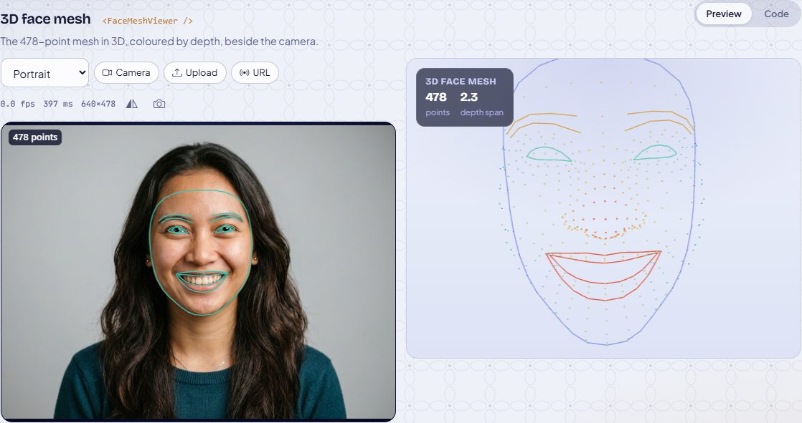

### FaceDetectionPanel

Real-time face detection: boxes, six keypoints and confidence with short- or full-range models, and an optional privacy blur.

Base: `VisionComponentBase`.

| Parameter | Type | Default | Purpose |
|---|---|---|---|
| `Title` | `string` | `"Face detection"` | Card title. |
| `PrivacyBlur` | `bool` | `false` | Starts with faces blurred in the picture. |
| `OnCountChanged` | `EventCallback<int>` | | Raised when the number of faces changes. |

```razor
<FaceDetectionPanel PrivacyBlur="true" OnCountChanged="n => visitors = n" />
```

### FaceLandmarkViewer

The 478-point face mesh with contours, head pose, eye openness and the strongest of the 52 blendshapes.

Base: `VisionComponentBase`.

| Parameter | Type | Default | Purpose |
|---|---|---|---|
| `Title` | `string` | `"Face landmarks"` | Card title. |
| `OnResult` | `Action<FaceLandmarkResult>?` | `null` | Called with each frame's result, on the processing thread. |

```razor
<FaceLandmarkViewer StartWithCamera="true" OnResult="r => faces = r.Faces.Count" />
```

### FaceMeshViewer

The 478-point face mesh rendered in 3D with Three.js, coloured by depth, beside the camera.

Base: `VisionComponentBase`. Needs the Blazor.AI.ThreeD stylesheet.

| Parameter | Type | Default | Purpose |
|---|---|---|---|
| `Title` | `string` | `"3D face mesh"` | Card title. |
| `SceneRate` | `double` | `5` | Maximum 3D scene updates per second (the camera itself runs faster). |

```razor
<FaceMeshViewer SceneRate="8" StartWithCamera="true" />
```

### FaceBlendshapeAnalyzer

Expression analysis: smile, angry, sad, surprised and neutral from the 52 face blendshapes, live and as a trend.

Base: `VisionComponentBase`.

| Parameter | Type | Default | Purpose |
|---|---|---|---|
| `Title` | `string` | `"Expression analyzer"` | Card title. |
| `HistoryLength` | `int` | `60` | Number of samples the trend keeps. |
| `OnExpression` | `Action<FaceExpression>?` | `null` | Called with each frame's expression, on the processing thread. |

```razor
<FaceBlendshapeAnalyzer HistoryLength="90" OnExpression="e => mood = e.Dominant" />
```

### FaceAttendance

Attendance: enrol people from the camera, then recognised faces are checked in once per window and can be exported as CSV.

Base: `VisionComponentBase`. Uses `FaceGallery` and `IFaceEmbedder`, registered by `AddBlazorAIMediaPipe()`.

| Parameter | Type | Default | Purpose |
|---|---|---|---|
| `Title` | `string` | `"Face attendance"` | Card title. |
| `Threshold` | `double` | `0.82` | Cosine similarity needed to count as the same person. |
| `DeduplicationWindow` | `TimeSpan` | `TimeSpan.FromMinutes(30)` | A person is not checked in again within this window. |
| `OnCheckIn` | `EventCallback<CheckIn>` | | Raised for each check-in (name, time, similarity). |

```razor
<FaceAttendance Threshold="0.85" DeduplicationWindow="@TimeSpan.FromHours(4)" OnCheckIn="Save" />
```

### FaceVerification

1:1 face verification: capture a reference and a probe, compare them, and use blinks as a liveness hint.

Base: `VisionComponentBase`. Uses `IFaceEmbedder`.

| Parameter | Type | Default | Purpose |
|---|---|---|---|
| `Title` | `string` | `"Face verification"` | Card title. |
| `Threshold` | `double` | `0.82` | Cosine similarity needed for a match. |
| `OnVerified` | `EventCallback<(double Similarity, bool Matched, int Blinks)>` | | Raised after each verification. |

```razor
<FaceVerification Threshold="0.86" OnVerified="r => approved = r.Matched && r.Blinks > 0" />
```

### FaceAnalyticsDashboard

Audience analytics: face count over time, emotion trend, attention from head pose, and a slot for your own age/gender estimator.

Base: `VisionComponentBase`.

| Parameter | Type | Default | Purpose |
|---|---|---|---|
| `Title` | `string` | `"Face analytics"` | Card title. |
| `Estimator` | `IFaceAttributeEstimator?` | `null` | Optional age/gender estimator. None ships by default. |
| `AttentionDegrees` | `double` | `22` | A face counts as attentive when yaw and pitch are both within this many degrees. |
| `MaxFaces` | `int` | `6` | Maximum faces tracked per frame (clamped to 1–10). |
| `HistoryLength` | `int` | `120` | Number of samples the trends keep. |

```razor
<FaceAnalyticsDashboard Estimator="@estimator" AttentionDegrees="20" Language="Bahasa Indonesia" />
```

### Hands


### HandTracker

21-point hand tracking with handedness, fingertip highlights, finger states and measurements in centimetres from world landmarks.

Base: `VisionComponentBase`.

| Parameter | Type | Default | Purpose |
|---|---|---|---|
| `Title` | `string` | `"Hand tracker"` | Card title. |
| `MaxHands` | `int` | `2` | Maximum hands tracked. |
| `OnResult` | `Action<HandLandmarkResult>?` | `null` | Called with each frame's hands, on the processing thread. |

```razor
<HandTracker MaxHands="2" OnResult="r => hands = r.Hands.Count" />
```

### GestureRecognizerPanel

Gesture recognition (thumbs up and down, victory, pointing, open palm, fist, I love you) plus custom gestures you teach by example.

Base: `VisionComponentBase`.

| Parameter | Type | Default | Purpose |
|---|---|---|---|
| `Title` | `string` | `"Gesture recognizer"` | Card title. |
| `MinScore` | `float` | `0.55f` | Minimum confidence for a gesture to count. |
| `OnGesture` | `EventCallback<string>` | | Raised when the recognised gesture changes, with a canned name such as `Thumb_Up` or a custom name. |

```razor
<GestureRecognizerPanel MinScore="0.6f" OnGesture="HandleGesture" />
```

### FingerCounter

Counts extended fingers on one or two hands in real time.

Base: `VisionComponentBase`.

| Parameter | Type | Default | Purpose |
|---|---|---|---|
| `Title` | `string` | `"Finger counter"` | Card title. |
| `OnCount` | `EventCallback<int>` | | Raised when the total changes. |

```razor
<FingerCounter OnCount="n => answer = n" />
```

### HandDrawingCanvas

Air drawing: point with the index finger to draw, make a fist or pinch to lift the pen, hold an open palm to clear. Exports SVG (`ToSvg()`) and lets AI guess the drawing.

Base: `VisionComponentBase`.

| Parameter | Type | Default | Purpose |
|---|---|---|---|
| `Title` | `string` | `"Air drawing"` | Card title. |

```razor
<HandDrawingCanvas @ref="canvas" StartWithCamera="true" />
```

### SignLanguageAssistant

Static hand shapes become letters (a built-in subset plus signs you teach); AI turns the letters into a sentence.

Base: `VisionComponentBase`.

| Parameter | Type | Default | Purpose |
|---|---|---|---|
| `Title` | `string` | `"Sign language assistant"` | Card title. |
| `StableFrames` | `int` | `8` | Consecutive live frames a sign must hold before it is added. |
| `OnSign` | `EventCallback<string>` | | Raised when a letter or word is added. |

```razor
<SignLanguageAssistant StableFrames="10" OnSign="letter => log.Add(letter)" Language="Bahasa Indonesia" />
```

### Pose


### PoseTracker

33-point body pose with joint angles, visibility and an optional person mask.

Base: `VisionComponentBase`.

| Parameter | Type | Default | Purpose |
|---|---|---|---|
| `Title` | `string` | `"Pose tracker"` | Card title. |
| `OnPose` | `Action<PoseLandmarks>?` | `null` | Called with each detected pose, on the processing thread. |

```razor
<PoseTracker OnPose="pose => last = pose" Height="480px" />
```

### SkeletonViewer

Real-time skeletons in three styles for up to three people, with optional motion trails on wrists and ankles.

Base: `VisionComponentBase`.

| Parameter | Type | Default | Purpose |
|---|---|---|---|
| `Title` | `string` | `"Skeleton viewer"` | Card title. |
| `Style` | `string` | `"Neon"` | `Neon`, `Bones` or `Minimal`. |
| `Trails` | `bool` | `true` | Draws motion trails. |
| `TrailLength` | `int` | `25` | Frames kept per trail. |
| `People` | `int` | `1` | Number of people to track (1–3). |

```razor
<SkeletonViewer Style="Neon" People="2" Trails="true" TrailLength="24" StartWithCamera="true" />
```

### ExerciseMonitor

Fitness analytics: rep counting with hysteresis for squats, push-ups, jumping jacks, curls and lunges, plus form cues and an AI coach.

Base: `VisionComponentBase`.

| Parameter | Type | Default | Purpose |
|---|---|---|---|
| `Title` | `string` | `"Exercise monitor"` | Card title. |
| `ExerciseName` | `string` | `"Squat"` | `Squat`, `Push-up`, `Jumping jack`, `Bicep curl` or `Lunge`. |
| `OnRep` | `EventCallback<int>` | | Raised when a repetition completes, with the total reps. |

```razor
<ExerciseMonitor ExerciseName="Squat" OnRep="reps => total = reps" />
```

### YogaTrainer

Pose correction: compares joint angles against an asana library (either side), scores each joint and times the hold.

Base: `VisionComponentBase`.

| Parameter | Type | Default | Purpose |
|---|---|---|---|
| `Title` | `string` | `"Yoga trainer"` | Card title. |
| `Asana` | `string` | `"Warrior II"` | Target pose from the built-in library. |
| `HoldThreshold` | `double` | `80` | Score (0–100) at which the hold timer runs. |

```razor
<YogaTrainer Asana="Warrior II" HoldThreshold="80" />
```

### SportsAnalyzer

Movement analytics: joint-angle time series, limb speed, left/right symmetry and peak detection, with an AI analyst.

Base: `VisionComponentBase`.

| Parameter | Type | Default | Purpose |
|---|---|---|---|
| `Title` | `string` | `"Sports analyzer"` | Card title. |
| `Pair` | `string` | `"Knee"` | Joint pair to chart: `Elbow`, `Shoulder`, `Hip` or `Knee`. |
| `WindowSeconds` | `int` | `15` | Length of the time series window in seconds. |
| `Activity` | `string` | `"running drill"` | Sport or drill being analysed, given to the AI analyst. |

```razor
<SportsAnalyzer Activity="Tennis serve" Pair="Elbow" WindowSeconds="15" />
```

### ErgonomicMonitor

Workplace posture: neck flexion, trunk lean, arm reach and shoulder elevation, a RULA-style risk score, time in risky posture and break reminders.

Base: `VisionComponentBase`.

| Parameter | Type | Default | Purpose |
|---|---|---|---|
| `Title` | `string` | `"Ergonomic monitor"` | Card title. |
| `BreakAfterMinutes` | `double` | `20` | Minutes of risky posture before a break reminder. |
| `OnBreakReminder` | `EventCallback<ErgonomicAssessment>` | | Raised when a break reminder is shown. |

```razor
<ErgonomicMonitor BreakAfterMinutes="25" OnBreakReminder="Notify" />
```

### Holistic

### HolisticTracker

Face, both hands and body in one pass (543 landmarks), with layer toggles and an optional person mask.

Base: `VisionComponentBase`.

| Parameter | Type | Default | Purpose |
|---|---|---|---|
| `Title` | `string` | `"Holistic tracker"` | Card title. |
| `ShowPose` | `bool` | `true` | Draws the body layer. |
| `ShowFace` | `bool` | `true` | Draws the face mesh layer. |
| `ShowHands` | `bool` | `true` | Draws the hand layers. |
| `ShowMask` | `bool` | `false` | Draws the person mask. |
| `OnResult` | `Action<HolisticResult>?` | `null` | Called with each result, on the processing thread. |

```razor
<HolisticTracker ShowPose="true" ShowFace="true" ShowHands="true" ShowMask="false" />
```

### HumanDigitalTwin

A digital twin of a person's movement: a 3D capsule body driven by metric world landmarks, with height, arm span, balance and posture.

Base: `VisionComponentBase`. Needs the Blazor.AI.ThreeD stylesheet.

| Parameter | Type | Default | Purpose |
|---|---|---|---|
| `Title` | `string` | `"Human digital twin"` | Card title. |
| `BodyColor` | `string` | `"#d9d4c4"` | Body colour. |
| `AccentColor` | `string` | `ThreeDPalette.Nila` | Accent colour. |
| `OnMetrics` | `Action<TwinMetrics>?` | `null` | Called with each metrics update, on the processing thread. |

```razor
<HumanDigitalTwin BodyColor="#d9d4c4" AccentColor="#3cc4b1" OnMetrics="m => height = m.Height" />
```

### MotionCaptureStudio

Markerless motion capture: record pose world landmarks, smooth them, scrub and replay over the picture and in 3D, and export JSON or BVH.

Base: `VisionComponentBase`. Needs the Blazor.AI.ThreeD stylesheet.

| Parameter | Type | Default | Purpose |
|---|---|---|---|
| `Title` | `string` | `"Motion capture studio"` | Card title. |
| `Smooth` | `bool` | `true` | Applies One-Euro smoothing to live recordings. |
| `MaxSeconds` | `int` | `60` | Longest take in seconds. |
| `OnTake` | `EventCallback<IReadOnlyList<MocapFrame>>` | | Raised when a take is finished, with the recorded frames. |

```razor
<MotionCaptureStudio MaxSeconds="60" Smooth="true" OnTake="SaveTake" />
```

### AvatarController

Drives a 3D avatar from the camera: body from pose world landmarks, head turn and nod from the face mesh.

Base: `VisionComponentBase`. Needs the Blazor.AI.ThreeD stylesheet.

| Parameter | Type | Default | Purpose |
|---|---|---|---|
| `Title` | `string` | `"Avatar controller"` | Card title. |
| `Mirror` | `bool` | `true` | Flips left and right like a mirror. |
| `Smooth` | `bool` | `true` | Applies One-Euro smoothing to live landmarks. |
| `HeadGain` | `double` | `1.2` | Multiplier for head turn and nod. |
| `BodyColor` | `string` | `"#d9d4c4"` | Body colour. |
| `AccentColor` | `string` | `ThreeDPalette.Nila` | Accent colour. |

```razor
<AvatarController Mirror="true" HeadGain="1.2" BodyColor="#3d4fb8" AccentColor="#d9964f" />
```

### Segmentation

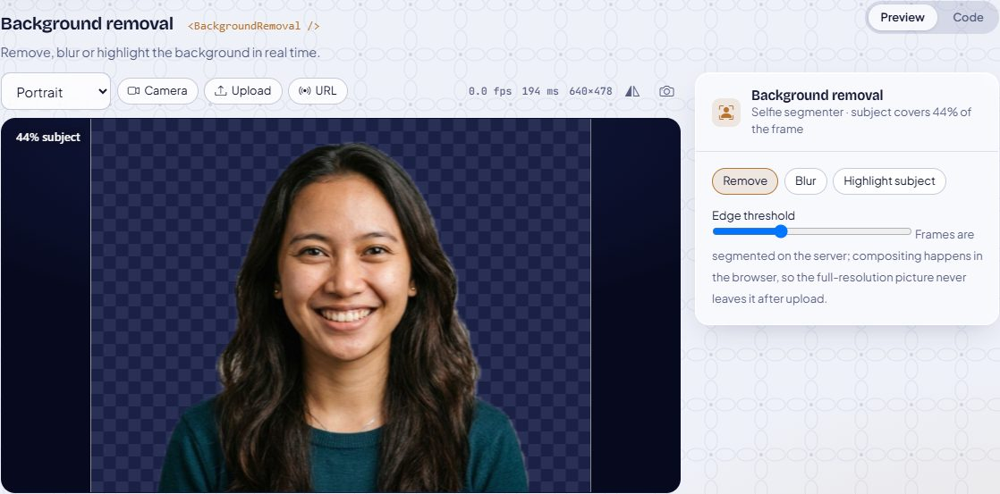

### BackgroundRemoval

Real-time background removal: cut out, blur or tint the background with the selfie segmenter.

Base: `VisionComponentBase`.

| Parameter | Type | Default | Purpose |
|---|---|---|---|
| `Title` | `string` | `"Background removal"` | Card title. |

```razor
<BackgroundRemoval StartWithCamera="true" Fps="15" />
```

### GreenScreenReplacement

A virtual green screen: the selfie segmenter keeps the person and the browser puts a picture, a colour or your own upload behind them.

Base: `VisionComponentBase`.

| Parameter | Type | Default | Purpose |
|---|---|---|---|
| `Title` | `string` | `"Green screen replacement"` | Card title. |
| `Backgrounds` | `IReadOnlyList<BackgroundChoice>?` | `null` | Background pictures to offer. `null` uses `DefaultBackgrounds`. |
| `BackgroundUrl` | `string?` | `null` | Initial background URL. `null` starts with a colour. |
| `MaxUploadBytes` | `long` | `8 * 1024 * 1024` | Largest accepted upload in bytes. |

```razor
<GreenScreenReplacement BackgroundUrl="@ThreeDAssets.WorldConcept" StartWithCamera="true" />
```

### SubjectIsolationViewer

Per-part person segmentation with the selfie multiclass model: hair, face skin, body skin, clothes and accessories as separate masks with coverage.

Base: `VisionComponentBase`.

| Parameter | Type | Default | Purpose |
|---|---|---|---|
| `Title` | `string` | `"Subject isolation"` | Card title. |
| `InitialParts` | `IReadOnlyList<string>?` | `null` | Parts selected at start, by model label: `hair`, `face-skin`, `body-skin`, `clothes`, `others`. |
| `OnCoverage` | `Action<IReadOnlyDictionary<string, double>>?` | `null` | Called with per-part coverage after each frame, on the processing thread. |

```razor
<SubjectIsolationViewer InitialParts="@(["hair"])" OnCoverage="c => hair = c.GetValueOrDefault("hair")" />
```

### ObjectSegmentationStudio

Scene segmentation: DeepLab v3 class masks with coverage, plus point-prompted (MagicTouch) segmentation of any object in a still picture.

Base: `VisionComponentBase`.

| Parameter | Type | Default | Purpose |
|---|---|---|---|
| `Title` | `string` | `"Object segmentation studio"` | Card title. |
| `MinCoverage` | `double` | `0.003` | Minimum fraction of the frame for a class to be listed. |
| `OnClasses` | `Action<IReadOnlyList<ClassCoverage>>?` | `null` | Called with the classes found after each frame, on the processing thread. |

```razor
<ObjectSegmentationStudio MinCoverage="0.005" OnClasses="classes => found = classes" />
```

### 3D views

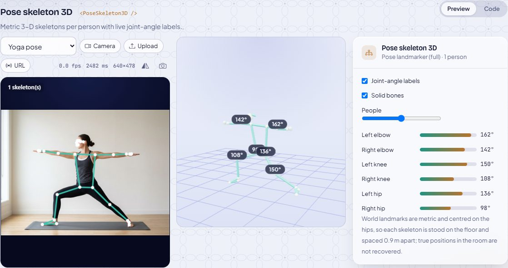

These components render with Three.js from Blazor.AI.ThreeD and need its stylesheet.

### FaceMesh3D

The 478-point face mesh as an orbitable 3D point cloud, coloured by depth or expression, with a gaze arrow and live blendshapes.

Base: `VisionComponentBase`.

| Parameter | Type | Default | Purpose |
|---|---|---|---|
| `Title` | `string` | `"Face mesh 3D"` | Card title. |
| `ColorMode` | `string` | `"Depth"` | `Depth`, `Expression` or `Mono`. |
| `PointSize` | `double` | `0.035` | Point size in scene units. |
| `TopBlendshapes` | `int` | `6` | Number of blendshapes listed in the panel. |

```razor
<FaceMesh3D ColorMode="Depth" PointSize="0.035" TopBlendshapes="6" />
```

### AvatarMirror3D

A 3D magic mirror: your capsule avatar stands in front of a glass pane and its reflection moves behind it.

Base: `VisionComponentBase`.

| Parameter | Type | Default | Purpose |
|---|---|---|---|
| `Title` | `string` | `"Avatar mirror 3D"` | Card title. |
| `BodyColor` | `string` | `"#d9d4c4"` | Body colour. |
| `AccentColor` | `string` | `ThreeDPalette.Nila` | Accent colour. |

```razor
<AvatarMirror3D BodyColor="#d9d4c4" AccentColor="#3cc4b1" StartWithCamera="true" />
```

### PoseSkeleton3D

Metric 3D skeletons from pose world landmarks, one per person, with live joint-angle labels and low-visibility joints dimmed.

Base: `VisionComponentBase`.

| Parameter | Type | Default | Purpose |
|---|---|---|---|
| `Title` | `string` | `"Pose skeleton 3D"` | Card title. |

```razor
<PoseSkeleton3D Height="460px" />
```

### GestureSpace3D

Both hands as 3D skeletons with their recognised gesture; point to draw in the air and make a fist to clear.

Base: `VisionComponentBase`.

| Parameter | Type | Default | Purpose |
|---|---|---|---|
| `Title` | `string` | `"Gesture space 3D"` | Card title. |
| `Mirror` | `bool` | `true` | Flips left and right like a mirror (natural for a front camera). |
| `MaxStrokes` | `int` | `12` | Maximum air-drawing strokes kept. |
| `OnGesture` | `EventCallback<string>` | | Raised when a hand's gesture changes, with a canned name such as `Pointing_Up`. |

```razor
<GestureSpace3D Mirror="true" MaxStrokes="12" OnGesture="g => last = g" StartWithCamera="true" />
```

### MotionReplay3D

Record a movement, or load a mocap JSON take, and replay it in 3D with onion-skin ghosts, joint trails and variable speed.

Base: `VisionComponentBase`.

| Parameter | Type | Default | Purpose |
|---|---|---|---|
| `Title` | `string` | `"Motion replay 3D"` | Card title. |
| `MaxSeconds` | `double` | `30` | Longest recording in seconds. |
| `OnTake` | `EventCallback<IReadOnlyList<MocapFrame>>` | | Raised when a take is recorded or loaded. |

```razor
<MotionReplay3D MaxSeconds="30" OnTake="take => frames = take.Count" />
```

### HumanBodyTracker3D

Places the tracked person in the room: distance from the camera (pinhole estimate), floor path, distance walked and speed.

Base: `VisionComponentBase`.

| Parameter | Type | Default | Purpose |
|---|---|---|---|
| `Title` | `string` | `"Human body tracker 3D"` | Card title. |
| `OnFix` | `Action<BodyFix>?` | `null` | Called with each position estimate, on the processing thread. |

```razor
<HumanBodyTracker3D OnFix="fix => distance = fix.Distance" />
```

### DigitalTwinAvatar

A full digital-twin avatar from the holistic landmarker: body, articulated hands, head pose and expression, with a state log and an AI narrator.

Base: `VisionComponentBase`.

| Parameter | Type | Default | Purpose |
|---|---|---|---|
| `Title` | `string` | `"Digital twin avatar"` | Card title. |
| `BodyColor` | `string` | `"#d9d4c4"` | Body colour. |
| `Mirror` | `bool` | `false` | Flips left and right like a mirror. |
| `OnStateChanged` | `EventCallback<TwinState>` | | Raised when posture, expression or hand state changes. |

```razor
<DigitalTwinAvatar Language="Bahasa Indonesia" OnStateChanged="s => log.Add(s.Posture)" />
```

### Detection

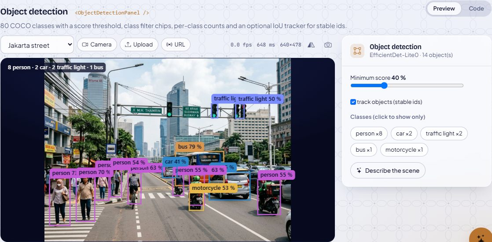

### ObjectDetectionPanel

General object detection (EfficientDet-Lite0, 80 COCO classes) with class filters, per-class counts and stable track ids.

Base: `VisionComponentBase`.

| Parameter | Type | Default | Purpose |
|---|---|---|---|
| `Title` | `string` | `"Object detection"` | Card title. |
| `Classes` | `IReadOnlySet<string>?` | `null` | Only report these COCO classes, for example `person`, `car`, `dog`. `null` reports all 80. |
| `OnObjects` | `Action<IReadOnlyList<TrackedObject>>?` | `null` | Called with each frame's tracked objects, on the processing thread. |

```razor
<ObjectDetectionPanel Classes="@(new HashSet<string> { "person", "car", "dog" })" OnObjects="objects => latest = objects" />
```

### SmartRetailVision

Shelf analytics: shelf rows, empty gaps, fill against a planogram target and detected products, with AI restock suggestions.

Base: `VisionComponentBase`.

| Parameter | Type | Default | Purpose |
|---|---|---|---|
| `Title` | `string` | `"Smart retail vision"` | Card title. |
| `Target` | `double` | `0.85` | Shelf fill below this ratio is flagged. |
| `OnLowStock` | `EventCallback<(int Row, double Fill)>` | | Raised when a shelf row falls below `Target`, with the 1-based row and its fill. |

```razor
<SmartRetailVision Target="0.9" OnLowStock="e => Notify(e.Row, e.Fill)" />
```

### WarehouseVision

Warehouse monitoring: people and vehicles per zone, person–vehicle safety distance, and a stock-fill estimate for racks.

Base: `VisionComponentBase`.

| Parameter | Type | Default | Purpose |
|---|---|---|---|
| `Title` | `string` | `"Warehouse vision"` | Card title. |
| `Zones` | `IReadOnlyList<string>` | `["Aisle A", "Aisle B", "Aisle C"]` | Names of the vertical zones (aisles), left to right. |
| `OnProximityAlert` | `EventCallback<int>` | | Raised when a person comes closer to a vehicle than the safety distance. |

```razor
<WarehouseVision Zones="@(["Inbound", "Racking", "Dispatch"])" OnProximityAlert="pairs => nearMisses += pairs" />
```

### SafetyHelmetDetector

PPE compliance: people are detected, then each head (and optionally torso) region is checked for a hard hat and a hi-vis vest, with compliance and a violation log.

Base: `VisionComponentBase`.

| Parameter | Type | Default | Purpose |
|---|---|---|---|
| `Title` | `string` | `"Safety helmet detector"` | Card title. |
| `OnViolation` | `EventCallback<int>` | | Raised when the number of people without PPE goes up. |

```razor
<SafetyHelmetDetector OnViolation="count => siren.Trigger(count)" Language="Bahasa Indonesia" />
```

### VehicleDetector

Transport analytics: vehicle counts by class, a virtual counting line with direction from tracking, and counts over time.

Base: `VisionComponentBase`.

| Parameter | Type | Default | Purpose |
|---|---|---|---|
| `Title` | `string` | `"Vehicle detector"` | Card title. |
| `OnCrossing` | `EventCallback<(string Class, string Direction)>` | | Raised when a vehicle crosses the counting line, with its class and direction (`"in"` or `"out"`). |

```razor
<VehicleDetector OnCrossing="e => log.Add($"{e.Class} {e.Direction}")" Fps="15" />
```

### Classification

### ImageClassifierPanel

Generic image classification (EfficientNet-Lite0, 1,000 ImageNet classes) with top-k bars and an optional region of interest.

Base: `VisionComponentBase`.

| Parameter | Type | Default | Purpose |
|---|---|---|---|
| `Title` | `string` | `"Image classifier"` | Card title. |
| `Allowlist` | `IReadOnlySet<string>?` | `null` | Restricts results to these ImageNet labels. |
| `OnClassified` | `Action<IReadOnlyList<(string Label, float Score)>>?` | `null` | Called with each result, on the processing thread. |

```razor
<ImageClassifierPanel OnClassified="top => label = top.FirstOrDefault().Label" />
```

### FoodRecognition

Food items from object detection and ImageNet food classes, then an AI nutrition estimate labelled as an estimate.

Base: `VisionComponentBase`.

| Parameter | Type | Default | Purpose |
|---|---|---|---|
| `Title` | `string` | `"Food recognition"` | Card title. |

```razor
<FoodRecognition Samples="@([VisionSamples.Food, VisionSamples.Fruit])" Language="Bahasa Indonesia" />
```

### PlantDiseaseDetector

Plant disease screening: leaf colour analysis (healthy green, yellowing, brown lesions), few-shot matching against examples you label, and an optional vision-model opinion.

Base: `VisionComponentBase`.

| Parameter | Type | Default | Purpose |
|---|---|---|---|
| `Title` | `string` | `"Plant disease detector"` | Card title. |
| `Crop` | `string` | `"tomato"` | Crop name used in AI prompts, for example `tomato`, `chilli` or `rice`. |

```razor
<PlantDiseaseDetector Crop="cabai (chilli)" Language="Bahasa Indonesia" />
```

### FishSpeciesRecognizer

Fish species: ImageNet fish classes scanned over a 3×3 grid, plus a reference gallery you extend with your own labelled species.

Base: `VisionComponentBase`.

| Parameter | Type | Default | Purpose |
|---|---|---|---|
| `Title` | `string` | `"Fish species recognizer"` | Card title. |

```razor
<FishSpeciesRecognizer Samples="@([VisionSamples.Fish])" />
```

### MedicalImageAssistant

A clinical image workflow helper: view with contrast and zoom, measure, annotate, then ask a vision model for a structured observation. Not a diagnosis; images stay in memory only.

Base: `AiComponentBase`. Works on uploaded images; no camera.

| Parameter | Type | Default | Purpose |
|---|---|---|---|
| `Title` | `string` | `"Medical image assistant"` | Card title. |
| `Height` | `string` | `"520px"` | Maximum CSS height of the viewer. |
| `BaseWidth` | `double` | `560` | Display width at zoom 1, in CSS pixels. The viewer scrolls when zoomed. |
| `MaxBytes` | `long` | `12 * 1024 * 1024` | Largest accepted upload in bytes. |
| `Modalities` | `IReadOnlyList<string>` | `["Dermoscopy", "Clinical skin photo", "Chest X-ray", "Other X-ray", "Wound photo", "Ophthalmic photo", "Other"]` | Image types offered. |
| `Language` | `string?` | `null` | Language of answers. `null` follows the model's default. |

```razor
<MedicalImageAssistant Provider="openai" Modalities="@(["Dermoscopy", "Wound photo"])" />
```

### Copilot


### VisionCopilot

Chat with the camera: each answer is grounded in local detections (objects, faces, posture, scene classes) plus the frame itself.

Base: `VisionComponentBase`.

| Parameter | Type | Default | Purpose |
|---|---|---|---|
| `Title` | `string` | `"Vision copilot"` | Card title. |
| `Role` | `string` | `"a helpful visual assistant looking through the user's camera"` | Role given to the model. |
| `Suggestions` | `IReadOnlyList<string>` | four starter questions | Suggested questions shown as chips. |
| `FullAnalysisSeconds` | `double` | `1` | Seconds between full analyses (faces, pose, classes) on live video; objects run every frame. |

```razor
<VisionCopilot StartWithCamera="true" Suggestions="@(["What objects are visible?", "How many people are present?"])" />
```

### SceneExplainer

One click explains the current frame as a caption, a detailed description, alt text or a safety check, with the detected items it is based on.

Base: `VisionComponentBase`.

| Parameter | Type | Default | Purpose |
|---|---|---|---|
| `Title` | `string` | `"Scene explainer"` | Card title. |

```razor
<SceneExplainer Samples="VisionSamples.Scenes" />
```

### VisualQuestionAnswering

Ask free-form questions about an uploaded or sample picture and keep the history of questions and answers.

Base: `VisionComponentBase`.

| Parameter | Type | Default | Purpose |
|---|---|---|---|
| `Title` | `string` | `"Visual question answering"` | Card title. |
| `OnAnswer` | `EventCallback<(string Question, string Answer)>` | | Raised after each answer. |

```razor
<VisualQuestionAnswering OnAnswer="qa => history.Add(qa)" />
```

### VideoSummarizer

Samples a video, stream or the camera every k seconds, keeps a timeline of detections and classes, then summarises it.

Base: `VisionComponentBase`.

| Parameter | Type | Default | Purpose |
|---|---|---|---|
| `Title` | `string` | `"Video summarizer"` | Card title. |
| `OnTimeline` | `EventCallback<IReadOnlyList<TimelineEntry>>` | | Raised with the finished timeline when sampling stops. |
| `AutoSummarise` | `bool` | `true` | Summarises automatically when sampling stops. |

```razor
<VideoSummarizer AutoSummarise="true" OnTimeline="t => timeline = t" />
```

### Healthcare


### ElderlyFallDetection

Fall detection from pose: a rapid drop of the hip centre and a horizontal torso flag a possible fall, confirmed when the person stays down, with a snapshot alert.

Base: `SolutionComponentBase`.

| Parameter | Type | Default | Purpose |
|---|---|---|---|
| `Title` | `string` | `"Elderly fall detection"` | Card title. |
| `ConfirmSeconds` | `double` | `4` | Seconds a person must stay down before a fall is confirmed. |
| `OnStateChanged` | `EventCallback<FallState>` | | Raised when the state changes: `Normal`, `Possible` or `Confirmed`. |

```razor
<ElderlyFallDetection StartWithCamera="true" ConfirmSeconds="5" OnStateChanged="OnFall" OnEvent="Notify" />
```

### PatientMovementMonitor

Bed or chair monitoring: safe-zone exit alerts, movement level, and a repositioning reminder when the patient has been still too long.

Base: `SolutionComponentBase`.

| Parameter | Type | Default | Purpose |
|---|---|---|---|
| `Title` | `string` | `"Patient movement monitor"` | Card title. |
| `PatientName` | `string` | `"Bed 4"` | Patient or bed label used in events. |
| `SafeZone` | `(float X, float Y, float W, float H)` | `(0.08f, 0.35f, 0.84f, 0.6f)` | Bed or chair area (normalized). Leaving it raises an out-of-bed alert. |
| `RepositionMinutes` | `double` | `2` | Minutes without meaningful movement before a repositioning reminder. |

```razor
<PatientMovementMonitor PatientName="Bed 4" SafeZone="(0.2f, 0.25f, 0.6f, 0.7f)" RepositionMinutes="120" StartWithCamera="true" />
```

### RehabilitationTracker

Range-of-motion rehabilitation: counts reps, measures the peak angle of each rep against a target and writes an AI session note.

Base: `SolutionComponentBase`.

| Parameter | Type | Default | Purpose |
|---|---|---|---|
| `Title` | `string` | `"Rehabilitation tracker"` | Card title. |

```razor
<RehabilitationTracker StartWithCamera="true" OnEvent="e => session.Add(e)" Language="Bahasa Indonesia" />
```

### MedicalSkillsTrainer

Skills practice from hand and pose landmarks: WHO hand-hygiene steps or CPR hand position, with hold timers, a checklist, a score and a debrief. A training aid, not a certification.

Base: `SolutionComponentBase`.

| Parameter | Type | Default | Purpose |
|---|---|---|---|
| `Title` | `string` | `"Medical skills trainer"` | Card title. |

```razor
<MedicalSkillsTrainer StartWithCamera="true" />
```

### Agritech

### CropVision

Field and canopy analysis from RGB: excess-green vegetation index, canopy cover, stress zones (yellowing or browning) as a heat map, and AI agronomy notes.

Base: `SolutionComponentBase`.

| Parameter | Type | Default | Purpose |
|---|---|---|---|
| `Title` | `string` | `"Crop vision"` | Card title. |
| `Crop` | `string` | `"tomato"` | Crop name used in AI prompts. |
| `GridColumns` | `int` | `24` | Heat grid resolution (columns). |

```razor
<CropVision Crop="Rice" GridColumns="32" OnEvent="LogField" />
```

### FruitQualityInspector

Fruit grading: detects bananas, apples and oranges, then scores ripeness hue and dark-spot defects inside each box (grade A, B or C).

Base: `SolutionComponentBase`.

| Parameter | Type | Default | Purpose |
|---|---|---|---|
| `Title` | `string` | `"Fruit quality inspector"` | Card title. |
| `DefectLimitC` | `double` | `0.12` | Dark-spot share above which a fruit is grade C; grade B starts at half of it. |
| `OnGraded` | `EventCallback<IReadOnlyList<FruitGrade>>` | | Raised with the grades of each processed frame. |

```razor
<FruitQualityInspector DefectLimitC="0.10" OnGraded="Sort" StartWithCamera="true" />
```

### LivestockMonitor

Livestock counts per species, stable ids and trails across frames, and activity (moving or resting) from box motion.

Base: `SolutionComponentBase`.

| Parameter | Type | Default | Purpose |
|---|---|---|---|
| `Title` | `string` | `"Livestock monitor"` | Card title. |
| `ExpectedCount` | `int?` | `null` | Expected herd size. Fewer animals in view raises a missing-animals warning. |

```razor
<LivestockMonitor ExpectedCount="24" StartWithCamera="true" Fps="4" OnEvent="Alert" />
```

### AquacultureVision

Pond and cage camera: water colour and turbidity index, surface activity by frame differencing, fish presence per tile and feeding response.

Base: `SolutionComponentBase`.

| Parameter | Type | Default | Purpose |
|---|---|---|---|
| `Title` | `string` | `"Aquaculture vision"` | Card title. |
| `PondName` | `string` | `"Keramba 1"` | Pond or cage label used in events. |
| `TileGrid` | `int` | `3` | Tiles per side for fish classification (`TileGrid` × `TileGrid` crops per frame). |

```razor
<AquacultureVision PondName="Pond B" TileGrid="4" StartWithCamera="true" />
```

### Education

### InteractiveScienceVision

Hand-driven science activities: a finger protractor, a "magnet" whose force follows the inverse-square law, and an object counter, with an AI explanation.

Base: `SolutionComponentBase`.

| Parameter | Type | Default | Purpose |
|---|---|---|---|
| `Title` | `string` | `"Interactive science vision"` | Card title. |

```razor
<InteractiveScienceVision StartWithCamera="true" Language="Bahasa Indonesia" />
```

### GestureLearningPlatform

Gamified gesture lessons: show the target gesture before the timer runs out, build streaks and level up.

Base: `SolutionComponentBase`.

| Parameter | Type | Default | Purpose |
|---|---|---|---|
| `Title` | `string` | `"Gesture learning platform"` | Card title. |
| `RoundSeconds` | `double` | `8` | Seconds per round at level 1. |

```razor
<GestureLearningPlatform RoundSeconds="6" StartWithCamera="true" OnEvent="e => scores.Add(e)" />
```

### SignLanguageLearningStudio

Fingerspelling practice: a target letter card, a live match meter, progress per letter, and reference shapes you record for your own sign language.

Base: `SolutionComponentBase`.

| Parameter | Type | Default | Purpose |
|---|---|---|---|
| `Title` | `string` | `"Sign language learning studio"` | Card title. |
| `HoldSeconds` | `double` | `1.2` | Seconds the target letter must be held at 75% match or more to count as mastered. |

```razor
<SignLanguageLearningStudio HoldSeconds="1.5" StartWithCamera="true" />
```

### Industry

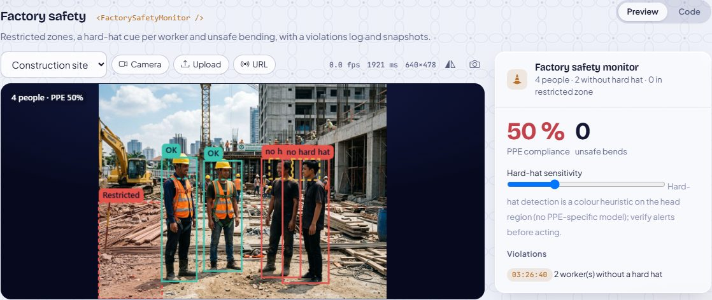

### FactorySafetyMonitor

Factory and site safety: people in restricted zones, a hard-hat cue per worker and unsafe bending, with a violations log and snapshots.

Base: `SolutionComponentBase`.

| Parameter | Type | Default | Purpose |
|---|---|---|---|
| `Title` | `string` | `"Factory safety monitor"` | Card title. |
| `RestrictedZones` | `IReadOnlyList<(float X, float Y, float W, float H)>` | `[(0.0f, 0.55f, 0.22f, 0.45f)]` | Restricted areas (normalized rectangles) where people must not stand. |
| `HelmetThreshold` | `double` | `0.18` | Share of safety-coloured pixels in the head region that counts as a hard hat. |
| `BendLimit` | `double` | `45` | Back angle in degrees from vertical that counts as unsafe bending. |

```razor
<FactorySafetyMonitor RestrictedZones="@zones" HelmetThreshold="0.2" BendLimit="50" Events="@plantEvents" SourceName="Line 2 · Press" />
```

### WorkerTrackingSystem

Multi-person tracking with stable ids and path trails; headcount and dwell time per zone.

Base: `SolutionComponentBase`.

| Parameter | Type | Default | Purpose |
|---|---|---|---|
| `Title` | `string` | `"Worker tracking"` | Card title. |
| `Zones` | `IReadOnlyList<WorkZone>` | `Loading dock`, `Assembly`, `Storage` | Zones as `WorkZone(Name, X, Y, W, H, Color)` in normalized coordinates. |

```razor
<WorkerTrackingSystem Zones="@zones" StartWithCamera="true" Fps="8" />
```

### AssemblyLineAnalytics

Manual assembly analytics: hands entering and leaving the work zone mark cycles; cycle time against takt, idle alerts and a trend chart.

Base: `SolutionComponentBase`.

| Parameter | Type | Default | Purpose |
|---|---|---|---|
| `Title` | `string` | `"Assembly line analytics"` | Card title. |
| `Station` | `string` | `"A-3"` | Station label used in events. |
| `TaktSeconds` | `double` | `12` | Target cycle time in seconds. |
| `ExitSeconds` | `double` | `0.8` | Seconds hands must stay out of the work zone to end a cycle. |
| `IdleAlertSeconds` | `double` | `20` | Idle seconds before a warning event is published. |
| `WorkZone` | `(float X, float Y, float W, float H)` | `(0.25f, 0.35f, 0.5f, 0.6f)` | Work area on the bench (normalized). |

```razor
<AssemblyLineAnalytics Station="A-3" TaktSeconds="12" IdleAlertSeconds="30" WorkZone="(0.25f, 0.35f, 0.5f, 0.6f)" />
```

### SmartSurveillanceDashboard

A camera wall: two to four tiles, each with its own detector, people and vehicle totals across cameras, guarded-area intrusions and one event list.

No AI calls. Does not inherit a base class. Each tile is a `SurveillanceTile`.

| Parameter | Type | Default | Purpose |
|---|---|---|---|
| `Tiles` | `IReadOnlyList<CameraTile>` | `Gate`, `Warehouse`, `Site` samples | Up to four cameras as `CameraTile(Name, Url, GuardedArea)`; image, video or stream URLs. Each tile can also switch to a webcam. |
| `Events` | `VisionEventStream?` | `null` | Optional shared stream to also publish into, for example for a `VisionDashboard`. |
| `TileHeight` | `string` | `"220px"` | CSS height of each tile. |
| `Fps` | `double` | `6` | Frames per second requested per tile. |
| `Class` | `string?` | `null` | Extra CSS classes. |

```razor
<SmartSurveillanceDashboard Tiles="@cameras" Events="@siteEvents" Fps="5" />
```

### SurveillanceTile

One camera tile of a surveillance wall: counts people and vehicles and raises intrusion events for a guarded area. Exposes `Counts` (people, vehicles, intrusion).

Base: `SolutionComponentBase`.

| Parameter | Type | Default | Purpose |
|---|---|---|---|
| `Name` | `string` | `"Camera"` | Camera name, also shown on the tile. |
| `InitialImage` | `string?` | `null` | Sample or stream URL shown first. |
| `GuardedArea` | `(float X, float Y, float W, float H)?` | `null` | Guarded area (normalized). A person whose feet are inside raises an intrusion event. |
| `ShowToolbar` | `bool` | `false` | Shows the camera source toolbar. |

```razor
<SurveillanceTile Name="Gate" InitialImage="@VisionSamples.Street.Url" GuardedArea="(0.0f, 0.6f, 0.3f, 0.4f)" />
```

### Analytics

### VisionDashboard

An operations dashboard over a `VisionEventStream`: KPI tiles, events per minute, events by kind, the latest counts per source and an AI shift summary.

Base: `StreamComponentBase`.

| Parameter | Type | Default | Purpose |
|---|---|---|---|
| `WindowMinutes` | `int` | `15` | Window in minutes for the recent-events tile and the per-minute chart. |
| `Language` | `string?` | `null` | Language of the AI summary. `null` follows the model's default. |

```razor
<VisionDashboard Events="@events" WindowMinutes="30" Language="Bahasa Indonesia" />
```

### EventTimeline

Chronological vision events with snapshot thumbnails, grouped by minute, filterable by severity, source and text.

Base: `StreamComponentBase`.

| Parameter | Type | Default | Purpose |
|---|---|---|---|
| `Title` | `string` | `"Event timeline"` | Card title. |
| `MaxItems` | `int` | `200` | Maximum events shown. |
| `ShowSnapshots` | `bool` | `true` | Shows snapshot thumbnails. |
| `AllowClear` | `bool` | `true` | Shows a button that clears the stream. |
| `MaxHeight` | `string` | `"360px"` | CSS maximum height of the list. |

```razor
<EventTimeline Events="@events" MaxItems="500" MaxHeight="480px" />
```

### ActivityHeatmap

Where activity happens: accumulates people, hand or body positions into a decaying heat grid drawn over the camera.

Base: `SolutionComponentBase`.

| Parameter | Type | Default | Purpose |
|---|---|---|---|
| `Title` | `string` | `"Activity heatmap"` | Card title. |
| `Source` | `HeatSource` | `HeatSource.People` | What to accumulate: `People`, `Hands` or `Body`. |
| `Columns` | `int` | `32` | Heat grid columns. |
| `Rows` | `int` | `18` | Heat grid rows. |
| `Decay` | `double` | `0.995` | Multiplier applied to the grid each frame (`1` never forgets). |

```razor
<ActivityHeatmap Source="ActivityHeatmap.HeatSource.People" Columns="40" Rows="22" Decay="0.998" StartWithCamera="true" />
```

### DetectionStatistics

Object counts per class over time windows: a bar chart of the current frame, per-window trend lines and a summary table with average and peak.

Base: `SolutionComponentBase`.

| Parameter | Type | Default | Purpose |
|---|---|---|---|
| `Title` | `string` | `"Detection statistics"` | Card title. |
| `Classes` | `IReadOnlySet<string>?` | `null` | COCO classes to count. `null` counts every class. |
| `WindowSeconds` | `double` | `10` | Length of one time window in seconds. |
| `MaxWindows` | `int` | `30` | Number of windows kept. |
| `ScoreThreshold` | `float` | `0.35f` | Minimum detection score. |

```razor
<DetectionStatistics Classes="@(new HashSet<string> { "person", "car", "truck" })" WindowSeconds="60" MaxWindows="60" />
```

### RealtimeMetrics

Live pipeline health from `VisionTelemetry`: frames per second, latency (average and p95), errors and events, plus fps and latency per named camera.

No AI calls. Does not inherit a base class.

| Parameter | Type | Default | Purpose |
|---|---|---|---|
| `Title` | `string` | `"Realtime metrics"` | Card title. |
| `Sources` | `IReadOnlyList<(string Name, Func<VisionStats?> Stats)>?` | `null` | Named components to break down, for example `("Safety", () => safety?.CameraStats)`. |
| `IntervalMs` | `int` | `1000` | Sampling interval in milliseconds. |
| `LatencyBudgetMs` | `double` | `120` | Latency above this is highlighted. |
| `Class` | `string?` | `null` | Extra CSS classes. |

```razor
<RealtimeMetrics Sources="@Sources()" LatencyBudgetMs="100" />
```
