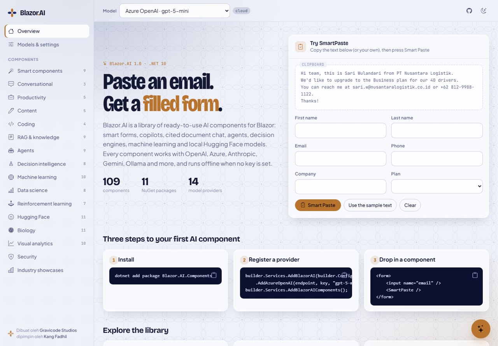

# Getting started

*Dibuat oleh Gravicode Studios dipimpin oleh Kang Fadhil.* · [Bahasa Indonesia](../id/getting-started.md)

This guide takes you from an empty folder to a Blazor app with AI chat and SmartPaste, then shows how to add the other packages.

## Requirements

- .NET 10 SDK
- A Blazor Web App with interactive server or WebAssembly render mode. The packages are Razor class libraries, so they work in both.
- Optional: an API key for a cloud model, or a local Ollama, llama.cpp or LocalGen server. Without one, every component uses the built-in simulated model.

## 1. Create the app

The fastest route is the template:

```bash
dotnet new install Blazor.AI.Templates
dotnet new blazorai -n MyAiApp                 # simulated model, no keys needed
dotnet new blazorai -n MyAiApp --provider azure --agents true
cd MyAiApp && dotnet run
```

| Template option | Values | Effect |
|---|---|---|
| `--provider` | `simulated` (default), `openai`, `azure`, `anthropic`, `ollama` | Adds the provider to `appsettings.json` and makes it the default |
| `--agents` | `true` / `false` | Adds `Blazor.AI.Agents` and an `/agent` page with a sample tool |

## 2. Or add Blazor.AI to an existing app

```bash
dotnet add package Blazor.AI.Components
```

Register services in `Program.cs`:

```csharp
builder.Services.AddBlazorAI(builder.Configuration)   // reads the "BlazorAI" section
    .AddSimulated();                                  // offline model, always available
builder.Services.AddBlazorAIComponents();
```

Add the theme to `App.razor`. It needs Bootstrap Icons; Bootstrap itself is optional.

```html
<link href="https://fonts.googleapis.com/css2?family=Bricolage+Grotesque:opsz,wdth,wght@12..96,75..100,400..800&family=JetBrains+Mono:wght@400;500&family=Plus+Jakarta+Sans:wght@400;500;600;700&display=swap" rel="stylesheet" />
<link href="https://cdn.jsdelivr.net/npm/bootstrap-icons@1.11.3/font/bootstrap-icons.min.css" rel="stylesheet" />
<link rel="stylesheet" href="@Assets["_content/Blazor.AI.Components/blazor-ai.css"]" />
...
<body class="bai-surface">
```

Add `@using Blazor.AI.Components` to `_Imports.razor`.

## 3. Your first components

```razor
@page "/"

<form data-smartpaste-scope>
    <label>Name <input name="name" @bind="name" /></label>
    <label>Email <input name="email" type="email" @bind="email" /></label>
    <SmartPaste />
</form>

<AiChat Title="Assistant" SystemPrompt="You answer questions about our product." Suggestions="@(["What can you do?"])" />

@code { string? name, email; }
```

SmartPaste reads the clipboard, asks the model to map it onto the fields in the nearest form (`data-smartpaste-scope`), and fills them. Field names, labels and `<select>` options are sent as hints. Nothing is submitted for you.

## 4. Pick a real model

Add a provider in `appsettings.json` and put its key in user-secrets:

```json
{
  "BlazorAI": {
    "DefaultProvider": "openai",
    "Providers": [
      { "Name": "simulated", "Kind": "Simulated" },
      { "Name": "openai", "Kind": "OpenAI", "Model": "gpt-5-mini" }
    ]
  }
}
```

```bash
dotnet user-secrets init
dotnet user-secrets set "BlazorAI:Providers:1:ApiKey" "sk-..."
```

`<AiProviderPicker />` lets users switch models at runtime, and each component also has a `Provider` parameter. See [providers](providers.md) for every provider and its settings.

## 5. Add more packages

| Need | Package | Registration |
|---|---|---|
| Charts and dashboards | `Blazor.AI.Visualization` | none (pure components) |
| Chat with your documents | `Blazor.AI.RAG` | `AddBlazorAIRag()` |
| Tool-calling agents, MCP | `Blazor.AI.Agents` | `AddBlazorAIAgents(tools => tools.Register(...))` |
| Rules, decision tables, risk | `Blazor.AI.Decision` | `AddBlazorAIDecision(o => o.ApiKey = ...)` |
| ML, statistics, RL | `Blazor.AI.Analytics` | `AddBlazorAIAnalytics()` |
| Hugging Face and local models | `Blazor.AI.LocalModels` | `AddBlazorAILocalModels(o => o.HuggingFaceToken = ...)` |
| Biology and chemistry | `Blazor.AI.Bio` | `AddBlazorAIAgents().AddBlazorAIBio()` |

The [component catalogue](components.md) lists every component with an example.

## 6. Run the gallery

The repository's gallery app shows all 109 components with live previews and code:

```bash
git clone https://github.com/DotNetVibeCoderz/Vibe_Components
cd Vibe_Components/Blazor.AI
dotnet run --project samples/Blazor.AI.Gallery      # http://localhost:5180
```



To try real models, set keys with `dotnet user-secrets` in `samples/Blazor.AI.Gallery` (see `tools/Import-DevKeys.ps1` for the expected names).
