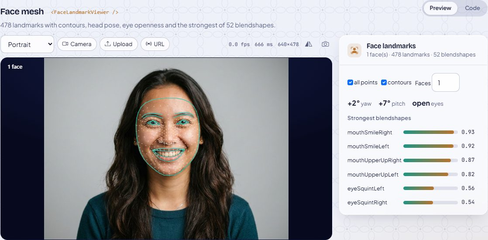
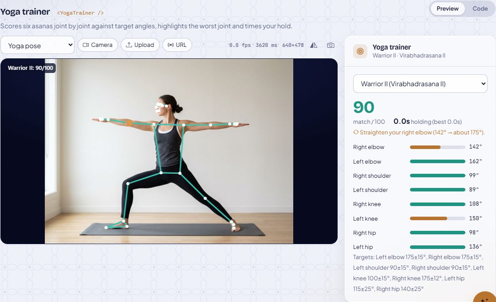
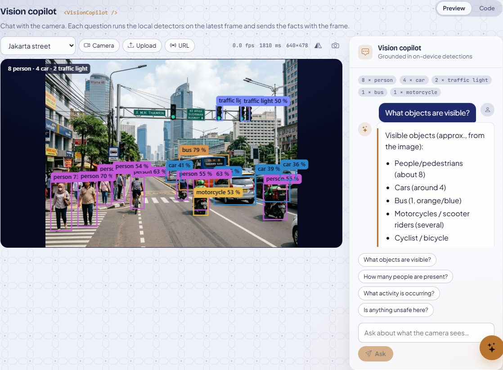
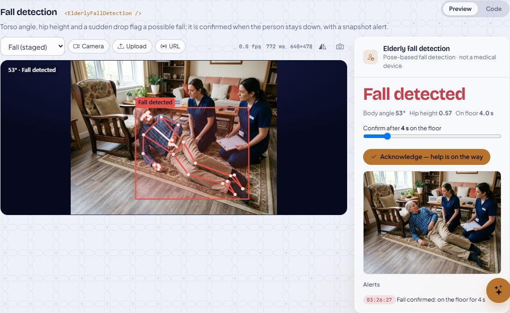

# Computer vision (Blazor.AI.MediaPipe)

*Dibuat oleh Gravicode Studios dipimpin oleh Kang Fadhil.* · [Bahasa Indonesia](../id/vision.md)

`Blazor.AI.MediaPipe` brings real-time computer vision to Blazor: face mesh and expressions, attendance and verification, hands and gestures, sign language, body pose and exercise analytics, holistic tracking and motion capture, background removal, object detection, image classification, a vision copilot, Three.js views, and ready-made healthcare, agritech, education, industry and analytics components.

It runs on **MediaPipe.NET** (`Gravicode.MediaPipeNet.Tasks.Vision`), native .NET ports of Google MediaPipe Tasks on ONNX Runtime. Inference happens on the server; the browser only captures frames and draws results.



## Setup

```bash
dotnet add package Blazor.AI.MediaPipe
```

```csharp
builder.Services.AddRazorComponents().AddInteractiveServerComponents();
builder.Services.AddBlazorAI(builder.Configuration).AddSimulated();
builder.Services.AddBlazorAIComponents();
builder.Services.AddBlazorAIMediaPipe(o =>
{
    o.PreloadModels = true;                    // download models at startup instead of on first use
    // o.Provider = ExecutionProvider.Cuda;    // or DirectML / CoreML; falls back to CPU
    // o.ModelDirectory = "/opt/models";       // offline / edge: pre-copied models
    // o.AllowModelDownload = false;           // air-gapped sites
});
```

```html
<link rel="stylesheet" href="_content/Blazor.AI.Components/blazor-ai.css" />
<link rel="stylesheet" href="_content/Blazor.AI.MediaPipe/blazor-ai-vision.css" />
```

Use **Interactive Server** render mode for vision components. ONNX Runtime does not run inside browser WebAssembly, so a WebAssembly app needs a server it can send frames to.

## How frames flow

1. `CameraViewer` captures a frame from the webcam, a video file, an image or an HTTP stream, scales it to `MaxWidth` (640 px by default) and encodes it as JPEG.
2. The JPEG goes to the server over the Blazor circuit. Only one frame is in flight per viewer: the next is captured when the previous result returns, so slow devices drop frames instead of queueing them.
3. The component's `Process(VisionFrame)` runs MediaPipe tasks in VIDEO mode (with tracking and smoothing) for live sources, and IMAGE mode for stills.
4. It returns a `VisionOverlay` (landmarks, boxes, labels, paths, heat grids, masks) in normalized coordinates, which the browser draws over the picture, mirrored when needed.

On a laptop CPU, face mesh, hand, pose and segmentation each take roughly 20–40 ms per 640×480 frame, so 10–15 fps per viewer is typical. `AddBlazorAIMediaPipe` raises the SignalR message limit to 2 MB for frames.

## Building your own component

```razor
@inherits VisionComponentBase

<CameraViewer @ref="Camera" OnFrame="HandleFrameAsync" OnSourceChanged="HandleSourceChanged" Samples="@EffectiveSamples" />
<p>@_fingers fingers</p>

@code {
    int _fingers;

    protected override VisionOverlay? Process(VisionFrame frame)
    {
        var hands = Tasks.Hands(frame);
        _fingers = hands.Hands.Sum(VisionMath.CountFingers);
        var overlay = new VisionOverlay { Status = $"{_fingers} fingers" };
        overlay.Landmarks.AddRange(hands.Hands.Select(h => Overlay.Hand(h)));
        return overlay;
    }
}
```

- `Tasks` has `DetectFaces`, `FaceLandmarks` (478 points, 52 blendshapes), `Hands`, `Gestures`, `Pose` (33 points, world coordinates, optional mask), `Holistic`, `Segment` (Selfie, SelfieMulticlass, Hair, DeepLabV3), `SegmentAt` (click to segment), `Objects` (80 COCO classes), `Classify` (1,000 ImageNet classes), `Embed` and `Stylize`.
- `VisionMath` has joint angles (2-D and 3-D), distances, finger states, eye aspect ratio and head pose.
- `AskAboutFrameAsync(role, question, facts)` sends the latest frame to a vision-capable model with your computed facts, and falls back to the facts alone for text-only models.
- `RecordEvent(summary)` writes to the guardrail audit trail and the `blazorai.vision.events` counter.

## Privacy and enterprise

- Frames are processed in memory and discarded. Nothing is stored unless you use `VisionRecorder`, snapshots or the attendance log.
- Face recognition uses `IFaceEmbedder`. The default embeds an eye-aligned face crop with MobileNet (same face scores about 0.94–0.99, different people about 0.4–0.65): it suits demos and small cooperative groups and is **not biometric-grade**. Register your own embedder (for example an ArcFace ONNX model) for production identity use, and get consent.
- RBAC and audit come from Blazor.AI guardrails (`RecordEvent` goes to `IAuditTrail`).
- OpenTelemetry: add the source and meter named `Blazor.AI.MediaPipe` (`VisionTelemetry.Name`) for traces (`vision.frame`) and metrics (`blazorai.vision.frames`, `blazorai.vision.latency`, `blazorai.vision.errors`, `blazorai.vision.events`).
- Offline and edge: set `ModelDirectory` and `AllowModelDownload = false`, and use `ModelManagerPanel` or `VisionModelManager.EnsureAsync` to fetch models in advance. GPU: set `Provider` to CUDA, DirectML or CoreML.
- Multi-tenant: services are scoped per circuit (for example `FaceGallery` and `VisionEventStream`); persist galleries per tenant in your own store.

## Sources

`CameraViewer` accepts the webcam (front or back, any device), uploaded images and videos, image or video URLs, MJPEG-over-HTTP streams and HLS. RTSP cameras need a bridge that exposes HTTP (MJPEG or HLS), such as go2rtc or MediaMTX. Streams from another origin need CORS headers so frames can be read.

## Components

See the [component catalogue](components.md#blazoraimediapipe). Every component has a live demo with sample photos (and your camera) in the gallery's Vision pages.

| | |
|---|---|
|  |  |
|  |  |
