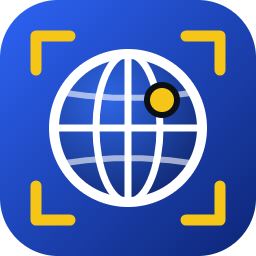
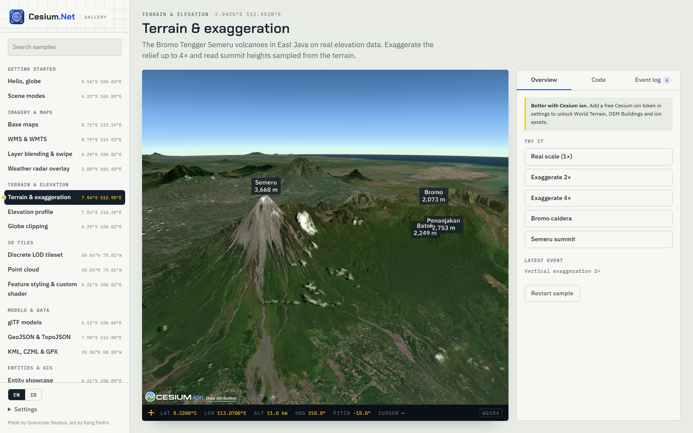
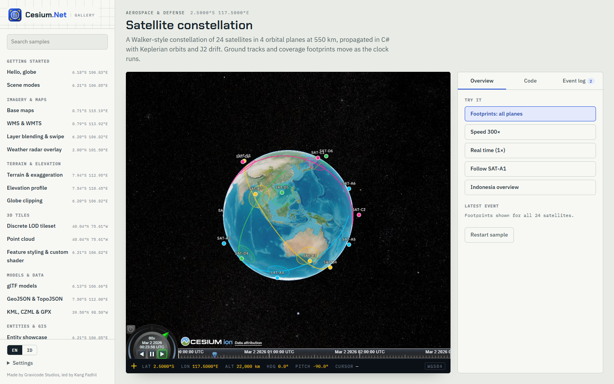
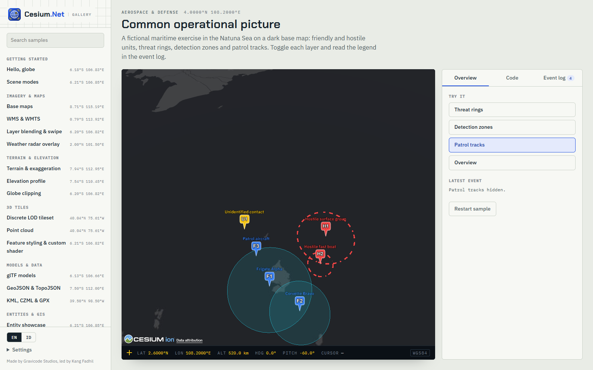

<p align="center"></p>

<h1 align="center">Cesium.Net</h1>

<p align="center"><b>CesiumJS for .NET</b> — 3D globes, maps, terrain, 3D Tiles, time-dynamic data and geospatial analysis, driven entirely from C#.<br>
One API for <b>Blazor</b> (web) and <b>Avalonia UI</b> (desktop).</p>

<p align="center"><a href="README.id.md">Bahasa Indonesia</a> · <a href="docs/en/index.md">Documentation</a> · <a href="docs/en/gallery.md">Gallery</a> · <a href="PLAN.md">Roadmap</a> · <a href="Progress.md">Progress</a></p>


## Why Cesium.Net

- **Same C# everywhere.** `CesiumController` is host-agnostic. The Blazor component and the Avalonia control are thin hosts, so a sample written once runs on web *and* desktop. The gallery proves it: both front-ends share one sample catalog.
- **Broad coverage of CesiumJS.** It covers entities, imagery, terrain, 3D Tiles, vector data, camera, clock, drawing and measuring, picking, effects and weather. `ExecuteScriptAsync` is the escape hatch for anything else.
- **Geospatial math in .NET.** Vincenty geodesy, WGS84/ECEF/ENU/Web Mercator conversions, area and containment checks, and Keplerian orbits with J2. All of it is unit-tested and usable server-side.
- **Built for throughput.** It uses source-generated JSON (trim/AOT-safe), compact `[lon,lat,h]` positions and batched entity creation. A lock-free `RealtimeEntityFeed` coalesces SignalR/MQTT/WebSocket bursts, and GPU point collections handle 100k+ points.
- **No account needed.** It uses OpenStreetMap and Esri imagery plus Esri terrain out of the box. Add a Cesium ion token for World Terrain, OSM Buildings and ion assets.

| Package | Use it for |
|---|---|
| [`Cesium.Net`](src/Cesium.Net) | Core API, math, orbits, realtime batching, ion REST client |
| [`Cesium.Net.Blazor`](src/Cesium.Net.Blazor) | `<CesiumViewer>` for Blazor Server, WebAssembly and Web Apps |
| [`Cesium.Net.Avalonia`](src/Cesium.Net.Avalonia) | `CesiumView` for Windows, macOS and Linux (native WebView2 / WKWebView / WebKitGTK) |

## Quick start

### Blazor

```bash
dotnet add package Cesium.Net.Blazor
```

```razor
@using CesiumNet
@using CesiumNet.Blazor

<CesiumViewer Style="height:600px" OnReady="OnReady" OnLeftClick="OnClick" />

@code {
    async Task OnReady(CesiumController cesium)
    {
        await cesium.Entities.AddAsync(new EntityOptions
        {
            Name = "Monas",
            Position = new GeoPoint(106.827153, -6.175392),
            Billboard = new BillboardGraphics { PinColor = "#1F4FE0", PinIcon = "monument" },
            Label = new LabelGraphics { Text = "Monas", PixelOffset = new Cartesian2(0, -58) },
        });
        await cesium.Camera.FlyToAsync(106.8272, -6.1880, 2_500, pitch: -40);
    }

    void OnClick(PickResult pick) => Console.WriteLine($"{pick.Kind} at {pick.Position}");
}
```

The component needs an interactive render mode (Server, WebAssembly or Auto). Optionally set app-wide defaults with `builder.Services.AddCesiumNet(o => o.IonAccessToken = "...")`.

### Avalonia

```bash
dotnet add package Cesium.Net.Avalonia
```

```xml
<Window xmlns:cesium="using:CesiumNet.Avalonia" ...>
  <cesium:CesiumView Ready="OnGlobeReady" />
</Window>
```

```csharp
private async void OnGlobeReady(object? sender, CesiumReadyEventArgs e)
{
    var cesium = e.Controller;
    await cesium.Camera.FlyToAsync(106.8272, -6.1880, 2_500, pitch: -40);
}
```

> **Windows:** ship an `app.manifest` that declares Windows 10/11 support (`<supportedOS Id="{8e0f7a12-bfb3-4fe8-b9a5-48fd50a15a9a}"/>`). The native WebView host needs it. See [`samples/Cesium.Net.Gallery.Avalonia/app.manifest`](samples/Cesium.Net.Gallery.Avalonia/app.manifest).

## What it covers

| Area | Highlights |
|---|---|
| Rendering | 3D / 2D / Columbus view, lighting, shadows, atmosphere, fog, bloom, ambient occlusion, HDR, request-render mode |
| Imagery | OSM, Esri satellite/streets/topo, CARTO, Bing, WMS, WMTS, TMS, XYZ templates, ion, single image; alpha, color adjustments, swipe/split |
| Terrain | Ellipsoid, Cesium World Terrain, Esri World Elevation, custom quantized-mesh; exaggeration, height sampling, profiles, clipping |
| 3D Tiles | URL / ion / OSM Buildings / Google Photorealistic; declarative styling, custom GLSL shaders, point cloud shading, clipping polygons |
| Vector data | GeoJSON, TopoJSON, KML/KMZ, CZML, GPX; extrusion by property |
| Entities | Point, billboard/pin (Maki icons), label, polyline (glow/dash/arrow/outline), polygon (holes, extrusion), ellipse, rectangle, box, cylinder, ellipsoid/sensor volumes, corridor, wall, glTF model, path |
| Time | Clock & timeline, sampled positions (Lagrange/Hermite), velocity orientation, live position updates |
| Interaction | Click / right-click / double-click / mouse-move picking (entities, 3D Tiles features, primitives, globe), camera fly-to/look-at/orbit/first-person flight, drawing, editing, measuring |
| Analysis (C#) | Vincenty distance/bearing/destination, geodesic interpolation, area, perimeter, centroid, point-in-polygon, ECEF/ENU/Web Mercator/XYZ tile/DMS conversion, Keplerian orbits, footprint radius |
| Effects | Rain, snow and fog post-processing; camera light; globe translucency |

The full mapping of every CesiumJS feature is in [docs/en/feature-matrix.md](docs/en/feature-matrix.md).

## Gallery

Every sample is one C# class in [`samples/Cesium.Net.Gallery.Shared`](samples/Cesium.Net.Gallery.Shared). The same class runs in both front-ends, each with its live code, actions and an event log.

```bash
dotnet run --project samples/Cesium.Net.Gallery.Blazor      # http://localhost:5180
dotnet run --project samples/Cesium.Net.Gallery.Avalonia
```

| | |
|---|---|
|  |  |
|  |  |
|  |  |
|  |  |

## How it works

```
 Your C#  ──►  CesiumController (Cesium.Net)
                 │  method name + JSON args  (ICesiumTransport)
      ┌──────────┴──────────┐
 Blazor JS interop    Avalonia NativeWebView + loopback server
      └──────────┬──────────┘
          cesium-net.js bridge  ──►  CesiumJS (WebGL)
                 │  events: clicks, camera, drawing, clock, errors
                 └──────────►  .NET events / EventCallbacks
```

## Build & test

```bash
dotnet build Cesium.Net.slnx
dotnet test tests/Cesium.Net.Tests
./build/pack.ps1            # NuGet packages → ./artifacts
```

## Documentation

- English: [docs/en](docs/en/index.md). Getting started, Blazor, Avalonia, core concepts, API reference, guides, performance, offline & ion, troubleshooting.
- Bahasa Indonesia: [docs/id](docs/id/index.md).

## License

MIT. See [LICENSE](LICENSE). CesiumJS is Apache-2.0. Imagery, terrain and 3D content follow their providers' terms, so keep the on-screen credits visible.

---

<p align="center"><b>Made by Gravicode Studios, led by Kang Fadhil.</b><br><i>Dibuat oleh Gravicode Studios dipimpin oleh Kang Fadhil.</i></p>
