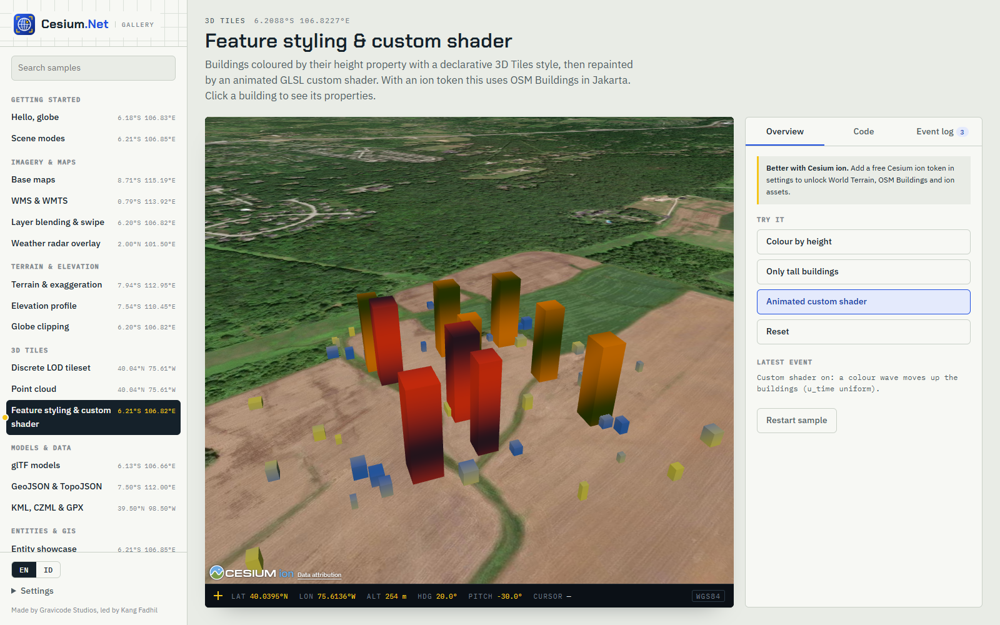

[Bahasa Indonesia](../id/3d-tiles-and-data.md)

# 3D Tiles & data



## Loading tilesets

```csharp
// Any tileset.json (photogrammetry, BIM, point cloud, city model)
string mesh = await cesium.Tilesets.AddAsync(TilesetOptions.FromUrl("https://example.com/site/tileset.json", flyTo: true));

// Cesium ion asset (token required)
string ionTs = await cesium.Tilesets.AddAsync(TilesetOptions.FromIon(2275207));

// Cesium OSM Buildings (token required)
string osm = await cesium.Tilesets.AddAsync(TilesetOptions.OsmBuildings());

// Google Photorealistic 3D Tiles: via ion (token) or a Google Maps API key
string google = await cesium.Tilesets.AddAsync(TilesetOptions.GooglePhotorealistic(key: null));
```

Useful `TilesetOptions`:

| Property | Effect |
|---|---|
| `MaximumScreenSpaceError` | Detail vs speed. Default 16; lower is sharper, higher is faster. |
| `SkipLevelOfDetail` | Skips intermediate LODs, so massive datasets load faster (creation only). |
| `DynamicScreenSpaceError` | Lowers detail for distant tiles in horizon views (creation only). |
| `HeightOffset` | Moves the tileset up or down in meters, e.g. to seat photogrammetry on terrain. |
| `Shadows` | Cast/receive shadows (creation only). |
| `FlyTo` | Zooms to the tileset after load. |
| `DebugShowBoundingVolume` | Shows tile bounds. |

`Tilesets.UpdateAsync` re-applies `Show`, `MaximumScreenSpaceError`, `DebugShowBoundingVolume`, `Style`, `PointCloudShading`, `HeightOffset`, `ClippingPolygons`/`ClipInverse` and `CustomShader`. The creation-only options are ignored on update.

Google Photorealistic tiles come with Google's attribution and terms. Keep `ShowCredits = true`; see [Offline & Cesium ion](offline-and-ion.md#attribution).

## Styling

```csharp
await cesium.Tilesets.SetStyleAsync(osm, new TilesetStyle
{
    ColorConditions =
    [
        ["${feature['building']} === 'hospital'", "color('#FF3B30')"],
        ["Number(${feature['cesium#estimatedHeight']}) > 100", "color('#1F4FE0', 0.9)"],
        ["true", "color('white', 0.8)"],
    ],
    Show = "${feature['building']} !== 'construction'",
});
await cesium.Tilesets.SetStyleAsync(osm, null); // reset
```

The expressions use the [3D Tiles styling language](https://github.com/CesiumGS/3d-tiles/tree/main/specification/Styling). The first matching condition wins. `Defines` declares reusable named expressions.

## Picking features (BIM, city models)

```csharp
cesium.LeftClick += (_, pick) =>
{
    if (pick.Kind != PickKind.TileFeature || pick.Properties is null) return;
    // pick.OwnerId is the tileset id; pick.Properties holds the feature's properties (e.g. IFC attributes).
    foreach (var (k, v) in pick.Properties) Console.WriteLine($"{k} = {v}");
};
```

To hide or color individual features, build a style that matches on feature properties, such as an element id.

## Point clouds (LiDAR)

```csharp
string cloud = await cesium.Tilesets.AddAsync(new TilesetOptions
{
    Kind = TilesetKind.Url, Url = "https://example.com/lidar/tileset.json", FlyTo = true,
    PointCloudShading = new PointCloudShading { Attenuation = true, MaximumAttenuation = 4, EyeDomeLighting = true, EyeDomeLightingStrength = 1.0, EyeDomeLightingRadius = 1.0 },
    Style = new TilesetStyle { PointSize = "3", Color = "color('#00C7FF')" },
});
```

## Clipping and custom shaders (digital twins)

```csharp
// Cut a hole in a photogrammetry mesh where a new design will go:
await cesium.Tilesets.UpdateAsync(mesh, new TilesetOptions
{
    ClippingPolygons = [Geodesy.Circle(new GeoPoint(106.8272, -6.1754), 80, 32)],
});

// Animated scan-line shader; u_time is provided when AnimateTime = true.
string twin = await cesium.Tilesets.AddAsync(new TilesetOptions
{
    Kind = TilesetKind.Url, Url = "https://example.com/plant/tileset.json",
    CustomShader = new CustomShaderOptions
    {
        LightingModel = "PBR",
        AnimateTime = true,
        Uniforms = new() { ["u_intensity"] = 0.6 },
        FragmentShaderText = """
            void fragmentMain(FragmentInput fsInput, inout czm_modelMaterial material) {
                float h = fsInput.attributes.positionMC.z;
                float band = smoothstep(0.0, 0.5, abs(fract(h * 0.05 - u_time * 0.2) - 0.5));
                material.diffuse = mix(vec3(0.0, 0.78, 1.0), material.diffuse, mix(1.0, band, u_intensity));
            }
            """,
    },
});
await cesium.Tilesets.SetShaderUniformAsync(twin, "u_intensity", 0.9);
```

`Uniforms` holds float uniforms only. Custom shaders are available for 3D Tiles; models and entities would need `ExecuteScriptAsync`.

## Vector data: GeoJSON, TopoJSON, KML/KMZ, CZML, GPX

```csharp
// GeoJSON from a URL, extruded by a numeric property (choropleth-style buildings)
string districts = await cesium.DataSources.LoadAsync(new DataSourceOptions
{
    Kind = DataSourceKind.GeoJson, Url = "https://example.com/districts.geojson", Name = "Districts", FlyTo = true,
    Stroke = CesiumColor.White, StrokeWidth = 2, Fill = CesiumColor.Blue.WithAlpha(0.4f),
    ExtrudeByProperty = "population", ExtrudeScale = 0.01, RandomFill = true,
});

// Inline GeoJSON
string pts = await cesium.DataSources.LoadAsync(DataSourceOptions.GeoJsonData("""
    { "type": "FeatureCollection", "features": [
      { "type": "Feature", "properties": { "name": "Monas" }, "geometry": { "type": "Point", "coordinates": [106.8272, -6.1754] } } ] }
    """));

await cesium.DataSources.LoadAsync(DataSourceOptions.TopoJson("https://example.com/provinces.topojson"));
await cesium.DataSources.LoadAsync(DataSourceOptions.Kml("https://example.com/route.kmz"));      // clamps to ground
await cesium.DataSources.LoadAsync(DataSourceOptions.Gpx("https://example.com/ride.gpx"));
string czml = await cesium.DataSources.LoadAsync(DataSourceOptions.Czml("https://example.com/mission.czml"));

int count = await cesium.DataSources.CountAsync(districts);
await cesium.DataSources.SetVisibleAsync(districts, false);
await cesium.Camera.FlyToObjectAsync(czml);
await cesium.DataSources.RemoveAsync(pts);
```

- `Data` takes inline text: JSON for GeoJSON, TopoJSON and CZML, XML for KML and GPX. KMZ must come from a URL.
- CZML documents usually carry their own clock. Call `Clock.ConfigureAsync` afterwards if you want a different range.
- Entities from data sources keep the ids from the file. `Entities.UpdateAsync`, `SetVisibleAsync`, `SelectAsync`, `GetPositionAsync` and `RemoveAsync` can address them.
- In Avalonia, serve local files with [`MapFolder`](avalonia.md#cesiumlocalserver-and-mapfolder).

## 100k points with primitives

Entities are flexible but cost CPU per object. For large static point sets such as sensors, addresses or LiDAR samples, use a GPU `PointPrimitiveCollection`:

```csharp
var rnd = new Random(42);
var positions = new GeoPoint[150_000];
var colors = new CesiumColor[positions.Length];
for (var i = 0; i < positions.Length; i++)
{
    positions[i] = new GeoPoint(95 + rnd.NextDouble() * 46, -11 + rnd.NextDouble() * 17);
    colors[i] = CesiumColor.Lerp(CesiumColor.Cyan, CesiumColor.Magenta, (float)rnd.NextDouble());
}

string cloudId = await cesium.Primitives.AddPointsAsync(new PointCollectionOptions
{
    Positions = positions, Colors = colors, PixelSize = 3,
    ScaleByDistance = new NearFarScalar(1e4, 2.0, 5e6, 0.6),
});

cesium.LeftClick += (_, p) =>
{
    if (p.Kind == PickKind.Primitive && p.OwnerId == cloudId)
        Console.WriteLine($"Point #{p.Properties?["index"]}");
};
await cesium.Camera.FlyToObjectAsync(cloudId);
```

A point collection is static: to change it, remove it and add it again. It supports `SetVisibleAsync` and `RemoveAsync`. Per-point colors are deduplicated on the JavaScript side, so a small palette stays cheap.

---
Made by Gravicode Studios, led by Kang Fadhil.
