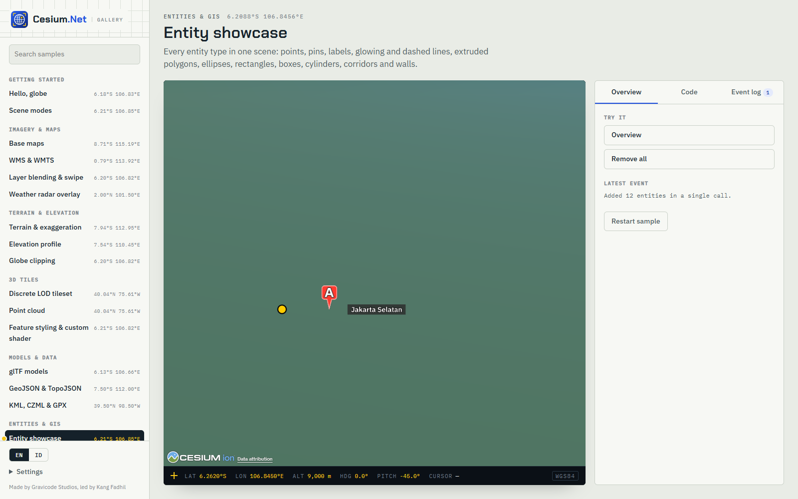

[Bahasa Indonesia](../id/entities.md)

# Entities

An entity is one object on the globe. It has a position, either static or time-sampled, plus any combination of graphics. All snippets assume `CesiumController cesium` and `using CesiumNet;`.



## Add, update, remove

```csharp
string id = await cesium.Entities.AddAsync(new EntityOptions
{
    Id = "hq",                                   // optional; generated if omitted
    Name = "Headquarters",
    Description = "<b>Open</b> 08:00–17:00",     // HTML shown in the info box
    Position = new GeoPoint(106.8456, -6.2088),
    Point = new PointGraphics { PixelSize = 12, Color = CesiumColor.Yellow, OutlineColor = CesiumColor.Black, OutlineWidth = 2 },
    Properties = new() { ["floor"] = "12", ["owner"] = "ACME" },   // returned in PickResult.Properties
});

await cesium.Entities.UpdateAsync(id, new EntityOptions { Position = new GeoPoint(106.85, -6.21) });
await cesium.Entities.SetVisibleAsync(id, false);
await cesium.Entities.SelectAsync(id);          // opens the info box
bool removed = await cesium.Entities.RemoveAsync(id);
await cesium.Entities.ClearAsync();              // everything in the viewer's entity collection
```

To add many entities, use **`AddRangeAsync`**. It makes one interop call with collection events suspended:

```csharp
var batch = Enumerable.Range(0, 500).Select(i => new EntityOptions
{
    Id = $"site-{i}",
    Position = new GeoPoint(95 + Random.Shared.NextDouble() * 46, -10 + Random.Shared.NextDouble() * 15),
    Point = new PointGraphics { PixelSize = 6, Color = CesiumColor.Cyan },
}).ToList();
string[] ids = await cesium.Entities.AddRangeAsync(batch);
```

For thousands of plain points, use `Primitives.AddPointsAsync` instead; see [3D Tiles & data](3d-tiles-and-data.md#100k-points-with-primitives).

## Points, pins, icons, labels

```csharp
// Map pin generated by CesiumJS PinBuilder (color + text or Maki icon), bottom-anchored automatically.
await cesium.Entities.AddAsync(new EntityOptions
{
    Position = new GeoPoint(106.8272, -6.1754),
    Billboard = new BillboardGraphics { PinColor = CesiumColor.Red, PinIcon = "hospital", PinSize = 48, HeightReference = HeightReference.ClampToGround },
});

// Icon from an image URL or data URL.
await cesium.Entities.AddAsync(new EntityOptions
{
    Position = new GeoPoint(106.80, -6.20),
    Billboard = new BillboardGraphics { Image = "https://example.com/icons/drone.png", Scale = 0.5, Rotation = 45 }, // clockwise degrees
});

// Label with background, visible only within 50 km and always drawn on top.
await cesium.Entities.AddAsync(new EntityOptions
{
    Position = new GeoPoint(106.8456, -6.2088, 200),
    Label = new LabelGraphics
    {
        Text = "Jakarta Selatan",
        Font = "600 14px \"IBM Plex Sans\", sans-serif",
        ShowBackground = true,
        BackgroundColor = "#15212ACC",
        PixelOffset = new Cartesian2(0, -24),               // y negative = up
        DistanceDisplayCondition = new DistanceDisplayCondition(0, 50_000),
        ScaleByDistance = new NearFarScalar(1_000, 1.0, 50_000, 0.5),
        AlwaysOnTop = true,
    },
});
```

`AlwaysOnTop` disables depth testing, so terrain and 3D Tiles never hide the graphic. Pins are cached per color, text, icon and size, so thousands of identical pins cost one image.

## Lines and surfaces

```csharp
var a = new GeoPoint(106.70, -6.10);
var b = new GeoPoint(106.95, -6.30);

await cesium.Entities.AddRangeAsync(
[
    new() { Polyline = new PolylineGraphics { Positions = [a, b], Width = 8, Material = CesiumMaterial.Glow(CesiumColor.Cyan), ClampToGround = true } },
    new() { Polyline = new PolylineGraphics { Positions = [a, b], Width = 4, Material = CesiumMaterial.Dash(CesiumColor.Orange), Geodesic = false } },
    new()
    {
        Polygon = new PolygonGraphics
        {
            Positions = [new(106.80, -6.15), new(106.86, -6.15), new(106.86, -6.20), new(106.80, -6.20)],
            Holes = [[new(106.82, -6.17), new(106.84, -6.17), new(106.84, -6.18)]],
            Material = CesiumColor.Blue.WithAlpha(0.4f),
            Outline = true, OutlineColor = CesiumColor.White,
        },
    },
    new() { Rectangle = new RectangleGraphics { Coordinates = new GeoRectangle(106.9, -6.3, 107.0, -6.2), Material = CesiumMaterial.Grid(CesiumColor.Yellow) } },
    new() { Position = new GeoPoint(106.75, -6.25), Ellipse = new EllipseGraphics { SemiMajorAxis = 3_000, SemiMinorAxis = 1_500, Rotation = 30, Material = CesiumMaterial.Stripe(CesiumColor.Green, CesiumColor.White) } },
    new() { Corridor = new CorridorGraphics { Positions = [a, new(106.8, -6.3), b], Width = 400, Material = CesiumColor.Teal.WithAlpha(0.6f) } },
    new() { Wall = new WallGraphics { Positions = [new(106.7, -6.3, 800), new(106.8, -6.35, 800)], Material = CesiumColor.Magenta.WithAlpha(0.5f) } },
]);
```

- `ClassifyGround = true` on a polygon with no height drapes it over terrain **and** 3D Tiles.
- `EllipseGraphics.Rotation` is in degrees clockwise from north, like billboard rotation.
- A polygon's `Holes` are inner rings.

## Volumes

```csharp
var p = new GeoPoint(106.8456, -6.2088);
await cesium.Entities.AddRangeAsync(
[
    // Extruded footprint (e.g. a building massing model).
    new() { Polygon = new PolygonGraphics { Positions = Geodesy.Circle(p, 120, 6), ExtrudedHeight = 160, Material = CesiumColor.Indigo, Shadows = ShadowMode.Enabled } },
    new() { Position = p.WithHeight(250), Box = new BoxGraphics { Dimensions = new Cartesian3(200, 200, 500), Material = CesiumColor.Red.WithAlpha(0.7f), Outline = true } },
    new() { Position = p.WithHeight(400), Cylinder = new CylinderGraphics { Length = 800, TopRadius = 0, BottomRadius = 300, Material = CesiumColor.Teal } }, // cone
    new() { Position = p, Ellipsoid = EllipsoidGraphics.Dome(5_000, outline: CesiumColor.Cyan) },                                                   // hemisphere
]);
```

Box, cylinder and ellipsoid are centered on `Position`, so lift them by half their height if they should sit on the ground. For sensor wedges, see [Aerospace & defense](aerospace-and-defense.md).

## 3D models (glTF / GLB)

```csharp
await cesium.Entities.AddAsync(new EntityOptions
{
    Id = "truck",
    Position = new GeoPoint(106.8272, -6.1754),
    Orientation = new HeadingPitchRoll(Heading: 135),       // compass heading, degrees
    Model = new ModelGraphics
    {
        Uri = "https://example.com/models/truck.glb",
        MinimumPixelSize = 48, MaximumScale = 200,
        RunAnimations = true,
        SilhouetteColor = CesiumColor.Yellow, SilhouetteSize = 2,
        HeightReference = HeightReference.ClampToGround,
        Shadows = ShadowMode.Enabled,
    },
});
```

The model is expected to face **+X** in its own frame (the glTF convention used by CesiumJS samples). The compass heading is converted for you. In Avalonia, serve local models with [`CesiumLocalServer.MapFolder`](avalonia.md#cesiumlocalserver-and-mapfolder).

## Dynamic entities

| Need | API |
|---|---|
| Change any property | `UpdateAsync(id, changes)` |
| Move many entities often (live feeds) | `UpdatePositionsAsync([...])` or [`RealtimeEntityFeed`](realtime-tracking.md) |
| Rotate a model or billboard while moving | `EntityPositionUpdate.Heading` |
| Pre-recorded or simulated track | `SampledPosition` + `Path` + clock, see [Camera & time](camera-and-time.md#time-dynamic-tracks) |
| Append samples to a track | `AddSamplesAsync(id, samples)` |
| Show only in a time window | `Availability = new TimeInterval(start, stop)` |
| Show/hide together | `ParentId` |

```csharp
await cesium.Entities.UpdatePositionsAsync(
[
    new EntityPositionUpdate("truck", new GeoPoint(106.8300, -6.1760), Heading: 140),
    new EntityPositionUpdate("bus-12", new GeoPoint(106.8100, -6.2000)),
]);
GeoPoint? where = await cesium.Entities.GetPositionAsync("truck");
```

`UpdatePositionsAsync` replaces a sampled position with a constant one, and it skips ids that don't exist, so create the entity first.

## Picking

```csharp
cesium.LeftClick += async (_, pick) =>
{
    if (pick.Kind == PickKind.Entity && pick.Properties?.TryGetValue("floor", out var floor) == true)
        Console.WriteLine($"{pick.EntityName} on floor {floor}");
    else if (pick.Kind == PickKind.Globe && pick.Position is { } pos)
        await cesium.Entities.AddAsync(new EntityOptions { Position = pos, Point = new PointGraphics { Color = CesiumColor.Lime } });
};
cesium.SelectedEntityChanged += (_, id) => Console.WriteLine(id is null ? "Deselected" : $"Selected {id}");
```

Screen-space hit tests on demand: `await cesium.Scene.PickAsync(x, y)`.

---
Made by Gravicode Studios, led by Kang Fadhil.
