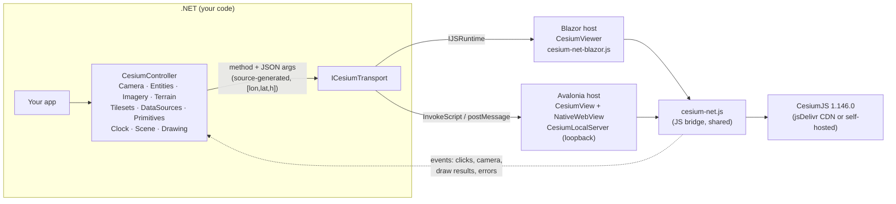

[Bahasa Indonesia](../id/index.md)

# Cesium.Net documentation

Cesium.Net is a .NET 10 wrapper around [CesiumJS](https://github.com/CesiumGS/cesium). You drive a CesiumJS 3D globe or 2D map entirely from C#. The same API runs in **Blazor** (web) and **Avalonia** (desktop): camera, entities, imagery, terrain, 3D Tiles, vector data, time-dynamic data, drawing and measuring, visual effects, geodesy and coordinate math.


## Architecture



The same thing as ASCII:

```
 C# code ──► CesiumController ──► ICesiumTransport ──┬─► Blazor: IJSRuntime ──────────────┐
   ▲            (sub-APIs)        (method, argsJson) │                                   ▼
   │                                                 └─► Avalonia: NativeWebView ──► cesium-net.js ──► CesiumJS
   └──────────────────── events (HandleHostEvent) ◄────────────────────────────────────┘
```

- **`CesiumController`** is the host-agnostic API. It does not know whether it runs in a browser or a desktop WebView.
- **`ICesiumTransport`** carries each call as a method name and a JSON argument array, and returns a JSON string. Blazor implements it over `IJSRuntime`. Avalonia implements it with script injection and posted messages.
- **`cesium-net.js`** is one JavaScript bridge used by both hosts. It loads CesiumJS, creates the viewer, executes calls and forwards events.

## Packages

| NuGet id | Namespace | Target | Contents |
|---|---|---|---|
| `Cesium.Net` | `CesiumNet`, `CesiumNet.Realtime`, `CesiumNet.Aerospace`, `CesiumNet.Ion`, `CesiumNet.Interop` | net10.0 | Core API, options, math, geodesy, realtime feed, orbits, ion client. Host-agnostic and AOT-compatible. |
| `Cesium.Net.Blazor` | `CesiumNet.Blazor` | net10.0 | `CesiumViewer` component, `AddCesiumNet`, JS bridge (static web assets). Server, WebAssembly and Web App. |
| `Cesium.Net.Avalonia` | `CesiumNet.Avalonia` | net10.0 | `CesiumView` control (native WebView: WebView2 / WKWebView / WebKitGTK), `CesiumLocalServer`. |

License: MIT. Default CesiumJS version: **1.146.0** from jsDelivr. No Cesium ion token is needed by default: the globe uses OpenStreetMap or Esri imagery with ellipsoid or Esri ArcGIS terrain.

## Pages

| Page | What it covers |
|---|---|
| [Getting started](getting-started.md) | Install, minimal Blazor and Avalonia apps, first fly-to and first entity |
| [Blazor](blazor.md) | `CesiumViewer` parameters, callbacks, render modes, overlays, templates, disposal |
| [Avalonia](avalonia.md) | `CesiumView`, `Ready`/`LoadFailed`, `CesiumLocalServer`, Linux/macOS, airspace, threading |
| [Core concepts](core-concepts.md) | Lifecycle, async model, partial updates, events, ids, units, colors, errors |
| [API reference](api-reference.md) | Every public method, grouped by API |
| [Entities](entities.md) | Points, pins, labels, shapes, volumes, models, updates |
| [Imagery & terrain](imagery-terrain.md) | Base maps, WMS/WMTS/TMS/XYZ, blending, terrain, heights, profiles, clipping |
| [3D Tiles & data](3d-tiles-and-data.md) | Tilesets, styling, point clouds, custom shaders, GeoJSON/KML/CZML/GPX, 100k points |
| [Camera & time](camera-and-time.md) | Fly-to, look-at, orbit, first-person flight, clock, time-dynamic tracks |
| [Drawing & measuring](drawing-and-measuring.md) | Interactive drawing, measurement, vertex editing |
| [Realtime tracking](realtime-tracking.md) | `RealtimeEntityFeed` with SignalR, WebSocket, MQTT and REST |
| [Aerospace & defense](aerospace-and-defense.md) | Orbits, ground tracks, footprints, sensor volumes, common operational picture |
| [Geodesy & coordinates](geodesy-and-coordinates.md) | WGS84, ECEF, ENU, Web Mercator, tiles, DMS, Vincenty, area |
| [Visual effects](visual-effects.md) | Lighting, shadows, atmosphere, fog, water, post-processing, weather, screenshots |
| [Performance](performance.md) | Batching, coalescing, primitives, request-render mode, event opt-out |
| [Offline & Cesium ion](offline-and-ion.md) | Self-hosting CesiumJS, ion tokens, `CesiumIonClient`, attribution |
| [Feature matrix](feature-matrix.md) | Every CesiumJS feature mapped to Cesium.Net coverage |
| [Gallery](gallery.md) | Running both galleries, adding samples, sample list |
| [Troubleshooting](troubleshooting.md) | CDN blocked, WebGL, WebView2, ion 401, CORS, blank globe |

## Thirty-second example

```csharp
// Works the same with Blazor's CesiumViewer.OnReady and Avalonia's CesiumView.Ready.
async Task OnReady(CesiumController cesium)
{
    await cesium.Entities.AddAsync(new EntityOptions
    {
        Name = "Monas",
        Position = new GeoPoint(106.827153, -6.175392),          // longitude, latitude (degrees)
        Billboard = new BillboardGraphics { PinColor = CesiumColor.Blue, PinText = "M" },
    });
    await cesium.Camera.FlyToAsync(106.8272, -6.1880, 2_500, pitch: -40);
}
```

---
Made by Gravicode Studios, led by Kang Fadhil.
