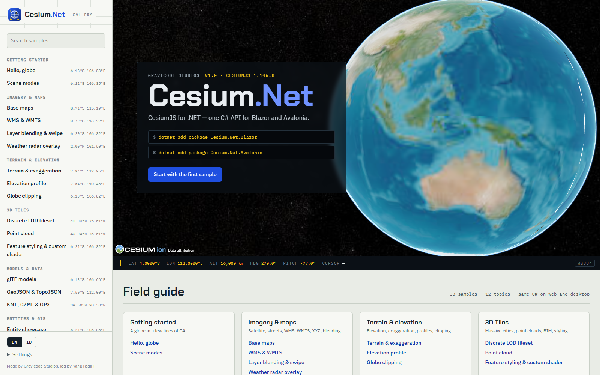
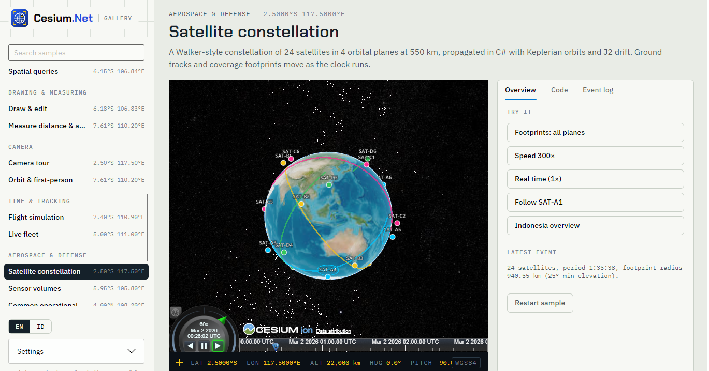

[English](../en/gallery.md)

# Galeri

Cesium.Net Gallery adalah kumpulan kasus penggunaan yang bisa dijalankan. Setiap contoh adalah **satu kelas C#** di `samples/Cesium.Net.Gallery.Shared`. Front-end web (Blazor) dan front-end desktop (Avalonia) menjalankan kelas yang sama, sehingga setiap contoh sekaligus membuktikan bahwa kodenya tidak bergantung pada host.



## Menjalankan

```bash
# Web (Blazor Server, http://localhost:5180)
dotnet run --project samples/Cesium.Net.Gallery.Blazor

# Desktop (Avalonia; Windows butuh runtime WebView2, Linux butuh WebKitGTK)
dotnet run --project samples/Cesium.Net.Gallery.Avalonia
```



Setiap halaman contoh menampilkan viewer langsung, ringkasan, tombol aksi **Coba**, kode sumber contoh (hanya bagian `// <snippet>`), dan log peristiwa berisi klik, hasil gambar, dan error. Bahasa UI bisa diganti antara English dan Bahasa Indonesia.

### Token Cesium ion (opsional)

Contoh bertanda **"Lebih baik dengan Cesium ion"** (`UsesIon`) membuka World Terrain, OSM Buildings, dan aset ion jika token sudah diatur. Tanpa token, contoh-contoh itu memakai data yang tidak membutuhkan key.

| Front-end | Tempat mengaturnya |
|---|---|
| Blazor | Dialog Pengaturan (disimpan di penyimpanan browser), atau konfigurasi server `Cesium:IonToken` (`appsettings.json`, user secrets, atau variabel lingkungan `Cesium__IonToken`) |
| Avalonia | Panel Pengaturan (disimpan di `%AppData%/Cesium.Net.Gallery/settings.json`, atau folder data aplikasi per pengguna yang setara) |

## Struktur proyek

| Proyek | Peran |
|---|---|
| `Cesium.Net.Gallery.Shared` | `GallerySample`, `SampleContext`, `SampleCatalog`, `Text`, `GalleryDefaults`, dan semua contoh di `Samples/<Kategori>/`. Berkas `.cs` contoh di-embed sebagai resource agar UI bisa menampilkan kode persisnya. |
| `Cesium.Net.Gallery.Blazor` | Host Blazor Server: indeks, halaman contoh dengan `CesiumViewer`, tampilan kode, pengaturan |
| `Cesium.Net.Gallery.Avalonia` | Host Avalonia: katalog yang sama dalam shell desktop dengan `CesiumView` (MVVM, CommunityToolkit) |

## Menambahkan contoh

1. Buat `samples/Cesium.Net.Gallery.Shared/Samples/<Kategori>/MyThingSample.cs`. Nama berkas harus sama dengan nama kelas, karena pencarian sumber memakai `/{NamaKelas}.cs`.
2. Turunkan dari `GallerySample`, lalu isi metadata dan `RunAsync`:

```csharp
using CesiumNet.Realtime;

namespace CesiumNet.Gallery.Samples;

[SampleOrder(3)]                                         // urutan dalam kategori (default 100)
public sealed class HarbourTrafficSample : GallerySample
{
    public override string Id => "harbour-traffic";      // URL: /sample/harbour-traffic (unik)
    public override string CategoryId => "time";         // salah satu dari SampleCatalog.Categories
    public override Text Title => ("Harbour traffic", "Lalu lintas pelabuhan");
    public override Text Summary => (
        "Ships moving around Tanjung Priok with live position updates.",
        "Kapal bergerak di sekitar Tanjung Priok dengan pembaruan posisi langsung.");
    public override GeoPoint? Location => new(106.8833, -6.1000);
    public override bool UsesIon => false;

    public override CesiumViewerOptions CreateOptions(string? ionToken)
        => GalleryDefaults.Options(ionToken, o => o.BaseLayer = ImageryLayerOptions.Dark());

    public override IReadOnlyList<SampleAction> Actions =>
    [
        new("follow", ("Follow ship 1", "Ikuti kapal 1"), ctx => ctx.Cesium.Camera.TrackEntityAsync("ship-1").AsTask()),
        new("stop", ("Stop following", "Berhenti mengikuti"), ctx => ctx.Cesium.Camera.TrackEntityAsync(null).AsTask()),
    ];

    public override async Task RunAsync(SampleContext ctx)
    {
        // <snippet>
        var cesium = ctx.Cesium;
        var feed = new RealtimeEntityFeed(cesium);
        ctx.Resources.Add(feed);                          // di-dispose saat contoh berhenti

        await cesium.Entities.AddAsync(new EntityOptions
        {
            Id = "ship-1", Position = new GeoPoint(106.88, -6.09),
            Billboard = new BillboardGraphics { PinColor = CesiumColor.Teal, PinText = "1" },
        });
        await cesium.Camera.FlyToAsync(106.8833, -6.1000, 8_000, pitch: -50);

        _ = Task.Run(async () =>
        {
            var lon = 106.88;
            using var timer = new PeriodicTimer(TimeSpan.FromMilliseconds(200));
            while (await timer.WaitForNextTickAsync(ctx.Token))
                feed.Push("ship-1", new GeoPoint(lon += 0.0002, -6.09), heading: 90);
        }, ctx.Token);
        ctx.Log("Ship 1 under way.");
        // </snippet>
    }
}
```

Hanya itu. `SampleCatalog` menemukan tipe `GallerySample` non-abstrak lewat reflection, mengurutkannya berdasarkan urutan kategori lalu `[SampleOrder]`, dan kedua front-end menampilkannya secara otomatis.

### Konvensi

| Item | Aturan |
|---|---|
| `// <snippet>` … `// </snippet>` | Menandai bagian yang ditampilkan di tab Kode. Indentasi bagian itu dirapikan. Tanpa penanda, seluruh berkas ditampilkan. Buat snippet yang berdiri sendiri dan bisa langsung disalin. |
| `Text` | Setiap string yang terlihat pengguna dibuat dwibahasa: `("English", "Bahasa Indonesia")`. Tuple dikonversi implisit menjadi `Text`. |
| `Id` | Kebab-case huruf kecil, unik, stabil (dipakai di URL). |
| `CategoryId` | `start`, `imagery`, `terrain`, `tiles`, `data`, `gis`, `draw`, `camera`, `time`, `aerospace`, `effects`, `advanced` |
| `[SampleOrder(n)]` | Urutan dalam kategori; nilai lebih kecil tampil lebih dulu; default 100. |
| `Location` | Opsional; ditampilkan sebagai koordinat di indeks. |
| `UsesIon` | `true` menampilkan tag dan petunjuk ion. Periksa `ctx.HasIonToken` dan sediakan fallback yang wajar. |
| `CreateOptions` | Mulai dari `GalleryDefaults.Options(ionToken, o => …)`: basemap satelit, tampilan Indonesia, event klik dan kamera. |
| `SampleContext` | `Cesium`, `Token` (dibatalkan saat contoh berhenti), `Log(...)`, `State` (kamus sementara), `Resources` (`IAsyncDisposable` yang di-dispose saat berhenti), `Http` (`HttpClient` bersama), `IonToken`/`HasIonToken` |
| Aksi | `SampleAction(key, label, run)`, dengan label `Group` opsional. Setiap aksi berjalan dengan `SampleContext` yang sama. |
| Kode bersama | Harus bisa dikompilasi untuk kedua host: pakai hanya API `CesiumNet`, tanpa tipe Blazor atau Avalonia. |

## Contoh

### Kategori

Kategori didefinisikan di `SampleCatalog.Categories` dan ditampilkan dalam urutan berikut:

| Id | Judul | Cakupan |
|---|---|---|
| `start` | Memulai | Globe 3D dengan beberapa baris C# |
| `imagery` | Citra & peta | Satelit, jalan, WMS, WMTS, XYZ, blending |
| `terrain` | Terrain & elevasi | Elevasi, eksagerasi, profil, clipping |
| `tiles` | 3D Tiles | Kota masif, point cloud, BIM, styling |
| `data` | Model & data | glTF, GeoJSON, TopoJSON, KML, CZML, GPX |
| `gis` | Entitas & GIS | Bentuk, picking, koordinat, kueri spasial |
| `draw` | Menggambar & mengukur | Sketsa, edit, ukur jarak dan luas |
| `camera` | Kamera | Tur fly-to, orbit, terbang orang pertama |
| `time` | Waktu & pelacakan | Timeline, simulasi, armada real-time |
| `aerospace` | Dirgantara & pertahanan | Orbit, sensor, gambaran operasional |
| `effects` | Efek visual | Pencahayaan, bayangan, atmosfer, cuaca |
| `advanced` | Performa & integrasi | 100rb titik, Cesium ion, screenshot, JS |

### Contoh yang tersedia saat ini

Galeri saat ini berisi 33 contoh di seluruh 12 kategori. Galeri yang sedang berjalan selalu menjadi indeks yang paling akurat.

| Kategori | Id | Judul | Ion |
|---|---|---|---|
| start | `hello-globe` | Halo, globe |  |
| start | `scene-modes` | Mode tampilan |  |
| imagery | `base-maps` | Peta dasar |  |
| imagery | `wms-wmts` | WMS & WMTS |  |
| imagery | `layer-blending` | Blending lapisan & swipe |  |
| imagery | `weather-radar` | Overlay radar cuaca |  |
| terrain | `terrain-exaggeration` | Terrain & eksagerasi | ✓ |
| terrain | `elevation-profile` | Profil elevasi | ✓ |
| terrain | `globe-clipping` | Clipping globe |  |
| tiles | `discrete-lod` | Tileset LOD diskret |  |
| tiles | `point-cloud` | Point cloud |  |
| tiles | `feature-styling` | Styling fitur & custom shader | ✓ |
| data | `gltf-models` | Model glTF |  |
| data | `geojson-topojson` | GeoJSON & TopoJSON |  |
| data | `kml-czml-gpx` | KML, CZML & GPX |  |
| gis | `entity-showcase` | Ragam entitas |  |
| gis | `picking` | Picking & properti |  |
| gis | `coordinate-systems` | Sistem koordinat |  |
| gis | `spatial-queries` | Kueri spasial |  |
| draw | `draw-edit` | Menggambar & mengedit |  |
| draw | `measure` | Ukur jarak & luas |  |
| camera | `camera-tour` | Tur kamera | ✓ |
| camera | `orbit-first-person` | Orbit & orang pertama | ✓ |
| time | `flight-simulation` | Simulasi penerbangan |  |
| time | `live-fleet` | Armada real-time |  |
| aerospace | `satellite-constellation` | Konstelasi satelit |  |
| aerospace | `sensor-volumes` | Volume sensor |  |
| aerospace | `operational-picture` | Gambaran operasional bersama |  |
| effects | `lighting-shadows` | Pencahayaan & bayangan |  |
| effects | `atmosphere-weather` | Atmosfer & cuaca | ✓ |
| advanced | `points-100k` | 100.000 titik |  |
| advanced | `cesium-ion` | Cesium ion | ✓ |
| advanced | `screenshot-script` | Screenshot & JavaScript |  |


---
Dibuat oleh Gravicode Studios dipimpin oleh Kang Fadhil.
