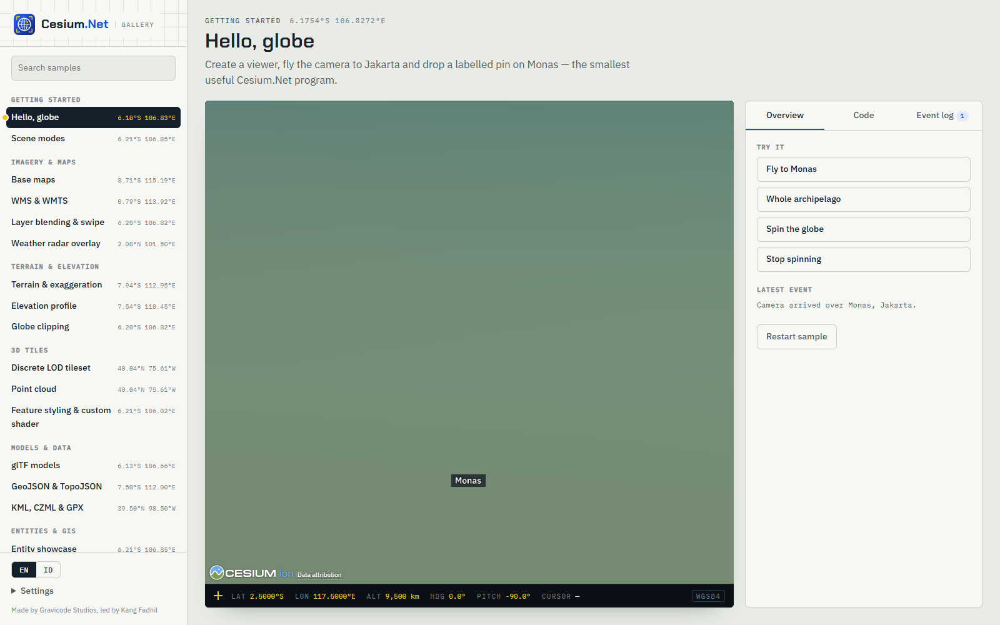

[English](../en/getting-started.md)

# Memulai

Anda membutuhkan .NET 10 SDK. Secara default viewer memuat CesiumJS 1.146.0 dari `cdn.jsdelivr.net`, jadi mesin yang menjalankan browser atau WebView butuh akses internet. Untuk berjalan tanpa internet, lihat [Offline & Cesium ion](offline-and-ion.md).



## 1. Instalasi

| Host | Perintah |
|---|---|
| Blazor (Server, WebAssembly, Web App) | `dotnet add package Cesium.Net.Blazor` |
| Avalonia desktop | `dotnet add package Cesium.Net.Avalonia` |
| Kode library bersama saja (tanpa UI) | `dotnet add package Cesium.Net` |

Kedua paket host sudah mereferensikan `Cesium.Net`, jadi paket itu tidak perlu ditambahkan terpisah.

## 2a. Blazor

### Program.cs

Registrasi bersifat opsional. Gunanya untuk mengatur default di seluruh aplikasi, misalnya token ion atau URL CesiumJS yang di-host sendiri.

```csharp
using CesiumNet.Blazor;

var builder = WebApplication.CreateBuilder(args);
builder.Services.AddRazorComponents().AddInteractiveServerComponents();
builder.Services.AddCesiumNet(); // opsional: o => o.IonAccessToken = builder.Configuration["Cesium:IonToken"]

var app = builder.Build();
app.UseAntiforgery();
app.MapStaticAssets();             // menyajikan _content/Cesium.Net.Blazor/*.js
app.MapRazorComponents<App>().AddInteractiveServerRenderMode();
app.Run();
```

Untuk **WebAssembly standalone**, panggil `builder.Services.AddCesiumNet()` pada `WebAssemblyHostBuilder` di `Program.cs` milik klien.

### _Imports.razor

```razor
@using CesiumNet
@using CesiumNet.Blazor
```

### App.razor

Tata letak komponen berasal dari scoped CSS-nya. Pertahankan link bundle standar yang sudah ada di template:

```html
<link rel="stylesheet" href="@Assets["MyApp.styles.css"]" />
```

### Sebuah halaman

`CesiumViewer` memakai JS interop, jadi komponen ini harus di-render secara **interaktif** (Server, WebAssembly, atau Auto). Ukurannya mengikuti elemen induk, jadi beri tinggi pada induk atau pada komponennya.

```razor
@page "/map"
@rendermode InteractiveServer

<div style="height: 80vh">
    <CesiumViewer OnReady="OnReady" OnLeftClick="OnClick" />
</div>

<p>@_status</p>

@code {
    private string _status = "Loading…";

    private async Task OnReady(CesiumController cesium)
    {
        // Entitas pertama: pin dengan label.
        await cesium.Entities.AddAsync(new EntityOptions
        {
            Id = "monas",
            Name = "Monumen Nasional",
            Position = new GeoPoint(106.827153, -6.175392),
            Billboard = new BillboardGraphics { PinColor = "#1F4FE0", PinIcon = "monument", HeightReference = HeightReference.ClampToGround },
            Label = new LabelGraphics { Text = "Monas", PixelOffset = new Cartesian2(0, -58), ShowBackground = true },
        });

        // Fly-to pertama: bujur, lintang, ketinggian (m), pitch dalam derajat.
        await cesium.Camera.FlyToAsync(106.8272, -6.1880, 2_500, pitch: -40, duration: 4);
        _status = "Ready";
    }

    private void OnClick(PickResult pick)
        => _status = pick.Position is { } p ? $"Clicked {pick.Kind} at {p}" : "Clicked space";
}
```

Catatan render mode:

- **Blazor Web App, Interactive Server**: gunakan contoh di atas.
- **Blazor Web App, Interactive WebAssembly / Auto**: letakkan halaman di proyek `.Client` dan referensikan `Cesium.Net.Blazor` dari proyek tersebut.
- **WebAssembly standalone**: semua komponen sudah interaktif, jadi `@rendermode` boleh dihapus.

Semua parameter dijelaskan di [Blazor](blazor.md).

## 2b. Avalonia

Cesium.Net.Avalonia menargetkan Avalonia 12 dan memakai `Avalonia.Controls.WebView`. Aplikasi pada umumnya juga mereferensikan `Avalonia.Desktop` dan `Avalonia.Themes.Fluent`.

### Windows: application manifest (wajib)

Di Windows, aplikasi yang memakai `CesiumView` **wajib** menyertakan application manifest yang mendeklarasikan dukungan Windows 10/11. Tanpa manifest itu aplikasi crash dengan `InvalidOperationException: Unable to create child window for native control host. Application manifest with supported OS list might be required.`

```xml
<!-- MyApp.csproj -->
<PropertyGroup>
  <ApplicationManifest>app.manifest</ApplicationManifest>
</PropertyGroup>
```

```xml
<!-- app.manifest -->
<?xml version="1.0" encoding="utf-8"?>
<assembly manifestVersion="1.0" xmlns="urn:schemas-microsoft-com:asm.v1">
  <assemblyIdentity version="1.0.0.0" name="MyApp.app" />
  <compatibility xmlns="urn:schemas-microsoft-com:compatibility.v1">
    <application>
      <!-- Windows 10 dan Windows 11 -->
      <supportedOS Id="{8e0f7a12-bfb3-4fe8-b9a5-48fd50a15a9a}" />
    </application>
  </compatibility>
  <application xmlns="urn:schemas-microsoft-com:asm.v3">
    <windowsSettings>
      <dpiAwareness xmlns="http://schemas.microsoft.com/SMI/2016/WindowsSettings">PerMonitorV2</dpiAwareness>
    </windowsSettings>
  </application>
</assembly>
```

File lengkapnya ada di `samples/Cesium.Net.Gallery.Avalonia/app.manifest`.

### Program.cs

```csharp
using Avalonia;

internal static class Program
{
    [STAThread]
    public static void Main(string[] args) => BuildAvaloniaApp().StartWithClassicDesktopLifetime(args);

    public static AppBuilder BuildAvaloniaApp()
        => AppBuilder.Configure<App>().UsePlatformDetect().WithInterFont().LogToTrace();
}
```

### MainWindow.axaml

Letakkan toolbar **di samping** globe, bukan di atasnya. Native WebView digambar di atas konten Avalonia; lihat [Avalonia: airspace](avalonia.md#airspace-overlay-diletakkan-di-samping-view).

```xml
<Window xmlns="https://github.com/avaloniaui"
        xmlns:x="http://schemas.microsoft.com/winfx/2006/xaml"
        xmlns:cesium="using:CesiumNet.Avalonia"
        x:Class="MyApp.MainWindow"
        Title="My globe" Width="1200" Height="800">
  <DockPanel>
    <StackPanel DockPanel.Dock="Left" Width="220" Margin="12" Spacing="8">
      <Button Content="Fly to Monas" Click="OnFlyClick" />
      <TextBlock x:Name="Status" Text="Loading…" TextWrapping="Wrap" />
    </StackPanel>
    <cesium:CesiumView x:Name="Globe" Ready="OnGlobeReady" LoadFailed="OnGlobeLoadFailed" />
  </DockPanel>
</Window>
```

### MainWindow.axaml.cs

```csharp
using Avalonia.Controls;
using Avalonia.Interactivity;
using CesiumNet;
using CesiumNet.Avalonia;

namespace MyApp;

public partial class MainWindow : Window
{
    public MainWindow()
    {
        InitializeComponent();
        // Options dibaca saat halaman dimuat, jadi atur sebelum window ditampilkan.
        Globe.Options = new CesiumViewerOptions
        {
            BaseLayer = ImageryLayerOptions.Satellite(),
            InitialView = CameraView.At(117.5, -2.5, 9_500_000),
        };
        Globe.Controller.LeftClick += (_, pick) => Status.Text = $"{pick.Kind} at {pick.Position}";
    }

    private async void OnGlobeReady(object? sender, CesiumReadyEventArgs e)
    {
        var cesium = e.Controller;
        await cesium.Entities.AddAsync(new EntityOptions
        {
            Id = "monas",
            Name = "Monumen Nasional",
            Position = new GeoPoint(106.827153, -6.175392),
            Billboard = new BillboardGraphics { PinColor = CesiumColor.Blue, PinText = "M" },
        });
        await cesium.Camera.FlyToAsync(106.8272, -6.1880, 2_500, pitch: -40);
        Status.Text = "Ready";
    }

    private void OnGlobeLoadFailed(object? sender, CesiumError error)
        => Status.Text = "CesiumJS failed to load: " + error.Message;

    private async void OnFlyClick(object? sender, RoutedEventArgs e)
        => await Globe.Controller.Camera.FlyToAsync(106.8272, -6.1820, 1_800, pitch: -35);
}
```

Deklarasikan `CesiumView` di XAML seperti contoh di atas. Jika membuatnya lewat kode, lakukan setelah window selesai dimuat (di event `Loaded`), bukan di konstruktor. `Globe.Controller` sudah boleh dipanggil sebelum viewer siap karena pemanggilan diantrekan. Di Windows, WebView2 runtime harus terpasang; di Linux, pasang WebKitGTK. Lihat [Avalonia](avalonia.md).

## 3. Langkah berikutnya

- [Konsep inti](core-concepts.md): id, satuan, event, error.
- [Entitas](entities.md) dan [Kamera & waktu](camera-and-time.md).
- Jalankan [galeri](gallery.md): `dotnet run --project samples/Cesium.Net.Gallery.Blazor`.

---
Dibuat oleh Gravicode Studios dipimpin oleh Kang Fadhil.
