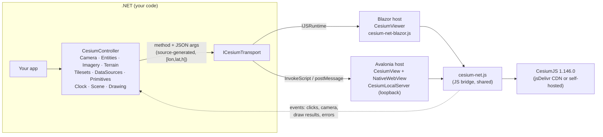

[English](../en/index.md)

# Dokumentasi Cesium.Net

Cesium.Net adalah wrapper .NET 10 untuk [CesiumJS](https://github.com/CesiumGS/cesium). Dengan Cesium.Net, globe 3D atau peta 2D CesiumJS dikendalikan sepenuhnya dari C#. API yang sama berjalan di **Blazor** (web) dan **Avalonia** (desktop). Cakupannya meliputi kamera, entitas, imagery, terrain, 3D Tiles, data vektor, data time-dynamic, menggambar dan mengukur, efek visual, geodesi, serta matematika koordinat.


## Arsitektur



Versi ASCII-nya:

```
 C# code ──► CesiumController ──► ICesiumTransport ──┬─► Blazor: IJSRuntime ──────────────┐
   ▲            (sub-APIs)        (method, argsJson) │                                   ▼
   │                                                 └─► Avalonia: NativeWebView ──► cesium-net.js ──► CesiumJS
   └──────────────────── events (HandleHostEvent) ◄────────────────────────────────────┘
```

- **`CesiumController`** adalah API yang tidak bergantung pada host. Ia tidak tahu apakah sedang berjalan di browser atau di WebView desktop.
- **`ICesiumTransport`** membawa setiap pemanggilan sebagai nama method plus array argumen JSON, lalu mengembalikan string JSON. Blazor mengimplementasikannya lewat `IJSRuntime`, sedangkan Avalonia lewat injeksi skrip dan pesan yang di-post.
- **`cesium-net.js`** adalah satu bridge JavaScript yang dipakai kedua host. Bridge ini memuat CesiumJS, membuat viewer, menjalankan pemanggilan, dan meneruskan event.

## Paket

| NuGet id | Namespace | Target | Isi |
|---|---|---|---|
| `Cesium.Net` | `CesiumNet`, `CesiumNet.Realtime`, `CesiumNet.Aerospace`, `CesiumNet.Ion`, `CesiumNet.Interop` | net10.0 | API inti, opsi, matematika, geodesi, feed real-time, orbit, klien ion. Tidak bergantung host dan kompatibel AOT. |
| `Cesium.Net.Blazor` | `CesiumNet.Blazor` | net10.0 | Komponen `CesiumViewer`, `AddCesiumNet`, bridge JS (static web assets). Mendukung Server, WebAssembly, dan Web App. |
| `Cesium.Net.Avalonia` | `CesiumNet.Avalonia` | net10.0 | Kontrol `CesiumView` (native WebView: WebView2 / WKWebView / WebKitGTK) dan `CesiumLocalServer`. |

Lisensi: MIT. Versi CesiumJS default: **1.146.0** dari jsDelivr. Secara default tidak perlu token Cesium ion: globe memakai imagery OpenStreetMap atau Esri dengan terrain ellipsoid atau Esri ArcGIS.

## Halaman

| Halaman | Isi |
|---|---|
| [Memulai](getting-started.md) | Instalasi, aplikasi Blazor dan Avalonia minimal, fly-to dan entitas pertama |
| [Blazor](blazor.md) | Parameter `CesiumViewer`, callback, render mode, overlay, template, disposal |
| [Avalonia](avalonia.md) | `CesiumView`, `Ready`/`LoadFailed`, `CesiumLocalServer`, Linux/macOS, airspace, threading |
| [Konsep inti](core-concepts.md) | Siklus hidup, model async, update parsial, event, id, satuan, warna, error |
| [Referensi API](api-reference.md) | Semua method publik, dikelompokkan per API |
| [Entitas](entities.md) | Titik, pin, label, bentuk, volume, model, update |
| [Imagery & terrain](imagery-terrain.md) | Peta dasar, WMS/WMTS/TMS/XYZ, blending, terrain, ketinggian, profil, clipping |
| [3D Tiles & data](3d-tiles-and-data.md) | Tileset, styling, point cloud, custom shader, GeoJSON/KML/CZML/GPX, 100rb titik |
| [Kamera & waktu](camera-and-time.md) | Fly-to, look-at, orbit, terbang orang pertama, clock, lintasan time-dynamic |
| [Menggambar & mengukur](drawing-and-measuring.md) | Menggambar interaktif, pengukuran, edit vertex |
| [Pelacakan real-time](realtime-tracking.md) | `RealtimeEntityFeed` dengan SignalR, WebSocket, MQTT, dan REST |
| [Dirgantara & pertahanan](aerospace-and-defense.md) | Orbit, ground track, footprint, volume sensor, common operational picture |
| [Geodesi & koordinat](geodesy-and-coordinates.md) | WGS84, ECEF, ENU, Web Mercator, tile, DMS, Vincenty, luas |
| [Efek visual](visual-effects.md) | Pencahayaan, bayangan, atmosfer, kabut, air, post-processing, cuaca, screenshot |
| [Performa](performance.md) | Batching, coalescing, primitive, mode request-render, menonaktifkan event |
| [Offline & Cesium ion](offline-and-ion.md) | Self-hosting CesiumJS, token ion, `CesiumIonClient`, atribusi |
| [Matriks fitur](feature-matrix.md) | Setiap fitur CesiumJS dipetakan ke cakupan Cesium.Net |
| [Galeri](gallery.md) | Menjalankan kedua galeri, menambah sampel, daftar sampel |
| [Pemecahan masalah](troubleshooting.md) | CDN diblokir, WebGL, WebView2, ion 401, CORS, globe kosong |

## Contoh tiga puluh detik

```csharp
// Sama saja di Blazor (CesiumViewer.OnReady) maupun Avalonia (CesiumView.Ready).
async Task OnReady(CesiumController cesium)
{
    await cesium.Entities.AddAsync(new EntityOptions
    {
        Name = "Monas",
        Position = new GeoPoint(106.827153, -6.175392),          // bujur, lintang (derajat)
        Billboard = new BillboardGraphics { PinColor = CesiumColor.Blue, PinText = "M" },
    });
    await cesium.Camera.FlyToAsync(106.8272, -6.1880, 2_500, pitch: -40);
}
```

---
Dibuat oleh Gravicode Studios dipimpin oleh Kang Fadhil.
