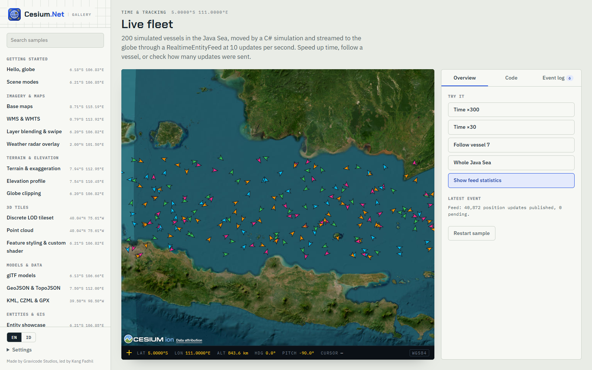

[English](../en/realtime-tracking.md)

# Pelacakan real-time



Feed langsung (kapal AIS, pesawat ADS-B, telemetri UAV, bus, sensor IoT) sering mengirim jauh lebih banyak pesan daripada yang perlu dirender viewer. `RealtimeEntityFeed` (namespace `CesiumNet.Realtime`) berada di antara sumber pesan apa pun dan viewer.

```
SignalR / WebSocket / MQTT / REST ──Push()──► RealtimeEntityFeed ──every 100 ms──► Entities.UpdatePositionsAsync(batch)
          (any thread, never blocks)            latest-wins per id                    one interop call
```

- `Push` thread-safe dan lock-free. Hanya **pembaruan terbaru per id entitas** yang disimpan, sehingga 1.000 pesan untuk satu pesawat di antara dua flush hanya menjadi satu pembaruan.
- Setiap `interval` (default 100 ms, yaitu 10 Hz), pembaruan yang tertunda dikirim dalam **satu** panggilan `UpdatePositionsAsync`.
- `PublishedCount` dan `PendingCount` membantu pemantauan. `FlushFailed` melaporkan exception, misalnya saat viewer sudah tidak ada. Event ini dimunculkan di thread pool.
- `DisposeAsync` menghentikan loop. Pembaruan yang masih tertunda dibuang; panggil `FlushAsync()` lebih dulu jika masih dibutuhkan.

## Polanya

`UpdatePositionsAsync` diam-diam melewati id yang belum ada. Buat entitas saat sebuah id pertama kali terlihat, lalu alirkan posisinya:

```csharp
using System.Collections.Concurrent;
using CesiumNet;
using CesiumNet.Realtime;

public sealed class TrackLayer(CesiumController cesium) : IAsyncDisposable
{
    private readonly RealtimeEntityFeed _feed = new(cesium, TimeSpan.FromMilliseconds(100));
    private readonly ConcurrentDictionary<string, byte> _known = new();

    public async ValueTask OnPositionAsync(string id, double lon, double lat, double alt, double? heading)
    {
        if (_known.TryAdd(id, 0))
        {
            await cesium.Entities.AddAsync(new EntityOptions
            {
                Id = id, Name = id,
                Position = new GeoPoint(lon, lat, alt),
                Billboard = new BillboardGraphics { Image = "/icons/arrow.png", Scale = 0.6, Rotation = heading ?? 0 },
                Label = new LabelGraphics { Text = id, PixelOffset = new Cartesian2(0, -22), Scale = 0.8,
                                            DistanceDisplayCondition = new DistanceDisplayCondition(0, 150_000) },
            });
            return;
        }
        _feed.Push(id, new GeoPoint(lon, lat, alt), heading);   // murah; digabungkan (coalesced)
    }

    public ValueTask DisposeAsync() => _feed.DisposeAsync();
}
```

`Heading` memutar model, box, dan cylinder (orientation) serta billboard (rotasi searah jarum jam). Label tidak ikut diputar.

## SignalR

Paket `Microsoft.AspNetCore.SignalR.Client`. Berfungsi di Blazor Server, Blazor WebAssembly, dan Avalonia.

```csharp
using Microsoft.AspNetCore.SignalR.Client;

var tracks = new TrackLayer(cesium);
await using var hub = new HubConnectionBuilder()
    .WithUrl("https://example.com/hubs/fleet")
    .WithAutomaticReconnect()
    .Build();

hub.On<string, double, double, double, double?>("position",
    (id, lon, lat, alt, heading) => tracks.OnPositionAsync(id, lon, lat, alt, heading).AsTask());

await hub.StartAsync();
```

Di sisi server, misalnya di hub ASP.NET Core atau background service:

```csharp
await hubContext.Clients.All.SendAsync("position", "PK-ABC", 106.65, -6.12, 3_200.0, 87.0);
```

## WebSocket (JSON mentah)

`System.Net.WebSockets.ClientWebSocket` berfungsi di desktop dan di browser (Blazor WebAssembly).

```csharp
using System.Net.WebSockets;
using System.Text.Json;

public sealed record PositionMessage(string Id, double Lon, double Lat, double Alt, double? Heading);

async Task RunWebSocketAsync(TrackLayer tracks, CancellationToken ct)
{
    using var ws = new ClientWebSocket();
    await ws.ConnectAsync(new Uri("wss://example.com/live"), ct);
    var buffer = new byte[16 * 1024];
    using var message = new MemoryStream();
    var json = new JsonSerializerOptions(JsonSerializerDefaults.Web);

    while (!ct.IsCancellationRequested && ws.State == WebSocketState.Open)
    {
        var result = await ws.ReceiveAsync(buffer, ct);
        if (result.MessageType == WebSocketMessageType.Close) break;
        message.Write(buffer, 0, result.Count);
        if (!result.EndOfMessage) continue;

        // Satu pesan bisa membawa array posisi.
        var batch = JsonSerializer.Deserialize<PositionMessage[]>(message.GetBuffer().AsSpan(0, (int)message.Length), json) ?? [];
        message.SetLength(0);
        foreach (var p in batch) await tracks.OnPositionAsync(p.Id, p.Lon, p.Lat, p.Alt, p.Heading);
    }
}
```

Jika Anda mem-publish dengan trimming atau Native AOT, ganti panggilan `JsonSerializer` berbasis reflection dengan `JsonSerializerContext` hasil source generator.

## MQTT

Paket `MQTTnet`. Cuplikan ini memakai API 5.x; versi 4.x memakai `MqttFactory` dan member serupa. Di Blazor WebAssembly, sambungkan lewat MQTT-over-WebSockets (`.WithWebSocketServer(...)`), karena TCP mentah tidak tersedia di browser.

```csharp
using MQTTnet;
using System.Text.Json;

var factory = new MqttClientFactory();
using var mqtt = factory.CreateMqttClient();
var tracks = new TrackLayer(cesium);
var json = new JsonSerializerOptions(JsonSerializerDefaults.Web);

mqtt.ApplicationMessageReceivedAsync += async e =>
{
    // Topik: fleet/{id}/position   Payload: {"lon":..,"lat":..,"alt":..,"heading":..}
    var id = e.ApplicationMessage.Topic.Split('/')[1];
    var p = JsonSerializer.Deserialize<PositionMessage>(e.ApplicationMessage.ConvertPayloadToString(), json);
    if (p is not null) await tracks.OnPositionAsync(id, p.Lon, p.Lat, p.Alt, p.Heading);
};

await mqtt.ConnectAsync(new MqttClientOptionsBuilder().WithTcpServer("broker.example.com", 1883).Build());
await mqtt.SubscribeAsync(factory.CreateSubscribeOptionsBuilder().WithTopicFilter("fleet/+/position").Build());
```

## Polling REST

```csharp
using System.Net.Http.Json;

async Task PollAsync(HttpClient http, TrackLayer tracks, CancellationToken ct)
{
    using var timer = new PeriodicTimer(TimeSpan.FromSeconds(5));
    do
    {
        var snapshot = await http.GetFromJsonAsync<PositionMessage[]>("https://example.com/api/vehicles", ct) ?? [];
        foreach (var v in snapshot) await tracks.OnPositionAsync(v.Id, v.Lon, v.Lat, v.Alt, v.Heading);
    }
    while (await timer.WaitForNextTickAsync(ct));
}
```

Dengan polling yang lambat, lompatan posisi terlihat. Ada dua cara untuk menghaluskannya:

- Gunakan `SampledPosition` dengan `Extrapolate = true` dan tambahkan setiap posisi dengan `AddSamplesAsync`. CesiumJS lalu menginterpolasi di antara posisi tersebut, asalkan clock berjalan real-time (`Multiplier = 1`, `ShouldAnimate = true`, `CurrentTime` ≈ sekarang, sedikit tertunda).
- Gunakan `Path` pendek (`TrailTime`) untuk menampilkan riwayat terbaru.

## Simulator dan pengujian

`RealtimeEntityFeed` tidak peduli dari mana pembaruan berasal, jadi timer yang menggerakkan N kendaraan sudah cukup untuk load test sebuah scene:

```csharp
await using var feed = new RealtimeEntityFeed(cesium);
var rnd = new Random(1);
var ids = Enumerable.Range(0, 2_000).Select(i => $"veh-{i}").ToArray();
await cesium.Entities.AddRangeAsync(ids.Select(id => new EntityOptions
{
    Id = id, Position = new GeoPoint(106.8 + rnd.NextDouble() * 0.2, -6.3 + rnd.NextDouble() * 0.2),
    Point = new PointGraphics { PixelSize = 5, Color = CesiumColor.Lime },
}).ToList());

using var tick = new PeriodicTimer(TimeSpan.FromMilliseconds(20));        // produsen 50 Hz
while (await tick.WaitForNextTickAsync(ct))
    foreach (var id in ids)
        feed.Push(id, new GeoPoint(106.8 + rnd.NextDouble() * 0.2, -6.3 + rnd.NextDouble() * 0.2));
// Viewer tetap hanya menerima 10 batch per detik.
```

## Catatan per host

| Host | Catatan |
|---|---|
| Blazor Server | Feed berjalan di server; setiap flush adalah satu pesan SignalR ke browser. Pertahankan interval 100 ms atau lebih untuk banyak klien. Dispose feed di `DisposeAsync` milik komponen. |
| Blazor WebAssembly | Semuanya berjalan di browser. Gunakan klien SignalR, WebSocket, atau MQTT-over-WebSocket. |
| Avalonia | Flush di-marshal ke UI thread oleh transport. `FlushFailed` datang dari thread pool, jadi gunakan `Dispatcher.UIThread.Post` untuk memperbarui UI. |

Gunakan `RequestRenderMode = true` untuk scene yang sebagian besar statis. Setiap flush otomatis memicu render.

---
Dibuat oleh Gravicode Studios dipimpin oleh Kang Fadhil.
