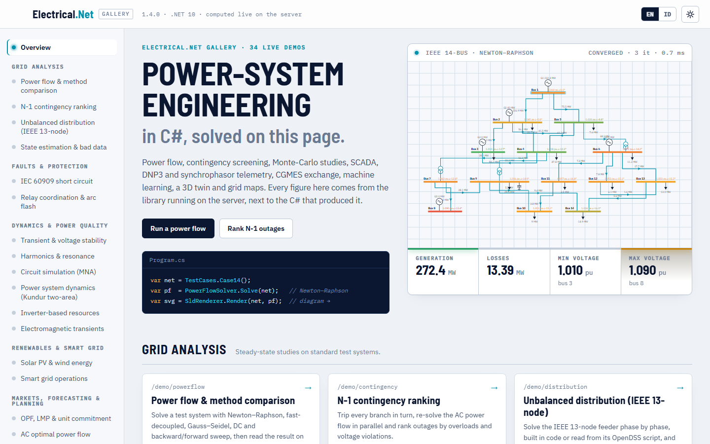

# Electrical.Net

**Comprehensive Electrical Engineering & Power System Framework for .NET.** Made by Gravicode Studios, led by Kang Fadhil
(*Dibuat oleh Gravicode Studios dipimpin oleh Kang Fadhil*).



Building blocks for EMS, DMS, ADMS, DERMS, VPP, SCADA, digital twins and smart grids on .NET 10:

- **Electrical.Core**: sparse complex LU, per-unit, phasors and symmetrical components, network model, Y-bus, MATPOWER I/O, IEEE test cases
- **Electrical.PowerFlow**: Newton–Raphson, fast-decoupled, Gauss–Seidel, DC, backward/forward sweep, N-1 contingency, PTDF/LODF
- **Electrical.ShortCircuit / Protection / Stability / Harmonic / Circuit**: IEC 60909 faults, relay coordination and arc flash, transient and voltage stability, harmonics and power quality, circuit simulation (MNA)
- **Electrical.Dynamics / Emt** (1.3): GENROU/GENSAL machines, exciters, governors, PSS, REGC/REEC/REPC and grid-forming inverters, PSS/E .dyr, small-signal analysis; electromagnetic transients with Bergeron lines, switches, power electronics and Rust kernels
- **Electrical.Renewable / SmartGrid / Optimization / StateEstimation / Forecasting / Simulation**: PV, wind, BESS, hosting capacity; demand response, EV charging, microgrids, VPP, reconfiguration; economic dispatch, DC-OPF with LMPs, unit commitment; WLS state estimation; load and renewable forecasting; QSTS and Monte-Carlo reliability
- **Electrical.SCADA / IEC61850 / CIM / GIS**: Modbus TCP, DNP3 outstation/master, IEC 104 client/server, alarms, historian; SCL, GOOSE, Sampled Values; CGMES 2.4.15/3.0 export, import and 22-rule validation; GeoJSON and maps
- **Electrical.Pmu** (1.4): IEEE C37.118 synchrophasor frames and PMU/PDC transport, PMU simulator, P/M-class phasor estimation, linear PMU state estimation
- **Electrical.AI.Learning** (1.4): ML load forecasting (GraviLearn, ML.NET), fault classification and location, topology identification, deep-RL Volt/VAR with Gravicode.RLNet
- **Electrical.DigitalTwin.ThreeD(.Avalonia)** (1.4): 3D substation and feeder scenes coloured by power flow or twin state, glTF export, off-screen render, Avalonia view (ThreeNet)
- **Electrical.DigitalTwin / AI / Cloud / HPC / Native**: live grid twin, LLM grid-operator agent, web API, parallel probabilistic load flow, Rust kernels
- **Electrical.Visualization(.Blazor)**: single-line diagrams and charts · **Electrical.Cli** (`eln`) · **Electrical.Templates**

```csharp
using Electrical.Core.Network;
using Electrical.PowerFlow;

var result = PowerFlowSolver.Solve(TestCases.Case14());
Console.WriteLine(result); // NewtonRaphson: converged in 4 it, ... losses 13.393 MW
```

Documentation (English & Bahasa Indonesia), gallery apps and source: https://github.com/DotNetVibeCoderz/Vibe_Components/tree/main/Electrical.Net
