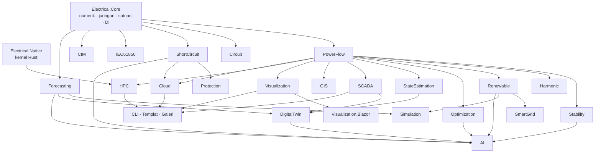

<p align="center"></p>

<h1 align="center">Electrical.Net</h1>
<p align="center"><b>Framework Teknik Elektro &amp; Sistem Tenaga Listrik Terlengkap untuk .NET</b><br/>
.NET 10 · kernel native Rust · Blazor &amp; Avalonia · MIT<br/>
<i>Dibuat oleh Gravicode Studios dipimpin oleh Kang Fadhil</i></p>

<p align="center"><a href="README.md">🇬🇧 Read in English</a></p>


Electrical.Net menyediakan blok bangunan perangkat lunak sistem tenaga untuk pengembang .NET: aliran daya, hubung singkat, proteksi,
stabilitas, harmonik, energi terbarukan, kendali smart grid, optimasi, estimasi keadaan, SCADA dan protokol gardu induk, pertukaran model CIM,
GIS, simulasi, API cloud, dan digital twin. Framework ini dirancang sebagai fondasi aplikasi EMS, DMS, ADMS, DERMS, VPP, SCADA, dan digital twin.
Algoritmanya diuji terhadap nilai acuan yang telah dipublikasikan (MATPOWER, IEC 60909, IEEE 1584, Anderson & Fouad, Baran & Wu, Billinton &
Allan, Wood & Wollenberg, dan lainnya); lihat [Validasi](#validasi).

```csharp
using Electrical.Core.Network;
using Electrical.PowerFlow;

var pf = PowerFlowSolver.Solve(TestCases.Case14());   // Newton–Raphson sparse
Console.WriteLine(pf);
// NewtonRaphson: converged in 4 it, mismatch 1.00E-014, gen 272.393 MW, load 259 MW, losses 13.393 MW, Vmin 1.0100 pu @ bus 3
```

## Modul

| Paket | Isi |
|---|---|
| **Electrical.Core** | Aljabar linear dense/sparse generik (`SparseLU<Complex>` dengan pengurutan minimum-degree), sistem per-unit, fasor, komponen simetris, model `PowerNetwork` bus-cabang, `NetworkBuilder` dalam satuan fisik, pustaka penghantar, Y-bus (urutan positif/negatif/nol), topologi, I/O MATPOWER, kasus uji (case9, case14, Baran–Wu 33-bus, jaringan sintetis), `TimeSeries`, builder DI dan event bus |
| **Electrical.Circuit** | Analisis nodal termodifikasi (MNA): titik kerja DC, sapuan AC / Bode, transien (trapezoidal, backward Euler); R, L, C, induktor terkopel, sumber, dioda, saklar, sumber terkendali, trafo ideal; netlist mirip SPICE; rangkaian tiga fasa bintang/segitiga |
| **Electrical.PowerFlow** | Newton–Raphson (sparse, batas Q, beban ZIP), Gauss–Seidel, fast-decoupled XB, DC, backward/forward sweep; penyaringan kontingensi N-1 (paralel); PTDF / LODF |
| **Electrical.ShortCircuit** | IEC 60909: gangguan 3φ, SLG, LL, LLG melalui jaringan urutan; faktor c, κ (metode A/B/C), I″k, ip, Ib, Ith, komponen DC; kontribusi cabang dan sumber; pemindaian semua bus |
| **Electrical.Protection** | Relai waktu-terbalik IEC 60255 / IEEE C37.112, fuse, kurva TCC, koordinasi CTI, zona jarak mho, relai diferensial persentase, kemampuan pemutus (breaker duty), arc flash IEEE 1584-2002 |
| **Electrical.Stability** | Stabilitas transien multi-mesin model klasik (RK4) dengan daftar kejadian, waktu pemutusan kritis, kriteria luas sama SMIB, analisis eigen sinyal kecil dengan faktor partisipasi, kurva PV / QV, indeks-L, respons frekuensi (ROCOF, nadir) |
| **Electrical.Harmonic** | FFT (radix-2 + Bluestein), spektrum, THD/TDD/faktor-K, batas IEEE 519 dan IEC 61000, aliran daya harmonik, frequency scan dan deteksi resonansi, desain filter single-tuned, ketidakseimbangan |
| **Electrical.Renewable** | Posisi matahari (setara SPA), model clear-sky dan transposisi, suhu sel, PV single-diode (Villalva), PVWatts, model inverter, MPPT; turbin angin, AEP Weibull, wind shear; baterai dengan degradasi; volt-var / volt-watt / freq-watt IEEE 1547; hosting capacity |
| **Electrical.SmartGrid** | Demand response berbasis harga, peak shaving baterai, penjadwalan pengisian EV (valley filling), EMS microgrid (aturan dan dynamic programming), virtual power plant, optimasi Volt/VAR, rekonfigurasi penyulang, SAIFI/SAIDI/CAIDI/ENS |
| **Electrical.Optimization** | Economic dispatch (dengan koefisien rugi B), DC-OPF dengan LMP dan kendala aktif, DC-OPF dengan kendala keamanan N-1, unit commitment, penempatan kapasitor, QP interior-point, Nelder–Mead, particle swarm |
| **Electrical.StateEstimation** | Estimator AC WLS (matriks gain sparse), pengukuran V/P/Q/aliran/PMU, observabilitas, uji χ², penghapusan bad data dengan largest normalized residual |
| **Electrical.SCADA** | Klien/server Modbus TCP dan codec PDU, basis data tag dengan penskalaan dan kualitas, alarm ISA-18.2, historian swinging-door, simulator RTU, codec APDU IEC 60870-5-104 |
| **Electrical.IEC61850** | Parser SCL (ICD/CID/SCD), object reference dan katalog logical node, data MMS, ASN.1 BER, frame GOOSE dan Sampled Values (9-2LE), retransmisi GOOSE |
| **Electrical.CIM** | Ekspor RDF/XML IEC 61970 CIM / gaya CGMES (EQ, TP, SSH, SV) dan impor dengan pemrosesan topologi |
| **Electrical.DigitalTwin** | Kembaran jaringan langsung: tag SCADA → estimasi keadaan WLS dengan penghapusan bad data → KPI, alarm yang dijelaskan, deviasi prakiraan; simulasi what-if; penuaan aset IEEE C57.91; simulator twin loop tertutup |
| **Electrical.Forecasting** | Holt–Winters (musiman tunggal/ganda), regresi dengan fitur cuaca, k-NN hari serupa, ensemble, prakiraan daya surya dan angin, metrik galat, profil sintetis |
| **Electrical.AI** | Agen operator jaringan LLM dwibahasa dengan 10 tool yang membumi (OpenAI, Azure OpenAI, Hugging Face, Ollama, atau aturan offline), deteksi anomali (robust z, EWMA, CUSUM), klasifikasi dan lokasi gangguan, klasterisasi profil beban, lingkungan RL Volt/VAR dengan Q-learning |
| **Electrical.GIS** | Ekspor/impor GeoJSON, Web Mercator, panjang saluran haversine, tata letak geografis force-directed, indeks spasial, peta SVG, area padam |
| **Electrical.Visualization** (+ **.Blazor**) | Tata letak dan render SVG diagram segaris otomatis dengan overlay aliran daya, grafik SVG (garis, batang, heatmap, gauge, fasor, TCC), encoder PNG, variabel tema terang/gelap; komponen Blazor |
| **Electrical.Simulation** | Simulasi deret waktu kuasi-statis (QSTS) dengan profil beban/PV dan kejadian, manajer skenario, kecukupan pembangkitan (analitis dan Monte-Carlo sekuensial) |
| **Electrical.Cloud** | Runner job studi, kontrak JSON jaringan, minimal API ASP.NET Core (`MapElectricalApi`), penyimpanan skenario multi-tenant |
| **Electrical.HPC** | Aliran daya batch paralel, sapuan beban, aliran daya probabilistik Monte-Carlo, benchmark skalabilitas |
| **Electrical.Native** | Kernel Rust (FFT, harmonik Goertzel, THD/RMS, injeksi daya kompleks sparse, sampling normal deterministik) dengan fallback managed yang identik |
| **Electrical.Cli** | Dotnet tool `eln` dengan 30 perintah (termasuk `eln ask` dan `eln twin`) |
| **Electrical.Templates** | `dotnet new eln-console / eln-blazor / eln-avalonia / eln-scada / eln-webapi` |

## Mulai cepat

```bash
dotnet add package Electrical.PowerFlow       # otomatis menarik Electrical.Core
dotnet add package Electrical.ShortCircuit
dotnet add package Electrical.Visualization
```

Bangun jaringan dalam satuan fisik, selesaikan aliran dayanya, lalu jalankan studi hubung singkat:

```csharp
using Electrical.Core.Network;
using Electrical.PowerFlow;
using Electrical.ShortCircuit;

var net = new NetworkBuilder("plant", baseMva: 100, frequencyHz: 50)
    .AddBus(1, 150, BusType.Slack, "Grid 150 kV")
    .AddBus(2, 20, name: "MV bus")
    .AddBus(3, 20, name: "Feeder end")
    .AddGenerator(1, 0, vset: 1.0)                                   // infeed slack
    .AddTransformer(1, 2, ratingMva: 60, ukPercent: 12, copperLossKw: 250)
    .AddLine(2, 3, 8, "NA2XS2Y 1x240 RM/25 12/20 kV")               // kabel standar 8 km
    .AddLoad(3, 18, 6)                                               // 18 MW, 6 Mvar
    .AddShunt(3, 3)                                                  // bank kapasitor 3 Mvar
    .Build();                                                        // memvalidasi model

var pf = PowerFlowSolver.Solve(net);
Console.WriteLine($"V3 = {pf.Bus(3).Vm:0.000} pu, rugi {pf.LossesMw:0.000} MW");

var sc = ShortCircuitAnalysis.Calculate(net, 3, FaultType.ThreePhase, new ShortCircuitOptions
{
    ExternalGrids = [new ExternalGrid { Bus = 1, SkMva = 3000, RxRatio = 0.1 }],
});
Console.WriteLine(sc);   // I"k, ip, Ib, Ith, S"k di bus 3
```

Dengan dependency injection:

```csharp
services.AddElectrical(b => b.AddPowerFlow().AddShortCircuit().AddProtection().AddScada().AddCloud());
```

CLI dan templat:

```bash
dotnet tool install -g Electrical.Cli
eln pf --case case14
eln sc --case case14 --bus 4 --type slg
eln stability --case case9 --bus 8 --clear 0.083 --trip 8-9
eln ask "Berapa arus hubung singkat 3 fasa di bus 4?"           # agen AI (LLM atau offline)
eln twin --steps 24 --lang id                               # demo digital twin

dotnet new install Electrical.Templates
dotnet new eln-blazor -n DasborJaringanSaya
```

## Validasi

Setiap baris di bawah ini diuji oleh suite xUnit di `tests/Electrical.Tests` (sitasinya ada di dalam tes) atau dicetak oleh CLI `eln`.

| Studi | Acuan | Nilai acuan | Electrical.Net |
|---|---|---|---|
| Aliran daya AC, IEEE 9-bus | MATPOWER `case9` | P<sub>G1</sub> 71,64 MW, rugi 4,641 MW, \|V<sub>9</sub>\| 0,9956 pu | 71,64 MW, 4,641 MW, 0,9956 pu |
| Aliran daya AC, IEEE 14-bus | MATPOWER `case14` | P<sub>G1</sub> 232,39 MW, rugi 13,393 MW, V<sub>14</sub> 1,036 ∠ −16,04° | 232,39 MW, 13,393 MW, 1,0355 ∠ −16,034° |
| Penyulang radial (NR dan backward/forward sweep) | Baran & Wu 33-bus | rugi 202,7 kW, V<sub>min</sub> 0,9131 pu di bus 18 | 202,7 kW, 0,9131 pu di bus 18 |
| Gangguan 3φ IEC 60909, penyulang radial 110/20 kV | Perhitungan tangan, IEC 60909-0 pers. 6, 7, 12 | I″k3 = 3,899 kA | 3,899 kA |
| Faktor IEC 60909 | IEC 60909-0 | κ(R/X = 0,1) = 1,7460, μ(5; 0,1 s) = 0,76537 | 1,7460, 0,76537 |
| Arc flash 480 V, 30 kA, 0,1 s, 610 mm, G = 32 mm | IEEE 1584-2002 pers. 1, 3, 6 | I<sub>a</sub> 15,72 kA, E 3,434 cal/cm², AFB 1245 mm | 15,72 kA, 3,434 cal/cm², 1245 mm |
| Arc flash 13,8 kV, 20 kA, 0,2 s, 910 mm | IEEE 1584-2002 | I<sub>a</sub> 19,18 kA, E 5,23 cal/cm² | 19,18 kA, 5,226 cal/cm² |
| Relai waktu-terbalik, M = 10, TMS = 1 | IEC 60255-151 Standard Inverse | 2,971 s | 2,971 s |
| Sudut rotor awal model klasik, 9-bus | Anderson & Fouad | δ = 2,27°, 19,73°, 13,17° | 2,27°, 19,73°, 13,17° |
| CCT, gangguan di bus 7 (A&F) dibuka oleh saluran 5–7 | Literatur model klasik ≈ 0,16–0,17 s | | 0,161–0,162 s |
| Mode elektromekanis, 9-bus klasik | Sauer & Pai / Anderson & Fouad | ω ≈ 8,7 dan 13,4 rad/s | 8,690 dan 13,360 rad/s (1,383 / 2,126 Hz) |
| Gangguan bolted SMIB (H = 5 s, P<sub>m</sub> = 0,8, P<sub>max</sub> = 1,8) | Kriteria luas sama (bentuk tertutup) | t<sub>cr</sub> = 0,2600 s | 0,2599 s lewat simulasi |
| Kurva PV dua bus, X = 0,1 pu | Transfer maksimum analitis V²/2X | λ<sub>max</sub> = 5,0 | 4,95–5,0 |
| Frequency scan, 500 MVA / 20 Mvar | h<sub>r</sub> = √(S<sub>sc</sub>/Q<sub>c</sub>) | 5,0 (300 Hz) | 5,0 (300 Hz) |
| PV single-diode, Kyocera KC200GT | Villalva dkk. 2009, Tabel II | R<sub>s</sub> 0,221 Ω, R<sub>p</sub> 415,4 Ω, I<sub>pv</sub> 8,214 A, I<sub>0</sub> 9,825e-8 A | 0,221 Ω, 416,3 Ω, 8,214 A, 9,825e-8 A; P<sub>mp</sub> 200,15 W |
| Posisi matahari | Contoh laporan NREL SPA (Reda & Andreas 2008) | zenit 50,11162°, azimut 194,34024° | dalam 0,05° |
| Economic dispatch, 9-bus, 315 MW | Biaya MATPOWER case9 (biaya inkremental sama) | λ 24,04 $/MWh, 86,56 / 134,38 / 94,06 MW | 24,044 $/MWh, 86,56 / 134,38 / 94,06 MW |
| Daftar prioritas unit commitment | Wood & Wollenberg Contoh 4A | biaya rata-rata beban penuh 9,79 / 9,40 / 11,19 $/MWh | sama; prioritas 2, 1, 3 |
| Rekonfigurasi penyulang, 33-bus + 5 tie | Optimum literatur | buka 7-8, 9-10, 14-15, 32-33, 25-29; ≈ 139,5 kW | saklar yang sama; 139,6 kW |
| Penempatan kapasitor, 33-bus (3 bank) | Rentang literatur | 132–145 kW | 132,2 kW |
| Keandalan radial | Billinton & Allan §7.2, Tabel 7.1 | λ<sub>C</sub> 0,45 f/thn, U<sub>C</sub> 2,9 jam | 0,45 f/thn, 2,9 jam |
| Tabel probabilitas kapasitas keluar | Billinton & Allan §2.2 | 0,9604 / 0,0392 / 0,0004 | identik |
| Estimasi keadaan WLS tanpa derau | Solusi aliran daya | keadaan eksak | diperoleh kembali secara eksak; aliran buruk dihapus oleh uji LNR |
| Round trip CIM | Jaringan asli | aliran daya identik | identik (case14 13,393 MW, case33 202,7 kW) |
| Penuaan trafo | IEEE C57.91 | θ<sub>H</sub> = 110 °C pada beban pengenal (ambien 30 °C), F<sub>AA</sub>(110 °C) = 1, ≈ 2 pada 116,8 °C | 110 °C, 1,0, 2,0 |
| Digital twin, case14 24 jam dengan derau RTU | Keadaan aliran daya sebenarnya | galat tegangan < 0,005 pu, beban dalam 3 % | rata-rata 0,00017 pu, maks 0,00077 pu |
| Agen LLM, live | Azure OpenAI `gpt-5-mini`, rugi case14 (MATPOWER 13,393 MW) | 13,39 MW dikutip dari tool | lulus |

## Galeri

Dua puluh demo langsung yang mencakup semua modul dengan UI profesional, sebagai aplikasi web **Blazor** dan aplikasi desktop **Avalonia** yang berbagi kode skenario
(`gallery/Electrical.Gallery.Shared`). Setiap angka dihitung oleh pustaka saat aplikasi berjalan, di samping kode C# yang menghasilkannya.

```bash
dotnet run --project gallery/Electrical.Gallery.Web --urls http://localhost:5290
dotnet run --project gallery/Electrical.Gallery.Desktop
```

| Web (Blazor) | Desktop (Avalonia) |
|---|---|
|  |  |
|  |  |
|  |  |
|  |  |
|  |  |

Tema gelap: 

Tangkapan layar desktop bernama `desktop-<demo>.png` (misalnya `docs/images/desktop-powerflow.png`). Semua tangkapan layar ada di
[docs/images](docs/images); lihat [docs/id/galeri.md](docs/id/galeri.md).

## Arsitektur



Dependensi bersifat asiklik (Core → PowerFlow → modul analisis → SmartGrid/Simulation → DigitalTwin/AI/Cloud). Pustaka kompatibel AOT,
memakai satuan teknik di permukaan API (MW, Mvar, kV, kA, Ω, pu, derajat, detik), dan deterministik. Detail di
[docs/id/arsitektur.md](docs/id/arsitektur.md).

## Struktur repositori

```
src/              23 paket pustaka (+ Electrical.Visualization.Blazor)
native/           Crate Rust electrical-native (C ABI, fungsi eln_*)
tools/            Electrical.Cli (dotnet tool "eln")
templates/        Electrical.Templates (paket dotnet new)
gallery/          Skenario bersama, galeri web Blazor, galeri desktop Avalonia
tests/            Suite tes xUnit dengan sitasi nilai acuan
docs/en, docs/id  Dokumentasi (Inggris / Bahasa Indonesia)
build/            build-native.ps1, pack.ps1, publish-nuget.ps1, ci/electrical-net.yml
```

## Build dari sumber

```bash
pwsh build/build-native.ps1                 # kernel Rust (opsional; tanpa ini dipakai fallback managed)
dotnet build Electrical.Net.slnx
dotnet test tests/Electrical.Tests
dotnet run --project tools/Electrical.Cli -- help
pwsh build/pack.ps1                         # paket NuGet → artifacts/packages
```

Membutuhkan .NET 10 SDK; Rust (stable) hanya untuk kernel native. Tag `electrical-net-vX.Y.Z` di monorepo menjalankan
`.github/workflows/electrical-net.yml`, yang membangun kernel untuk win-x64, linux-x64, linux-arm64, osx-x64, dan osx-arm64, menjalankan tes, lalu
memublikasikan paket ke NuGet.

## Dokumentasi

- Bahasa Indonesia: [docs/id](docs/id/README.md): memulai, arsitektur, panduan modul, aliran daya, hubung singkat & proteksi, stabilitas,
  harmonik, energi terbarukan & smart grid, optimasi, estimasi keadaan, SCADA / IEC 61850 / CIM, GIS & visualisasi, simulasi / HPC / native,
  API cloud, AI & digital twin, CLI, templat, galeri.
- English: [docs/en](docs/en/README.md).
- Peta jalan: [PLAN.md](PLAN.md).

## Lisensi

MIT © 2026 Gravicode Studios. Dibuat oleh Gravicode Studios dipimpin oleh Kang Fadhil.
