<p align="center">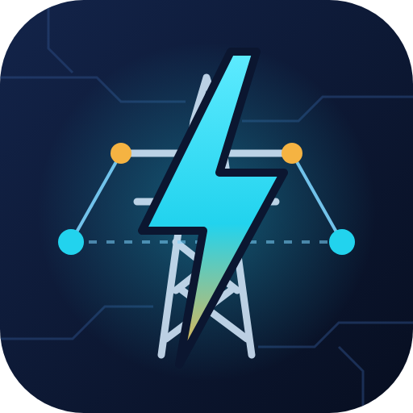</p>

<h1 align="center">Electrical.Net</h1>
<p align="center"><b>Comprehensive Electrical Engineering &amp; Power System Framework for .NET</b><br/>
.NET 10 · Rust native kernels · Blazor &amp; Avalonia · MIT<br/>
<i>Made by Gravicode Studios, led by Kang Fadhil</i></p>

<p align="center"><a href="README.id.md">🇮🇩 Baca dalam Bahasa Indonesia</a></p>

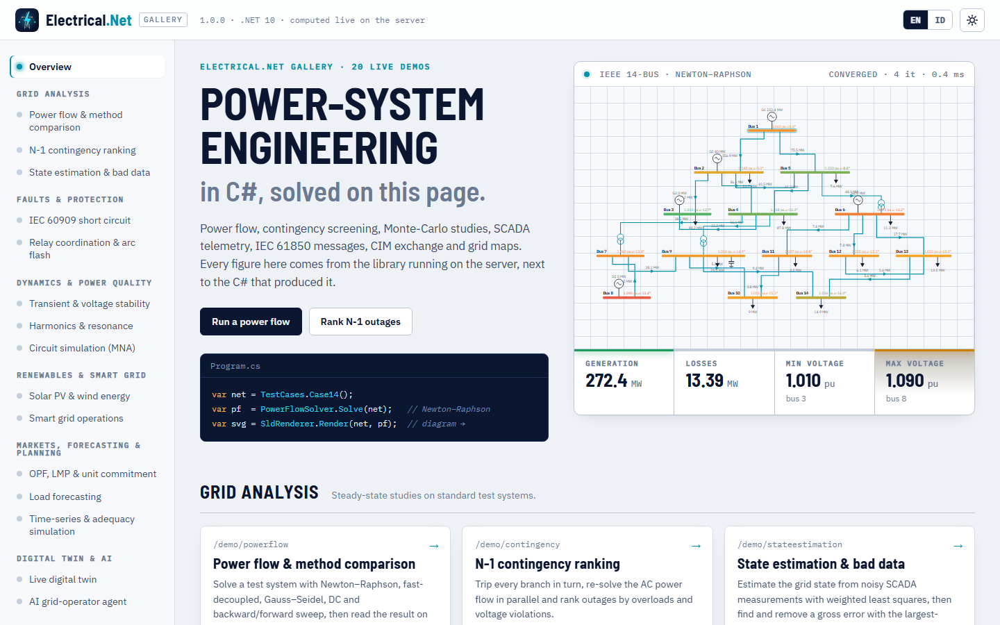

Electrical.Net gives .NET developers the building blocks of power-system software: power flow, short circuit, protection, stability,
harmonics, renewables, smart-grid control, optimization, state estimation, SCADA and substation protocols, CIM model exchange, GIS,
simulation, cloud APIs and a digital twin. It is meant as a base for EMS, DMS, ADMS, DERMS, VPP, SCADA and digital-twin applications.
The algorithms are checked against published reference values (MATPOWER, IEC 60909, IEEE 1584, Anderson & Fouad, Baran & Wu, Billinton &
Allan, Wood & Wollenberg and others); see [Validation](#validation).

```csharp
using Electrical.Core.Network;
using Electrical.PowerFlow;

var pf = PowerFlowSolver.Solve(TestCases.Case14());   // sparse Newton–Raphson
Console.WriteLine(pf);
// NewtonRaphson: converged in 4 it, mismatch 1.00E-014, gen 272.393 MW, load 259 MW, losses 13.393 MW, Vmin 1.0100 pu @ bus 3
```

## Modules

| Package | What it gives you |
|---|---|
| **Electrical.Core** | Generic dense/sparse linear algebra (`SparseLU<Complex>` with minimum-degree ordering), per-unit system, phasors, symmetrical components, bus-branch `PowerNetwork`, `NetworkBuilder` in physical units, line library, Y-bus (positive/negative/zero sequence), topology, MATPOWER I/O, test cases (case9, case14, Baran–Wu 33-bus, synthetic grids), `TimeSeries`, DI builder and event bus |
| **Electrical.Circuit** | Modified nodal analysis: DC operating point, AC sweep / Bode, transient (trapezoidal, backward Euler); R, L, C, coupled inductors, sources, diodes, switches, controlled sources, ideal transformers; SPICE-like netlists; three-phase star/delta circuits |
| **Electrical.PowerFlow** | Newton–Raphson (sparse, Q limits, ZIP loads), Gauss–Seidel, fast-decoupled XB, DC, backward/forward sweep; N-1 contingency screening (parallel); PTDF / LODF |
| **Electrical.ShortCircuit** | IEC 60909: 3φ, SLG, LL, LLG faults via sequence networks; c factor, κ (methods A/B/C), I″k, ip, Ib, Ith, DC component; branch and source contributions; all-bus scan |
| **Electrical.Protection** | IEC 60255 / IEEE C37.112 inverse-time relays, fuses, TCC curves, CTI grading, mho distance zones, percentage-differential relay, breaker duty, IEEE 1584-2002 arc flash |
| **Electrical.Stability** | Classical multi-machine transient stability (RK4) with event lists, critical clearing time, SMIB equal-area criterion, small-signal eigen-analysis with participation factors, PV / QV curves, L-index, frequency response (ROCOF, nadir) |
| **Electrical.Harmonic** | FFT (radix-2 + Bluestein), spectra, THD/TDD/K-factor, IEEE 519 and IEC 61000 limits, harmonic load flow, frequency scan and resonance detection, single-tuned filter design, unbalance |
| **Electrical.Renewable** | Solar position (SPA-grade), clear-sky and transposition models, cell temperature, single-diode PV (Villalva), PVWatts, inverter models, MPPT; wind turbines, Weibull AEP, shear; battery storage with degradation; IEEE 1547 volt-var / volt-watt / freq-watt; hosting capacity |
| **Electrical.SmartGrid** | Price-based demand response, battery peak shaving, EV charging (valley filling), microgrid EMS (rules and dynamic programming), virtual power plant, Volt/VAR optimization, feeder reconfiguration, SAIFI/SAIDI/CAIDI/ENS |
| **Electrical.Optimization** | Economic dispatch (with B-loss coefficients), DC-OPF with LMPs and binding constraints, N-1 security-constrained DC-OPF, unit commitment, capacitor placement, interior-point QP, Nelder–Mead, particle swarm |
| **Electrical.StateEstimation** | WLS AC estimator (sparse gain matrix), V/P/Q/flow/PMU measurements, observability, χ² test, largest-normalized-residual bad-data removal |
| **Electrical.SCADA** | Modbus TCP client/server and PDU codec, tag database with scaling and quality, ISA-18.2 alarms, swinging-door historian, RTU simulator, IEC 60870-5-104 APDU codec |
| **Electrical.IEC61850** | SCL (ICD/CID/SCD) parser, object references and logical-node catalog, MMS data, ASN.1 BER, GOOSE and Sampled Values (9-2LE) frames, GOOSE retransmission |
| **Electrical.CIM** | IEC 61970 CIM / CGMES-style RDF/XML export (EQ, TP, SSH, SV) and import with topology processing |
| **Electrical.DigitalTwin** | Live grid twin: SCADA tags → WLS state estimation with bad-data removal → KPIs, explained alarms, forecast deviation; what-if simulation; IEEE C57.91 asset ageing; closed-loop twin simulator |
| **Electrical.Forecasting** | Holt–Winters (single/double season), regression with weather features, similar-day k-NN, ensembles, solar and wind power forecasts, error metrics, synthetic profiles |
| **Electrical.AI** | Bilingual LLM grid-operator agent with 10 grounded tools (OpenAI, Azure OpenAI, Hugging Face, Ollama or offline rules), anomaly detection (robust z, EWMA, CUSUM), fault classification and location, load-profile clustering, Volt/VAR RL environment with Q-learning |
| **Electrical.GIS** | GeoJSON export/import, Web Mercator, haversine line lengths, force-directed geographic layout, spatial index, SVG maps, outage areas |
| **Electrical.Visualization** (+ **.Blazor**) | Automatic single-line diagram layout and SVG rendering with power-flow overlay, SVG charts (line, bar, heatmap, gauge, phasor, TCC), PNG encoder, light/dark theme variables; Blazor components |
| **Electrical.Simulation** | Quasi-static time series (QSTS) with load/PV profiles and events, scenario manager, generation adequacy (analytical and sequential Monte-Carlo) |
| **Electrical.Cloud** | Study job runner, JSON network contract, ASP.NET Core minimal API (`MapElectricalApi`), multi-tenant scenario stores |
| **Electrical.HPC** | Parallel batch power flow, load sweeps, Monte-Carlo probabilistic load flow, scaling benchmark |
| **Electrical.Native** | Rust kernels (FFT, Goertzel harmonics, THD/RMS, sparse complex power injections, deterministic normal sampling) with identical managed fallbacks |
| **Electrical.Cli** | `eln` dotnet tool with 30 commands (incl. `eln ask` and `eln twin`) |
| **Electrical.Templates** | `dotnet new eln-console / eln-blazor / eln-avalonia / eln-scada / eln-webapi` |

## Quick start

```bash
dotnet add package Electrical.PowerFlow       # pulls Electrical.Core
dotnet add package Electrical.ShortCircuit
dotnet add package Electrical.Visualization
```

Build a network in physical units, solve it and run a short-circuit study:

```csharp
using Electrical.Core.Network;
using Electrical.PowerFlow;
using Electrical.ShortCircuit;

var net = new NetworkBuilder("plant", baseMva: 100, frequencyHz: 50)
    .AddBus(1, 150, BusType.Slack, "Grid 150 kV")
    .AddBus(2, 20, name: "MV bus")
    .AddBus(3, 20, name: "Feeder end")
    .AddGenerator(1, 0, vset: 1.0)                                   // slack infeed
    .AddTransformer(1, 2, ratingMva: 60, ukPercent: 12, copperLossKw: 250)
    .AddLine(2, 3, 8, "NA2XS2Y 1x240 RM/25 12/20 kV")               // 8 km standard cable
    .AddLoad(3, 18, 6)                                               // 18 MW, 6 Mvar
    .AddShunt(3, 3)                                                  // 3 Mvar capacitor bank
    .Build();                                                        // validates the model

var pf = PowerFlowSolver.Solve(net);
Console.WriteLine($"V3 = {pf.Bus(3).Vm:0.000} pu, losses {pf.LossesMw:0.000} MW");

var sc = ShortCircuitAnalysis.Calculate(net, 3, FaultType.ThreePhase, new ShortCircuitOptions
{
    ExternalGrids = [new ExternalGrid { Bus = 1, SkMva = 3000, RxRatio = 0.1 }],
});
Console.WriteLine(sc);   // I"k, ip, Ib, Ith, S"k at bus 3
```

With dependency injection:

```csharp
services.AddElectrical(b => b.AddPowerFlow().AddShortCircuit().AddProtection().AddScada().AddCloud());
```

CLI and templates:

```bash
dotnet tool install -g Electrical.Cli
eln pf --case case14
eln sc --case case14 --bus 4 --type slg
eln stability --case case9 --bus 8 --clear 0.083 --trip 8-9
eln ask "What is the 3-phase short-circuit current at bus 4?"   # AI agent (LLM or offline)
eln twin --steps 24                                         # digital twin demo

dotnet new install Electrical.Templates
dotnet new eln-blazor -n MyGridDashboard
```

## Validation

Every row below is asserted by the xUnit suite in `tests/Electrical.Tests` (the citation is in the test) or printed by the `eln` CLI.

| Study | Reference | Reference value | Electrical.Net |
|---|---|---|---|
| AC power flow, IEEE 9-bus | MATPOWER `case9` | P<sub>G1</sub> 71.64 MW, losses 4.641 MW, \|V<sub>9</sub>\| 0.9956 pu | 71.64 MW, 4.641 MW, 0.9956 pu |
| AC power flow, IEEE 14-bus | MATPOWER `case14` | P<sub>G1</sub> 232.39 MW, losses 13.393 MW, V<sub>14</sub> 1.036 ∠ −16.04° | 232.39 MW, 13.393 MW, 1.0355 ∠ −16.034° |
| Radial feeder (NR and backward/forward sweep) | Baran & Wu 33-bus | losses 202.7 kW, V<sub>min</sub> 0.9131 pu at bus 18 | 202.7 kW, 0.9131 pu at bus 18 |
| IEC 60909 3φ fault, 110/20 kV radial feeder | Hand calculation, IEC 60909-0 eqs. 6, 7, 12 | I″k3 = 3.899 kA | 3.899 kA |
| IEC 60909 factors | IEC 60909-0 | κ(R/X = 0.1) = 1.7460, μ(5, 0.1 s) = 0.76537 | 1.7460, 0.76537 |
| Arc flash 480 V, 30 kA, 0.1 s, 610 mm, G = 32 mm | IEEE 1584-2002 eqs. 1, 3, 6 | I<sub>a</sub> 15.72 kA, E 3.434 cal/cm², AFB 1245 mm | 15.72 kA, 3.434 cal/cm², 1245 mm |
| Arc flash 13.8 kV, 20 kA, 0.2 s, 910 mm | IEEE 1584-2002 | I<sub>a</sub> 19.18 kA, E 5.23 cal/cm² | 19.18 kA, 5.226 cal/cm² |
| Inverse-time relay, M = 10, TMS = 1 | IEC 60255-151 Standard Inverse | 2.971 s | 2.971 s |
| Classical initial rotor angles, 9-bus | Anderson & Fouad | δ = 2.27°, 19.73°, 13.17° | 2.27°, 19.73°, 13.17° |
| CCT, fault at A&F bus 7 cleared by line 5–7 | Classical-model literature ≈ 0.16–0.17 s | | 0.161–0.162 s |
| Electromechanical modes, 9-bus classical | Sauer & Pai / Anderson & Fouad | ω ≈ 8.7 and 13.4 rad/s | 8.690 and 13.360 rad/s (1.383 / 2.126 Hz) |
| SMIB bolted fault (H = 5 s, P<sub>m</sub> = 0.8, P<sub>max</sub> = 1.8) | Equal-area criterion (closed form) | t<sub>cr</sub> = 0.2600 s | 0.2599 s by simulation |
| Two-bus PV curve, X = 0.1 pu | Analytic maximum transfer V²/2X | λ<sub>max</sub> = 5.0 | 4.95–5.0 |
| Frequency scan, 500 MVA / 20 Mvar | h<sub>r</sub> = √(S<sub>sc</sub>/Q<sub>c</sub>) | 5.0 (300 Hz) | 5.0 (300 Hz) |
| Single-diode PV, Kyocera KC200GT | Villalva et al. 2009, Table II | R<sub>s</sub> 0.221 Ω, R<sub>p</sub> 415.4 Ω, I<sub>pv</sub> 8.214 A, I<sub>0</sub> 9.825e-8 A | 0.221 Ω, 416.3 Ω, 8.214 A, 9.825e-8 A; P<sub>mp</sub> 200.15 W |
| Solar position | NREL SPA report example (Reda & Andreas 2008) | zenith 50.11162°, azimuth 194.34024° | within 0.05° |
| Economic dispatch, 9-bus, 315 MW | MATPOWER case9 costs (equal incremental cost) | λ 24.04 $/MWh, 86.56 / 134.38 / 94.06 MW | 24.044 $/MWh, 86.56 / 134.38 / 94.06 MW |
| Unit commitment priority list | Wood & Wollenberg Example 4A | full-load average costs 9.79 / 9.40 / 11.19 $/MWh | same; priority 2, 1, 3 |
| Feeder reconfiguration, 33-bus + 5 ties | Literature optimum | open 7-8, 9-10, 14-15, 32-33, 25-29; ≈ 139.5 kW | same switches; 139.6 kW |
| Capacitor placement, 33-bus (3 banks) | Literature range | 132–145 kW | 132.2 kW |
| Radial reliability | Billinton & Allan §7.2, Table 7.1 | λ<sub>C</sub> 0.45 f/yr, U<sub>C</sub> 2.9 h | 0.45 f/yr, 2.9 h |
| Capacity outage probability table | Billinton & Allan §2.2 | 0.9604 / 0.0392 / 0.0004 | identical |
| WLS state estimation, noise-free | Power-flow solution | exact state | recovered exactly; bad flow removed by LNR test |
| CIM round trip | Original network | identical power flow | identical (case14 13.393 MW, case33 202.7 kW) |
| Transformer ageing | IEEE C57.91 | θ<sub>H</sub> = 110 °C at rated load (30 °C ambient), F<sub>AA</sub>(110 °C) = 1, ≈ 2 at 116.8 °C | 110 °C, 1.0, 2.0 |
| Digital twin, 24 h case14 with RTU noise | True power-flow state | voltage error < 0.005 pu, load within 3 % | mean 0.00017 pu, max 0.00077 pu |
| LLM agent, live | Azure OpenAI `gpt-5-mini`, case14 losses (MATPOWER 13.393 MW) | 13.39 MW quoted from the tool | passed |

## Gallery

Twenty live demos covering all modules with a professional UI, as a **Blazor** web app and an **Avalonia** desktop app that share their scenario code
(`gallery/Electrical.Gallery.Shared`). Every figure is computed by the library at run time, next to the C# that produced it.

```bash
dotnet run --project gallery/Electrical.Gallery.Web --urls http://localhost:5290
dotnet run --project gallery/Electrical.Gallery.Desktop
```

| Web (Blazor) | Desktop (Avalonia) |
|---|---|
| 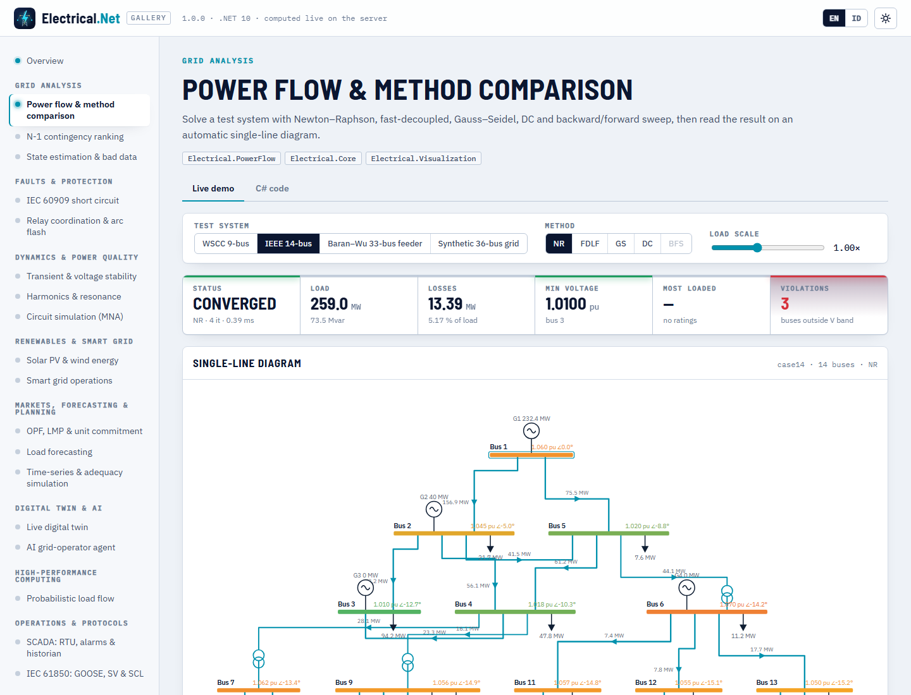 | 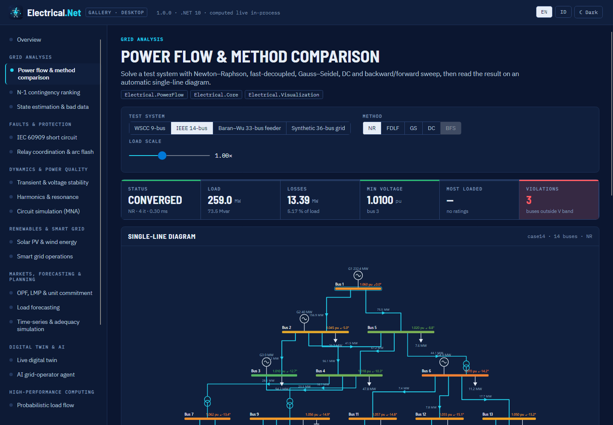 |
| 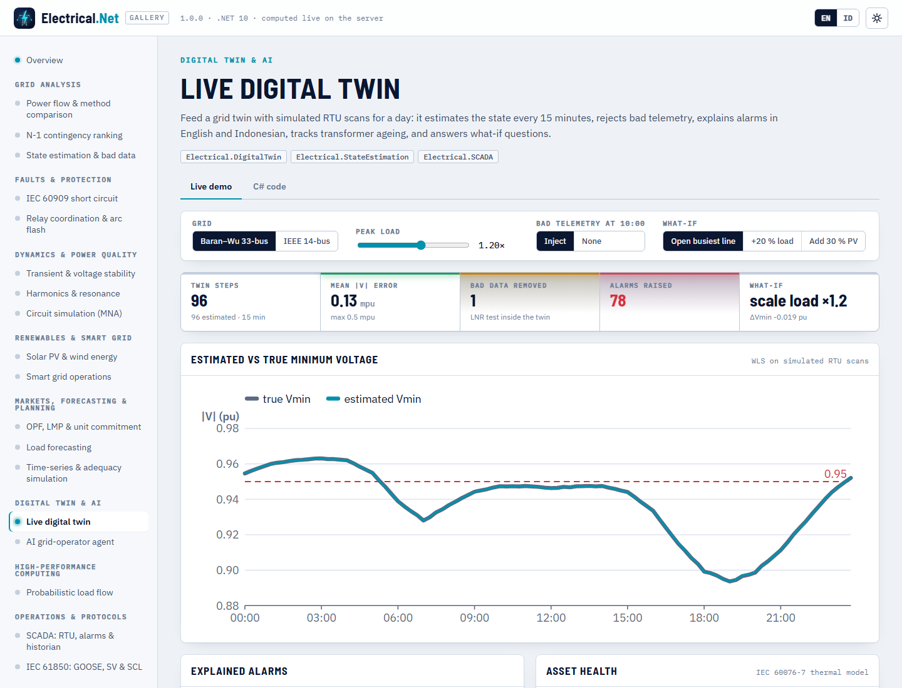 | 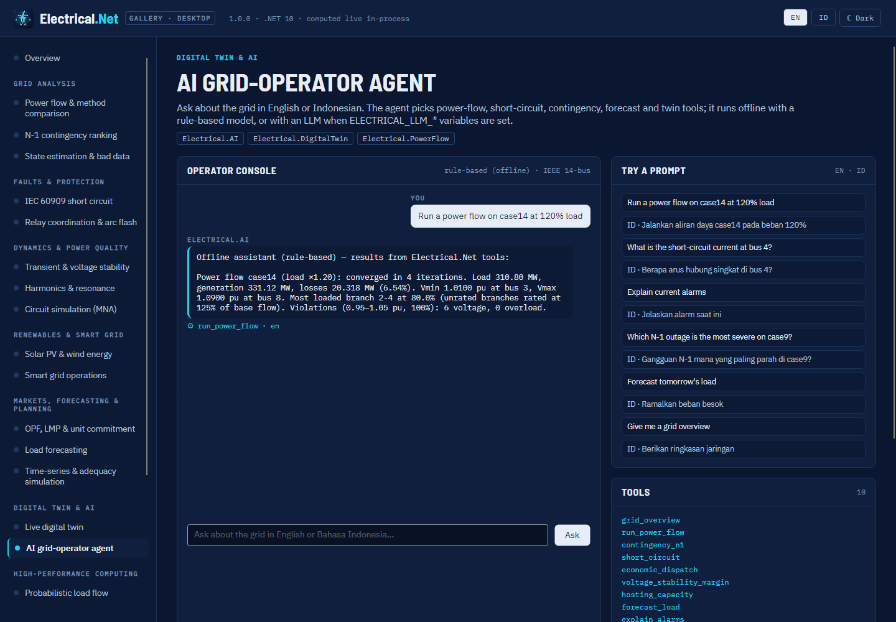 |
| 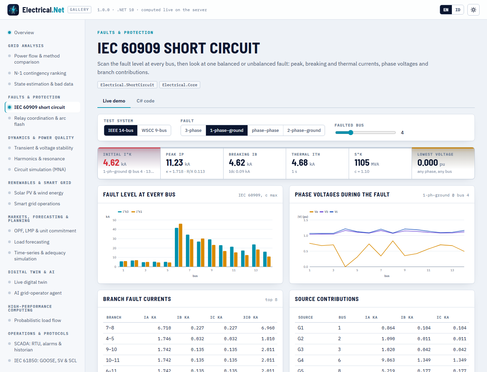 | 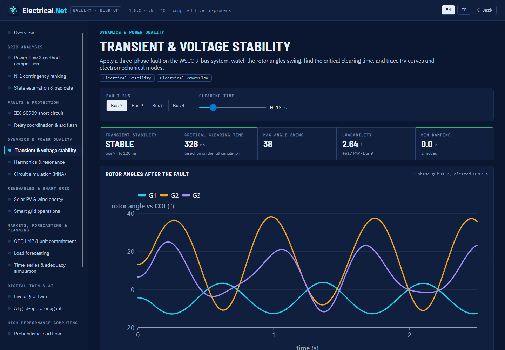 |
| 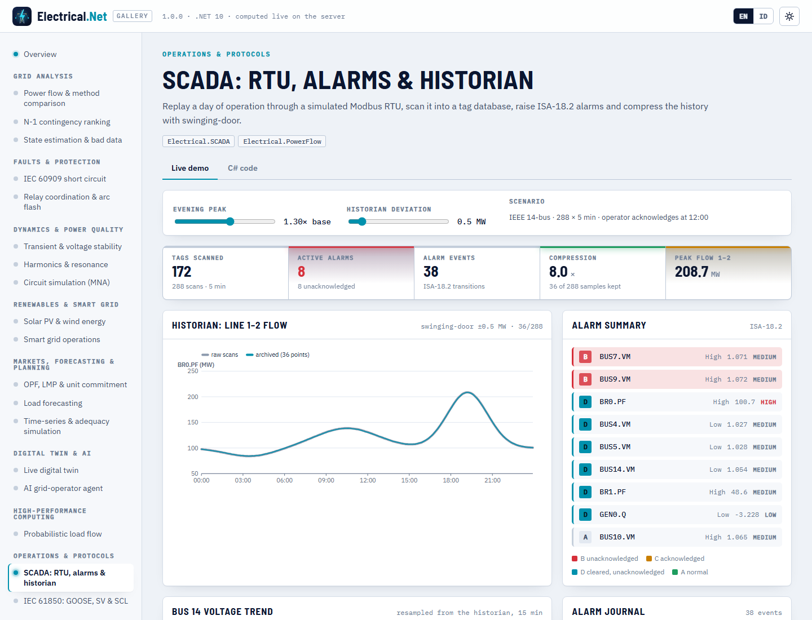 | 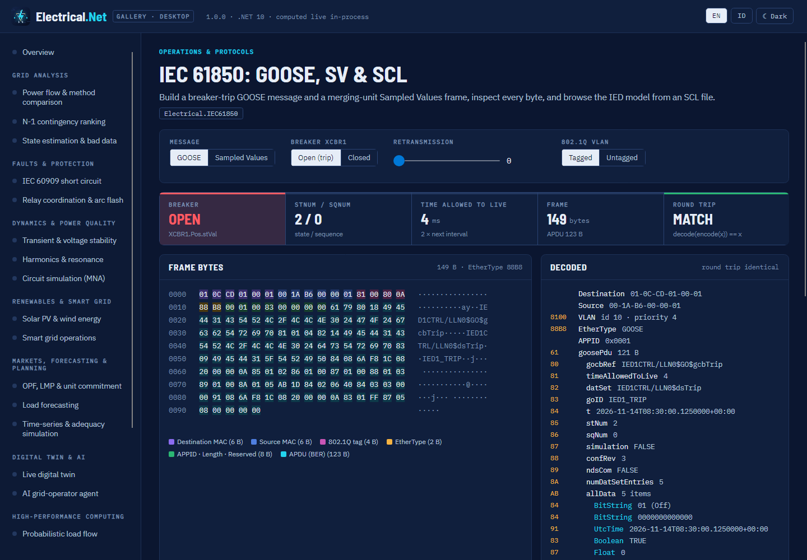 |
| 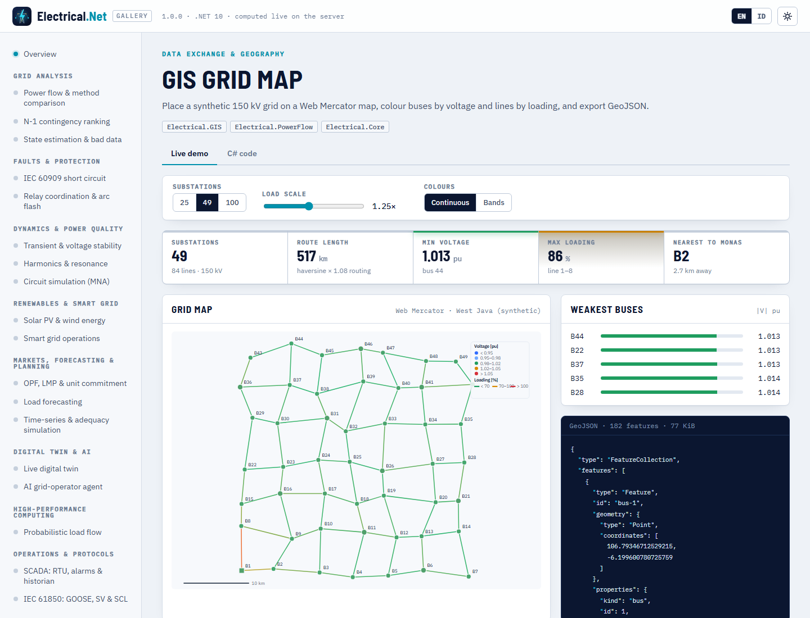 | 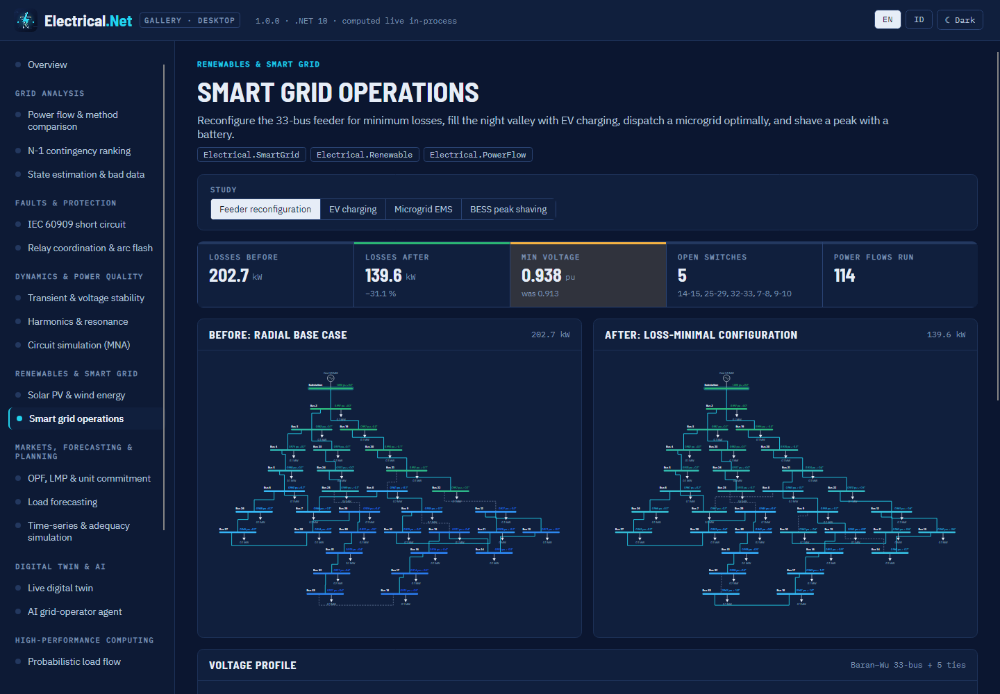 |

Dark theme: 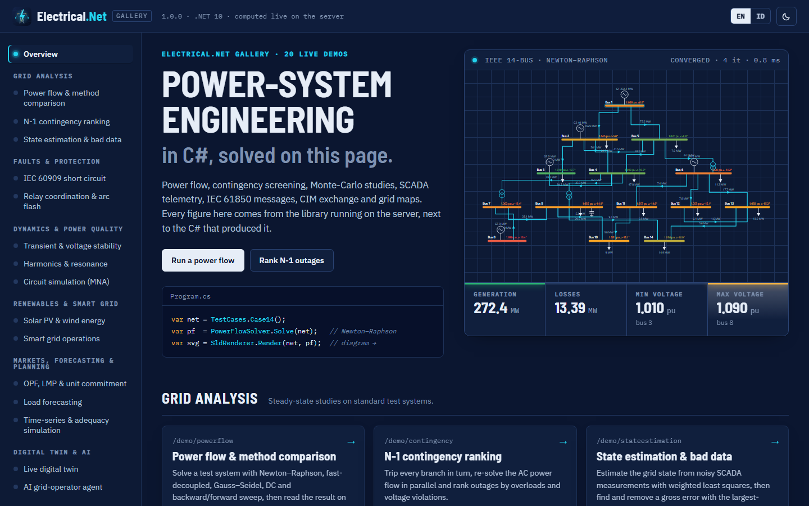

Desktop screenshots are named `desktop-<demo>.png` (for example `docs/images/desktop-powerflow.png`). All screenshots live in
[docs/images](docs/images); see [docs/en/gallery.md](docs/en/gallery.md).

## Architecture

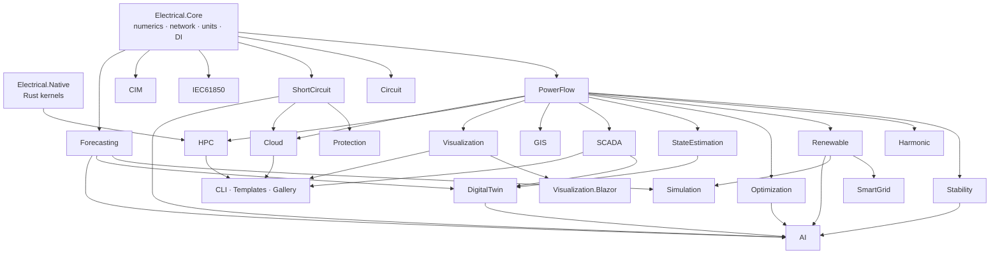

Dependencies are acyclic (Core → PowerFlow → analysis modules → SmartGrid/Simulation → DigitalTwin/AI/Cloud). Libraries are
AOT-compatible, use SI/engineering units at the API surface (MW, Mvar, kV, kA, Ω, pu, degrees, seconds) and are deterministic. Details in
[docs/en/architecture.md](docs/en/architecture.md).

## Repository layout

```
src/              23 library packages (+ Electrical.Visualization.Blazor)
native/           Rust crate electrical-native (C ABI, eln_* functions)
tools/            Electrical.Cli (dotnet tool "eln")
templates/        Electrical.Templates (dotnet new pack)
gallery/          Shared scenarios, Blazor web gallery, Avalonia desktop gallery
tests/            xUnit test suite with reference-value citations
docs/en, docs/id  Documentation (English / Bahasa Indonesia)
build/            build-native.ps1, pack.ps1, publish-nuget.ps1, ci/electrical-net.yml
```

## Build from source

```bash
pwsh build/build-native.ps1                 # Rust kernels (optional; managed fallback otherwise)
dotnet build Electrical.Net.slnx
dotnet test tests/Electrical.Tests
dotnet run --project tools/Electrical.Cli -- help
pwsh build/pack.ps1                         # NuGet packages → artifacts/packages
```

Requires the .NET 10 SDK; Rust (stable) only for the native kernels. A tag `electrical-net-vX.Y.Z` in the monorepo runs
`.github/workflows/electrical-net.yml`, which builds the kernels for win-x64, linux-x64, linux-arm64, osx-x64 and osx-arm64, runs the tests and
publishes the packages to NuGet.

## Documentation

- English: [docs/en](docs/en/README.md): getting started, architecture, module guide, power flow, short circuit & protection, stability,
  harmonics, renewables & smart grid, optimization, state estimation, SCADA / IEC 61850 / CIM, GIS & visualization, simulation / HPC / native,
  cloud API, AI & digital twin, CLI, templates, gallery.
- Bahasa Indonesia: [docs/id](docs/id/README.md).
- Roadmap: [PLAN.md](PLAN.md).

## License

MIT © 2026 Gravicode Studios. Made by Gravicode Studios, led by Kang Fadhil.
