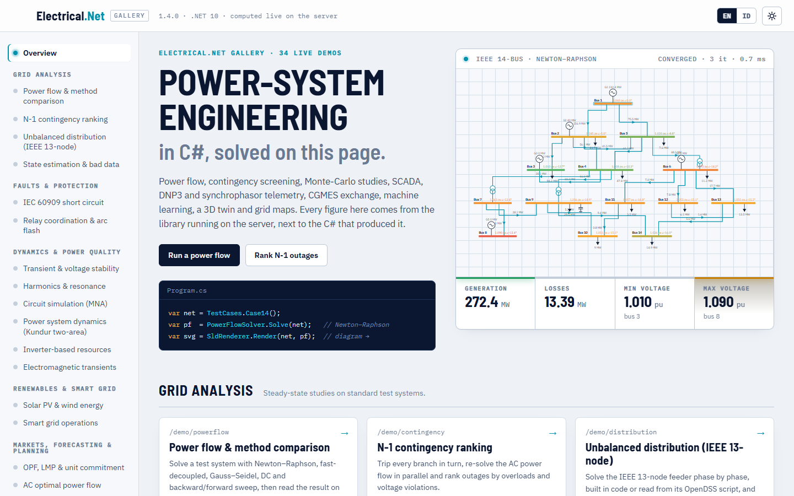

# Electrical.Net documentation (English)

> Made by Gravicode Studios, led by Kang Fadhil · [Bahasa Indonesia](../id/README.md)

Electrical.Net is a power-system framework for .NET 10: 34 library packages plus Rust native kernels, a CLI tool, project templates and a
Blazor/Avalonia gallery. Start with [Getting started](getting-started.md), then read the guide for the area you work in.

| Guide | Contents |
|---|---|
| [Getting started](getting-started.md) | Install, first program, building networks, dependency injection, units and conventions |
| [Architecture](architecture.md) | Dependency graph, network model, numerics, design rules, performance, native interop |
| [Module guide](modules.md) | Every package: purpose, key types, short example, references and limitations |
| [Power flow](power-flow.md) | Newton–Raphson, fast-decoupled, Gauss–Seidel, DC, backward/forward sweep, ZIP loads, Q limits, N-1, PTDF/LODF |
| [Unbalanced distribution](distribution.md) | Phase-frame power flow for IEEE 4/13-node feeders, Carson and Kron line constants, regulators and capacitor controls, OpenDSS scripts (v1.1) |
| [Short circuit & protection](short-circuit-protection.md) | IEC 60909, relays, grading, distance and differential protection, breaker duty, arc flash |
| [Stability](stability.md) | Transient stability (classical model), CCT, equal-area criterion, small-signal, PV/QV curves, L-index, frequency response |
| [Power system dynamics](dynamics.md) | Detailed machines (GENROU/GENSAL), exciters, governors, PSS, REGC/REEC/REPC and grid-forming inverters, PSS/E .dyr, Kundur two-area, small signal (v1.3) |
| [Electromagnetic transients](emt.md) | EMT solver: R/L/C, switches, diodes/thyristors, Bergeron lines, transformers, line energization, capacitor inrush, Rust kernels (v1.3) |
| [Harmonics & power quality](harmonics.md) | FFT and spectra, IEEE 519 / IEC 61000, harmonic load flow, frequency scan, filters |
| [Renewables & smart grid](renewables-smartgrid.md) | PV, wind, batteries, grid codes, hosting capacity, DR, EV, microgrid, VPP, VVO, reconfiguration, reliability, forecasting |
| [Optimization](optimization.md) | Economic dispatch, DC-OPF, AC-OPF (interior point) and LMP decomposition, security constraints, unit commitment, capacitor placement |
| [Electricity markets](markets.md) | Security-constrained unit commitment (MILP), day-ahead and real-time clearing, LMPs, settlement, FTRs (v1.2) |
| [LP / MILP solvers](solvers.md) | `LinearModel`, built-in dual simplex and branch and bound, HiGHS and OR-Tools adapters, choosing a solver (v1.2) |
| [State estimation](state-estimation.md) | WLS estimator, measurements, observability, bad-data detection |
| [Synchrophasors](pmu.md) | IEEE C37.118 frames and TCP/UDP transport, PMU simulator, P/M-class phasor estimation (TVE), linear PMU state estimation, PDC alignment (v1.4) |
| [SCADA, IEC 61850 & CIM](scada-iec61850-cim.md) | Modbus TCP, tags, alarms, historian, RTU simulator, IEC 104 codec, GOOSE, SV, SCL, CIM, CGMES 3.0 profiles and the 22-rule validator (v1.4) |
| [Utility protocols](protocols.md) | DNP3 outstation and master, IEC 60870-5-104 client and server, tag bridges, reference vectors (v1.4) |
| [Model exchange](interop.md) | PSS/E RAW v33/v35 read and write, IEEE CDF, CGMES detection, format auto-detection, conversion warnings (v1.1, v1.4) |
| [GIS & visualization](gis-visualization.md) | GeoJSON, maps, spatial index, outage areas, single-line diagrams, charts, Blazor components |
| [Simulation, HPC & native](simulation-hpc-native.md) | Circuit simulation, QSTS with OLTC/capacitor control, adequacy, batch and probabilistic load flow, Rust kernels (incl. EMT) |
| [Cloud API](cloud-api.md) | REST endpoints, study jobs, scenario stores, JSON network contract |
| [AI & digital twin](ai-digital-twin.md) | Grid-operator LLM agent and tools, anomaly detection, fault analytics, RL Volt/VAR, live digital twin, what-if, asset health |
| [Machine learning for grids](machine-learning.md) | ML load forecasting, fault classification and location, topology identification, deep-RL Volt/VAR with RLNet (v1.4) |
| [3D digital twin](digital-twin-3d.md) | Procedural substation/feeder scenes, power-flow and twin colouring, glTF export, off-screen render, Avalonia view (v1.4) |
| [CLI](cli.md) | `eln` command reference with sample output |
| [Templates](templates.md) | `dotnet new eln-*` templates |
| [Gallery](gallery.md) | Blazor and Avalonia showcase apps, screenshots, adding a demo |

---
*Made by Gravicode Studios, led by Kang Fadhil · [Bahasa Indonesia](../id/README.md)*
