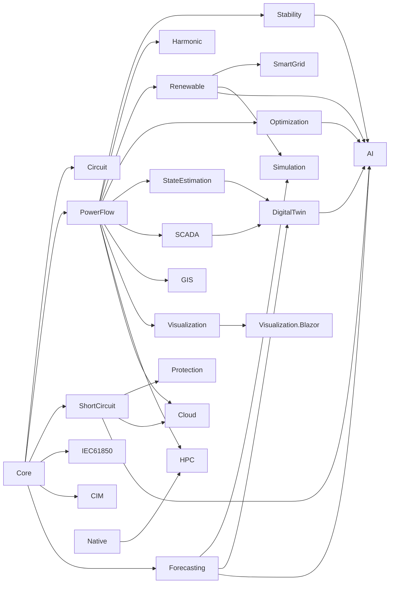

# Architecture

> Made by Gravicode Studios, led by Kang Fadhil · [Bahasa Indonesia](../id/arsitektur.md)

## Dependency graph



(Every module also references `Electrical.Core`; only the extra edges are drawn.) The graph is acyclic and layered:
**Core → PowerFlow → analysis modules → SmartGrid / Simulation → DigitalTwin / AI / Cloud**. `Electrical.Native` has no managed dependencies.
Applications sit on top: the `eln` CLI, the `dotnet new` templates and the gallery.

| Layer | Packages |
|---|---|
| Foundation | Core, Native |
| Steady state | PowerFlow, Circuit |
| Analysis | ShortCircuit, Protection, Stability, Harmonic, StateEstimation, Optimization |
| Resources & grid edge | Renewable, SmartGrid, Forecasting |
| Data & protocols | SCADA, IEC61850, CIM, GIS, Visualization(.Blazor) |
| Platform | Simulation, HPC, Cloud, DigitalTwin, AI |

## Core building blocks

### Network model (`Electrical.Core.Network`)

- `PowerNetwork`: name, `BaseMva`, `FrequencyHz` and mutable lists of `Bus`, `Load`, `Generator`, `Branch`. Bus lookup by id is cached and rebuilt
  when the list changes. `Clone()` deep-copies, `Validate()` reports issues (duplicate ids, missing slack, unknown terminals, zero impedance,
  islands).
- Positive-sequence, balanced bus-branch model with MATPOWER conventions (π branches in pu, total charging `B`, `Tap`, `ShiftDeg`).
  Zero-sequence data (`R0`, `X0`, `B0`) defaults to 3× positive sequence for lines; transformer `WindingConnection` (YNyn, YNd, Dyn, …)
  decides the zero-sequence path.
- `Load` has a `ZipModel` (constant Z / I / P fractions) and an optional `Category` used by forecasting and demand response.
- `Generator` carries limits, `PolynomialCost`, ramp rate and machine data (X″d, X′d, Xd, X2, X0, H, D on `MBase`) so one model serves power
  flow, dispatch, short circuit and stability.
- `AdmittanceMatrix.Build(net, Sequence)` returns the sparse Y-bus and per-branch `BranchAdmittance` (Yff, Yft, Ytf, Ytt).
- `Topology`: adjacency, islands, radial check, hop distance.
- `Matpower.Parse/Load/Write`, `TestCases`, `NetworkBuilder`, `LineLibrary`.

### Numerics (`Electrical.Core.Numerics`)

- `DenseMatrix<T>` / `DenseLU<T>` and CSR `SparseMatrix<T>` built with `SparseBuilder<T>` (duplicates summed), generic over `INumberBase<T>`
  (used with `double` and `Complex`).
- `SparseLU<T>`: minimum-degree ordering + IKJ elimination. `lu.Ordering` can be passed back to `Factorize` to reuse the symbolic work when only
  values change (Newton–Raphson iterations, short-circuit sequence networks, WLS gain matrix).

```csharp
var b = new SparseBuilder<Complex>(3, 3);
b.Add(0, 0, new Complex(4, 1)); b.Add(0, 1, -1); b.Add(1, 0, -1);
b.Add(1, 1, new Complex(4, 1)); b.Add(1, 2, -1); b.Add(2, 1, -1); b.Add(2, 2, new Complex(4, 1));
SparseMatrix<Complex> a = b.ToCsr();                 // duplicates are summed

var lu = SparseLU<Complex>.Factorize(a);              // minimum-degree ordering + LU
Complex[] x = lu.Solve([1, 0, 0]);
var lu2 = SparseLU<Complex>.Factorize(a, lu.Ordering); // reuse the ordering for the same pattern
```

### Units and data

- `PerUnitBase(BaseMva, BaseKv)` with Ω/S/kA conversions, `ElectricalFormulas` (√3 relations, PF correction, voltage drop, reactances,
  resonance), `Phasor`, `ThreePhase`, `SymmetricalComponents`.
- `TimeSeries` (regular step; SIMD sum/min/max through `TensorPrimitives`; resample, duration curve, energy, load factor) and `Stats`
  (mean, std, percentile, RMS, MAPE).

### Hosting and events

`services.AddElectrical(b => b.AddX())` creates an `ElectricalBuilder`; every module's `AddX` calls `TryAddModule` once, so registrations are
idempotent. `IGridEventBus` (in-memory, synchronous, thread-safe) carries `IGridEvent`s between modules, for example SCADA's
`TagValueChanged` and `AlarmEvent`.

## Design rules

- **Dependency-light and AOT-compatible.** Libraries set `IsAotCompatible`; no reflection-based JSON (`JsonNode`, `JsonDocument`,
  `Utf8JsonWriter` instead), no `dynamic`. Core depends only on `Microsoft.Extensions.DependencyInjection.Abstractions` and
  `System.Numerics.Tensors`; Cloud uses the ASP.NET Core shared framework.
- **Units at the API surface** are engineering units (MW, Mvar, kV, kA, Ω, pu, degrees, s, Hz) and are documented in XML comments.
- **Validated against references.** Each algorithm has tests that cite their source (MATPOWER, IEC 60909, IEEE 1584, IEEE 519,
  textbooks). See the validation table in the [README](../../README.md#validation).
- **Deterministic.** Synthetic data and Monte-Carlo sampling use fixed seeds (SplitMix64 + Box–Muller in the native kernel and its managed
  twin), never `HashCode.Combine`, so results match across processes and machines.
- **Static entry points plus DI facades.** Every study is available as a static method; DI interfaces wrap them for applications.
- **Immutable options, mutable models.** Options are `record`s with `init` properties and `Default` instances; networks are mutable and
  cloned for scenarios.

## Performance

- Newton–Raphson builds a sparse polar Jacobian and factorises it with `SparseLU`; the ordering is computed once per solve.
- Contingency screening, batch power flow and probabilistic load flow run with `Parallel.For` and warm starts.
- Short-circuit studies factorise the three sequence admittance matrices once; each fault is one sparse solve per sequence.
- `eln bench` on synthetic grids (Release build, best of 3, on the development machine — indicative only; the synthetic grids are 2-D meshes, a worst case for fill-in):

```
  Case            Buses  Branches  Iter      ms
  synthetic100      100       180     3      2.1
  synthetic1000    1000      1936     4     56.8
  synthetic3000    3000      5890     5    268.2
```

## Native interop

`Electrical.Native` P/Invokes the Rust crate `native/electrical-native` (C ABI, `eln_*` functions) through `LibraryImport`. A
`DllImportResolver` looks in the application folder and `runtimes/<rid>/native`. If the library is missing or a call fails, the managed fallback
(with identical semantics, verified by tests) is used. `GridKernels.Backend` reports `"native (Rust)"` or `"managed"`; set
`GridKernels.PreferNative = false` to force managed code. Details in [Simulation, HPC & native](simulation-hpc-native.md).

## Repository layout

```
src/Electrical.*           library packages
native/electrical-native   Rust crate (cdylib)
tools/Electrical.Cli       eln tool
templates/                 dotnet new templates
gallery/                   Shared scenarios + Blazor web + Avalonia desktop
tests/Electrical.Tests     xUnit tests (Analysis/, Operations/, Integration/, Intelligence/, Platform/)
build/                     build-native.ps1, pack.ps1, publish-nuget.ps1, ci/electrical-net.yml
```

CI (`.github/workflows/electrical-net.yml` at the monorepo root) builds the Rust kernels for five RIDs, places them under
`src/Electrical.Native/runtimes/<rid>/native`, builds and tests the solution, packs every library, the CLI and the templates, and pushes to NuGet
when a tag `electrical-net-vX.Y.Z` is pushed (secret `NUGET_API_KEY`).

---
*Made by Gravicode Studios, led by Kang Fadhil · [Bahasa Indonesia](../id/arsitektur.md)*
