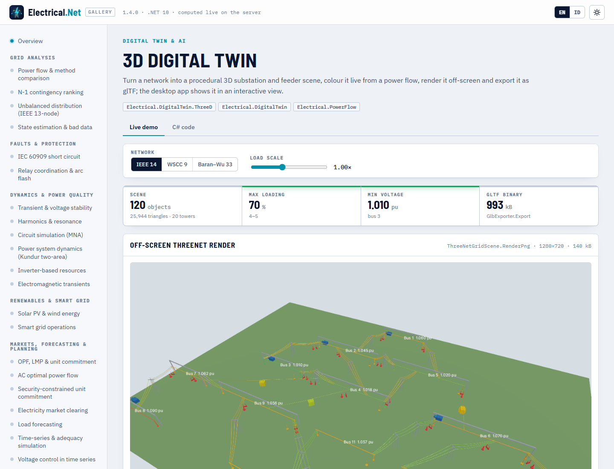
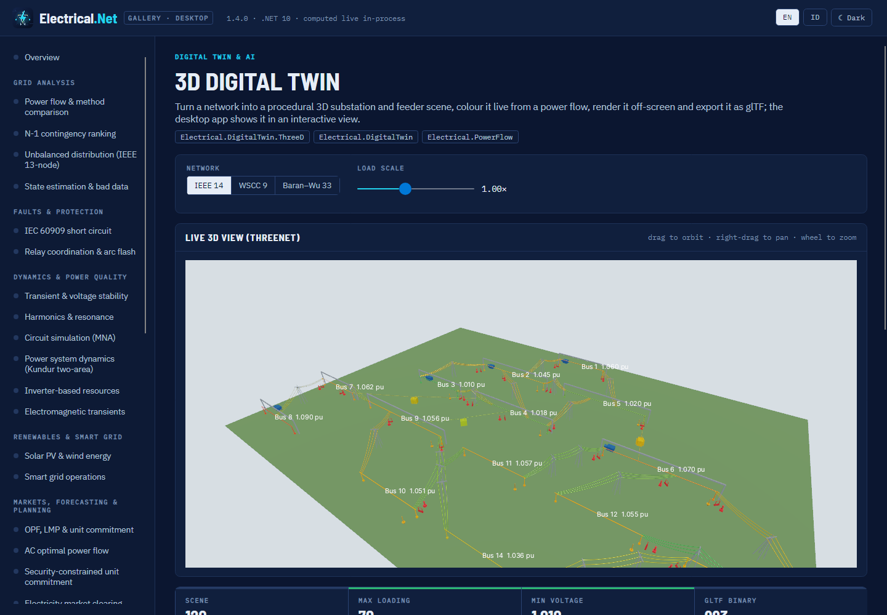

# 3D digital twin

> Made by Gravicode Studios, led by Kang Fadhil · [Bahasa Indonesia](../id/digital-twin-3d.md)

Packages: `Electrical.DigitalTwin.ThreeD` (v1.4, depends on Core, PowerFlow, DigitalTwin and Visualization; uses **ThreeNet 0.12.2**) and
`Electrical.DigitalTwin.ThreeD.Avalonia` (the `GridTwin3DView` control, **ThreeNet.Avalonia 0.12.2**). They turn a bus-branch network into
a procedural 3D model of its substations and feeders and keep it coloured from live data:

- `GridSceneBuilder` lays the network out from bus locations (GIS, when every bus has one) or the automatic single-line-diagram layout
  (layers become depth) and builds busbars on post insulators, gantries at substation buses, a breaker and disconnector bay at the from end
  of every branch, power transformers (tank, bushings, radiators), towers every span with three sagging catenary conductors, underground
  cables for branches of kind `Cable`, generators, loads and a ground plane;
- `GridScene3D.ApplyPowerFlow` / `ApplyTwinState` colour busbars by voltage and conductors by loading, show switch states (open branches
  turn grey, breakers green when open, red when closed) and make twin alarms flash; labels carry bus voltages;
- `GlbExporter` writes glTF 2.0 binary (ThreeNet has no exporter) with PBR materials in the current colours;
- `ThreeNetGridScene` realizes the model in a ThreeNet scene (wgpu: DirectX 12, Vulkan or Metal), keeps materials in sync and renders
  off-screen to PNG;
- `GridTwin3DView` shows it in Avalonia with an orbit camera, live colours, alarm flashing and HUD labels.

The scene model (`GridScene3D`, `SceneObject`, `MeshData`) is plain .NET and needs no GPU; only `ThreeNetGridScene` and the Avalonia view
do. Coordinates are metres (Y up).

## Build, colour, export, render

```csharp
var net = TestCases.Case14();
var scene = GridSceneBuilder.Build(net, new GridSceneOptions { Labels = true, UnratedReferenceMva = 100 });
Console.WriteLine($"{scene.Objects.Count} objects, {scene.TriangleCount} triangles, {scene.Count(GridElementKind.Tower)} towers");

scene.ApplyPowerFlow(PowerFlowSolver.Solve(net));          // busbars by voltage, conductors by loading, open branches grey
File.WriteAllBytes("case14.glb", GlbExporter.Export(scene)); // glTF 2.0 binary with PBR materials

using var three = ThreeNetGridScene.Create(scene);          // ThreeNet scene (needs a GPU adapter: DX12/Vulkan/Metal)
three.FrameCamera(elevationDeg: 40, azimuthDeg: 30);
File.WriteAllBytes("case14.png", three.RenderPng(1280, 720));
```

The IEEE 14-bus scene has 120 objects (about 26 000 triangles, 20 towers) and exports to a GLB of about 1 MB; the 33-bus feeder has 196
objects. Loading is `max(S_from, S_to) / RateA`; for unrated branches the reference is `UnratedReferenceMva` or, when that is null, the
most loaded branch of the current solution (so colours are relative). Important `GridSceneOptions`:

| Option | Default | Meaning |
|---|---|---|
| `LayoutScale`, `MetresPerKm`, `IgnoreLocations` | 0.35, 120, off | Metres per SLD unit; metres per km with geographic bus locations; force the SLD layout |
| `BusbarHeight`, `TowerHeight`, `SpanLength`, `Sag`, `PhaseSpacing` | 7, 16, 45, 1.6, 2.2 m | Geometry of substations and lines |
| `ShowGenerators`, `ShowLoads`, `ShowGround`, `Labels`, `BranchLabels` | on, on, on, on, off | Content |
| `VoltageSpanPu` | 0.1 | ±0.1 pu around 1.0 spans the voltage colour ramp |
| `UnratedReferenceMva` | null | Loading reference for branches without a rating (null = largest flow of the applied result) |
| `AlarmFlashHz` | 1.5 | Flash rate of alarmed objects |
| `SubstationBuses` | null | Buses drawn as substations with a gantry (null = slack and generator buses and transformer terminals) |

## Live twin

```csharp
var sim = new TwinSimulator(net, new TwinSimulatorOptions { Steps = 24 });
for (int h = 0; h < 24; h++)
{
    TwinState state = sim.Step();
    scene.ApplyTwinState(state);                            // estimated voltages / flows + alarms
}
int flashing = scene.UpdateAlarmFlash(timeSeconds: 0.5);    // call per frame; alarm objects glow
```

`ApplyTwinState` takes the output of the [digital twin](ai-digital-twin.md) (state estimate and explained alarms): an alarmed bus or
branch glows amber (warning) or red (high), and `UpdateAlarmFlash` animates the emission. Each `SceneObject` has a `Version` that changes
with its colour, so `ThreeNetGridScene.Sync()` updates only changed materials.

## Avalonia view

```csharp
var view = new GridTwin3DView { Model = scene, ShowLabels = true, Height = 560 };   // drag = orbit, right-drag = pan, wheel = zoom
scene.ApplyPowerFlow(pf);                                                           // the next frame shows the new colours
```

`GridTwin3DView` derives from `ThreeNetView`: it renders off-screen on the GPU and blits into a bitmap, so it works in any Avalonia
layout (and in headless screenshots after `RenderFrame()`). Setting `Model` rebuilds the ThreeNet scene and frames the camera; updating
the model's colours needs no other call.

## Command line and gallery

```
$ eln twin3d --case case14 --out grid.glb --png view.png --scale 1.3
3D twin of case14 (load ×1.30): 120 scene objects → grid.glb (993.3 KiB GLB)
Rendered view.png
```

The gallery demo **3D digital twin** uses `GridTwin3DView` in the desktop app; the web app shows an off-screen `RenderPng` image (or a
note when the server has no GPU adapter) and always offers the GLB as a download. A load-scale slider re-solves the power flow so heavy
corridors change colour.

| Web (off-screen render) | Desktop (live view) |
|---|---|
|  |  |

## Limitations

The geometry is procedural and schematic (standard bay, tower and transformer shapes), not a CAD model of a real substation; three-winding
transformers, HVDC and FACTS have no dedicated shapes. Rendering needs the ThreeNet native core (win-x64, linux-x64, osx-arm64) and a GPU
adapter; without one, use the GLB export. The packages are not AOT-compatible.

---
*Made by Gravicode Studios, led by Kang Fadhil · [Bahasa Indonesia](../id/digital-twin-3d.md)*
