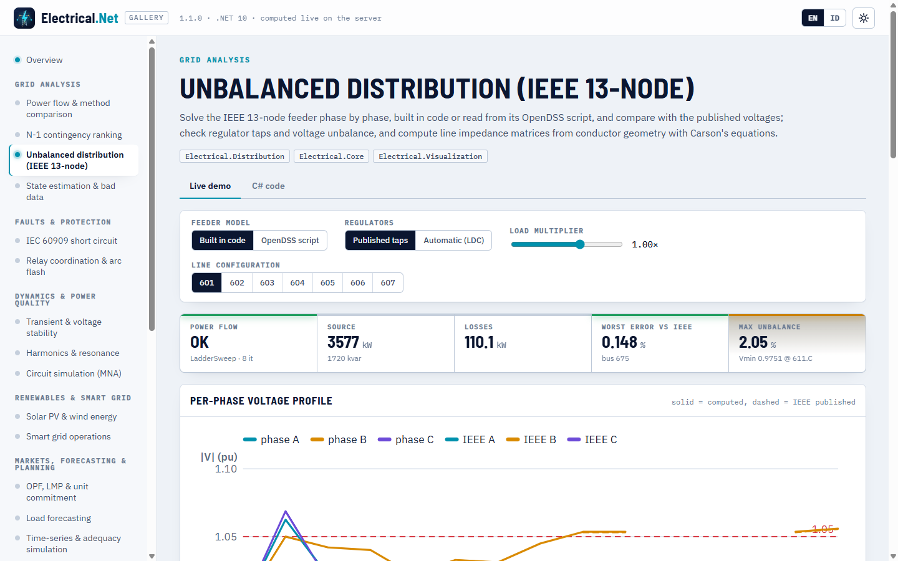

# Unbalanced distribution

> Made by Gravicode Studios, led by Kang Fadhil · [Bahasa Indonesia](../id/distribusi.md)

Package: `Electrical.Distribution` (new in v1.1, depends on `Electrical.Core` and `Electrical.PowerFlow`). It models distribution feeders phase by phase, the way
OpenDSS and Kersting's *Distribution System Modeling and Analysis* do: three-, two- and single-phase lines with full 3×3 impedance matrices
from conductor geometry, wye and delta loads with constant-power / current / impedance models, three-phase transformer connections, step
voltage regulators with line-drop compensation and switched capacitors. Units: V, A, kW, kvar, kVA, kV line-to-line, Ω and µS per mile
or km, pu of the bus line-to-neutral base.

| Part | Types |
|---|---|
| Network | `DistributionNetwork` (`AddBus`, `SetSource`, `AddLine`, `AddSwitch`, `AddTransformer`, `AddRegulator`, `AddWyeLoad`, `AddDeltaLoad`, `AddCapacitor`), `PhaseSet`, `LineCode`, `TransformerConnection`, `LoadModel` |
| Power flow | `UnbalancedPowerFlow.Solve`, `DistributionPowerFlowOptions` (`Method` Auto / LadderSweep / CurrentInjection, `ControlMode` Off / Static, `LoadMultiplier`, `Tolerance`), `DistributionPowerFlowResult`, `DistributionBusResult`, `DistributionBranchFlow` |
| Line constants | `LineConstants.Overhead / ConcentricNeutral / TapeShielded`, `OverheadConfiguration` (`Spacing500`), `ConductorLibrary`, `ConcentricNeutralCable`, `TapeShieldedCable`, `LineImpedance` (`ZOhmPerMile`, `YSiemensPerMile`, `Sequence`, `ToLineCode`) |
| Controls and time series | `VoltageRegulatorController`, `OltcController`, `CapacitorController` (voltage, var, time, power factor), `DistributionTimeSeries.Run` |
| Data | `DistributionTestCases` (`Ieee13Node`, `Ieee4Node`, `Ieee13NodePublished`, `Ieee13NodeDss`, `Ieee13Config(601..607)`), `OpenDssReader` |
| Interop | `ToBalanced(baseMva)` (positive-sequence `PowerNetwork`), `AddDistribution()` / `IDistributionService` |

## IEEE 13-node feeder

```csharp
using Electrical.Distribution;

var net = DistributionTestCases.Ieee13Node(automaticRegulator: true);
var r = UnbalancedPowerFlow.Solve(net);       // Auto → ladder sweep (radial); controllers iterate with ControlMode.Static
Console.WriteLine($"{r.Method}: {r.Iterations} it, source {r.TotalSourceKva.Real:0.0} kW, losses {r.LossesKw:0.0} kW");

var b675 = r.Bus("675");
for (int p = 0; p < 3; p++) Console.WriteLine($"675.{"ABC"[p]}: {b675.VmPu[p]:0.0000} pu ∠ {b675.VaDeg[p]:0.00}°");
Console.WriteLine($"VUF {b675.VoltageUnbalanceFactor:P2}, NEMA {b675.NemaUnbalance:P2}");
Console.WriteLine($"taps {string.Join("/", r.RegulatorTaps["Reg"])}; lowest {r.MinVoltage.Bus}.{"ABC"[r.MinVoltage.Phase]} {r.MinVoltage.Vpu:0.0000} pu");

var line = r.Branch("650632");
Console.WriteLine($"650632: {line.TotalPowerFromKva.Real:0.0} kW, max {line.MaxCurrentA:0.0} A");
```

```
LadderSweep: 8 it, source 3572.4 kW, losses 110.8 kW
675.A: 0.9832 pu ∠ -5.55°
675.B: 1.0493 pu ∠ -122.54°
675.C: 0.9702 pu ∠ 116.05°
VUF 1.88%, NEMA 1.63%
taps 10/7/10; lowest 611.C 0.9681 pu
650632: 3572.4 kW, max 588.4 A
```

`Ieee13Node()` without arguments fixes the regulator at the published taps 10/8/11 and reproduces the IEEE results; with
`automaticRegulator: true` the published LDC settings (122 V, 2 V band, PT 20, CT 700 A, R′ 3 V, X′ 9 V) move the taps, and the regulator
settles at 10/7/10, one step lower than the published end state on phases B and C. `DistributionTestCases.Ieee13NodePublished` holds the
IEEE voltages for comparison.

- `DistributionBusResult`: `VoltageV` (phase-to-neutral phasors), `VmPu`, `VaDeg` (NaN for absent phases), `VoltageUnbalanceFactor`
  (|V₂|/|V₁|, IEC 61000-4-30), `NemaUnbalance` (NEMA MG-1 line-voltage unbalance), `LineVoltage(i, j)`.
- `DistributionBranchFlow`: per-phase `CurrentFromA/CurrentToA`, `PowerFromKva/PowerToKva`, `LossesKva`, `MaxCurrentA`.
- `DistributionPowerFlowResult`: `Converged`, `Iterations`, `Method`, `SourcePowerKva` per phase, `LoadKva`, `LossesKw`, `RegulatorTaps`,
  `MinVoltage`/`MaxVoltage` (bus, phase, pu), `MaxVoltageUnbalance`, `Warnings`.

**Solvers.** `LadderSweep` is Kersting's ladder iterative technique with the generalized a, b, c, d, A, B matrices of each element (radial
feeders). `CurrentInjection` iterates nodal current injections on the sparse phase-frame Y-bus and also handles weakly meshed networks;
`Auto` chooses the ladder for radial feeders and current injection otherwise (`NonRadialNetworkException` if you force the ladder on a
mesh). `LoadMultiplier` scales every load.

## Building a feeder

```csharp
using System.Numerics;

var net = new DistributionNetwork { Name = "demo feeder", FrequencyHz = 50 };
net.AddBus("src", 20); net.AddBus("n1", 20); net.AddBus("lv", 0.4);
net.SetSource("src", voltagePu: 1.0);
var z = LineConstants.Overhead(OverheadConfiguration.Spacing500(ConductorLibrary.Acsr336_4_26_7, ConductorLibrary.Acsr4_0_6_1), frequencyHz: 50);
net.AddLine("L1", "src", "n1", z.ToLineCode("336ACSR", normalAmps: 530), 3.5, LengthUnit.Kilometer);
net.AddTransformer("T1", "n1", "lv", TransformerConnection.DeltaWyeG, 630, 20, 0.4, 1.0, 4.5);   // kVA, kV, kV, %R, %X
net.AddWyeLoad("L-lv", "lv", LoadModel.ConstantPower, new Complex(150, 50), new Complex(120, 40), new Complex(180, 60));  // kW + j kvar per phase
net.AddCapacitor("C1", "n1", 100, 100, 100);                                                     // kvar per phase
var r = UnbalancedPowerFlow.Solve(net);
Console.WriteLine(r);
```

```
LadderSweep: converged=True in 6 it, control rounds 0; source 454.2 kW -136.9 kvar, losses 4.20 kW
src: A 1.0000∠0.00°  B 1.0000∠-120.00°  C 1.0000∠120.00°
n1: A 0.9995∠-0.08°  B 0.9998∠-120.09°  C 0.9995∠119.91°
lv: A 0.9808∠-31.83°  B 0.9849∠-151.46°  C 0.9771∠87.81°
```

Lines take phase letters for laterals (`AddLine(name, from, to, code, length, unit, "cb")`); `AddSwitch` adds a near-ideal switch;
`AddRegulator(name, from, to, kvLN, phases, taps…)` a bank of single-phase step regulators (±16 steps of 0.625 %). Transformer connections
are `WyeGWyeG` (also single-phase units), `DeltaWyeG`, `WyeDelta`, `WyeGDelta` and `DeltaDelta`; Δ–Y and Y–Δ banks shift the low side
by −30° (ANSI), as above.

## Line constants (Carson and Kron)

```csharp
var oh = LineConstants.Overhead(OverheadConfiguration.Spacing500(ConductorLibrary.Acsr336_4_26_7, ConductorLibrary.Acsr4_0_6_1));
Console.WriteLine(oh);                                   // Kersting Example 4.1
Console.WriteLine($"z1 {oh.Sequence.Positive}, z0 {oh.Sequence.Zero} Ω/mile");
Complex[,] y = oh.YSiemensPerMile;                       // shunt admittance from potential coefficients (Example 5.1)

var cn = LineConstants.ConcentricNeutral(new ConcentricNeutralCable(ConductorLibrary.Aa250, ConductorLibrary.Cu14, StrandCount: 13, OutsideDiameterInches: 1.29),
    [new(ConductorRole.PhaseA, 0, 0), new(ConductorRole.PhaseB, 0.5, 0), new(ConductorRole.PhaseC, 1.0, 0)]);    // IEEE config 606
var ts = LineConstants.TapeShielded(new TapeShieldedCable(ConductorLibrary.Aa1_0, ShieldOutsideDiameterInches: 0.88, TapeThicknessMils: 5),
    [new(ConductorRole.PhaseA, 0, 0)], new ConductorPosition(ConductorRole.Neutral, 1.0 / 12, 0, ConductorLibrary.Cu1_0));   // IEEE config 607
var two = LineConstants.Overhead(new OverheadConfiguration("ID-505", [
    new(ConductorRole.PhaseC, 0, 28, ConductorLibrary.Acsr1_0_6_1), new(ConductorRole.PhaseB, 7, 28, ConductorLibrary.Acsr1_0_6_1),
    new(ConductorRole.Neutral, 4, 24, ConductorLibrary.Acsr1_0_6_1)]));                                             // IEEE config 603
LineCode sheet = DistributionTestCases.Ieee13Config(601);   // data-sheet matrices for 601–607
```

```
Z [Ω/mile], phases ABC:
0.4576+j1.0781  0.1560+j0.5017  0.1535+j0.3849
0.1560+j0.5017  0.4666+j1.0482  0.1580+j0.4237
0.1535+j0.3849  0.1580+j0.4237  0.4615+j1.0651
z1 <0.3060699820543037; 0.6270116140021461>, z0 <0.7735134837350859; 1.937286001420575> Ω/mile
```

`Overhead` builds the primitive matrix with the modified Carson equations (60 Hz and ρ = 100 Ω·m by default; both are parameters) and
Kron-reduces the neutrals; the shunt admittance comes from Maxwell's potential coefficients with image conductors. Concentric-neutral and
tape-shielded cables follow Kersting §4.3–4.4 and §5.3–5.4. Positions are in feet (`ConductorPosition.Metric` takes metres);
`ConductorData.FromMetric` adds your own conductors. `LineImpedance.ToLineCode` turns a result into a line code for `AddLine`, and
`ZFull3x3OhmPerMile()` pads a lateral to 3×3. Recomputing the IEEE 13-node configurations 601–607 from conductor data and spacings 500, 505,
510, 515 and 520 gives the data-sheet matrices within 0.0001 Ω/mile (the gallery calculator shows each matrix next to the data sheet).

```
$ eln linecode --config 601
IEEE 13-node configuration 601 (3 phases): phase impedance matrix [Ω/mile]
   0.3465+j1.0179    0.1560+j0.5017    0.1580+j0.4236
   0.1560+j0.5017    0.3375+j1.0478    0.1535+j0.3849
   0.1580+j0.4236    0.1535+j0.3849    0.3414+j1.0348
  Computed from conductors + pole spacing with modified Carson and Kron: z_aa =  0.3465+j1.0180 Ω/mile
  Sequence impedances: z1 =  0.1860+j0.5968, z0 =  0.6534+j1.9071 Ω/mile
```

## OpenDSS scripts

```csharp
var net = OpenDssReader.ParseFile("ieee13.dss");          // or OpenDssReader.Parse(DistributionTestCases.Ieee13NodeDss)
foreach (var w in net.Warnings) Console.WriteLine($"warning: {w}");
var r = UnbalancedPowerFlow.Solve(net);                    // RegControls became VoltageRegulatorControllers
```

The reader covers the subset used by the IEEE test feeders and most utility exports: `Clear`, `New Circuit` / `Vsource` (modelled as an ideal
source, with a warning), `LineCode` (rmatrix/xmatrix/cmatrix or r1/x1/r0/x0/c1/c0, units), `WireData` + `LineGeometry` (through Carson's
equations), `Line` (node notation `bus.1.2.3`, linecode or geometry, switch, length, units), two-winding `Transformer` (wye/delta, kVs,
kVAs, %R, XHL, taps), `Load` (models 1, 2 and 5; kW/kvar/pf/kVA), `Capacitor`, `RegControl` (turns its transformer into a regulator with a
controller), `CapControl`, `Edit`, `Class.Name.Prop=value`, `Set VoltageBases / DefaultBaseFrequency / ControlMode`, `CalcV`,
`Redirect`/`Compile` (relative paths), comments (`!`, `//`, `/* */`), continuation lines (`~`, `more`) and in-line RPN expressions such as
`(8 1000 /)`. Unsupported objects are skipped with a warning in `DistributionNetwork.Warnings`.

```
$ eln dss --file ieee13.dss --auto
warning: Source impedance ignored: the source is modelled as an ideal (infinite) bus.
Unbalanced power flow: converged in 8 it (LadderSweep), source 3573.0 kW / 1727.6 kvar, losses 111.2 kW
  Regulator reg1 taps: 10/0/0
  Regulator reg2 taps: 0/7/0
  Regulator reg3 taps: 0/0/10
  Max voltage unbalance (IEC): 1.88 %
  Bus          A [pu]          B [pu]          C [pu]
  sourcebus 1.0001∠  30.00 1.0001∠ -90.00 1.0001∠ 150.00
  rg60     1.0625∠  -0.00 1.0438∠-120.00 1.0624∠ 119.99
  ...
```

The feeder voltages from the script agree with the model built in code (`eln dist --auto`) to about 0.0001 pu, and the losses agree too
(111.2 kW against 110.8 kW; the difference is the copper loss of the 115/4.16 kV substation transformer, which only the script models).

## Controllers and time series

The distribution controllers act per phase on the three-phase model, with time delays in seconds:

| Controller | Settings |
|---|---|
| `VoltageRegulatorController(regulator)` | `VoltageLevel` [V on the 120 V base], `Bandwidth` [V], `PtRatio`, `CtPrimary` [A], LDC `R`/`X` [V], `TimeDelay` [s], `Ganged`, `ControlledPhases` |
| `OltcController(transformer, monitoredBus)` | `TargetPu`, `BandwidthPu`, `StepPu`, `MinTapPu`/`MaxTapPu`, `MonitoredPhase` (−1 = average), `TimeDelay` |
| `CapacitorController(capacitor, mode)` | `Voltage` [pu], `ReactivePower` [kvar], `Time` [hour of day] or `PowerFactor`; `OnSetting`/`OffSetting`, `MonitoredBus`/`MonitoredPhase`/`MonitoredElement`, `OnDelay`/`OffDelay` [s] |

```csharp
var net = DistributionTestCases.Ieee13Node();
net.Controllers.Add(new VoltageRegulatorController(net.Regulator("Reg"))
    { VoltageLevel = 122, Bandwidth = 2, PtRatio = 20, CtPrimary = 700, R = 3, X = 9, TimeDelay = 30 });
net.Controllers.Add(new CapacitorController(net.Capacitor("cap611"), CapacitorControlMode.Voltage)
{
    MonitoredBus = "611", MonitoredPhase = 2, OnSetting = 0.98, OffSetting = 1.04, OnDelay = 300, OffDelay = 300,
});
double[] shape = DistributionTimeSeries.DailyLoadShape();   // 24 hourly multipliers
var ts = DistributionTimeSeries.Run(net, shape, stepSeconds: 3600);
Console.WriteLine($"Vmin {ts.MinVoltagePu:0.0000}, Vmax {ts.MaxVoltagePu:0.0000}, tap ops {ts.TapOperations}, cap switchings {ts.CapacitorSwitchings}");
Console.WriteLine($"energy {ts.EnergyKwh:0} kWh, losses {ts.LossesKwh:0.0} kWh");
```

```
Vmin 0.9611, Vmax 1.0562, tap ops 25, cap switchings 0
energy 63464 kWh, losses 1507.7 kWh
```

`UnbalancedPowerFlow.Solve` with `ControlMode.Static` iterates power flow and controllers (ignoring delays) until none acts;
`DistributionTimeSeries.Run` keeps the controller state between steps and applies the delays, and returns per-step `DistributionTimeStep`
rows (voltages, source power, losses, unbalance, taps, capacitor states) plus `ControllerOperations`. These classes share names with the
bus-branch QSTS controllers in `Electrical.Simulation` ([Voltage control in QSTS](simulation-hpc-native.md#voltage-control-in-qsts-v11));
use a namespace alias when you import both.

## Balanced reduction and DI

```csharp
PowerNetwork balanced = net.ToBalanced(baseMva: 10);    // positive-sequence equivalent for the bus-branch solvers

var services = new ServiceCollection();
services.AddElectrical(b => b.AddDistribution());
var dist = services.BuildServiceProvider().GetRequiredService<IDistributionService>();
var r4 = dist.Solve(DistributionTestCases.Ieee4Node(Ieee4NodeConnection.DeltaGrY, unbalanced: true));
```

`ToBalanced` uses Z₁ for three-phase lines and self-minus-mutual impedance for laterals, keeps transformer ratios (and the 30° Δ–Y shift),
turns regulators into fixed-tap transformers with the average tap, sums loads per bus and turns capacitors into bus shunts; the source bus is
the slack. Use it to run short-circuit, contingency or optimisation studies on a feeder model.

## CLI

```
$ eln dist
Unbalanced power flow: converged in 8 it (LadderSweep), source 3576.5 kW / 1719.9 kvar, losses 110.1 kW
  Regulator Reg taps: 10/8/11
  Max voltage unbalance (IEC): 2.05 %
  Bus          A [pu]          B [pu]          C [pu]        max |Δ| vs IEEE
  650      1.0000∠   0.00 1.0000∠-120.00 1.0000∠ 120.00    0.000 %
  rg60     1.0625∠  -0.00 1.0500∠-120.00 1.0687∠ 120.00    0.004 %
  632      1.0210∠  -2.49 1.0420∠-121.73 1.0177∠ 117.83    0.027 %
  633      1.0180∠  -2.56 1.0401∠-121.77 1.0151∠ 117.82    0.026 %
  645             -        1.0328∠-121.91 1.0157∠ 117.85    0.019 %
  646             -        1.0311∠-121.98 1.0136∠ 117.90    0.023 %
  670      1.0107∠  -3.40 1.0450∠-121.94 1.0035∠ 117.18
  671      0.9896∠  -5.30 1.0535∠-122.35 0.9791∠ 116.09    0.135 %
  680      0.9896∠  -5.30 1.0535∠-122.35 0.9791∠ 116.09    0.135 %
  684      0.9877∠  -5.32        -        0.9771∠ 115.99    0.134 %
  611             -               -        0.9751∠ 115.84    0.134 %
  652      0.9821∠  -5.24        -               -           0.041 %
  692      0.9896∠  -5.30 1.0535∠-122.35 0.9791∠ 116.09    0.144 %
  675      0.9831∠  -5.55 1.0559∠-122.53 0.9772∠ 116.10    0.144 %
  634      0.9940∠  -3.23 1.0217∠-122.23 0.9962∠ 117.34    0.023 %

$ eln dist --feeder ieee4 --unbalanced
Unbalanced power flow: converged in 26 it (LadderSweep), source 6109.9 kW / 4209.2 kvar, losses 659.9 kW
  Max voltage unbalance (IEC): 6.38 %
  Bus          A [pu]          B [pu]          C [pu]
  1        1.0000∠   0.00 1.0000∠-120.00 1.0000∠ 120.00
  2        0.9950∠  -0.14 0.9876∠-120.18 0.9837∠ 119.26
  3        0.9599∠  -2.26 0.9387∠-123.62 0.9172∠ 114.79
  4        0.9056∠  -4.12 0.8035∠-126.80 0.7630∠ 102.84
```

Options: `dist [--feeder ieee13|ieee4] [--auto] [--delta] [--unbalanced]`, `dss --file feeder.dss [--auto]`, `linecode --config 601..607`.
(Node 670 is the lumped distributed load added by the model, so it has no published value; the CLI column is the absolute difference in pu.)

## Validation

| Check | Reference | Result |
|---|---|---|
| IEEE 13-node, published regulator taps | IEEE PES test feeder results (node 675: 0.9835 / 1.0553 / 0.9758 pu) | 0.9831 / 1.0559 / 0.9772 pu; worst error 0.148 % |
| IEEE 4-node, GrY–GrY and Δ–GrY, balanced and unbalanced | IEEE PES 4-node results | worst error 0.026 % |
| Overhead line, 336,400 ACSR on spacing 500 | Kersting Example 4.1: z<sub>aa</sub> = 0.4576 + j1.0780 Ω/mile, z₁ = 0.3061 + j0.6270, z₀ = 0.7735 + j1.9373 | same to 1e-3 |
| Shunt admittance | Kersting Example 5.1 | within 0.2 % |
| Concentric-neutral cable | Kersting Examples 4.2 / 5.2 (IEEE config 606) | same to 1.5e-3 Ω/mile, y within 0.5 % |
| Tape-shielded cable | Kersting Example 4.3 | same to 2e-3 Ω/mile |
| IEEE 13-node configurations 601–607 from geometry | IEEE data sheet | within 0.0001 Ω/mile |

## Gallery

The **Unbalanced distribution (IEEE 13-node)** demo (`distribution`) solves the feeder built in code or read from the OpenDSS script,
plots the per-phase voltage profile against the published values, lists regulator taps and unbalance factors, shows the OpenDSS script and
recomputes the impedance matrix of any configuration 601–607 next to the data sheet.



## Limitations

- Sources are ideal (OpenDSS source impedances are ignored with a warning); no harmonic, fault or dynamic analysis on the phase model yet
  (use `ToBalanced` with the bus-branch modules).
- The OpenDSS reader covers the common subset listed above: only the first two windings of a transformer are modelled, and other objects
  (PV systems, storage, generators, load shapes, …) are skipped with a warning (use `DistributionTimeSeries` multipliers for load shapes).
- The ladder sweep needs a radial feeder; use `CurrentInjection` for weakly meshed networks.

---
*Made by Gravicode Studios, led by Kang Fadhil · [Bahasa Indonesia](../id/distribusi.md)*
