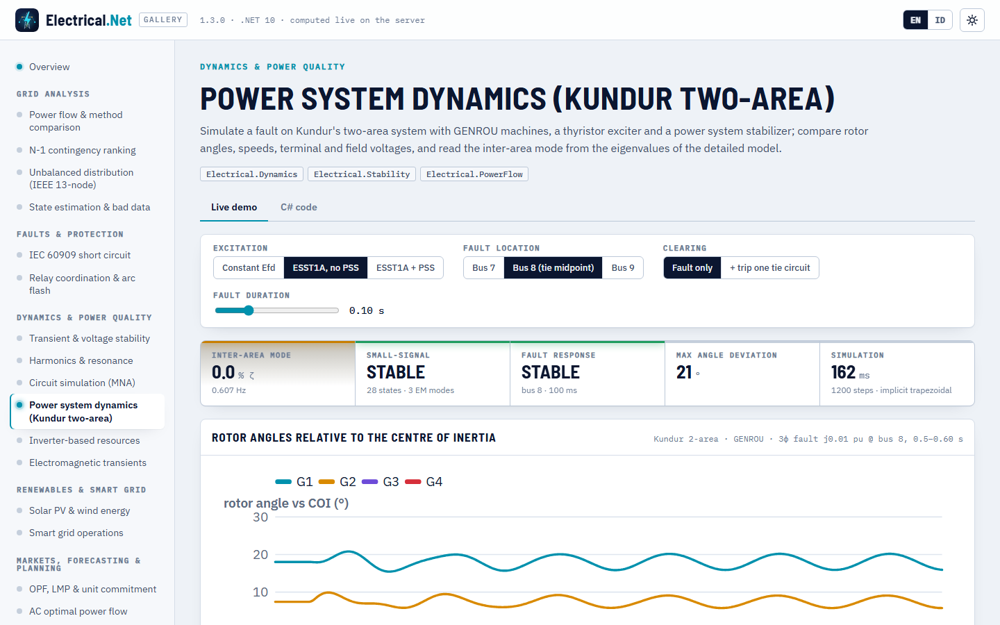
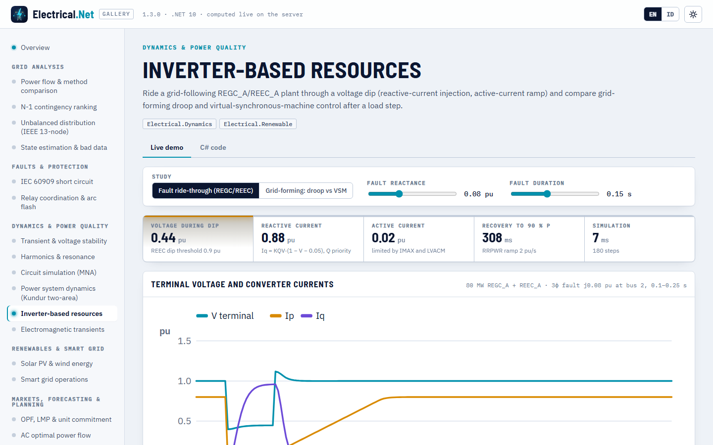

# Power system dynamics

> Made by Gravicode Studios, led by Kang Fadhil · [Bahasa Indonesia](../id/dinamika.md)

Package: `Electrical.Dynamics` (v1.3, depends on PowerFlow and Stability). RMS (phasor) time-domain simulation and small-signal analysis with
detailed models: synchronous machines with their exciters, governors and power system stabilizers, inverter-based resources (WECC
generic REGC/REEC/REPC models and grid-forming inverters), PSS/E `.dyr` input and event-driven simulation. The classical model in
[`Electrical.Stability`](stability.md) stays the quick screening tool; see [Classical vs detailed](#classical-vs-detailed).

## Quick start: Kundur two-area system

```csharp
using System.Numerics;
using Electrical.Dynamics;

var study = DynamicTestCases.KundurTwoArea(KundurExcitation.StaticExciterWithPss);
DynamicSystem sys = study.Build();                    // power flow + initialization of every model
Console.WriteLine(sys);                               // kundur2area: 4 units, 40 states, 11 buses
var (dmax, mismatch) = sys.InitializationResidual();  // 5.6e-15, 2.8e-14: a true equilibrium

var events = new[]
{
    DynamicEvent.Fault(0.5, busId: 8, impedancePu: new Complex(0, 0.01)),   // 3-phase fault at the tie-line midpoint
    DynamicEvent.Clear(0.6, busId: 8),
};
var r = DynamicSimulation.Run(sys, events, new SimulationOptions { EndTimeS = 10 });
Console.WriteLine($"stable {r.Stable}, {r.Steps} steps, {r.Elapsed.TotalMilliseconds:0} ms");   // stable True, 1200 steps, ≈ 90–120 ms

int g1 = r.UnitIndex("G1");
double[] delta = r.AngleCoiDeg[g1], speed = r.SpeedPu[g1], vt = r.TerminalVoltagePu[g1], efd = r.FieldVoltagePu[g1];
double efdDuringFault = r.At(efd, 0.55);              // 8.67 pu, the exciter ceiling is 9 pu
```

`DynamicSimulationResult` holds one row per unit (generator, inverter or dynamic load, in `UnitNames` order) and one column per output
sample: `AngleDeg`, `AngleCoiDeg` (relative to the centre of inertia), `SpeedPu`, `TerminalVoltagePu`, `ActivePowerMw`,
`ReactivePowerMvar`, `FieldVoltagePu`, `MechanicalPowerPu`, `ActiveCurrentPu`, `ReactiveCurrentPu`, plus `BusVoltagePu` and
`BusFrequencyHz` per bus, any state by name (`States`, `Channel("EFD G1")`), `Stable`, `MaxAngleDeviationDeg`, `Steps`, `Iterations`,
`ConvergenceFailures` and `Elapsed`. `At(channel, t)` interpolates.



## Building a study

### From PSS/E `.dyr` data

```csharp
var net = DynamicTestCases.KundurNetwork();                                  // or NetworkFormats.Load("case.raw").Network
string dyr = DynamicTestCases.KundurDyr(KundurExcitation.StaticExciter);    // or File.ReadAllText("case.dyr")
DynamicModelSet models = DyrReader.Parse(dyr, net);
foreach (var w in models.Warnings) Console.WriteLine(w);                     // unknown models, unmatched generators, …
var sys = DynamicSystem.Build(net, models, new DynamicSystemOptions { Loads = LoadRepresentation.ConstantImpedance });
```

`DyrReader` accepts multi-line records ending in `/`, comments (`//`, `@!`), quoted machine ids and trailing text. Records are matched to
generators by bus and machine id; unknown models (`USRMDL`, …) and records without a generator become warnings, never exceptions.
`DynamicModelLibrary.Names` lists what is understood:

```
AC4A, ESAC4A, ESST1A, GAST, GENCLS, GENROU, GENSAL, GFMDRP, GFMVSM, HYGOV, IEEEG1, IEEEST, IEEET1, PSS2A, PSS2B, REECA1, REECAU1, REEC_A,
REGCA1, REGCAU1, REGC_A, REPCA1, REPCAU1, REPC_A, SEXS, ST1A, TGOV1
```

`DynamicModelLibrary.Register` adds your own model factory under a name.

### In code

```csharp
var net = TestCases.Case9();
var models = new DynamicModelSet()
    .Add(0, new Gensal(8.96, 0.03, 0.05, 23.64, 0, 0.146, 0.0969, 0.0608, 0.05, 0.0336), new Sexs(0.1, 10, 100, 0.1, 0, 5))
    .Add(1, new Genrou(6.0, 0.03, 0.535, 0.05, 6.4, 0, 0.8958, 0.8645, 0.1198, 0.1969, 0.1, 0.0521),
            new Ieeet1(0, 20, 0.2, 5, -5, 1.0, 0.314, 0.063, 0.35), new Tgov1(0.05, 0.5, 5, 0, 1, 3, 0));
// generator 2 has no models: it becomes GENCLS from Generator.H, D and XdPrime
var sys = DynamicSystem.Build(net, models);                                 // 20 states
var r = DynamicSimulation.Run(sys,
    [DynamicEvent.LoadStep(0.5, busId: 5, deltaPMw: 20), DynamicEvent.ReferenceStep(5, generatorIndex: 1, "Vref", 0.02)],
    new SimulationOptions { EndTimeS = 20, TimeStepS = 0.01 });             // G2: Pm 1.630 → 1.815 pu, Vt 1.025 → 1.036 pu
```

Constructor parameters follow the PSS/E CON order of each model (machine data in pu on `Generator.MBase`, times in s). A generator index is
the position in `PowerNetwork.Generators`. `DynamicModelSet.Without(ModelCategory.Stabilizer)` strips a category for a what-if study and
`Loads.Add(new ExponentialRecoveryLoad(bus, …))` adds a dynamic load.

### Models

| Category | Models | Notes |
|---|---|---|
| Machines | `Gencls`, `Genrou` (round rotor), `Gensal` (salient pole) | Subtransient, quadratic or exponential saturation; H = 0 makes an infinite bus |
| Exciters | `Sexs`, `Ieeet1`, `Esst1a`, `Esac4a` | Windup and non-windup limits, rate feedback, exciter saturation (IEEET1) |
| Governors | `Tgov1`, `Hygov`, `Gast`, `Ieeeg1` | Steam, hydro (water column), gas turbine, multi-stage steam |
| Stabilizers | `Ieeest`, `Pss2b` | Speed, power or accelerating-power inputs (`StabilizerInput`) |
| Inverter-based resources | `Regca` (REGC_A), `Reeca` (REEC_A), `Repca` (REPC_A) | Generic WECC renewable models: LVPL, Iq injection, current limits with P/Q priority, plant V/Q/f control |
| Grid-forming | `GridFormingInverter` (`GridFormingMode.Droop` / `VirtualSynchronousMachine`) | Voltage source behind XF with P–f and Q–V droops, virtual inertia H, current limit |
| Loads | Static: constant Z (default), the network's ZIP models or one ZIP for all; `ExponentialRecoveryLoad` | `DynamicSystemOptions.Loads`, `ConstantPowerBreakpoint` |

## Events

| Factory | Effect |
|---|---|
| `DynamicEvent.Fault(t, bus, z)` / `Clear(t, bus)` | Three-phase fault through `z` pu (zero → bolted, 1e-5 pu) |
| `TripBranch(t, index)` / `CloseBranch(t, index)` | Branch switching (`TransientStability.BranchIndex(net, from, to)` finds the index) |
| `TripGenerator(t, index)` | Removes a unit (its outputs become NaN) |
| `LoadStep(t, bus, ΔP, ΔQ)` / `ScaleLoad(t, bus, k)` | Load changes with the bus' load characteristic |
| `ReferenceStep(t, gen, "Vref"/"Pref"/"Qref"/"Efd"/"Pm", value, relative)` | Controller set-point changes |
| `DynamicEvent.From(StabilityEvent)` | Reuses a classical-model event list |

## Solver

`SimulationOptions.Method` selects the integrator:

- `ImplicitTrapezoidal` (default): the differential and algebraic equations are solved together by Newton's method with a sparse Jacobian
  (exact network admittances, numerical per-unit derivatives). The Jacobian is reused across steps and refreshed after events, step changes
  or slow convergence; a step whose Newton iteration stalls on non-smooth switching is redone as two explicit half steps (counted in
  `FallbackSteps`). Default step: half a cycle (8.33 ms at 60 Hz). Kundur two-area, 10 s, 40 states: about 85 ms.
- `ModifiedEuler`: partitioned explicit Heun method with a network solution at the predictor and the corrector (use a small `TimeStepS`).

Limits (anti-windup, current limits) are applied inside every Newton iteration; discrete logic (REEC voltage-dip state, current-limit switching)
is evaluated between steps. `OutputInterval` thins the stored samples, `StopWhenUnstable` ends a run when the COI angle spread exceeds
`InstabilityAngleDeg`, and `RecordBuses = false` skips per-bus channels.

## Small-signal analysis

`DynamicSmallSignal.Analyze` linearises the full model around its initialized equilibrium. Each column of the state matrix is a central
difference with the network re-solved for the perturbed state, so the algebraic variables are eliminated exactly; eigenvalues come from the
balanced Hessenberg QR solver of `Electrical.Stability` and participation factors from left and right eigenvectors.

```csharp
var ss = DynamicSmallSignal.Analyze(DynamicTestCases.KundurTwoArea(KundurExcitation.ConstantField).Build());
foreach (var m in ss.ElectromechanicalModes())        // rotor participation ≥ 0.3, 0.1–3 Hz
    Console.WriteLine(m);

var inter = ss.ElectromechanicalModes()[0];          // lowest frequency: the inter-area mode
foreach (var (unit, shape) in inter.SpeedShape)
    Console.WriteLine($"  {unit}: {shape.Magnitude:0.00} ∠ {shape.Phase * 180 / Math.PI:0}°");
```

```
λ = -0.1289 ± j3.4074  f = 0.542 Hz  ζ = 3.78 %  [G3.GENROU.dw 0.24, G3.GENROU.delta 0.24, G4.GENROU.dw 0.16]
λ = -0.6116 ± j6.7639  f = 1.077 Hz  ζ = 9.01 %  [G2.GENROU.dw 0.26, G2.GENROU.delta 0.25, G1.GENROU.dw 0.20]
λ = -0.6182 ± j6.9867  f = 1.112 Hz  ζ = 8.81 %  [G4.GENROU.dw 0.27, G4.GENROU.delta 0.27, G3.GENROU.dw 0.18]
  G1: 0.21 ∠ -60°
  G2: 0.15 ∠ -49°
  G3: 1.00 ∠ 92°
  G4: 0.91 ∠ 91°
```

The mode shape shows area 1 (G1, G2) swinging against area 2 (G3, G4). `StateMatrix`, `States`, `Eigenvalues` (all, by decreasing real
part), `Modes` (oscillatory, with participation) and `ModeTable()` are available. The three Kundur variants show the classic story:

| Excitation | Inter-area mode | Local modes |
|---|---|---|
| Constant field voltage (`ConstantField`) | 0.542 Hz, ζ 3.8 % | 1.077 / 1.112 Hz, ζ ≈ 9 % |
| ESST1A, KA = 200, no PSS (`StaticExciter`) | 0.607 Hz, ζ ≈ 0.0 % | 1.130 / 1.165 Hz |
| ESST1A + Kundur PSS (`StaticExciterWithPss`) | 0.609 Hz, ζ 18.6 % | 1.297 / 1.351 Hz, ζ ≈ 24 % |

## Inverter-based resources

### Grid-following: REGC_A + REEC_A (+ REPC_A)

```csharp
var ibr = DynamicTestCases.InverterBehindLine();      // infinite bus — line — 80 MW REGC_A + REEC_A at bus 2
var r = DynamicSimulation.Run(ibr.Build(),
    [DynamicEvent.Fault(0.1, busId: 2, impedancePu: new Complex(0, 0.08)), DynamicEvent.Clear(0.25, busId: 2)],
    new SimulationOptions { EndTimeS = 1.5 });
int u = r.UnitIndex("PV1");
double iq = r.At(r.ReactiveCurrentPu[u], 0.2);         // V 0.45 pu → Iq 0.94 pu, Ip 0.02 pu

// your own plant: converter + electrical control (+ optional plant controller) attached to a generator
var models = new DynamicModelSet()
    .Add(1, new Regca(tg: 0.02, rrpwr: 2), new Reeca(qFlag: false) { Kqv = 2, Imax = 1.1 }, new Repca(fFlag: true) { Kp = 1, Ki = 20 });
var plant = DynamicSystem.Build(ibr.Network, models);  // generator 0 (H = 0) stays an infinite bus; 17 states
```

During the dip REEC_A injects Iq = KQV·(1 − V − dead band) with reactive-current priority and LVACM/LVPL cut the active current; after
clearing the active current recovers at RRPWR (2 pu/s here: 40.6 MW at 0.40 s, 60.6 MW at 0.50 s, 80 MW in steady state).

### Grid-forming: droop vs virtual synchronous machine

```csharp
foreach (var mode in new[] { GridFormingMode.Droop, GridFormingMode.VirtualSynchronousMachine })
{
    var g = DynamicSimulation.Run(DynamicTestCases.GridFormingPair(mode).Build(),
        [DynamicEvent.LoadStep(1, busId: 3, deltaPMw: 10)], new SimulationOptions { EndTimeS = 8 });
    double d1 = g.ActivePowerMw[0][^1] - g.ActivePowerMw[0][0], d2 = g.ActivePowerMw[1][^1] - g.ActivePowerMw[1][0];
    Console.WriteLine($"{mode}: ΔP1 {d1:0.00} MW, ΔP2 {d2:0.00} MW, f {50 * g.SpeedPu[0][^1]:0.000} Hz, nadir {50 * g.SpeedPu[0].Min():0.000} Hz");
}
```

```
Droop: ΔP1 3.25 MW, ΔP2 6.50 MW, f 49.919 Hz, nadir 49.914 Hz
VirtualSynchronousMachine: ΔP1 3.25 MW, ΔP2 6.50 MW, f 49.919 Hz, nadir 49.918 Hz
```

Droops MP = 0.05 and 0.025 pu share the step 1 : 2 in both modes; the virtual inertia of the VSM removes the frequency overshoot below the
droop line. `SpeedPu` of a grid-forming unit is its internal frequency.



## Classical vs detailed

| | `Electrical.Stability` (classical) | `Electrical.Dynamics` (detailed) |
|---|---|---|
| Machine | E′ behind X′d, constant | GENCLS, GENROU, GENSAL with flux dynamics and saturation |
| Controls | none | exciters, governors, PSS, IBR controls |
| Network | Kron-reduced to machine nodes | full bus network solved with the machine states |
| Integration | RK4 | implicit trapezoidal (DAE, Newton) or modified Euler |
| Use | screening, CCT by bisection, teaching | design studies, controller tuning, IBR behaviour |

A GENROU machine pushed to the classical limit (X″ ≈ X′d = X′q ≈ Xd = Xq, T′do = T′qo = 1000 s) reproduces the classical first swing
on case9 within 2.3°, and the detailed case9 (GENSAL/GENROU + IEEET1) has its electromechanical modes at 1.33 and 2.10 Hz next to the
classical 1.38 and 2.13 Hz. Events convert with `DynamicEvent.From`.

## Dependency injection

```csharp
var sp = new ServiceCollection().AddElectrical(b => b.AddDynamics().AddEmt()).BuildServiceProvider();
IDynamicsService dyn = sp.GetRequiredService<IDynamicsService>();   // Build, Simulate, SmallSignal, ParseDyr
```

## CLI

```
$ eln dyn
kundur2area: Kundur two-area system, StaticExciterWithPss
Electromechanical modes (stable):
   0.609 Hz  ζ =  18.6 %  λ = -0.7257 ± j3.8257  G3.GENROU.dw 0.16, G3.GENROU.delta 0.16, G4.GENROU.dw 0.12
   1.297 Hz  ζ =  24.3 %  λ = -2.0408 ± j8.1499  G2.GENROU.dw 0.22, G1.GENROU.dw 0.18, G2.GENROU.delta 0.17
   1.351 Hz  ζ =  24.4 %  λ = -2.1323 ± j8.4860  G4.GENROU.dw 0.23, G4.GENROU.delta 0.17, G3.GENROU.dw 0.17
Three-phase fault at bus 8 (t = 1 s), cleared after 100 ms: STABLE, 1200 steps in 127 ms
  Unit   δ(COI) max swing   speed range [pu]        V term min [pu]   Efd max [pu]
  G1             3.82°   1.00000–1.00342          0.939          9.000
  G2             4.05°   1.00000–1.00424          0.855          9.000
  G3             3.94°   0.99997–1.00274          0.919          9.000
  G4             3.30°   0.99998–1.00312          0.828          9.000
```

More (`--exc const|st|pss`, `--case case9`, `--trip`, `--modes`) in the [CLI reference](cli.md#new-in-13).

## Validation

| Check | Reference | Result |
|---|---|---|
| Kundur two-area load flow | Kundur Example 12.6: Q 185 / 235 / 176 / 202 Mvar, δ 20.2 / 10.5 / −6.8 / −17.0° | 185.0 / 234.6 / 176.0 / 202.1 Mvar, 20.27 / 10.51 / −6.80 / −16.99° |
| Inter-area mode, constant Efd | Kundur: 0.545 Hz, ζ ≈ 3 % | 0.542 Hz, ζ 3.8 % (constant-impedance loads) |
| Local modes, constant Efd | Kundur: 1.09 / 1.12 Hz | 1.077 / 1.112 Hz |
| ESST1A KA = 200 without PSS | Kundur: inter-area mode loses its damping (ζ ≈ −0.8 %) | ζ ≈ 0.0 % |
| ESST1A with Kundur PSS | Well damped (ζ > 5 %) | ζ 18.6 %; time domain: tie swing 7–10 s below 10 % of the no-PSS case |
| GENROU at the classical limit, case9 | Classical first swing (`Electrical.Stability`) | within 2.3° |
| Flat runs | Equilibrium | drift < 1e-6 over 10 s; initialization residual < 1e-9 for every model |
| Governors after a load step | Droop line Δω = −R·ΔPm | within 3 % (TGOV1, GAST, IEEEG1, HYGOV with gate gain) |
| REGC/REEC fault ride-through | Iq = KQV·(1 − V − 0.05) at V ≈ 0.45 pu; RRPWR 2 pu/s | Iq ≈ 0.94 pu, ramp 200 MW/s ± 10 % |
| Grid-forming droop sharing | MP 0.05 : 0.025 → 1 : 2 | 1 : 2.00, frequency on the droop line to 1e-5 |
| REPC frequency response in a GFM island | ΔP = DUP·(\|Δf\| − dead band) | equal to 1e-4 pu |
| Performance | — | Kundur 10 s (40 states, 1200 steps) in ≈ 85 ms, implicit |

## Limitations

Positive-sequence RMS models only (unbalanced faults, DC-side converter dynamics and sub-cycle phenomena belong in [EMT](emt.md)). No
user-defined model compiler: custom models are C# classes registered with `DynamicModelLibrary.Register`. The `.dyr` reader covers the
listed models; others are skipped with a warning. Dynamic load models are limited to exponential recovery.

---
*Made by Gravicode Studios, led by Kang Fadhil · [Bahasa Indonesia](../id/dinamika.md)*
