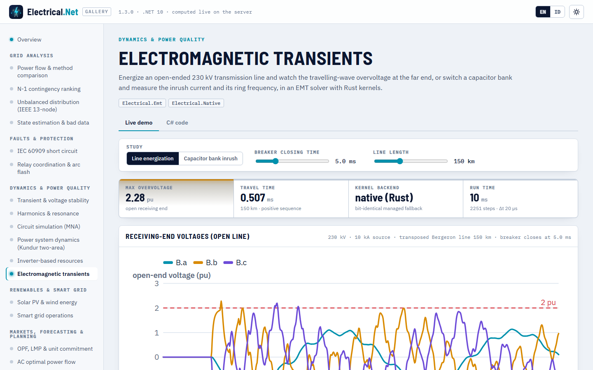

# Electromagnetic transients (EMT)

> Made by Gravicode Studios, led by Kang Fadhil · [Bahasa Indonesia](../id/transien-elektromagnetik.md)

Package: `Electrical.Emt` (v1.3, depends on Core and Native). Instantaneous-value (EMTP-type) simulation of networks in SI units (V, A, Ω, H,
F, s): lumped R/L/C, time-controlled switches and breakers that open at current zero, diodes and thyristors, voltage and current sources,
ideal transformers with leakage, coupled π sections and transposed three-phase Bergeron (travelling-wave) lines. The hot loops run in Rust
kernels with a bit-identical managed fallback.

Use it for what phasor tools cannot see: switching overvoltages, capacitor inrush, travelling waves, current chopping, rectifier
waveforms. For electromechanical dynamics over seconds, use [Electrical.Dynamics](dynamics.md).

## Quick start

```csharp
using Electrical.Emt;

var net = new EmtNetwork();
net.AddVoltageSource("V", "s", EmtWaveform.Dc(10));                        // node "0" is ground
net.AddSeriesRLC("rlc", "s", "0", ohms: 2, henries: 1e-3, farads: 10e-6);
var r = EmtSimulation.Simulate(net, new EmtOptions { TimeStep = 1e-6, StopTime = 3e-3 });

EmtChannel i = r.Current("rlc");
var zc = i.ZeroCrossings(1e-4);
double fRing = (zc.Count - 1) / (2 * (zc[^1] - zc[0]));
Console.WriteLine($"peak {i.Peak():0.000} A at {i.TimeOfPeak() * 1e3:0.000} ms, ring {fRing:0} Hz [{r.Backend}]");
// peak 0.863 A at 0.148 ms, ring 1584 Hz [native (Rust)]
```

## Network elements

| Method | Element |
|---|---|
| `AddResistor`, `AddInductor` (initial current), `AddCapacitor` (initial voltage), `AddSeriesRL`, `AddSeriesRLC` | Lumped branches |
| `AddSwitch(name, a, b, closeTime, openTime, initiallyClosed, openAtCurrentZero, ron, roff)` | Time-controlled switch; with `openAtCurrentZero` it interrupts at the next current zero (no chopping) |
| `AddDiode`, `AddThyristor(…, gate: t => …)` | Two-state devices (R<sub>on</sub>/R<sub>off</sub>); on when forward-biased, off when the current reverses; a thyristor turns on only while its gate is true |
| `AddVoltageSource(name, node, waveform, r, l)`, `AddCurrentSource` | `EmtWaveform.Dc`, `Step`, `Cosine`, `Sine`, `Ramp`, `Custom` |
| `AddTransformer(name, p1, p2, s1, s2, ratio, r, l)` | Ideal transformer with leakage referred to the secondary |
| `AddBergeronLine`, `Add(BergeronLine.SinglePhase(…))` | Lossless travelling-wave line with lumped loss (R/4, R/2, R/4) |
| `AddPiSection(name, from[], to[], R, L, C)` | Coupled n-phase π section from matrices |
| `AddThreePhaseSource`, `AddThreePhaseLoad`, `AddThreePhaseSeries`, `AddThreePhaseCapacitorBank`, `AddThreePhaseSwitch` (per-pole times), `AddThreePhaseLine` (transposed Bergeron from sequence data), `AddThreePhasePiSection`, `AddThreePhaseTransformer` (YNyn, YNd) | Three-phase helpers: bus `B` expands to nodes `B.a`, `B.b`, `B.c`; elements are named `name.a`, … |

## Line energization

```csharp
double vpk = 230e3 * Math.Sqrt(2.0 / 3.0);                                 // phase peak (V)
var net = new EmtNetwork();
net.AddThreePhaseSource("Grid", "S", lineVoltageRms: 230e3, frequencyHz: 50, l: 0.0423);      // ≈ 10 kA short-circuit level
net.AddThreePhaseSwitch("CB", "S", "A", closeTime: 0.005);
net.AddThreePhaseLine("Line", "A", "B", 0.03, 0.93e-3, 12.3e-9, 0.30, 3.0e-3, 7.9e-9, lengthKm: 150);   // R1, L1, C1, R0, L0, C0 per km

var r = EmtSimulation.Simulate(net, new EmtOptions { TimeStep = 20e-6, StopTime = 0.045 });
foreach (var ph in new[] { "a", "b", "c" })
{
    EmtChannel v = r.Voltage($"B.{ph}");                                    // three-phase buses expand to B.a, B.b, B.c
    Console.WriteLine($"B.{ph}: {v.Peak() / vpk:0.00} pu at {v.TimeOfPeak() * 1e3:0.00} ms");
}
```

```
B.a: 1.17 pu at 9.58 ms
B.b: 2.28 pu at 6.60 ms
B.c: 2.20 pu at 12.94 ms
2251 steps, 2 factorizations, native (Rust), 10 ms
```

At 5 ms phase a passes through zero while b and c are at ±0.87 pu, so b and c see the doubled travelling wave at the open end
(τ = 0.507 ms for 150 km) and reach about 2.2–2.3 pu. Move the closing instant to a phase peak to see the worst case for that phase.



## Capacitor switching

Back-to-back switching of two 10 µF banks through 50 µH (Greenwood ch. 6): the inrush peak is V₀·√(C<sub>eq</sub>/L) and the ring frequency
1/(2π√(L·C<sub>eq</sub>)) with C<sub>eq</sub> = C/2.

```csharp
const double v0 = 10e3, c = 10e-6, l = 50e-6;                               // bank 1 charged to 10 kV, 50 µH between banks
var net = new EmtNetwork();
net.AddCapacitor("C1", "a", "0", c, initialVoltage: v0);
net.AddSwitch("brk", "a", "x", closeTime: 10e-6);
net.AddSeriesRL("L", "x", "b", 0.01, l);
net.AddCapacitor("C2", "b", "0", c);
var r = EmtSimulation.Simulate(net, new EmtOptions { TimeStep = 0.2e-6, StopTime = 0.4e-3 });

var i = r.Current("L");
double ceq = c / 2, theory = v0 * Math.Sqrt(ceq / l), f0 = 1 / (2 * Math.PI * Math.Sqrt(l * ceq));
var zc = i.ZeroCrossings(20e-6);
Console.WriteLine($"inrush {i.Peak():0} A (theory {theory:0} A), ring {(zc.Count - 1) / (2 * (zc[^1] - zc[0])):0.0} Hz (theory {f0:0.0} Hz)");
// inrush 3154 A (theory 3162 A), ring 10065.7 Hz (theory 10065.8 Hz)
```

The three-phase version (an 11 kV bus energizing a wye-grounded bank) is `eln emt --case capbank` and the capacitor view of the gallery demo.

## Switches, power electronics and transformers

```csharp
var net = new EmtNetwork();
net.AddVoltageSource("V", "s", EmtWaveform.Cosine(10e3, 50));
net.AddSwitch("cb", "s", "x", initiallyClosed: true, openTime: 0.0123, openAtCurrentZero: true);   // waits for the current zero
net.AddSeriesRL("load", "x", "0", 5, 0.05);
net.AddDiode("D", "s", "rect");                                              // half-wave rectifier
net.AddResistor("Rdc", "rect", "0", 100);
net.AddThyristor("T", "s", "ctl", gate: t => (t * 50 % 1.0) * 360 is >= 60 and < 90);   // fired at α = 60°
net.AddResistor("Rt", "ctl", "0", 100);
net.AddTransformer("TR", "s", "0", "lv", "0", ratio: 10, r: 0.01, l: 1e-4);  // 10:1, leakage referred to the secondary
net.AddResistor("Rlv", "lv", "0", 10);
var r = EmtSimulation.Simulate(net, new EmtOptions { TimeStep = 10e-6, StopTime = 0.06 });
```

Every topology change (switch, diode or thyristor state) refactorizes the network matrix (`Factorizations`); diode states are iterated
within a step until consistent (`MaxSwitchIterations`).

## Solver

- **Companion models**: every branch is replaced by a conductance and a history current source (trapezoidal rule), the nodal equations
  G·v = i are factorized once with the Core `SparseLU` (minimum-degree ordering) and only re-factorized after a topology change.
- **Bergeron lines**: modal decomposition (Clarke transformation for transposed lines), interpolated travel-time history, lumped losses.
- **Critical damping adjustment** (`CriticalDampingAdjustment`, default on, Marti & Lin): after each topology change the solver takes two
  backward-Euler half steps, which keeps the matrix unchanged and removes the sustained ±(2L/Δt)·I oscillation of the trapezoidal rule after
  current interruption.
- **Output**: node voltages always, branch currents unless `RecordCurrents = false`; `RecordEvery` thins the samples. `EmtChannel` gives
  `At`, `Window`, `Peak`, `TimeOfPeak`, `Rms`, `RmsLastCycles`, `ZeroCrossings`, `Max`, `Min` and channel subtraction.

## Native kernels

The two inner loops, the history-current update of all R-L-C branches and the forward/backward substitution with the pre-factored sparse
LU, are the Rust functions `eln_emt_branch_update` and `eln_emt_lu_solve` (library `eln_version` ≥ 10300). `Electrical.Native.EmtKernels`
calls them when available and otherwise runs managed code that performs the same floating-point operations in the same order, so results
are bit-identical (a test runs the same network both ways and compares every sample).

```csharp
Console.WriteLine(EmtKernels.Backend);               // "native (Rust)" or "managed"
EmtKernels.PreferNative = false;                      // force managed code for the whole process
var opts = new EmtOptions { PreferNative = false, RecordEvery = 10, RecordCurrents = false };   // or per run
```

See [Simulation, HPC & native](simulation-hpc-native.md#native-kernels) for building the Rust library.

## Dependency injection

```csharp
var sp = new ServiceCollection().AddElectrical(b => b.AddEmt()).BuildServiceProvider();
IEmtService emt = sp.GetRequiredService<IEmtService>();   // Simulate(network, options)
```

## CLI

```
$ eln emt
Line energization: 230 kV, 150 km open-ended line, breaker closes at 5 ms (Δt 50 µs, 1201 steps, native (Rust), 136 ms)
  Open end phase a: peak 1.17 pu at 9.60 ms
  Open end phase b: peak 2.23 pu at 6.60 ms
  Open end phase c: peak 2.15 pu at 12.90 ms

$ eln emt --case capbank
Capacitor bank energization: 5 Mvar at 11 kV, S"k 250 MVA (Δt 50 µs, native (Rust))
  Inrush peak 3043 A = 8.2 × rated peak; ring frequency ≈ 354 Hz
  Bus overvoltage peak 1.97 pu
```

(The CLI uses Δt = 50 µs; the 20 µs run above resolves the wavefronts a little better. The first run includes JIT time.)

## Validation

| Check | Reference | Result |
|---|---|---|
| RL / RC / RLC responses | Closed-form exponential and damped sinusoid | error < 0.2 % (RL, RC), < 1.5 % of peak (RLC); ring period to 0.1 % |
| RL energization with DC offset | i = I<sub>m</sub>(cos ωt − e<sup>−t/τ</sup>) | error < 1 % of I<sub>m</sub> |
| Capacitor bank energization | Greenwood: V√(C/L), 1/(2π√(LC)) | peak within 0.95–1.12 × surge value, frequency within 1 % |
| Back-to-back capacitor switching | 3162 A, 10065.8 Hz | 3154 A, 10065.7 Hz; charge conserved |
| Bergeron line, step into an open end | Doubling after τ, Bewley lattice | exact to 1e-9 (also for non-integer τ/Δt) |
| Reflection coefficients Γ = (R − Z<sub>c</sub>)/(R + Z<sub>c</sub>) | Γ = 0, 0.5, −1 | to 1e-5 |
| 150 km, 230 kV line energization | ≈ 2 pu at the open end (Greenwood ch. 9) | 1.7–2.3 pu |
| Inductive current interruption | Trapezoidal ±(2L/Δt)·I oscillation; CDA removes it | residual < 1e-3 of the spike with CDA |
| Three-phase steady state | Long-line ABCD phasor solution; Electrical.Circuit AC analysis (π) | 0.0007 % (Bergeron), < 0.5 % (π) |
| Native vs managed | Same network both ways | bit-identical waveforms |

## Limitations

Frequency-independent line parameters (no J. Marti / universal line model), transposed three-phase lines only, linear transformers (no
saturation or hysteresis), no surge arresters or frequency-dependent network equivalents, fixed time step. Switch and diode events happen on
the step grid (a current-zero opening takes effect at the first step after the current changes sign).

---
*Made by Gravicode Studios, led by Kang Fadhil · [Bahasa Indonesia](../id/transien-elektromagnetik.md)*
