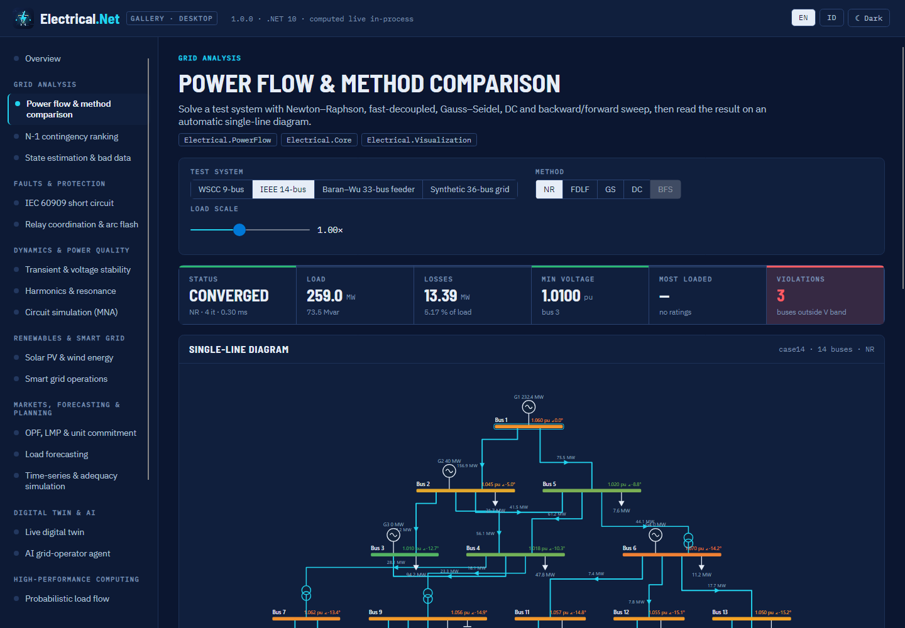
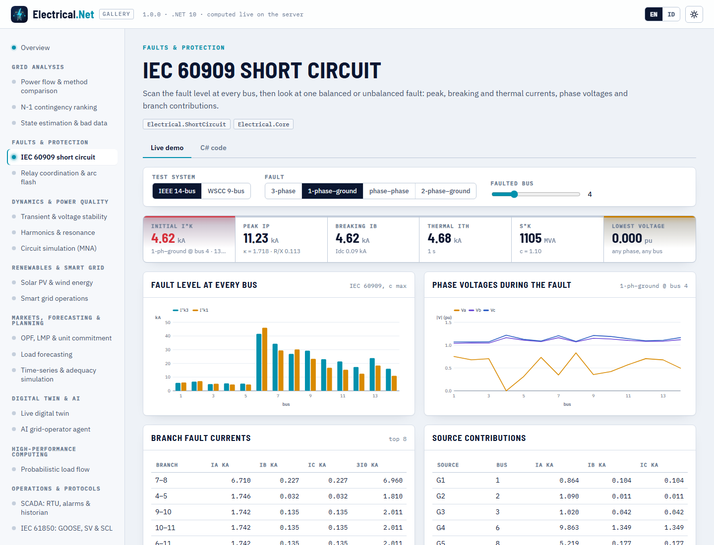
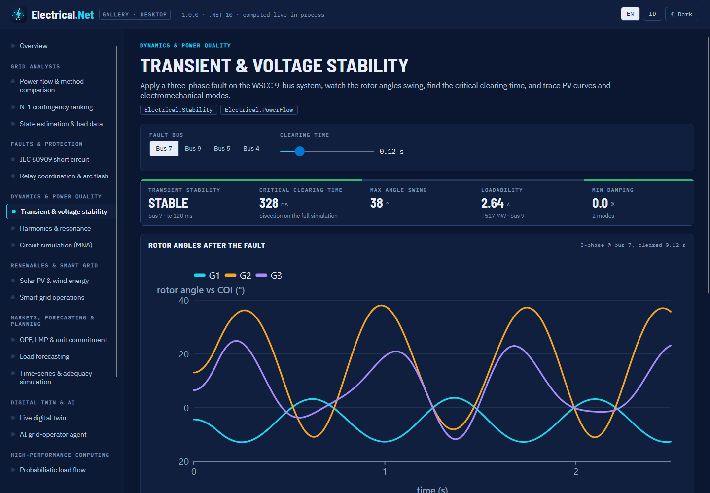
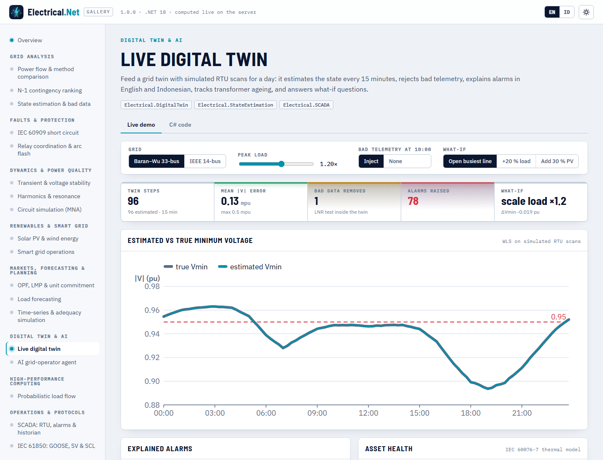
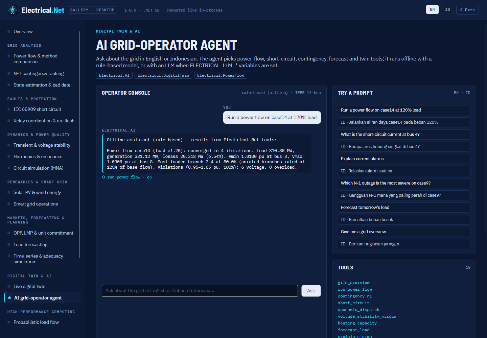
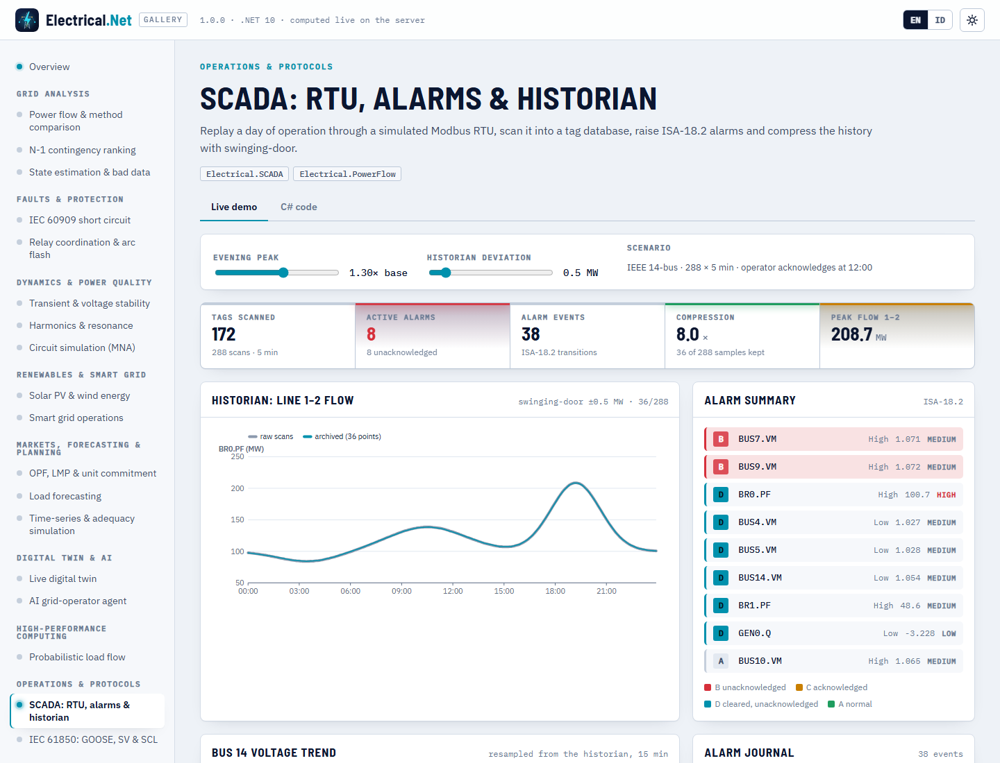
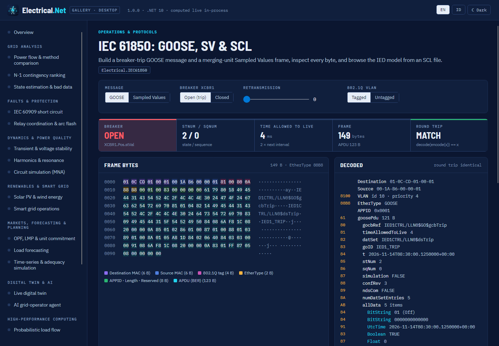
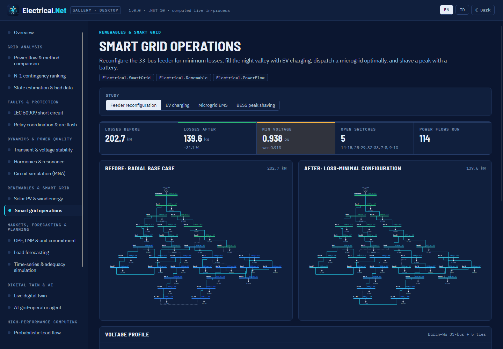
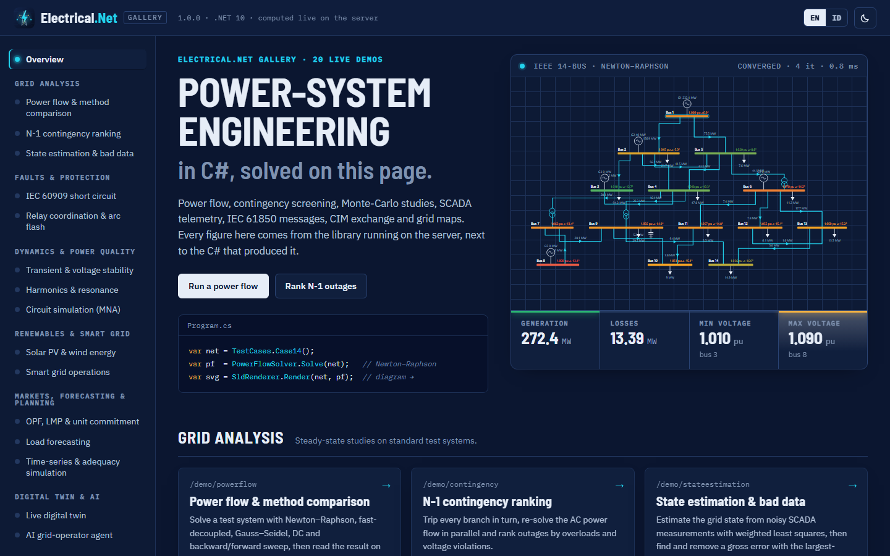

# Gallery

> Made by Gravicode Studios, led by Kang Fadhil · [Bahasa Indonesia](../id/galeri.md)

The Electrical.Net Gallery shows the library at work in 20 live demos, each next to the C# that produced it. It ships as a **Blazor** web
app and an **Avalonia** desktop app that share their scenario code (`gallery/Electrical.Gallery.Shared`). Both are bilingual (EN/ID) and have
light and dark themes. Every figure is computed by the library at run time; nothing is pre-rendered.

```bash
dotnet run --project gallery/Electrical.Gallery.Web --urls http://localhost:5290
dotnet run --project gallery/Electrical.Gallery.Desktop
```


## Demos

| Section | Demo (`/demo/<id>`) | Modules |
|---|---|---|
| Grid analysis | Power flow & method comparison (`powerflow`) | PowerFlow, Visualization |
| | N-1 contingency ranking (`contingency`) | PowerFlow |
| | State estimation & bad data (`stateestimation`) | StateEstimation |
| Faults & protection | IEC 60909 short circuit (`shortcircuit`) | ShortCircuit |
| | Relay coordination & arc flash (`protection`) | Protection |
| Dynamics & power quality | Transient & voltage stability (`stability`) | Stability |
| | Harmonics & resonance (`harmonic`) | Harmonic |
| | Circuit simulation (MNA) (`circuit`) | Circuit |
| Renewables & smart grid | Solar PV & wind energy (`renewable`) | Renewable |
| | Smart grid operations (`smartgrid`) | SmartGrid |
| Markets, forecasting & planning | OPF, LMP & unit commitment (`optimization`) | Optimization |
| | Load forecasting (`forecasting`) | Forecasting |
| | Time-series & adequacy simulation (`simulation`) | Simulation |
| Digital twin & AI | Live digital twin (`digitaltwin`) | DigitalTwin |
| | AI grid-operator agent (`agent`) | AI |
| High-performance computing | Probabilistic load flow (`plf`) | HPC, Native |
| Operations & protocols | SCADA: RTU, alarms & historian (`scada`) | SCADA |
| | IEC 61850: GOOSE, SV & SCL (`iec61850`) | IEC61850 |
| Data exchange & geography | CIM / CGMES export (`cim`) | CIM |
| | GIS grid map (`gis`) | GIS |

## Screenshots

All screenshots are in [docs/images](../images). Names: `web-home.png`, `web-home-dark.png`, `web-<demo>.png`, `desktop-home.png`,
`desktop-<demo>.png`.

| Web (Blazor) | Desktop (Avalonia) |
|---|---|
|  |  |
|  |  |
|  |  |
|  |  |
|  |  |

Dark theme: 

Regenerating the desktop screenshots (headless Skia renderer):

```bash
dotnet run --project gallery/Electrical.Gallery.Desktop -- --screenshot docs/images en          # desktop-<id>.png
dotnet run --project gallery/Electrical.Gallery.Desktop -- --screenshot docs/images id light    # desktop-<id>-id-light.png
```

Stop a running gallery server before `dotnet build`, otherwise locked DLLs cause MSB3027.

## Adding a demo

1. Append a `DemoInfo(id, category, title EN/ID, summary EN/ID, modules, code)` to `GalleryCatalog.Demos` in
   `gallery/Electrical.Gallery.Shared/GalleryCatalog.cs`. The `id` is the URL slug and the screenshot name.
2. Add a scenario class under `gallery/Electrical.Gallery.Shared/Scenarios/` that runs the library and returns view data.
3. Web: add `Components/Demos/<Name>View.razor` and a case in `DemoHost.razor`.
4. Desktop: add a case in `Views.Build`.
5. Keep text bilingual and data deterministic (seeded).

---
*Made by Gravicode Studios, led by Kang Fadhil · [Bahasa Indonesia](../id/galeri.md)*
