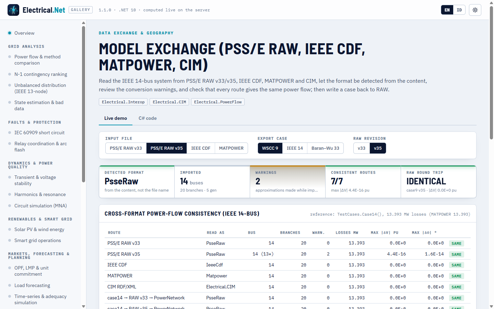

# Model exchange (PSS/E RAW, IEEE CDF, MATPOWER, CIM)

> Made by Gravicode Studios, led by Kang Fadhil · [Bahasa Indonesia](../id/pertukaran-model.md)

Package: `Electrical.Interop` (new in v1.1, depends on `Electrical.Core`). It reads and writes the formats that transmission planning tools
exchange and turns them into the bus-branch `PowerNetwork` used by every solver. MATPOWER I/O stays in `Electrical.Core` (`Matpower`), CIM
in [`Electrical.CIM`](scada-iec61850-cim.md#cim--cgmes), and OpenDSS feeders in [`Electrical.Distribution`](distribution.md#opendss-scripts).

| Format | Read | Write | Type |
|---|---|---|---|
| PSS/E RAW revisions 33, 34, 35 (32 and older read with the v33 layout) | `PsseRaw.Read/Parse/Load` | `PsseRaw.Write/Save(net, 33 \| 35)` | `NetworkFormat.PsseRaw` |
| IEEE Common Data Format (`ieee14cdf.txt` style) | `IeeeCdf.Read/Parse` | — | `NetworkFormat.IeeeCdf` |
| MATPOWER `.m` (version 2) | `Matpower.Parse` (Core) | `Matpower.Write` | `NetworkFormat.Matpower` |
| Electrical.Cloud network JSON | `NetworkFormats.ParseCloudJson` | `NetworkJson.Serialize` (Cloud) | `NetworkFormat.CloudJson` |
| CIM / CGMES RDF/XML | `CimImporter` (CIM) | `CimExporter` | (Electrical.CIM) |

## Format detection and loading

`NetworkFormats.Detect` looks at the content, not the file name: `mpc.bus` means MATPOWER, `BUS DATA FOLLOWS` means IEEE CDF, a first record
`IC, SBASE, REV, …` with REV between 20 and 40 (or an `END OF BUS DATA` marker) means PSS/E RAW, and `{"buses": …}` means the Cloud JSON
contract. `NetworkFormats.Load(path)` falls back to the extension (`.m`, `.raw`, `.cdf`/`.txt`, `.json`) only when the content is
ambiguous. Every reader returns an `ImportResult(Network, Format, Warnings)`; the warnings list each approximation made while mapping the
file onto the model.

```csharp
using Electrical.Interop;
using Electrical.PowerFlow;

var import = NetworkFormats.Load("ieee14_v35.raw");          // content-based detection; extension only breaks ties
Console.WriteLine($"{import.Format}: {import.Network.BusCount} buses, {import.Network.Branches.Count} branches");
foreach (var w in import.Warnings) Console.WriteLine($"warning: {w}");
var pf = PowerFlowSolver.Solve(import.Network);
Console.WriteLine($"losses {pf.LossesMw:0.000} MW");

NetworkFormat f = NetworkFormats.Detect(InteropSamples.Ieee14Cdf);   // IeeeCdf
var cdf = NetworkFormats.Parse(InteropSamples.Ieee14Cdf);            // same as IeeeCdf.Read(...)
```

Output:

```
PsseRaw: 14 buses, 20 branches
warning: Three-winding transformer 4-9-8 converted to a star equivalent with internal bus 15.
warning: Switched shunt at bus 9 modelled as a fixed shunt at its current value 19 Mvar.
losses 13.393 MW
```

`InteropSamples` embeds the IEEE 14-bus system as `Ieee14RawV33` (two-winding transformers, as in MATPOWER), `Ieee14RawV35` (the
4-7-8-9 transformers as a real three-winding unit, a switched shunt at bus 9, `@!` header lines and quoted names containing commas and
slashes) and `Ieee14Cdf`. All three solve to the MATPOWER case14 operating point (13.393 MW losses); they are handy as test data and as
format examples.

## PSS/E RAW

```csharp
var raw = PsseRaw.Read(InteropSamples.Ieee14RawV33);          // text, or the path of an existing file
PowerNetwork net = PsseRaw.Parse(InteropSamples.Ieee14RawV35, warnings: new List<string>());

var notes = new List<string>();
string v35 = PsseRaw.Write(TestCases.Case9(), version: 35, notes);
PsseRaw.Save(TestCases.Case14(), "case14_v33.raw", version: 33);
var back = PsseRaw.Read(v35).Network;                         // same power flow as case9
```

**Reading.** Case identification (SBASE [MVA], BASFRQ [Hz]); buses; loads, with the constant P / I / Y parts mapped to a `ZipModel`;
fixed shunts (to bus G<sub>s</sub>/B<sub>s</sub>); generators; non-transformer branches, with line shunts GI/BI/GJ/BJ added to the bus shunts; v35 system
switching devices (low-impedance branches); two-winding transformers with all winding-voltage (CW = 1/2/3), impedance (CZ = 1/2/3) and
magnetizing (CM = 1/2) codes, WINDV/NOMV, ANG and RATA; three-winding transformers converted to a star equivalent with an internal bus,
as MATPOWER's `psse2mpc` does. Switched shunts are frozen at their initial value BINIT. Area, zone, owner and the other sections are parsed
and skipped. Data in unsupported device sections (two-terminal and VSC DC, multi-terminal DC, FACTS, GNE, induction machines) produce a
warning. In v35 files the `@!` header lines locate fields by name, so reordered or extra columns are read correctly. Quoted strings may
contain blanks, commas and slashes.

**Writing.** `Write` emits a file that PSS/E and `Read` accept: bus shunts as fixed shunts, loads with their ZIP split as PL/IP/YP, and
every transformer as a two-winding CW = CZ = CM = 1 record (WINDV1 = tap, ANG1 = phase shift). Charging susceptance on a transformer is
written as magnetizing susceptance MAG2, with a warning. The output is deterministic, so `Write(Read(Write(net)))` reproduces the same text.

Warnings you may see: change cases (IC = 1) read as complete cases, unsupported revisions, records that reference unknown buses, duplicate
buses, loads whose P and Q use different ZIP splits, remote voltage regulation (IREG), switching devices, switched shunts, magnetizing
admittances and three-winding conversions.

## IEEE Common Data Format

```csharp
var c = IeeeCdf.Read(InteropSamples.Ieee14Cdf);               // or a path to ieee14cdf.txt / ieee118cdf.txt
Console.WriteLine($"{c.Format}: {c.Network.Name}, {c.Network.BusCount} buses");
```

The reader follows the 1973 IEEE working-group format: MVA base and case name from the title card; bus cards (type 0/1 = PQ, 2 = PV,
3 = swing, final voltage and angle, load and generation, base kV, desired voltage, Q limits, shunt G/B); branch cards (type 0 = line,
1–4 = transformer, R/X/B, ratings, final turns ratio and phase angle). It uses fixed columns when a card is long enough and blank-separated
fields otherwise, so hand-edited files still load. Loss-zone, interchange and tie-line sections are skipped. Regulating-transformer and
remote-control data are frozen at their final values, with a warning.

## Dependency injection

```csharp
var services = new ServiceCollection();
services.AddElectrical(b => b.AddInterop());
var importer = services.BuildServiceProvider().GetRequiredService<INetworkImporter>();
var r = importer.Parse(InteropSamples.Ieee14RawV33);
string text = importer.WriteRaw(r.Network, version: 35);
```

`INetworkImporter` exposes `Load`, `Parse`, `Detect` and `WriteRaw`.

## CLI

`--file` accepts `.raw` and `.cdf` (any format `NetworkFormats` recognises) in every command that takes a network, and `convert` writes RAW:

```
$ eln pf --file ieee14_v35.raw
warning: Three-winding transformer 4-9-8 converted to a star equivalent with internal bus 15.
warning: Switched shunt at bus 9 modelled as a fixed shunt at its current value 19 Mvar.
IEEE 14 BUS TEST CASE (RAW V35): 14 buses, 20 branches, 5 generators, 11 loads (base 100 MVA)
NewtonRaphson: converged in 3 it, mismatch 3.44E-009, gen 272.393 MW, load 259 MW, losses 13.393 MW, Vmin 1.0100 pu @ bus 3

$ eln pf --file ieee14.cdf
IEEE 14 Bus Test Case: 14 buses, 20 branches, 5 generators, 11 loads (base 100 MVA)
NewtonRaphson: converged in 3 it, mismatch 3.44E-009, gen 272.393 MW, load 259 MW, losses 13.393 MW, Vmin 1.0100 pu @ bus 3

$ eln convert --case case9 --out case9.raw --version 35
Saved case9.raw
```

## Validation

| Check | Reference | Result |
|---|---|---|
| IEEE 14-bus from RAW v33, RAW v35 (three-winding transformer, switched shunt), CDF | MATPOWER case14: losses 13.393 MW | 13.393 MW; all shared bus voltages within 1e-9 pu |
| `PsseRaw.Write` → `Read` for case9, case14, case33bw (v33 and v35) | Original network | identical power flow |
| Cross-format route MATPOWER → CIM → model | case14 | identical (gallery table) |

## Gallery

The **Model exchange** demo (`interop`) reads the IEEE 14-bus system through every route (RAW v33, RAW v35, CDF, MATPOWER, CIM and two
RAW round trips), shows the detected format, the warnings and a RAW v33/v35 listing, and compares the power-flow results in one table.



## Limitations

- HVDC, FACTS, GNE and induction-machine sections are ignored (with a warning); switched shunts and regulating transformers are frozen at
  their current values; remote voltage regulation is not modelled.
- The writer emits two-winding transformers only (a star equivalent stays as three branches and an internal bus).
- IEEE CDF is read-only. CIM goes through `Electrical.CIM`, and OpenDSS distribution scripts through `Electrical.Distribution`.

---
*Made by Gravicode Studios, led by Kang Fadhil · [Bahasa Indonesia](../id/pertukaran-model.md)*
