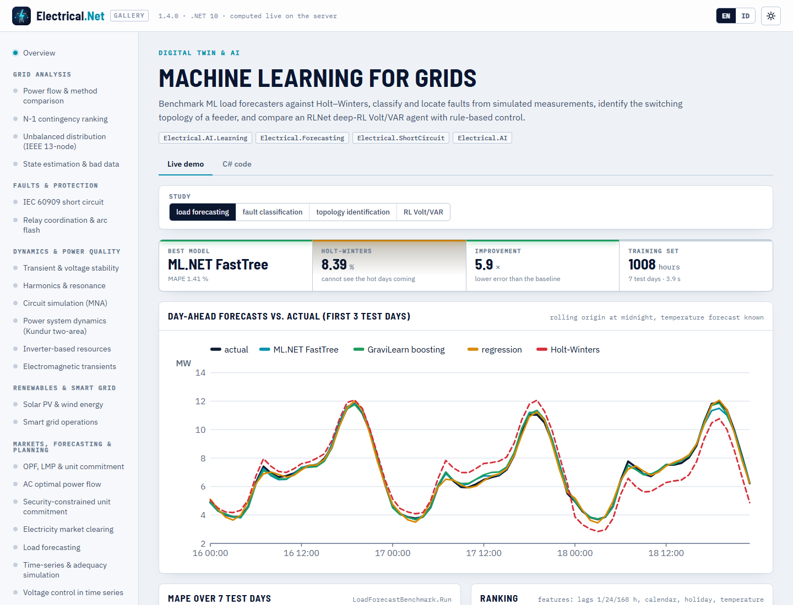

# Machine learning for grids

> Made by Gravicode Studios, led by Kang Fadhil · [Bahasa Indonesia](../id/pembelajaran-mesin.md)

Package: `Electrical.AI.Learning` (v1.4, depends on Core, PowerFlow, Forecasting, ShortCircuit and AI). It brings trained models to the
problems where the physics-based modules supply the data:

| Task | Models | Data |
|---|---|---|
| Load forecasting | GraviLearn gradient boosting, ML.NET FastTree (regression) | lags, calendar, holidays, temperature |
| Fault classification and location | Random forest (GraviLearn) or ML.NET FastTree (multiclass) | IEC 60909 short-circuit simulations with noise |
| Topology identification | Random forest + a correlation baseline | voltage snapshots of every radial configuration |
| Volt/VAR control | Gravicode.RLNet DQN / PPO / A2C | the `VoltVarEnvironment` of [Electrical.AI](ai-digital-twin.md) |

Libraries: GravicodeScience **GraviLearn 2.0.0** (tree ensembles, saved as JSON), **ML.NET 6.0.0** with FastTree (saved as ML.NET `.zip`)
and **Gravicode.RLNet 0.3.0** (checkpoints). Every generator and trainer is seeded, so results repeat across runs. The package is not
AOT-compatible (ML.NET uses reflection); keep it out of trimmed/AOT apps.

## Load forecasting

`LoadFeatureBuilder` turns a load series (and optionally temperature) into rows of lagged loads (default 1, 24 and 168 hours), calendar
features (daily and half-daily harmonics of the hour, weekday as sine/cosine, weekend, holiday) and temperature with cooling/heating
degrees and the temperature a day earlier. `MlLoadForecaster` trains one regressor and
forecasts recursively, feeding its own predictions back as lags. `LoadForecastBenchmark` compares the ML models with the double-seasonal
Holt–Winters baseline and, with temperature, the linear `RegressionForecaster` of `Electrical.Forecasting`, on a rolling day-ahead test.

```csharp
var bench = LoadForecastBenchmark.Run(load, temperature, new LoadForecastBenchmarkOptions { TestDays = 7 });
foreach (var (model, mape) in bench.Mape.OrderBy(kv => kv.Value)) Console.WriteLine($"{model,-30} {mape:0.00} %");

var forecaster = MlLoadForecaster.Train(load, temperature, new MlLoadForecastOptions
{
    Features = new LoadFeatureOptions { Lags = [1, 24, 168], Holidays = [new DateOnly(2026, 1, 1)] },
    Model = new RegressionTrainingOptions { Algorithm = RegressionAlgorithm.GradientBoosting, Trees = 150 },
});
var dayAhead = forecaster.Forecast(load, horizon: 24, temperature);   // recursive, uses the temperature forecast
forecaster.Model.Save("load-gb.json");                                 // tree ensembles as JSON, ML.NET models as .zip
```

On a residential profile whose peak grows 3 % per °C above 24 °C (49 days, 7 test days, temperature known as a perfect forecast):

| Model | MAPE |
|---|---|
| ML.NET FastTree | 1.41 % |
| GraviLearn gradient boosting | 1.43 % |
| Linear regression (calendar + weather) | 2.45 % |
| Holt–Winters (daily + weekly seasons) | 8.39 % |

Holt–Winters can only extrapolate the seasons; it cannot see a hot day coming. `ModelTrainer.LoadRegressor(path)` reloads either format.

## Fault classification and location

`FaultDatasetGenerator` simulates IEC 60909 faults with `Electrical.ShortCircuit`: bus faults and faults at 25/50/75 % of a line (the line
is split at the fault point), all ten phase combinations (AG … ABC), fault resistance up to 5 Ω and measurement noise, observed only
through a few measured bus voltages (phase magnitudes) and branch currents (phase and zero-sequence magnitudes). The classifier predicts the phase code; a
second model predicts the nearest bus.

```csharp
var dataset = FaultDatasetGenerator.Generate(new FaultDatasetOptions { Samples = 1600 });   // Case33BW, IEC 60909
var (model, report) = FaultLearning.Train(dataset, new ClassificationTrainingOptions { Trees = 50 });
Console.WriteLine(report);   // code 100.0 %, type 100.0 %, location 53.0 % (±1 bus 95.0 %), …
var (code, type, busId) = model.Predict(dataset.Samples[0].Features);
model.Save("fault-model");

var case14 = FaultDatasetGenerator.Generate(FaultDatasetOptions.Case14() with { Samples = 700 });
var (mlnet, r14) = FaultLearning.Train(case14, new ClassificationTrainingOptions { Algorithm = ClassificationAlgorithm.MlNetFastTree });
```

| Case | Model | Phase code | Fault type | Nearest bus | ±1 bus |
|---|---|---|---|---|---|
| Baran–Wu 33-bus, 7 V + 5 I measurements | random forest | 100 % | 100 % | 53 % | 95 % |
| IEEE 14-bus | ML.NET FastTree | 92 % | > 90 % | — | 85 % |

Exact location is limited by the few measurement points on a long radial feeder; neighbouring buses look almost alike, which is why the
±1 bus figure is the useful one.

## Topology identification

`ReconfigurableFeeders.Case33WithTies()` adds the five tie switches of Baran & Wu; `Case33Configurations` lists eight radial switching
states (including the base case, 202.7 kW losses, and the minimum-loss configuration, 139.5 kW). `TopologyIdentification` simulates
snapshots of each configuration at 60–120 % load with per-load noise and learns which configuration produced a set of measured voltages.

```csharp
var options = new TopologySnapshotOptions { SnapshotsPerConfiguration = 50 };
var snapshots = TopologyIdentification.GenerateSnapshots(options);   // 8 radial configurations of Case33 + 5 ties
var (classifier, correlation, report) = TopologyIdentification.Train(snapshots, options);
Console.WriteLine(report);   // classifier 100.0 %, correlation 100.0 % over 8 configurations
string config = classifier.Predict(snapshots[0].Features);
```

Both the random forest and the correlation baseline (cosine similarity of normalized voltage-drop signatures, which hardly depend on the
load level on a radial feeder) reach 100 % on held-out snapshots.

## Reinforcement learning for Volt/VAR control

`VoltVarRlEnvironment` wraps the Volt/VAR task of `Electrical.AI` (tap changers and capacitor banks on the 33-bus feeder, 24 hourly
decisions, reward = − losses − voltage violations − switching) as an RLNet environment. `VoltVarAgentTrainer` trains DQN, PPO or A2C and
compares them with fixed policies.

```csharp
var cmp = VoltVarAgentTrainer.Compare(options: new VoltVarRlOptions { Algorithm = VoltVarRlAlgorithm.Dqn, Steps = 6_000 });
Console.WriteLine(cmp);      // do-nothing -56.40, voltage rule -25.20, tabular Q -36.51, Dueling DQN -14.49 (trained in 3.4 s)

var ppo = VoltVarAgentTrainer.Train(options: VoltVarRlOptions.Long(VoltVarRlAlgorithm.Ppo));   // 48 000 steps
var episode = ppo.Evaluate();
Console.WriteLine($"{episode.TotalReward:0.0}, {episode.EnergyLossesKwh:0} kWh, {episode.ViolationBusHours} violation bus-hours");
ppo.Save("voltvar-ppo.rlnet");

var services = new ServiceCollection().AddElectrical(b => b.AddLearning());   // ILearningService
```

| Policy | Episode reward (higher is better) |
|---|---|
| Do nothing | −56.4 |
| Tabular Q-learning (400 episodes, seed 1) | −36.5 |
| Voltage rule | −25.2 |
| RLNet DQN, 6 000 steps (≈ 4 s) | −14.5 |
| RLNet DQN / PPO, 48 000 steps | −13.8 |

## Command line and gallery

```
$ eln learn forecast
Day-ahead load forecast benchmark (temperature-driven residential load, 7 test days), MAPE:
  ML.NET FastTree                  1.41 %
  GraviLearn gradient boosting     1.43 %
  Regression                       2.45 %
  Holt-Winters                     8.39 %
$ eln learn faults
Fault classification / location on case33bw (random forest): code 100.0 %, type 100.0 %, location 53.0 % (±1 bus 95.0 %), train 1200, test 400
$ eln learn topology
Topology identification on case33bw with 5 tie switches: classifier 100.0 %, correlation 100.0 % over 8 configurations (280 train / 120 test)
$ eln learn voltvar
Volt/VAR control on case33bw, average reward (higher is better): do-nothing -56.40, voltage rule -25.20, tabular Q -36.51, Dueling DQN -14.49 (trained in 3.4 s)
```

The gallery demo **Machine learning for grids** shows the four studies (forecasts against the actual curve with MAPE bars, the fault
confusion matrix and location-error histogram, per-configuration topology accuracy, the RL reward comparison and the agent's actions).
Each study is trained once per process with a small budget; the web app starts training in the background at start-up.



## Limitations

The datasets are synthetic (simulated from the network models); real deployments need measured data and retraining. Tree ensembles
extrapolate poorly beyond the training range (e.g. record temperatures). The RL agent learns one feeder and one load shape; retrain when
either changes. No GPU training; models are small and train in seconds on a CPU.

---
*Made by Gravicode Studios, led by Kang Fadhil · [Bahasa Indonesia](../id/pembelajaran-mesin.md)*
