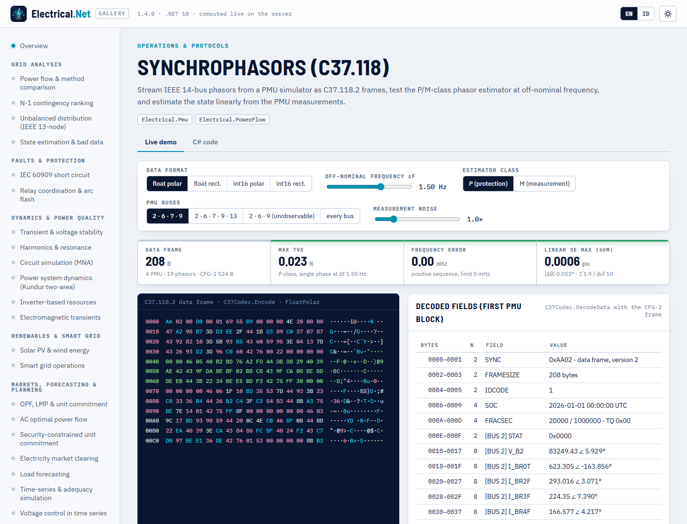

# Synchrophasors (IEEE C37.118)

> Made by Gravicode Studios, led by Kang Fadhil · [Bahasa Indonesia](../id/sinkrofasor.md)

Package: `Electrical.Pmu` (v1.4, depends on Core and PowerFlow). Everything a wide-area monitoring application needs from phasor
measurement units:

- an IEEE C37.118.2-2011 codec for data, configuration (CFG-1/2/3), header and command frames, with integer or float and rectangular or
  polar phasors and the CRC-CCITT check;
- transport: a TCP PMU server and PDC client (command/configuration/data exchange as in C37.118.2 §6), a UDP publisher and receiver;
- `PmuSimulator`, which publishes a power-flow solution as synchrophasors at nominal ± Δf with ROCOF and deterministic noise, and
  `PmuTimeSeriesSource`, which replays an `Electrical.Dynamics` simulation;
- `PhasorEstimator`, the C37.118.1 Annex C reference estimator (P and M class) with frequency, ROCOF and TVE;
- `LinearStateEstimator`, the non-iterative PMU-only state estimator, and `PdcAlignmentBuffer`, which aligns streams by time stamp.

Units: voltage phasors in V line-to-neutral RMS, currents in A, angles against the UTC-synchronised nominal cosine, frequency in Hz,
ROCOF in Hz/s. The state estimator works in per unit on the network base.

## From a power flow to C37.118 frames

```csharp
var pf = PowerFlowSolver.Solve(TestCases.Case14());
var sim = new PmuSimulator(pf, [2, 6, 7, 9], new PmuSimulatorOptions
{
    FrequencyOffsetHz = 1.5,            // the grid runs 1.5 Hz above nominal
    VoltageNoise = 0.001, CurrentNoise = 0.002, AngleNoiseDeg = 0.05,
});
byte[] cfg2 = C37Codec.Encode(sim.Configuration);                                   // CFG-2, 524 bytes
byte[] frame = C37Codec.Encode(sim.CreateFrame(DateTimeOffset.UtcNow), sim.Configuration);
var data = C37Codec.DecodeData(frame, sim.Configuration);
Console.WriteLine($"{frame.Length} B, {data.Blocks.Count} PMUs, CRC ok: {C37Codec.IsValid(frame)}");
foreach (var (block, pmu) in data.Blocks.Zip(sim.Configuration.Pmus))
    Console.WriteLine($"{pmu.StationName}: |V| {block.Phasors[0].Magnitude / 1000:0.00} kV, f {block.FrequencyHz:0.000} Hz");
```

Each PMU bus reports its voltage and the current of every incident in-service branch (`IncludeCurrents`). `sim.Bindings` records what
each phasor channel measures (`PmuChannelBinding`: bus voltage, or branch current at the from/to terminal), which is what the state
estimator needs. With four PMUs on the IEEE 14-bus system the stream carries 19 phasors in a 208-byte float-polar frame (116 bytes in
16-bit integer format, where `PhasorChannel.ScaleFactor` is the PHUNIT resolution in 10⁻⁵ V or A per bit).

| Field | Bytes | Content |
|---|---|---|
| SYNC | 2 | `AA 02`: data frame (bits 6–4 of byte 2 give the type: 0 data, 1 header, 2/3/5 CFG-1/2/3, 4 command), version 2 |
| FRAMESIZE, IDCODE | 2 + 2 | Total length, stream id |
| SOC, FRACSEC | 4 + 4 | UTC seconds since 1970, fraction of second (TIME_BASE, default 10⁶) and time-quality byte |
| per PMU: STAT, PHASORS, FREQ, DFREQ, ANALOG, DIGITAL | | Formats per PMU from the configuration frame |
| CHK | 2 | CRC-CCITT (polynomial 0x1021, initial 0xFFFF); `CrcCcitt.Compute("123456789")` = 0x29B1 |

## Streaming over TCP

```csharp
var sim = new PmuSimulator(pf, [2, 6, 7, 9]);
await using var server = new PmuServer(sim, IPAddress.Loopback, port: 4712);
server.Start();

await using var pdc = new PdcClient(idCode: 1);
await pdc.ConnectAsync("127.0.0.1", 4712);
var config = await pdc.RequestConfigurationAsync();          // CFG-2
await pdc.StartDataAsync();                                   // DATA ON command
await foreach (var f in pdc.ReadDataFramesAsync())
{
    Console.WriteLine($"{f.Time.ToDateTime():HH:mm:ss.fff} {f.Blocks[0].FrequencyHz:0.000} Hz");
    break;
}
```

`PmuServer` answers the commands of C37.118.2 Table 15 (data on/off, send header, CFG-1/2/3) and paces data frames at the configured
reporting rate (`PmuServerOptions.Paced = false` streams as fast as possible, useful in tests). `PmuUdpPublisher` / `PdcUdpReceiver`
carry data frames over UDP. A PDC that merges several streams aligns them by time stamp:

```csharp
var align = new PdcAlignmentBuffer(expectedIdCodes: [1, 2, 3], waitTime: TimeSpan.FromMilliseconds(50));
foreach (var set in align.Add(f, DateTimeOffset.UtcNow))   // complete sets, or incomplete ones after the wait time
    Console.WriteLine($"{set.Time.ToDateTime():HH:mm:ss.fff}: {set.Frames.Count} streams, missing {string.Join(",", set.Missing)}");

var services = new ServiceCollection().AddElectrical(b => b.AddPmu(new PmuOptions { PdcStreams = [1, 2, 3] }));
```

## Phasor estimation (P and M class)

`PhasorEstimator` implements the C37.118.1-2011 Annex C reference model: quadrature demodulation at f₀ followed by a symmetric FIR
low-pass filter. P class uses the two-cycle triangle W(k) = 1 − 2|k|/(N+2) with N = 2(f<sub>s</sub>/f₀ − 1); M class uses a
Hamming-windowed sinc with the Table C.1 filter frequency (≈ 0.1365·F<sub>s</sub>) and order. Frequency and ROCOF come from first and second
differences of the phasor angle over ± half a cycle; the magnitude is compensated for the filter gain at the estimated Δf.

```csharp
var est = new PhasorEstimator(new PhasorEstimatorOptions
{
    NominalFrequencyHz = 50, SampleRateHz = 1000, ReportingRate = 50, Class = PmuClass.P,
});
var x = Complex.FromPolarCoordinates(1.0, 0.3);                     // 1 pu RMS at 17.2°
double[] samples = PhasorEstimator.Sinusoid(x, 52, 1000, 600);     // 52 Hz: +2 Hz off-nominal
foreach (var e in est.Estimate(samples, t0S: 0))
{
    var reference = x * Complex.FromPolarCoordinates(1, 2 * Math.PI * 2 * e.TimeS);   // rotates at 2π·Δf
    Console.WriteLine($"{e.TimeS * 1000,5:0} ms  |X| {e.Magnitude:0.0000}  f {e.FrequencyHz:0.000} Hz  " +
                      $"TVE {PhasorEstimator.Tve(e.Phasor, reference):P3}");
}
```

`EstimatePositiveSequence(a, b, c, t0)` estimates X₁ = (X<sub>a</sub> + a·X<sub>b</sub> + a²·X<sub>c</sub>)/3, which cancels the 2f₀
ripple that single-phase estimates show off-nominal.

| Test (50 Hz, 1 kHz sampling, F<sub>s</sub> 50/s) | C37.118.1 limit | Electrical.Net |
|---|---|---|
| P class, Δf = ±2 Hz, single phase | TVE ≤ 1 % | max TVE 0.043 %, FE 0.0017 Hz |
| P class, Δf = ±2 Hz, positive sequence | TVE ≤ 1 %, FE ≤ 0.005 Hz | TVE ≈ 0, FE < 0.005 Hz |
| M class, Δf = ±5 Hz | TVE ≤ 1 % | max TVE 0.066 % |
| P class without gain compensation, Δf = 2 Hz | (sinc² droop) | TVE ≈ 0.5 % (gain 0.9947) |
| 5 % magnitude step, P class | response time ≤ 1.7/f₀, overshoot ≤ 5 % | ≈ 0.72/f₀ (14.4 ms), no overshoot |
| 1 Hz/s frequency ramp from 49 Hz, positive sequence | ramp test | f within 0.005 Hz of 49 + t, ROCOF 0.95–1.05 Hz/s |

## Linear state estimation

With voltage phasors V<sub>i</sub> and branch currents I = Y<sub>ff</sub>·V<sub>f</sub> + Y<sub>ft</sub>·V<sub>t</sub>, the measurement model
z = H·V is linear in the complex bus voltages, so the weighted least-squares estimate x̂ = (HᴴWH)⁻¹HᴴWz needs one solve and no
iterations. Every bus must be observed: measured directly, or reached through a measured current from a measured bus.

```csharp
var z = LinearStateEstimator.FromFrame(pf.Network, frame, sim.Bindings);   // V [V] and I [A] → pu
if (!LinearStateEstimator.IsObservable(pf.Network, z)) throw new InvalidOperationException("add PMUs");
var se = LinearStateEstimator.Estimate(pf.Network, z);                      // x̂ = (HᴴWH)⁻¹HᴴWz, no iterations
var v = se.Referenced(referenceBusId: 1, referenceAngleDeg: 0);            // PMU angles are UTC-referenced
Console.WriteLine($"J = {se.Objective:0.0} with {se.DegreesOfFreedom} degrees of freedom");
```

On the IEEE 14-bus system, PMUs at buses 2, 6, 7 and 9 (with branch currents) observe the whole network: noise-free measurements recover
the power-flow state to 1e-9; with σ<sub>V</sub> = 0.002 pu and σ<sub>I</sub> = 0.004 pu the largest error is 0.0016 pu in magnitude and 0.08° in angle,
and J stays inside its χ² band with 2(m − n) degrees of freedom. `FromPowerFlow(pf, buses, …)` synthesises measurements without going
through frames. For mixed SCADA + PMU estimation, use the PMU measurement types of [Electrical.StateEstimation](state-estimation.md).

## Command line and gallery

```
$ eln pmu --case case14 --buses 2,6,7,9 --offnominal 1.5
IEEE C37.118.2 data frame from 4 PMUs on case14: 208 bytes, CRC-CCITT 0xFFDC
  AA0200D000016AF9668000000000000047A29DD7BDB21971441B364FC04324D8…
Phasor estimation at 61.5 Hz (+1.5 Hz off-nominal), 1200 Hz sampling:
  P class: |V| 1.0000, f 61.4999 Hz, TVE 0.016 %
  M class: |V| 0.9997, f 61.5010 Hz, TVE 0.039 %
Linear PMU state estimation (19 phasor measurements): max |ΔV| 0.0010 pu, J 6.96 (10 dof)
```

The gallery demo **Synchrophasors (C37.118)** shows the frame as a hex dump with decoded fields, the TVE of the chosen class over time and
over Δf, and the linear estimate for four PMU placements (one of them unobservable).



## Limitations

The estimator is the Annex C reference model (no adaptive or interpolated-DFT algorithms); the simulator produces steady phasors plus
noise and constant ROCOF (use `PmuTimeSeriesSource` with a dynamic simulation for transients). No IEEE C37.118 security (IEC 62351) or
IEC 61850-90-5 routed sampled values. The linear estimator has no bad-data test; screen residuals yourself or use the WLS estimator.

---
*Made by Gravicode Studios, led by Kang Fadhil · [Bahasa Indonesia](../id/sinkrofasor.md)*
