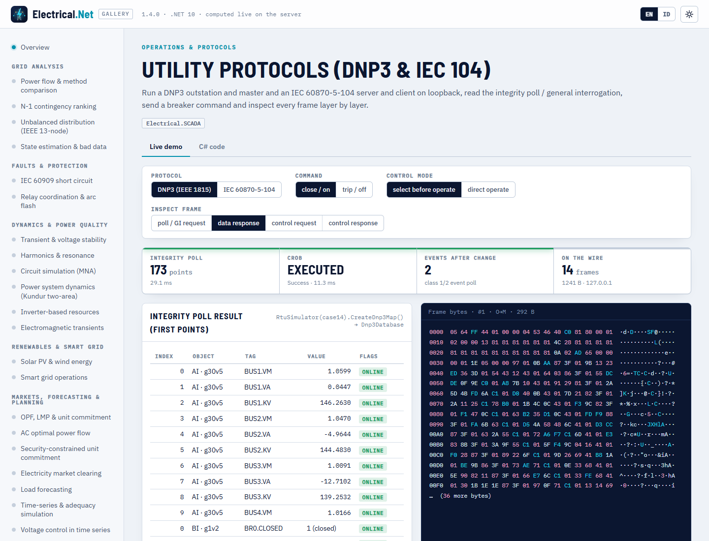

# Utility protocols: DNP3 and IEC 60870-5-104

> Made by Gravicode Studios, led by Kang Fadhil · [Bahasa Indonesia](../id/protokol.md)

Package: `Electrical.SCADA` (namespaces `Electrical.SCADA.Dnp3` and `Electrical.SCADA.Iec104`, v1.4). Both telecontrol protocols run
over TCP with complete controlled-station (outstation / server) and controlling-station (master / client) implementations, and both
bridge to the same `TagDatabase` as Modbus, the alarms and the historian (see [SCADA, IEC 61850 & CIM](scada-iec61850-cim.md)). The
`RtuSimulator` serves a power-flow result through either protocol, which makes an end-to-end SCADA test bench a few lines of code.

## DNP3 (IEEE 1815-2012)

| Layer | What is implemented |
|---|---|
| Data link | 0x0564 frames, LEN, DIR/PRM/FCB/FCV control, 16-bit addresses, CRC-16/DNP per 16-octet block (`Dnp3Crc`, check value 0xEA82); unconfirmed user data, reset/test link, link status |
| Transport | FIR/FIN/SEQ segmentation and reassembly (`Dnp3Transport`, `Dnp3TransportReassembler`) |
| Application | Control octet (FIR/FIN/CON/UNS/SEQ), IIN, qualifiers 0x00/01/06/07/08/17/28, multi-fragment responses with confirmation |
| Objects | g1v1/2 binary input, g2v1/2 events, g10 binary output status, g12v1 CROB, g30v1/2/5 analog input, g32v1/3/5/7 events, g40 analog output status, g41v1–3 analog output, g50v1 time, g52v2 delay, g60 class data, g80v1 IIN |
| Functions | READ (class 0–3 and ranges), WRITE (time, IIN restart bit), SELECT / OPERATE / DIRECT_OPERATE (/NR), ENABLE / DISABLE_UNSOLICITED, DELAY_MEASURE, CONFIRM, unsolicited responses |

### Outstation

```csharp
var rtu = new RtuSimulator(PowerFlowSolver.Solve(TestCases.Case14()));
var tags = new TagDatabase();
rtu.UpdateTags(tags);                                      // BUSn.VM, BRk.PF, BRk.CLOSED, …

var map = rtu.CreateDnp3Map(analogDeadband: 0.001);        // analogs → AI 0…, breaker states → BI k
var db = map.CreateDatabase(tags);
db.AddBinaryOutput(0);                                     // a breaker control point for CROBs
using var link = map.Attach(tags, db);                     // tag changes → DNP3 events (class 1/2)

await using var outstation = new Dnp3Outstation(db, new Dnp3OutstationOptions { LocalAddress = 1024 }, IPAddress.Any, 20000);
outstation.Commanded += c => Console.WriteLine($"{c.Type} {c.Index}: {c.Crob?.OpType} → {c.Status}");
outstation.Start();
```

`Dnp3Database` holds the points and per-class event buffers; a change beyond the point's deadband creates an event that stays buffered
until the master confirms the response that carried it. `Dnp3OutstationOptions` selects the static and event variations (default g1v2,
g30v5, g2v2, g32v7), the maximum fragment size, the select timeout, unsolicited reporting and a `NeedTime` IIN at start-up; command
handlers (`BinaryCommandHandler`, `AnalogCommandHandler`) decide the status of each control.

### Master

```csharp
await using var master = new Dnp3Master(localAddress: 1, outstationAddress: 1024);
await master.ConnectAsync("127.0.0.1", 20000);

var poll = await master.IntegrityPollAsync();              // READ class 1, 2, 3, 0
Console.WriteLine($"{poll.Measurements.AnalogInputs.Count} AI, {poll.Measurements.BinaryInputs.Count} BI, IIN {poll.Iin}");
await master.ClearRestartAsync();

var status = await master.OperateBinaryAsync(0, Crob.LatchOn(), selectBeforeOperate: true);   // SELECT + OPERATE
var events = await master.EventPollAsync();                 // class 1–3 events, confirmed automatically
foreach (var e in events.Measurements.Events) Console.WriteLine($"{e.Type} {e.Index} = {e.Value} @ {e.Time:O}");

await master.WriteTimeAsync(DateTimeOffset.UtcNow);
await master.EnableUnsolicitedAsync();
master.UnsolicitedReceived += r => Console.WriteLine($"unsolicited: {r.Measurements.Events.Count} events");
```

An OPERATE without a matching SELECT (same objects, within the timeout) returns `NO_SELECT`; an unknown point returns `NOT_SUPPORTED`.
`master.Values` accumulates the latest value of every point; `map.ApplyTo(tags, master.Values)` writes them back into a tag database on
the master side.

## IEC 60870-5-104

| Part | What is implemented |
|---|---|
| APCI | I/S/U formats, STARTDT / STOPDT / TESTFR act/con, send and receive sequence numbers with checks (a wrong N(S) closes the connection) |
| Flow control | k (max unacknowledged I-frames, default 12) and w (acknowledge after w, default 8) windows |
| Timers | t0 connect, t1 send/test acknowledgement, t2 acknowledgement without data, t3 idle test frames |
| ASDU types | M_SP_NA/TB, M_DP_NA/TB, M_ME_NA/NB/NC (normalized, scaled, float) and time-tagged TD/TE/TF, M_EI_NA, C_SC_NA, C_DC_NA, C_SE_NC, C_IC_NA, C_CS_NA |
| Services | General and group interrogation (QOI 20–36), clock synchronisation, select-before-operate and direct commands with ACTCON / ACTTERM, spontaneous reporting (COT 3) |

```csharp
var rtu = new RtuSimulator(pf);
var tags = new TagDatabase();
rtu.UpdateTags(tags);
var points = rtu.CreateIec104Map();                         // M_ME_NC_1 at IOA 1000+, M_SP_NA_1 at IOA 1+
tags.Add("CB1.CMD");
points.Add(5001, "CB1.CMD", TypeId.C_SC_NA_1, selectBeforeOperate: true);

await using var server = new Iec104Server(tags, points, new Iec104ServerOptions { CommonAddress = 1 }, IPAddress.Any, 2404);
server.Start();

await using var client = new Iec104Client(new Iec104Parameters { K = 12, W = 8 });
await client.ConnectAsync("127.0.0.1", 2404);
await client.StartDataTransferAsync();                      // STARTDT act / con
var gi = await client.GeneralInterrogationAsync();          // C_IC_NA_1, QOI 20
foreach (var (type, io) in gi.Take(3)) Console.WriteLine($"{type} IOA {io.Address}: {io.Value}");

var cmd = await client.SingleCommandAsync(5001, true, selectBeforeOperate: true);   // select, then execute
Console.WriteLine($"confirmed {cmd.Confirmed}, terminated {cmd.Terminated}");
await client.ClockSyncAsync(DateTimeOffset.UtcNow);
client.AsduReceived += a => Console.WriteLine($"{a.Type} {a.Cause}");               // spontaneous data (COT 3)
```

`Iec104PointMap` binds IOAs to tags with a type, a full scale for normalized values, an interrogation group and the select-before-operate
flag of command points. Tag changes become spontaneous ASDUs; commands write the command tag (and the server raises `Commanded`).
`client.ApplyTo(tags, map)` mirrors the received values into a tag database.

## Codecs and reference vectors

```csharp
Console.WriteLine($"{Dnp3Crc.Compute("123456789"u8):X4}");                          // EA82 (CRC-16/DNP)
var reset = new Dnp3LinkFrame(true, true, (byte)LinkFunction.ResetLinkStates, 1, 1024, []);
Console.WriteLine(Convert.ToHexString(reset.Encode()));                             // 056405C001000004E921

var gi = new Asdu(TypeId.C_IC_NA_1, CauseOfTransmission.Activation, 1, [new InformationObject(0, 20)]);
Console.WriteLine(Convert.ToHexString(Iec104Codec.Encode(Apdu.I(0, 0, gi))));     // 680E0000000064010600010000000014
```

| Check | Reference | Result |
|---|---|---|
| CRC-16/DNP of "123456789" | CRC catalogue | 0xEA82 |
| RESET_LINK_STATES, master 1024 → outstation 1 | IEEE 1815 / opendnp3 example | `05 64 05 C0 01 00 00 04 E9 21` |
| Integrity poll request (class 1, 2, 3, 0), seq 3 | IEEE 1815 object headers | `C3 01 3C 02 06 3C 03 06 3C 04 06 3C 01 06` |
| General interrogation APDU | IEC 60870-5-104 | `68 0E 00 00 00 00 64 01 06 00 01 00 00 00 00 14` |
| Normalized −0.5, double command OFF QU = 3 | IEC 60870-5-101 | NVA `00 C0`, DCO `0D` |
| 300 analogs, fragments ≤ 249 octets | multi-fragment confirmation | ≥ 6 fragments, all 300 values |

Thirteen loopback tests cover polls, events with confirmation, SBO/direct operate and their rejections, unsolicited responses, time
synchronisation, k/w windows, t2/t3 timers and the RTU bridges.

## Dependency injection

```csharp
var sp = new ServiceCollection()
    .AddElectrical(b => b.AddDnp3(new Dnp3OutstationOptions { LocalAddress = 10 }).AddIec104(new Iec104ServerOptions { CommonAddress = 7 }))
    .BuildServiceProvider();
var dnp3Points = sp.GetRequiredService<Dnp3PointMap>();     // shared TagDatabase, Dnp3Database, Iec104PointMap
```

## Command line and gallery

```
$ eln dnp3
DNP3 outstation (RTU for case14) on 127.0.0.1:63036: integrity poll → 152 analog inputs, 20 binary inputs, 2 fragment(s), IIN DeviceRestart
  AI    0: 1.0599
  AI    1: 0.0447
  AI    2: 146.2630
  …
$ eln iec104
IEC 60870-5-104 server (RTU for case14) on 127.0.0.1:63038: general interrogation → 172 information objects
  M_ME_NC_1    IOA   1000: 1.0599 (Good)
  M_ME_NC_1    IOA   1001: 0.0447 (Good)
  …
```

The gallery demo **Utility protocols (DNP3 & IEC 104)** runs both pairs in process through a loopback tap that records every frame: the
poll / interrogation result, a CROB or single command (SBO or direct), the session table and the bytes of a chosen frame with its decoded
link, transport and application layers (or APCI and ASDU).



## Limitations

No DNP3 Secure Authentication (SAv5/SAv6), file transfer, counters (g20–g23), octet strings or data sets; no serial (RS-232/485) link
layer or IEC 60870-5-101; IEC 104 without TLS (IEC 62351-3) and without redundancy groups. Use a firewall or VPN when exposing either
server beyond a test network.

---
*Made by Gravicode Studios, led by Kang Fadhil · [Bahasa Indonesia](../id/protokol.md)*
