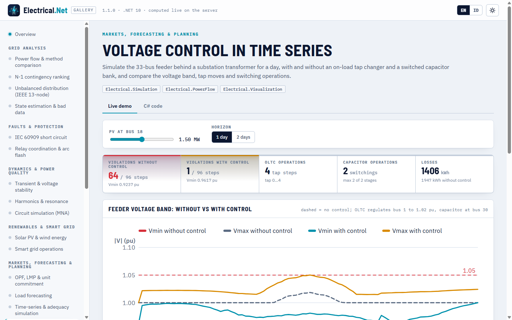

# Simulation, HPC and native kernels

> Made by Gravicode Studios, led by Kang Fadhil · [Bahasa Indonesia](../id/simulasi-hpc-native.md)

Packages: `Electrical.Circuit`, `Electrical.Simulation`, `Electrical.HPC` and `Electrical.Native`.

## Circuit simulation

`ElectricCircuit` solves lumped circuits by modified nodal analysis. Ground is node `"0"` (alias `"gnd"`); units are V, A, Ω, F, H, s, Hz.
Current sign follows SPICE (a source delivering power reports a negative current).

```csharp
var rc = new ElectricCircuit()
    .AddVoltageSource("V1", "in", "0", Waveform.Pulse(0, 1, delayS: 0, riseS: 1e-9))
    .AddResistor("R1", "in", "out", 1e3)
    .AddCapacitor("C1", "out", "0", 1e-6);
var tr = rc.Transient(stopTimeS: 5e-3, stepS: 1e-6);
double vTau = tr.At(tr.Voltage("out"), 1e-3);   // 0.632 V (τ = RC = 1 ms)

var rlc = Netlist.Parse("""
    * series RLC
    V1 in 0 AC 1
    R1 in a 10
    L1 a b 10m
    C1 b 0 1u
    """);
var ac = rlc.AcSweep(100, 100_000, pointsPerDecade: 50);
var bode = ac.Bode("b", "in");                  // resonance at 1591.5 Hz, Q = 10

var op = new ElectricCircuit().AddVoltageSource("V1", "a", "0", 10).AddResistor("R1", "a", "o", 1e3).AddResistor("R2", "o", "0", 3e3)
    .OperatingPoint();
Console.WriteLine(op.Voltage("o"));             // 7.5 V
```

- Analyses: `OperatingPoint` (Newton iterations for diodes), `AcAnalysis(frequencies)` / `AcSweep` (`Bode`), `Transient(stop, step,
  IntegrationMethod.Trapezoidal | BackwardEuler, useInitialConditions)`.
- Elements: R, L (with initial current), C (initial voltage), coupled inductors (`AddCoupling`), V/I sources (`Waveform.Dc/Sine/Pulse/
  PiecewiseLinear`, AC magnitude/phase), VCVS, VCCS, time-controlled or function-controlled switches, Shockley diodes, ideal transformers.
- Netlists: SPICE subset (R, C, L, V, I, D, S, K, E, G and an `X` ideal-transformer card, SPICE value suffixes, `+` continuation).
- `ThreePhaseCircuits`: star↔delta conversion, line voltages, balanced power, unbalanced star loads (with neutral impedance and neutral
  shift) and delta loads.

## Quasi-static time series (QSTS)

`QstsSimulation` steps a network through load and PV profiles with warm-started Newton–Raphson, applying timed events.

```csharp
var qsts = QstsSimulation.Case33Demo(days: 1, pvMw: 1.5, pvBus: 18);
qsts.Events.Add(new SimulationEvent(TimeSpan.FromHours(18), SimulationEventKind.ShuntSet, Index: 30, Value: 0.6, Description: "Cap 600 kvar on"));
var r = qsts.Run();
Console.WriteLine($"{r.Steps} steps: load {r.EnergyLoadMwh:0.00} MWh, PV {r.EnergyPvMwh:0.00} MWh, losses {r.EnergyLossesMwh:0.000} MWh");

var custom = new QstsSimulation(TestCases.Case33BW())
{
    DefaultLoadProfile = new TimeSeries(DateTimeOffset.UnixEpoch, TimeSpan.FromHours(1), Enumerable.Repeat(1.0, 24).ToArray()),
};
```

- Profiles: `DefaultLoadProfile`, `CategoryProfiles` (by `Load.Category`), `LoadProfiles` (per bus) as per-unit multipliers; `PvSystems` with
  rated MW, per-unit profile and power factor.
- Events (`SimulationEventKind`): `BranchOpen`, `BranchClose`, `GeneratorTrip`, `GeneratorReturn`, `LoadScale`, `ShuntSet`.
- `QstsResult`: per-step V<sub>min</sub>/V<sub>max</sub> (and bus), losses, max loading, load, PV, grid import, full bus-voltage matrix,
  event timeline, energy totals, `VoltageViolationSteps`, `ToChartSeries()`.

```
$ eln qsts
QSTS (33-bus, 96 steps of 15 min): converged 96/96
  Energy: load 55.97 MWh, PV 11.24 MWh, losses 1.821 MWh, import 46.55 MWh, export 0.00 MWh
  Voltage band: min 0.9370 pu, max 1.0311 pu, steps outside 0.95–1.05 pu: 36
  00:00  load  1.464 MW  PV  0.000 MW  Vmin 0.9681  losses   27.7 kW
  ...
  12:00  load  2.828 MW  PV  1.476 MW  Vmin 0.9546  losses  131.7 kW
  15:00  load  2.812 MW  PV  0.984 MW  Vmin 0.9489  losses   95.3 kW
  18:00  load  2.861 MW  PV  0.000 MW  Vmin 0.9370  losses  108.5 kW
  21:00  load  2.367 MW  PV  0.000 MW  Vmin 0.9492  losses   71.0 kW
```

`ScenarioManager` runs named what-if variants of a base case (`ScaleLoads`, `AddPv`, `OpenBranch`, `AddCapacitor` helpers) and returns
`ScenarioSummary` rows.

## Voltage control in QSTS (v1.1)

`QstsSimulation.Controllers` takes discrete controllers that act after every converged power flow. When any controller moves (a tap step or
a capacitor stage) the step is re-solved with a warm start and all controllers are evaluated again, up to `MaxControlIterations` (10)
times. Delay timers count consecutive out-of-band steps, so a short excursion does not wear the tap changer. Controllers keep run-time state
that is reset at the start of every `Run`, so the same simulation can be run repeatedly (one instance must not be shared by concurrent runs).

| Controller | Acts on | Settings |
|---|---|---|
| `OltcController(branchIndex, controlledBusId)` | Transformer ratio `Tap = NominalRatio / (1 + n·TapStepPu)` | `TargetPu`, `BandwidthPu` (total dead band), `TapStepPu` (0.00625 = 5/8 %), `MinTap`/`MaxTap` (±16), `InitialTap`, `DelaySteps`, `MaxTapsPerOperation` |
| `VoltageRegulatorController` | Same, regulating the line-drop-compensated voltage \|V<sub>to</sub> − (R + jX)·I\| | `LdcR`, `LdcX` [pu on the system base]; `Create(net, branch, ldcR, ldcX, targetPu)` uses the 2 V / 120 V band |
| `CapacitorController(busId, stageMvar, stages)` | Bus shunt `Bs` (stages × Mvar at 1 pu) | `Mode` `Voltage` (on below `OnThreshold` pu, off above `OffThreshold`) or `ReactivePower` (on above / off below a Mvar flow on `MonitoredBranchIndex`), `MonitoredBusId`, `DelaySteps`, `InitialStages` |

```csharp
// Baran–Wu 33-bus feeder behind a 10 MVA substation transformer (new slack bus 0, transformer = branch 32)
var sim = QstsSimulation.Case33ControlDemo(days: 1, withControl: false);
sim.Controllers.Add(new OltcController(branchIndex: 32, controlledBusId: 1)
{
    Name = "OLTC T1", TargetPu = 1.02, BandwidthPu = 0.0125, TapStepPu = 0.00625, MinTap = -16, MaxTap = 16, DelaySteps = 1,
});
sim.Controllers.Add(new CapacitorController(busId: 30, stageMvar: 0.45, stages: 2)
{
    Name = "Cap bus 30", Mode = CapacitorControlMode.Voltage, OnThreshold = 0.97, OffThreshold = 1.03, DelaySteps = 1,
});
var r = sim.Run();
Console.WriteLine($"violations {r.VoltageViolationSteps()}/{r.Steps}, Vmin {r.VminPu.Min():0.0000}");      // 1/96, 0.9617
Console.WriteLine($"tap steps {r.TotalOperations("OLTC T1")}, capacitor ops {r.TotalOperations("Cap bus 30")}"); // 4, 2
double[] tap = r.ControllerState("OLTC T1");      // tap position per step
int[,] cumulative = r.ControllerOperations;       // [step, controller] running operation count

// LDC regulator and a var-controlled bank on the same feeder
var ldc = QstsSimulation.Case33ControlDemo(withControl: false, pvMw: 0);
ldc.Controllers.Add(VoltageRegulatorController.Create(ldc.BaseNetwork, branchIndex: 32, ldcR: 0.01, ldcX: 0.02, targetPu: 1.0));
ldc.Controllers.Add(new CapacitorController(30, 0.9)
    { Mode = CapacitorControlMode.ReactivePower, MonitoredBranchIndex = 32, OnThreshold = 2.0, OffThreshold = 1.0 });
```

`QstsSimulation.Case33ControlDemo(days, withControl, pvMw)` builds exactly that study (with `withControl: true` the two controllers above are
added). Results for one day with 1.5 MW PV:

| | Without control | With OLTC + capacitor |
|---|---|---|
| Steps outside 0.95–1.05 pu | 64 of 96 | 1 of 96 |
| Lowest voltage | 0.9237 pu | 0.9617 pu |
| Operations | — | 4 tap steps, 2 capacitor switchings |
| Energy losses | 1.947 MWh | 1.406 MWh |

`QstsResult` gains `ControllerNames`, `ControllerKinds`, `ControllerStates[step, k]`, `ControllerOperations[step, k]` (cumulative),
`ControlIterations[step]` (re-solves), `ControllerState(name|index)` and `TotalOperations(name|index)`. The capacitor adds to the bus shunt
present at the start of the run, so it overrides `ShuntSet` events on the same bus. The gallery demo **Voltage control in time series**
(`voltagecontrol`) plots both runs; for three-phase feeders use the per-phase controllers of
[`Electrical.Distribution`](distribution.md#controllers-and-time-series).

```
$ eln qsts --control
QSTS (33-bus, 96 steps of 15 min): converged 96/96
  Energy: load 55.97 MWh, PV 11.24 MWh, losses 1.406 MWh, import 46.13 MWh, export 0.00 MWh
  Voltage band: min 0.9617 pu, max 1.0501 pu, steps outside 0.95–1.05 pu: 1
  Controllers: OLTC T1 (4 operations), Cap bus 30 (2 operations)
  00:00  load  1.464 MW  PV  0.000 MW  Vmin 0.9617  losses   29.6 kW
  03:00  load  1.296 MW  PV  0.000 MW  Vmin 0.9985  losses   16.4 kW
  06:00  load  1.974 MW  PV  0.079 MW  Vmin 0.9862  losses   35.4 kW
  09:00  load  2.896 MW  PV  1.093 MW  Vmin 0.9749  losses   78.9 kW
  12:00  load  2.828 MW  PV  1.476 MW  Vmin 0.9810  losses  104.6 kW
  15:00  load  2.812 MW  PV  0.984 MW  Vmin 0.9754  losses   70.6 kW
  18:00  load  2.861 MW  PV  0.000 MW  Vmin 0.9647  losses   83.0 kW
  21:00  load  2.367 MW  PV  0.000 MW  Vmin 0.9792  losses   56.7 kW
```



## Generation adequacy

```csharp
var units = Enumerable.Range(1, 5).Select(i => new GeneratingUnit($"U{i}", CapacityMw: 50, MttfHours: 980, MttrHours: 20)).ToArray();
var load = AdequacyAssessment.SyntheticAnnualLoad(peakMw: 200);
var exact = AdequacyAssessment.Analytical(units, load);
var mc = AdequacyAssessment.SequentialMonteCarlo(units, load, maxYears: 400, seed: 99);
Console.WriteLine($"LOLE {exact.LoleHoursPerYear:0.00} vs {mc.LoleHoursPerYear:0.00} h/yr");
```

`CapacityOutageTable` reproduces Billinton & Allan §2.2 (two 50 MW units, FOR 2 %: 0.9604 / 0.0392 / 0.0004). Sequential Monte-Carlo
(up/down state sampling, deterministic seed) agrees with the analytical LOLE within 10 % and EENS within 12 % in the tests, and reports LOLF,
the coefficient of variation and the running LOLE.

## HPC

```csharp
var plf = ProbabilisticLoadFlow.Run(TestCases.Case33BW(), new ProbabilisticLoadFlowOptions
{
    Samples = 1000, LoadStdFraction = 0.10, SystemStdFraction = 0.05, Seed = 2026,
});
Console.WriteLine($"{plf.Converged}/{plf.Samples} [{plf.Backend}] mean losses {plf.MeanLossesMw * 1000:0.0} kW, P(V<0.95) {plf.ProbabilityAnyUnderVoltage():P1}");
var weakest = plf.Buses.OrderBy(b => b.P05).First();

var sweep = BatchPowerFlow.LoadSweep(TestCases.Case14(), [0.8, 1.0, 1.2, 1.4]);
var scenarios = Enumerable.Range(0, 100).Select(_ => TestCases.Case14()).ToList();
PowerFlowResult[] results = BatchPowerFlow.Run(scenarios, maxDegreeOfParallelism: Environment.ProcessorCount);
var bench = PowerFlowBenchmark.Run([100, 1000, 3000]);
```

- `ProbabilisticLoadFlow`: Gaussian load samples (independent `LoadStdFraction` plus a common-mode `SystemStdFraction`), each solved by AC
  Newton–Raphson in parallel; per-bus statistics (mean, σ, P5, P95, probability of under/over-voltage) and per-branch loading statistics.
  Sampling uses SplitMix64 + Box–Muller from `GridKernels.NormalSamples` (native when available), so runs are reproducible.
- `BatchPowerFlow.Run` solves many independent networks in parallel; `LoadSweep` scales all loads.
- `PowerFlowBenchmark.Run` times Newton–Raphson on synthetic grids (`eln bench`).

```
$ eln plf --case case33bw --samples 500
Probabilistic load flow on case33bw: 500/500 samples converged, backend native (Rust), 490 ms
  Losses mean 0.206 MW, P5..P95 0.17..0.248 MW
  P(any bus < 0.95 pu) = 100.0 %
  Bus 18   mean 0.9125 σ 0.0050 P5 0.9041 P(V<Vmin) 0.8 %
```

(`P(V<Vmin)` uses each bus's own `Vmin`, which is 0.9 pu in the Baran–Wu data, while `P(any bus < 0.95 pu)` uses the 0.95 pu planning limit.)

## Native kernels

The Rust crate `native/electrical-native` exports a C ABI (`eln_version`, `eln_fft`, `eln_harmonics`, `eln_thd`, `eln_rms`,
`eln_power_injections`, `eln_normal_samples` and, since 1.3, `eln_emt_branch_update` and `eln_emt_lu_solve`). Every function returns 0 on success or a negative code (−1 null pointer, −2 invalid argument);
complex arrays are interleaved `[re, im, …]`. `Electrical.Native.GridKernels` wraps them:

```csharp
Console.WriteLine(GridKernels.Backend);                // "native (Rust)" or "managed"
var x = new Complex[1024];
GridKernels.Fft(x);                                    // in place, power-of-two length
double[] wave = new double[2000];
double[] amps = GridKernels.Harmonics(wave, sampleRateHz: 10_000, fundamentalHz: 50, maxHarmonic: 25);   // peak amplitudes, [0] = fundamental
double thd = GridKernels.Thd(amps);
var noise = new double[10_000];
GridKernels.NormalSamples(seed: 42, mean: 0, std: 1, noise);   // identical native / managed sequences
GridKernels.PreferNative = false;                      // force the managed path
```

| Kernel | Algorithm |
|---|---|
| `Fft` | Iterative radix-2 complex FFT (unscaled inverse) |
| `Harmonics` | Goertzel per harmonic (exact for coherent sampling) |
| `Thd`, `Rms` | THD from amplitudes, RMS of a signal |
| `PowerInjections` | S = V ∘ conj(Y·V) on a CSR complex matrix |
| `NormalSamples` | SplitMix64 + Box–Muller |

The library is loaded from the app folder or `runtimes/<rid>/native`. Tests check native vs. managed equality (FFT to 1e-9, identical
normal samples, power injections to 1e-12 against `AdmittanceMatrix.Injections`).

### EMT kernels (v1.3)

Library version 1.3 (`eln_version` = 10300) adds the two inner loops of the [EMT solver](emt.md): `eln_emt_branch_update` (history-current
recurrence of all series R-L-C branches, accumulated into the right-hand side) and `eln_emt_lu_solve` (forward/backward substitution with a
CSR sparse LU factorized once by the managed `SparseLU`). `Electrical.Native.EmtKernels` uses them only when the loaded library reports
`eln_version` ≥ 10300, so an older binary falls back to managed code. The managed fallbacks perform the same floating-point operations in
the same order, so native and managed waveforms are **bit-identical** (tested on a three-phase network with switching).

```csharp
Console.WriteLine(EmtKernels.Backend);                 // "native (Rust)" or "managed"
EmtKernels.PreferNative = false;                       // force managed EMT kernels (or EmtOptions.PreferNative = false per run)
```

| Kernel | Algorithm |
|---|---|
| `EmtKernels.BranchUpdate` (`eln_emt_branch_update`) | i = g·v<sub>b</sub> + i<sub>h</sub>; v<sub>C</sub> update; next history current; RHS accumulation |
| `EmtKernels.LuSolve` (`eln_emt_lu_solve`) | Permuted sparse forward/backward substitution with unit-diagonal L |

Building: `pwsh build/build-native.ps1` runs `cargo build --release` and `cargo test --release` and copies the binary to
`src/Electrical.Native/runtimes/<rid>/native` (`-Target`/`-Rid` for cross builds). CI builds win-x64, linux-x64, linux-arm64, osx-x64 and
osx-arm64 and packs them into the `Electrical.Native` NuGet package. The crate is built with `opt-level = 3`, fat LTO, one codegen unit and
`panic = "abort"`.

---
*Made by Gravicode Studios, led by Kang Fadhil · [Bahasa Indonesia](../id/simulasi-hpc-native.md)*
