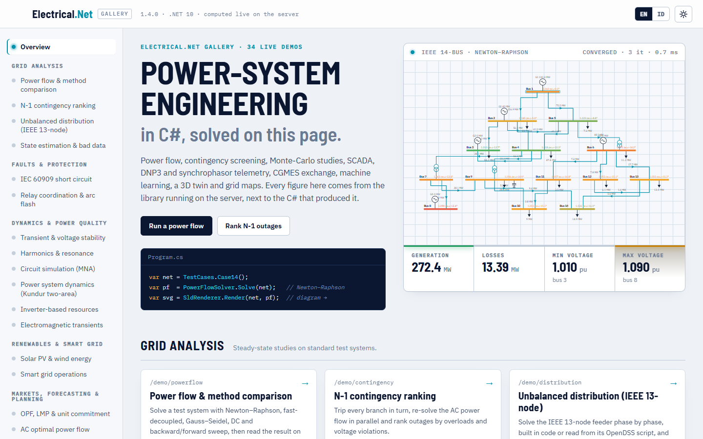

# Dokumentasi Electrical.Net (Bahasa Indonesia)

> Dibuat oleh Gravicode Studios dipimpin oleh Kang Fadhil · [English](../en/README.md)

Electrical.Net adalah framework sistem tenaga untuk .NET 10: 34 paket pustaka ditambah kernel native Rust, tool CLI, templat proyek, dan galeri
Blazor/Avalonia. Mulailah dari [Memulai](memulai.md), lalu baca panduan untuk bidang yang Anda kerjakan.

| Panduan | Isi |
|---|---|
| [Memulai](memulai.md) | Instalasi, program pertama, membangun jaringan, dependency injection, satuan dan konvensi |
| [Arsitektur](arsitektur.md) | Graf dependensi, model jaringan, numerik, aturan desain, kinerja, interop native |
| [Panduan modul](modul.md) | Setiap paket: tujuan, tipe utama, contoh singkat, acuan dan batasan |
| [Aliran daya](aliran-daya.md) | Newton–Raphson, fast-decoupled, Gauss–Seidel, DC, backward/forward sweep, beban ZIP, batas Q, N-1, PTDF/LODF |
| [Distribusi tak seimbang](distribusi.md) | Aliran daya kerangka fasa untuk penyulang IEEE 4/13 node, konstanta saluran Carson dan Kron, kendali regulator dan kapasitor, skrip OpenDSS (v1.1) |
| [Hubung singkat & proteksi](hubung-singkat-proteksi.md) | IEC 60909, relai, koordinasi, proteksi jarak dan diferensial, breaker duty, arc flash |
| [Stabilitas](stabilitas.md) | Stabilitas transien (model klasik), CCT, kriteria luas sama, sinyal kecil, kurva PV/QV, indeks-L, respons frekuensi |
| [Dinamika sistem tenaga](dinamika.md) | Mesin rinci (GENROU/GENSAL), eksiter, governor, PSS, inverter REGC/REEC/REPC dan grid-forming, PSS/E .dyr, Kundur dua area, sinyal kecil (v1.3) |
| [Transien elektromagnetik](transien-elektromagnetik.md) | Solver EMT: R/L/C, sakelar, dioda/tiristor, saluran Bergeron, transformator, energisasi saluran, inrush kapasitor, kernel Rust (v1.3) |
| [Harmonik & kualitas daya](harmonik.md) | FFT dan spektrum, IEEE 519 / IEC 61000, aliran daya harmonik, frequency scan, filter |
| [Energi terbarukan & smart grid](energi-terbarukan-smartgrid.md) | PV, angin, baterai, grid code, hosting capacity, DR, EV, microgrid, VPP, VVO, rekonfigurasi, keandalan, prakiraan |
| [Optimasi](optimasi.md) | Dispatch ekonomis, DC-OPF, AC-OPF (titik interior) dan dekomposisi LMP, kendala keamanan, unit commitment, penempatan kapasitor |
| [Pasar listrik](pasar-listrik.md) | Unit commitment dengan kendala keamanan (MILP), kliring day-ahead dan real-time, LMP, penyelesaian, FTR (v1.2) |
| [Solver LP / MILP](solver.md) | `LinearModel`, dual simplex dan branch and bound bawaan, adapter HiGHS dan OR-Tools, memilih solver (v1.2) |
| [Estimasi keadaan](estimasi-keadaan.md) | Estimator WLS, pengukuran, observabilitas, deteksi bad data |
| [Sinkrofasor](sinkrofasor.md) | Frame IEEE C37.118 dan transport TCP/UDP, simulator PMU, estimasi fasor kelas P/M (TVE), estimasi keadaan PMU linear, penyelarasan PDC (v1.4) |
| [SCADA, IEC 61850 & CIM](scada-iec61850-cim.md) | Modbus TCP, tag, alarm, historian, simulator RTU, codec IEC 104, GOOSE, SV, SCL, CIM, profil CGMES 3.0 dan validator 22 aturan (v1.4) |
| [Protokol utilitas](protokol.md) | Outstation dan master DNP3, klien dan server IEC 60870-5-104, jembatan tag, vektor acuan (v1.4) |
| [Pertukaran model](pertukaran-model.md) | Baca dan tulis PSS/E RAW v33/v35, IEEE CDF, deteksi CGMES, deteksi format otomatis, peringatan konversi (v1.1, v1.4) |
| [GIS & visualisasi](gis-visualisasi.md) | GeoJSON, peta, indeks spasial, area padam, diagram segaris, grafik, komponen Blazor |
| [Simulasi, HPC & native](simulasi-hpc-native.md) | Simulasi rangkaian, QSTS dengan kendali OLTC/kapasitor, kecukupan pembangkitan, aliran daya batch dan probabilistik, kernel Rust (termasuk EMT) |
| [API cloud](api-cloud.md) | Endpoint REST, job studi, penyimpanan skenario, kontrak JSON jaringan |
| [AI & digital twin](ai-digital-twin.md) | Agen LLM operator jaringan dan tool-nya, deteksi anomali, analitik gangguan, RL Volt/VAR, digital twin langsung, what-if, kesehatan aset |
| [Pembelajaran mesin](pembelajaran-mesin.md) | Peramalan beban ML, klasifikasi dan lokasi gangguan, identifikasi topologi, Volt/VAR deep-RL dengan RLNet (v1.4) |
| [Digital twin 3D](digital-twin-3d.md) | Adegan gardu induk/penyulang prosedural, pewarnaan aliran daya dan twin, ekspor glTF, render di luar layar, tampilan Avalonia (v1.4) |
| [CLI](cli.md) | Referensi perintah `eln` dengan contoh keluaran |
| [Templat](templat.md) | Templat `dotnet new eln-*` |
| [Galeri](galeri.md) | Aplikasi pameran Blazor dan Avalonia, tangkapan layar, menambah demo |

---
*Dibuat oleh Gravicode Studios dipimpin oleh Kang Fadhil · [English](../en/README.md)*
