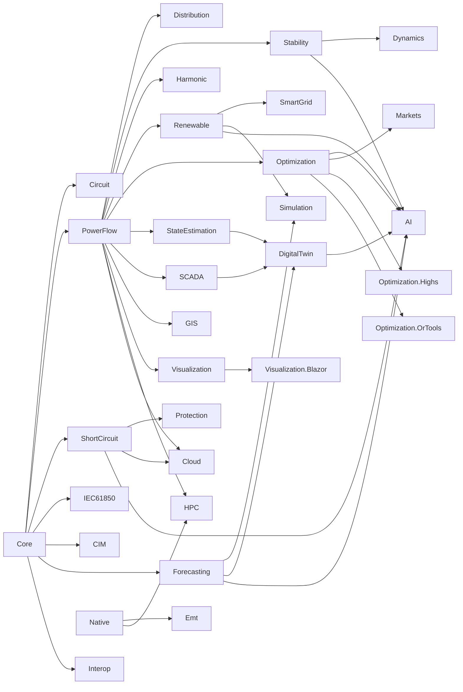

# Arsitektur

> Dibuat oleh Gravicode Studios dipimpin oleh Kang Fadhil · [English](../en/architecture.md)

## Graf dependensi



(Setiap modul juga mereferensikan `Electrical.Core`; hanya sisi tambahan yang digambar.) Graf ini asiklik dan berlapis:
**Core → PowerFlow → modul analisis → SmartGrid / Simulation → DigitalTwin / AI / Cloud**. `Electrical.Native` tidak punya dependensi managed.
Aplikasi berada di atasnya: CLI `eln`, templat `dotnet new`, dan galeri.

| Lapisan | Paket |
|---|---|
| Fondasi | Core, Native |
| Kondisi tunak | PowerFlow, Circuit |
| Analisis | ShortCircuit, Protection, Stability, Dynamics, Emt, Harmonic, StateEstimation, Optimization (+ adapter .Highs, .OrTools), Markets |
| Sumber daya & tepi jaringan | Renewable, SmartGrid, Forecasting |
| Data & protokol | SCADA, IEC61850, CIM, GIS, Visualization(.Blazor) |
| Platform | Simulation, HPC, Cloud, DigitalTwin, AI |

## Blok bangunan inti

### Model jaringan (`Electrical.Core.Network`)

- `PowerNetwork`: nama, `BaseMva`, `FrequencyHz`, dan list `Bus`, `Load`, `Generator`, `Branch` yang bisa diubah. Pencarian bus berdasarkan id
  di-cache dan dibangun ulang saat list berubah. `Clone()` membuat salinan dalam, `Validate()` melaporkan masalah (id ganda, tanpa slack,
  terminal tak dikenal, impedansi nol, pulau).
- Model bus-cabang urutan positif yang seimbang dengan konvensi MATPOWER (cabang π dalam pu, total charging `B`, `Tap`, `ShiftDeg`).
  Data urutan nol (`R0`, `X0`, `B0`) default-nya 3× urutan positif untuk saluran; `WindingConnection` trafo (YNyn, YNd, Dyn, …) menentukan
  jalur urutan nol.
- `Load` memiliki `ZipModel` (fraksi Z / I / P konstan) dan `Category` opsional untuk prakiraan dan demand response.
- `Generator` membawa batas, `PolynomialCost`, laju ramp, dan data mesin (X″d, X′d, Xd, X2, X0, H, D pada `MBase`) sehingga satu model melayani
  aliran daya, dispatch, hubung singkat, dan stabilitas.
- `AdmittanceMatrix.Build(net, Sequence)` mengembalikan Y-bus sparse dan `BranchAdmittance` per cabang (Yff, Yft, Ytf, Ytt).
- `Topology`: adjacency, pulau, cek radial, jarak hop.
- `Matpower.Parse/Load/Write`, `TestCases`, `NetworkBuilder`, `LineLibrary`.

### Numerik (`Electrical.Core.Numerics`)

- `DenseMatrix<T>` / `DenseLU<T>` dan CSR `SparseMatrix<T>` yang dibangun dengan `SparseBuilder<T>` (entri duplikat dijumlahkan), generik atas
  `INumberBase<T>` (dipakai dengan `double` dan `Complex`).
- `SparseLU<T>`: pengurutan minimum-degree + eliminasi IKJ. `lu.Ordering` bisa diberikan kembali ke `Factorize` untuk memakai ulang kerja
  simbolik bila hanya nilai yang berubah (iterasi Newton–Raphson, jaringan urutan hubung singkat, matriks gain WLS).

```csharp
var b = new SparseBuilder<Complex>(3, 3);
b.Add(0, 0, new Complex(4, 1)); b.Add(0, 1, -1); b.Add(1, 0, -1);
b.Add(1, 1, new Complex(4, 1)); b.Add(1, 2, -1); b.Add(2, 1, -1); b.Add(2, 2, new Complex(4, 1));
SparseMatrix<Complex> a = b.ToCsr();                 // duplikat dijumlahkan

var lu = SparseLU<Complex>.Factorize(a);              // pengurutan minimum-degree + LU
Complex[] x = lu.Solve([1, 0, 0]);
var lu2 = SparseLU<Complex>.Factorize(a, lu.Ordering); // pakai ulang pengurutan untuk pola yang sama
```

### Satuan dan data

- `PerUnitBase(BaseMva, BaseKv)` dengan konversi Ω/S/kA, `ElectricalFormulas` (relasi √3, koreksi faktor daya, jatuh tegangan, reaktansi,
  resonansi), `Phasor`, `ThreePhase`, `SymmetricalComponents`.
- `TimeSeries` (langkah tetap; jumlah/min/maks SIMD lewat `TensorPrimitives`; resample, kurva durasi, energi, faktor beban) dan `Stats`
  (rata-rata, simpangan baku, persentil, RMS, MAPE).

### Hosting dan event

`services.AddElectrical(b => b.AddX())` membuat `ElectricalBuilder`; `AddX` setiap modul memanggil `TryAddModule` sekali, sehingga registrasi
idempoten. `IGridEventBus` (in-memory, sinkron, thread-safe) membawa `IGridEvent` antar modul, misalnya `TagValueChanged` dan `AlarmEvent` dari
SCADA, atau `TwinStateUpdated` dari digital twin.

## Aturan desain

- **Ringan dependensi dan kompatibel AOT.** Pustaka memakai `IsAotCompatible`; tanpa JSON berbasis refleksi (`JsonNode`, `JsonDocument`,
  `Utf8JsonWriter` sebagai gantinya), tanpa `dynamic`. Core hanya bergantung pada `Microsoft.Extensions.DependencyInjection.Abstractions` dan
  `System.Numerics.Tensors`; Cloud memakai shared framework ASP.NET Core.
- **Satuan di permukaan API** adalah satuan teknik (MW, Mvar, kV, kA, Ω, pu, derajat, s, Hz) dan didokumentasikan di komentar XML.
- **Divalidasi terhadap acuan.** Setiap algoritma punya tes yang menyebut sumbernya (MATPOWER, IEC 60909, IEEE 1584, IEEE 519, buku teks).
  Lihat tabel validasi di [README](../../README.id.md#validasi).
- **Deterministik.** Data sintetis dan sampling Monte-Carlo memakai seed tetap (SplitMix64 + Box–Muller di kernel native dan kembarannya yang
  managed), tidak pernah `HashCode.Combine`, sehingga hasil sama di semua proses dan mesin.
- **Titik masuk statis plus fasad DI.** Setiap studi tersedia sebagai metode statis; interface DI membungkusnya untuk aplikasi.
- **Opsi immutable, model mutable.** Opsi adalah `record` dengan properti `init` dan instance `Default`; jaringan bisa diubah dan di-clone untuk
  skenario.

## Kinerja

- Newton–Raphson membangun Jacobian polar sparse dan memfaktorkannya dengan `SparseLU`; pengurutan dihitung sekali per penyelesaian.
- Penyaringan kontingensi, aliran daya batch, dan aliran daya probabilistik berjalan dengan `Parallel.For` dan warm start.
- Studi hubung singkat memfaktorkan tiga matriks admitansi urutan sekali; setiap gangguan adalah satu solve sparse per urutan.
- `eln bench` pada jaringan sintetis (build Release, terbaik dari 3, di mesin pengembang — hanya indikatif; jaringan sintetis berbentuk mesh 2-D, kasus terburuk untuk fill-in):

```
  Case            Buses  Branches  Iter      ms
  synthetic100      100       180     3      2.1
  synthetic1000    1000      1936     4     56.8
  synthetic3000    3000      5890     5    268.2
```

## Interop native

`Electrical.Native` memanggil crate Rust `native/electrical-native` (C ABI, fungsi `eln_*`) melalui `LibraryImport`. Sebuah `DllImportResolver`
mencari di folder aplikasi dan `runtimes/<rid>/native`. Bila pustaka tidak ada atau pemanggilan gagal, fallback managed (dengan semantik
identik, diverifikasi oleh tes) dipakai. `GridKernels.Backend` melaporkan `"native (Rust)"` atau `"managed"`; set
`GridKernels.PreferNative = false` untuk memaksa kode managed. Sejak 1.3 solver EMT memakai `EmtKernels` (`eln_emt_*`, aktif bila
`eln_version` ≥ 10300) dengan kontrak yang sama: cadangan managed identik bit, `EmtKernels.Backend`, `EmtKernels.PreferNative`. Detail di [Simulasi, HPC & native](simulasi-hpc-native.md).

## Struktur repositori

```
src/Electrical.*           paket pustaka
native/electrical-native   crate Rust (cdylib)
tools/Electrical.Cli       tool eln
templates/                 templat dotnet new
gallery/                   Skenario bersama + web Blazor + desktop Avalonia
tests/Electrical.Tests     tes xUnit (Analysis/, Operations/, Integration/, Intelligence/, Platform/)
build/                     build-native.ps1, pack.ps1, publish-nuget.ps1, ci/electrical-net.yml
```

CI (`.github/workflows/electrical-net.yml` di root monorepo) membangun kernel Rust untuk lima RID, menaruhnya di
`src/Electrical.Native/runtimes/<rid>/native`, membangun dan menguji solusi, mem-pack semua pustaka, CLI, dan templat, lalu mendorong ke NuGet
saat tag `electrical-net-vX.Y.Z` di-push (secret `NUGET_API_KEY`).

---
*Dibuat oleh Gravicode Studios dipimpin oleh Kang Fadhil · [English](../en/architecture.md)*
