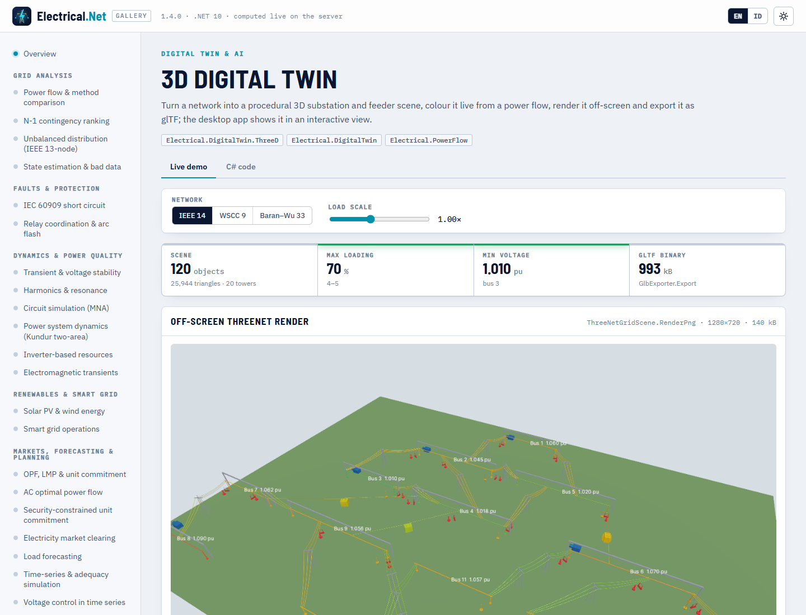
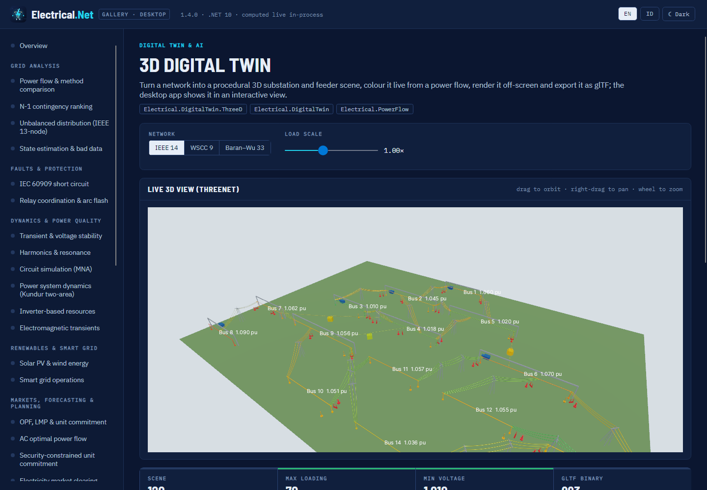

# Digital twin 3D

> Dibuat oleh Gravicode Studios dipimpin oleh Kang Fadhil · [English](../en/digital-twin-3d.md)

Paket: `Electrical.DigitalTwin.ThreeD` (v1.4, bergantung pada Core, PowerFlow, DigitalTwin, dan Visualization; memakai **ThreeNet 0.12.2**)
dan `Electrical.DigitalTwin.ThreeD.Avalonia` (kontrol `GridTwin3DView`, **ThreeNet.Avalonia 0.12.2**). Keduanya mengubah jaringan
bus-cabang menjadi model 3D prosedural dari gardu induk dan penyulangnya dan terus mewarnainya dari data langsung:

- `GridSceneBuilder` menata jaringan dari lokasi bus (GIS, bila setiap bus memilikinya) atau dari tata letak diagram segaris otomatis
  (lapisan menjadi kedalaman) dan membangun busbar di atas isolator tumpu, gantry di bus gardu induk, bay pemutus dan pemisah di ujung
  from setiap cabang, trafo daya (tangki, bushing, radiator), menara setiap gawang dengan tiga konduktor katenari yang melendut, kabel
  bawah tanah untuk cabang berjenis `Cable`, pembangkit, beban, dan bidang tanah;
- `GridScene3D.ApplyPowerFlow` / `ApplyTwinState` mewarnai busbar menurut tegangan dan konduktor menurut pembebanan, menampilkan keadaan
  sakelar (cabang terbuka menjadi abu-abu, pemutus hijau saat terbuka, merah saat tertutup) dan membuat alarm twin berkedip; label
  membawa tegangan bus;
- `GlbExporter` menulis glTF 2.0 biner (ThreeNet tidak memiliki eksporter) dengan material PBR dalam warna saat ini;
- `ThreeNetGridScene` mewujudkan model dalam adegan ThreeNet (wgpu: DirectX 12, Vulkan, atau Metal), menyinkronkan material, dan me-render
  di luar layar ke PNG;
- `GridTwin3DView` menampilkannya di Avalonia dengan kamera orbit, warna langsung, alarm berkedip, dan label HUD.

Model adegan (`GridScene3D`, `SceneObject`, `MeshData`) adalah .NET biasa dan tidak memerlukan GPU; hanya `ThreeNetGridScene` dan
tampilan Avalonia yang memerlukannya. Koordinat dalam meter (sumbu Y ke atas).

## Bangun, warnai, ekspor, render

```csharp
var net = TestCases.Case14();
var scene = GridSceneBuilder.Build(net, new GridSceneOptions { Labels = true, UnratedReferenceMva = 100 });
Console.WriteLine($"{scene.Objects.Count} objects, {scene.TriangleCount} triangles, {scene.Count(GridElementKind.Tower)} towers");

scene.ApplyPowerFlow(PowerFlowSolver.Solve(net));          // busbars by voltage, conductors by loading, open branches grey
File.WriteAllBytes("case14.glb", GlbExporter.Export(scene)); // glTF 2.0 binary with PBR materials

using var three = ThreeNetGridScene.Create(scene);          // ThreeNet scene (needs a GPU adapter: DX12/Vulkan/Metal)
three.FrameCamera(elevationDeg: 40, azimuthDeg: 30);
File.WriteAllBytes("case14.png", three.RenderPng(1280, 720));
```

Adegan IEEE 14 bus berisi 120 objek (sekitar 26 000 segitiga, 20 menara) dan diekspor menjadi GLB sekitar 1 MB; penyulang 33 bus berisi 196
objek. Pembebanan adalah `max(S_from, S_to) / RateA`; untuk cabang tanpa rating acuannya `UnratedReferenceMva` atau, bila null, cabang
terberat pada solusi saat ini (sehingga warnanya relatif). `GridSceneOptions` yang penting:

| Opsi | Bawaan | Arti |
|---|---|---|
| `LayoutScale`, `MetresPerKm`, `IgnoreLocations` | 0,35, 120, off | Meter per satuan SLD; meter per km dengan lokasi bus geografis; paksa tata letak SLD |
| `BusbarHeight`, `TowerHeight`, `SpanLength`, `Sag`, `PhaseSpacing` | 7, 16, 45, 1,6, 2,2 m | Geometri gardu induk dan saluran |
| `ShowGenerators`, `ShowLoads`, `ShowGround`, `Labels`, `BranchLabels` | on, on, on, on, off | Isi adegan |
| `VoltageSpanPu` | 0,1 | ±0,1 pu di sekitar 1,0 merentang skala warna tegangan |
| `UnratedReferenceMva` | null | Acuan pembebanan untuk cabang tanpa rating (null = aliran terbesar hasil yang diterapkan) |
| `AlarmFlashHz` | 1,5 | Laju kedip objek beralarm |
| `SubstationBuses` | null | Bus yang digambar sebagai gardu induk dengan gantry (null = bus slack dan pembangkit serta terminal trafo) |

## Twin langsung

```csharp
var sim = new TwinSimulator(net, new TwinSimulatorOptions { Steps = 24 });
for (int h = 0; h < 24; h++)
{
    TwinState state = sim.Step();
    scene.ApplyTwinState(state);                            // estimated voltages / flows + alarms
}
int flashing = scene.UpdateAlarmFlash(timeSeconds: 0.5);    // call per frame; alarm objects glow
```

`ApplyTwinState` menerima keluaran [digital twin](ai-digital-twin.md) (estimasi keadaan dan alarm yang dijelaskan): bus atau cabang
beralarm menyala kuning (peringatan) atau merah (tinggi), dan `UpdateAlarmFlash` menganimasikan emisinya. Setiap `SceneObject` memiliki
`Version` yang berubah bersama warnanya, sehingga `ThreeNetGridScene.Sync()` hanya memperbarui material yang berubah.

## Tampilan Avalonia

```csharp
var view = new GridTwin3DView { Model = scene, ShowLabels = true, Height = 560 };   // drag = orbit, right-drag = pan, wheel = zoom
scene.ApplyPowerFlow(pf);                                                           // the next frame shows the new colours
```

`GridTwin3DView` turunan dari `ThreeNetView`: me-render di luar layar pada GPU lalu menyalin ke bitmap, sehingga bekerja di tata letak
Avalonia mana pun (dan pada tangkapan layar headless setelah `RenderFrame()`). Mengatur `Model` membangun ulang adegan ThreeNet dan
membingkai kamera; memperbarui warna model tidak memerlukan panggilan lain.

## Baris perintah dan galeri

```
$ eln twin3d --case case14 --out grid.glb --png view.png --scale 1.3
3D twin of case14 (load ×1.30): 120 scene objects → grid.glb (993.3 KiB GLB)
Rendered view.png
```

Demo galeri **Kembaran digital 3D** memakai `GridTwin3DView` di aplikasi desktop; aplikasi web menampilkan gambar `RenderPng` di luar
layar (atau catatan bila server tidak memiliki adaptor GPU) dan selalu menyediakan GLB untuk diunduh. Slider skala beban menghitung ulang
aliran daya sehingga koridor berat berubah warna.

| Web (render di luar layar) | Desktop (tampilan langsung) |
|---|---|
|  |  |

## Batasan

Geometrinya prosedural dan skematis (bentuk bay, menara, dan trafo standar), bukan model CAD gardu induk nyata; trafo tiga belitan, HVDC,
dan FACTS tidak memiliki bentuk khusus. Rendering memerlukan inti native ThreeNet (win-x64, linux-x64, osx-arm64) dan adaptor GPU; tanpa
itu, gunakan ekspor GLB. Paket-paket ini tidak kompatibel AOT.

---
*Dibuat oleh Gravicode Studios dipimpin oleh Kang Fadhil · [English](../en/digital-twin-3d.md)*
