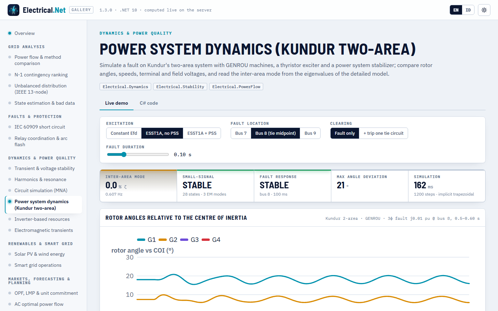
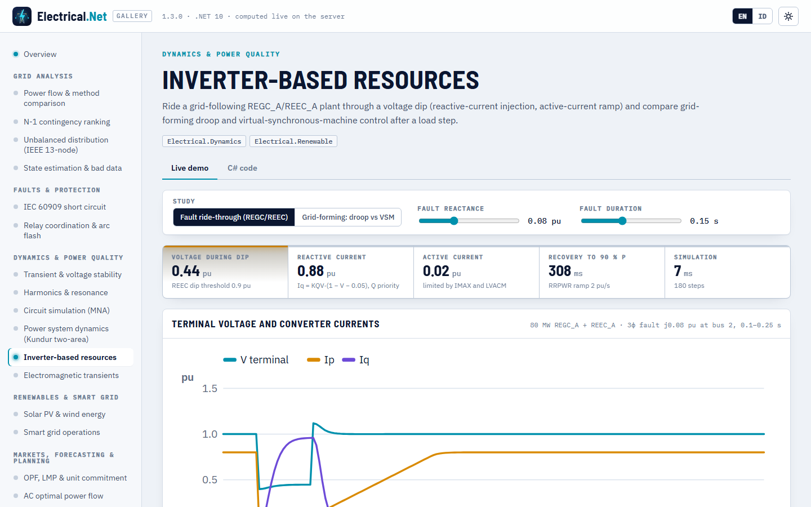

# Dinamika sistem tenaga

> Dibuat oleh Gravicode Studios dipimpin oleh Kang Fadhil · [English](../en/dynamics.md)

Paket: `Electrical.Dynamics` (v1.3, bergantung pada PowerFlow dan Stability). Simulasi domain waktu RMS (fasor) dan analisis sinyal kecil
dengan model rinci: mesin sinkron beserta eksiter, governor, dan stabilizer sistem tenaga (PSS), sumber berbasis inverter (model generik
WECC REGC/REEC/REPC dan inverter grid-forming), masukan PSS/E `.dyr`, serta simulasi berbasis kejadian. Model klasik di
[`Electrical.Stability`](stabilitas.md) tetap menjadi alat penyaringan cepat; lihat [Klasik vs rinci](#klasik-vs-rinci).

## Mulai cepat: sistem dua area Kundur

```csharp
using System.Numerics;
using Electrical.Dynamics;

var study = DynamicTestCases.KundurTwoArea(KundurExcitation.StaticExciterWithPss);
DynamicSystem sys = study.Build();                    // aliran daya + inisialisasi setiap model
Console.WriteLine(sys);                               // kundur2area: 4 units, 40 states, 11 buses
var (dmax, mismatch) = sys.InitializationResidual();  // 5,6e-15, 2,8e-14: kesetimbangan sejati

var events = new[]
{
    DynamicEvent.Fault(0.5, busId: 8, impedancePu: new Complex(0, 0.01)),   // gangguan 3 fasa di tengah saluran interkoneksi
    DynamicEvent.Clear(0.6, busId: 8),
};
var r = DynamicSimulation.Run(sys, events, new SimulationOptions { EndTimeS = 10 });
Console.WriteLine($"stabil {r.Stable}, {r.Steps} langkah, {r.Elapsed.TotalMilliseconds:0} ms");   // stabil True, 1200 langkah, ≈ 90–120 ms

int g1 = r.UnitIndex("G1");
double[] delta = r.AngleCoiDeg[g1], speed = r.SpeedPu[g1], vt = r.TerminalVoltagePu[g1], efd = r.FieldVoltagePu[g1];
double efdDuringFault = r.At(efd, 0.55);              // 8,67 pu, batas atas eksiter 9 pu
```

`DynamicSimulationResult` berisi satu baris per unit (generator, inverter, atau beban dinamis, urut `UnitNames`) dan satu kolom per sampel
keluaran: `AngleDeg`, `AngleCoiDeg` (relatif terhadap pusat inersia), `SpeedPu`, `TerminalVoltagePu`, `ActivePowerMw`,
`ReactivePowerMvar`, `FieldVoltagePu`, `MechanicalPowerPu`, `ActiveCurrentPu`, `ReactiveCurrentPu`, ditambah `BusVoltagePu` dan
`BusFrequencyHz` per bus, keadaan apa pun menurut nama (`States`, `Channel("EFD G1")`), `Stable`, `MaxAngleDeviationDeg`, `Steps`,
`Iterations`, `ConvergenceFailures`, dan `Elapsed`. `At(channel, t)` melakukan interpolasi.



## Menyusun studi

### Dari data PSS/E `.dyr`

```csharp
var net = DynamicTestCases.KundurNetwork();                                  // atau NetworkFormats.Load("case.raw").Network
string dyr = DynamicTestCases.KundurDyr(KundurExcitation.StaticExciter);    // atau File.ReadAllText("case.dyr")
DynamicModelSet models = DyrReader.Parse(dyr, net);
foreach (var w in models.Warnings) Console.WriteLine(w);                     // model tak dikenal, generator tak cocok, …
var sys = DynamicSystem.Build(net, models, new DynamicSystemOptions { Loads = LoadRepresentation.ConstantImpedance });
```

`DyrReader` menerima rekaman multi-baris yang diakhiri `/`, komentar (`//`, `@!`), id mesin bertanda kutip, dan teks di akhir rekaman.
Rekaman dicocokkan ke generator menurut bus dan id mesin; model tak dikenal (`USRMDL`, …) dan rekaman tanpa generator menjadi peringatan,
bukan exception. `DynamicModelLibrary.Names` mencantumkan model yang dikenali:

```
AC4A, ESAC4A, ESST1A, GAST, GENCLS, GENROU, GENSAL, GFMDRP, GFMVSM, HYGOV, IEEEG1, IEEEST, IEEET1, PSS2A, PSS2B, REECA1, REECAU1, REEC_A,
REGCA1, REGCAU1, REGC_A, REPCA1, REPCAU1, REPC_A, SEXS, ST1A, TGOV1
```

`DynamicModelLibrary.Register` menambahkan pabrik model Anda sendiri dengan sebuah nama.

### Di kode

```csharp
var net = TestCases.Case9();
var models = new DynamicModelSet()
    .Add(0, new Gensal(8.96, 0.03, 0.05, 23.64, 0, 0.146, 0.0969, 0.0608, 0.05, 0.0336), new Sexs(0.1, 10, 100, 0.1, 0, 5))
    .Add(1, new Genrou(6.0, 0.03, 0.535, 0.05, 6.4, 0, 0.8958, 0.8645, 0.1198, 0.1969, 0.1, 0.0521),
            new Ieeet1(0, 20, 0.2, 5, -5, 1.0, 0.314, 0.063, 0.35), new Tgov1(0.05, 0.5, 5, 0, 1, 3, 0));
// generator 2 tanpa model: menjadi GENCLS dari Generator.H, D, dan XdPrime
var sys = DynamicSystem.Build(net, models);                                 // 20 keadaan
var r = DynamicSimulation.Run(sys,
    [DynamicEvent.LoadStep(0.5, busId: 5, deltaPMw: 20), DynamicEvent.ReferenceStep(5, generatorIndex: 1, "Vref", 0.02)],
    new SimulationOptions { EndTimeS = 20, TimeStepS = 0.01 });             // G2: Pm 1,630 → 1,815 pu, Vt 1,025 → 1,036 pu
```

Parameter konstruktor mengikuti urutan CON PSS/E tiap model (data mesin dalam pu pada `Generator.MBase`, waktu dalam detik). Indeks
generator adalah posisinya di `PowerNetwork.Generators`. `DynamicModelSet.Without(ModelCategory.Stabilizer)` membuang satu kategori untuk
studi what-if dan `Loads.Add(new ExponentialRecoveryLoad(bus, …))` menambahkan beban dinamis.

### Model

| Kategori | Model | Catatan |
|---|---|---|
| Mesin | `Gencls`, `Genrou` (rotor silinder), `Gensal` (kutub menonjol) | Subtransien, saturasi kuadratik atau eksponensial; H = 0 membuat bus tak hingga |
| Eksiter | `Sexs`, `Ieeet1`, `Esst1a`, `Esac4a` | Batas windup dan non-windup, umpan balik laju, saturasi eksiter (IEEET1) |
| Governor | `Tgov1`, `Hygov`, `Gast`, `Ieeeg1` | Uap, air (kolom air), turbin gas, uap bertingkat |
| Stabilizer | `Ieeest`, `Pss2b` | Masukan kecepatan, daya, atau daya percepatan (`StabilizerInput`) |
| Sumber berbasis inverter | `Regca` (REGC_A), `Reeca` (REEC_A), `Repca` (REPC_A) | Model generik terbarukan WECC: LVPL, injeksi Iq, batas arus dengan prioritas P/Q, kendali V/Q/f pembangkit |
| Grid-forming | `GridFormingInverter` (`GridFormingMode.Droop` / `VirtualSynchronousMachine`) | Sumber tegangan di belakang XF dengan droop P–f dan Q–V, inersia virtual H, batas arus |
| Beban | Statis: Z konstan (bawaan), model ZIP jaringan, atau satu ZIP untuk semua; `ExponentialRecoveryLoad` | `DynamicSystemOptions.Loads`, `ConstantPowerBreakpoint` |

## Kejadian

| Pabrik | Efek |
|---|---|
| `DynamicEvent.Fault(t, bus, z)` / `Clear(t, bus)` | Gangguan tiga fasa melalui `z` pu (nol → bolted, 1e-5 pu) |
| `TripBranch(t, index)` / `CloseBranch(t, index)` | Switching cabang (`TransientStability.BranchIndex(net, from, to)` mencari indeksnya) |
| `TripGenerator(t, index)` | Melepas unit (keluarannya menjadi NaN) |
| `LoadStep(t, bus, ΔP, ΔQ)` / `ScaleLoad(t, bus, k)` | Perubahan beban dengan karakteristik beban bus |
| `ReferenceStep(t, gen, "Vref"/"Pref"/"Qref"/"Efd"/"Pm", nilai, relative)` | Perubahan setpoint pengendali |
| `DynamicEvent.From(StabilityEvent)` | Memakai ulang daftar kejadian model klasik |

## Solver

`SimulationOptions.Method` memilih integrator:

- `ImplicitTrapezoidal` (bawaan): persamaan diferensial dan aljabar diselesaikan bersama dengan metode Newton memakai Jacobian sparse
  (admitansi jaringan eksak, turunan numerik per unit). Jacobian dipakai ulang antarlangkah dan diperbarui setelah kejadian, perubahan
  langkah, atau konvergensi lambat; langkah yang iterasi Newton-nya macet karena switching tak mulus diulang sebagai dua setengah langkah
  eksplisit (dihitung di `FallbackSteps`). Langkah bawaan: setengah siklus (8,33 ms pada 60 Hz). Kundur dua area, 10 s, 40 keadaan:
  sekitar 85 ms.
- `ModifiedEuler`: metode Heun eksplisit terpartisi dengan solusi jaringan pada prediktor dan korektor (gunakan `TimeStepS` kecil).

Batas (anti-windup, batas arus) diterapkan di setiap iterasi Newton; logika diskret (status dip tegangan REEC, switching batas arus)
dievaluasi di antara langkah. `OutputInterval` menjarangkan sampel yang disimpan, `StopWhenUnstable` menghentikan simulasi bila sebaran
sudut COI melebihi `InstabilityAngleDeg`, dan `RecordBuses = false` melewatkan kanal per bus.

## Analisis sinyal kecil

`DynamicSmallSignal.Analyze` melinearkan model penuh di sekitar kesetimbangan hasil inisialisasi. Setiap kolom matriks keadaan adalah
beda tengah dengan jaringan diselesaikan ulang untuk keadaan yang diusik, sehingga variabel aljabar tereliminasi secara eksak; nilai eigen
dihitung dengan solver QR Hessenberg seimbang dari `Electrical.Stability` dan faktor partisipasi dari vektor eigen kiri dan kanan.

```csharp
var ss = DynamicSmallSignal.Analyze(DynamicTestCases.KundurTwoArea(KundurExcitation.ConstantField).Build());
foreach (var m in ss.ElectromechanicalModes())        // partisipasi rotor ≥ 0,3, 0,1–3 Hz
    Console.WriteLine(m);

var inter = ss.ElectromechanicalModes()[0];          // frekuensi terendah: mode antar-area
foreach (var (unit, shape) in inter.SpeedShape)
    Console.WriteLine($"  {unit}: {shape.Magnitude:0.00} ∠ {shape.Phase * 180 / Math.PI:0}°");
```

```
λ = -0.1289 ± j3.4074  f = 0.542 Hz  ζ = 3.78 %  [G3.GENROU.dw 0.24, G3.GENROU.delta 0.24, G4.GENROU.dw 0.16]
λ = -0.6116 ± j6.7639  f = 1.077 Hz  ζ = 9.01 %  [G2.GENROU.dw 0.26, G2.GENROU.delta 0.25, G1.GENROU.dw 0.20]
λ = -0.6182 ± j6.9867  f = 1.112 Hz  ζ = 8.81 %  [G4.GENROU.dw 0.27, G4.GENROU.delta 0.27, G3.GENROU.dw 0.18]
  G1: 0.21 ∠ -60°
  G2: 0.15 ∠ -49°
  G3: 1.00 ∠ 92°
  G4: 0.91 ∠ 91°
```

Bentuk mode memperlihatkan area 1 (G1, G2) berayun melawan area 2 (G3, G4). Tersedia `StateMatrix`, `States`, `Eigenvalues` (semua,
urut bagian real menurun), `Modes` (berosilasi, dengan partisipasi), dan `ModeTable()`. Ketiga varian Kundur menunjukkan cerita klasiknya:

| Eksitasi | Mode antar-area | Mode lokal |
|---|---|---|
| Tegangan medan konstan (`ConstantField`) | 0,542 Hz, ζ 3,8 % | 1,077 / 1,112 Hz, ζ ≈ 9 % |
| ESST1A, KA = 200, tanpa PSS (`StaticExciter`) | 0,607 Hz, ζ ≈ 0,0 % | 1,130 / 1,165 Hz |
| ESST1A + PSS Kundur (`StaticExciterWithPss`) | 0,609 Hz, ζ 18,6 % | 1,297 / 1,351 Hz, ζ ≈ 24 % |

## Sumber berbasis inverter

### Grid-following: REGC_A + REEC_A (+ REPC_A)

```csharp
var ibr = DynamicTestCases.InverterBehindLine();      // bus tak hingga — saluran — REGC_A + REEC_A 80 MW di bus 2
var r = DynamicSimulation.Run(ibr.Build(),
    [DynamicEvent.Fault(0.1, busId: 2, impedancePu: new Complex(0, 0.08)), DynamicEvent.Clear(0.25, busId: 2)],
    new SimulationOptions { EndTimeS = 1.5 });
int u = r.UnitIndex("PV1");
double iq = r.At(r.ReactiveCurrentPu[u], 0.2);         // V 0,45 pu → Iq 0,94 pu, Ip 0,02 pu

// pembangkit Anda sendiri: konverter + kendali elektris (+ pengendali pembangkit opsional) pada sebuah generator
var models = new DynamicModelSet()
    .Add(1, new Regca(tg: 0.02, rrpwr: 2), new Reeca(qFlag: false) { Kqv = 2, Imax = 1.1 }, new Repca(fFlag: true) { Kp = 1, Ki = 20 });
var plant = DynamicSystem.Build(ibr.Network, models);  // generator 0 (H = 0) tetap bus tak hingga; 17 keadaan
```

Selama dip, REEC_A menginjeksikan Iq = KQV·(1 − V − pita mati) dengan prioritas arus reaktif, sementara LVACM/LVPL memotong arus aktif;
setelah gangguan hilang, arus aktif pulih dengan laju RRPWR (di sini 2 pu/s: 40,6 MW pada 0,40 s, 60,6 MW pada 0,50 s, 80 MW saat tunak).

### Grid-forming: droop vs mesin sinkron virtual

```csharp
foreach (var mode in new[] { GridFormingMode.Droop, GridFormingMode.VirtualSynchronousMachine })
{
    var g = DynamicSimulation.Run(DynamicTestCases.GridFormingPair(mode).Build(),
        [DynamicEvent.LoadStep(1, busId: 3, deltaPMw: 10)], new SimulationOptions { EndTimeS = 8 });
    double d1 = g.ActivePowerMw[0][^1] - g.ActivePowerMw[0][0], d2 = g.ActivePowerMw[1][^1] - g.ActivePowerMw[1][0];
    Console.WriteLine($"{mode}: ΔP1 {d1:0.00} MW, ΔP2 {d2:0.00} MW, f {50 * g.SpeedPu[0][^1]:0.000} Hz, titik terendah {50 * g.SpeedPu[0].Min():0.000} Hz");
}
```

```
Droop: ΔP1 3.25 MW, ΔP2 6.50 MW, f 49.919 Hz, titik terendah 49.914 Hz
VirtualSynchronousMachine: ΔP1 3.25 MW, ΔP2 6.50 MW, f 49.919 Hz, titik terendah 49.918 Hz
```

Droop MP = 0,05 dan 0,025 pu membagi langkah beban 1 : 2 pada kedua mode; inersia virtual VSM menghilangkan lonjakan frekuensi di bawah
garis droop. `SpeedPu` unit grid-forming adalah frekuensi internalnya.



## Klasik vs rinci

| | `Electrical.Stability` (klasik) | `Electrical.Dynamics` (rinci) |
|---|---|---|
| Mesin | E′ di belakang X′d, konstan | GENCLS, GENROU, GENSAL dengan dinamika fluks dan saturasi |
| Kendali | tidak ada | eksiter, governor, PSS, kendali IBR |
| Jaringan | direduksi Kron ke node mesin | jaringan bus penuh diselesaikan bersama keadaan mesin |
| Integrasi | RK4 | trapesium implisit (DAE, Newton) atau Euler termodifikasi |
| Penggunaan | penyaringan, CCT dengan biseksi, pengajaran | studi desain, penyetelan pengendali, perilaku IBR |

Mesin GENROU yang didorong ke batas klasik (X″ ≈ X′d = X′q ≈ Xd = Xq, T′do = T′qo = 1000 s) mereproduksi ayunan pertama model klasik pada
case9 dalam 2,3°, dan case9 rinci (GENSAL/GENROU + IEEET1) memiliki mode elektromekanis 1,33 dan 2,10 Hz, dekat dengan 1,38 dan 2,13 Hz
model klasik. Kejadian dapat dikonversi dengan `DynamicEvent.From`.

## Dependency injection

```csharp
var sp = new ServiceCollection().AddElectrical(b => b.AddDynamics().AddEmt()).BuildServiceProvider();
IDynamicsService dyn = sp.GetRequiredService<IDynamicsService>();   // Build, Simulate, SmallSignal, ParseDyr
```

## CLI

```
$ eln dyn
kundur2area: Kundur two-area system, StaticExciterWithPss
Electromechanical modes (stable):
   0.609 Hz  ζ =  18.6 %  λ = -0.7257 ± j3.8257  G3.GENROU.dw 0.16, G3.GENROU.delta 0.16, G4.GENROU.dw 0.12
   1.297 Hz  ζ =  24.3 %  λ = -2.0408 ± j8.1499  G2.GENROU.dw 0.22, G1.GENROU.dw 0.18, G2.GENROU.delta 0.17
   1.351 Hz  ζ =  24.4 %  λ = -2.1323 ± j8.4860  G4.GENROU.dw 0.23, G4.GENROU.delta 0.17, G3.GENROU.dw 0.17
Three-phase fault at bus 8 (t = 1 s), cleared after 100 ms: STABLE, 1200 steps in 127 ms
  Unit   δ(COI) max swing   speed range [pu]        V term min [pu]   Efd max [pu]
  G1             3.82°   1.00000–1.00342          0.939          9.000
  G2             4.05°   1.00000–1.00424          0.855          9.000
  G3             3.94°   0.99997–1.00274          0.919          9.000
  G4             3.30°   0.99998–1.00312          0.828          9.000
```

Selebihnya (`--exc const|st|pss`, `--case case9`, `--trip`, `--modes`) ada di [referensi CLI](cli.md#baru-di-13).

## Validasi

| Pemeriksaan | Acuan | Hasil |
|---|---|---|
| Aliran daya Kundur dua area | Kundur Contoh 12.6: Q 185 / 235 / 176 / 202 Mvar, δ 20,2 / 10,5 / −6,8 / −17,0° | 185,0 / 234,6 / 176,0 / 202,1 Mvar, 20,27 / 10,51 / −6,80 / −16,99° |
| Mode antar-area, Efd konstan | Kundur: 0,545 Hz, ζ ≈ 3 % | 0,542 Hz, ζ 3,8 % (beban impedansi konstan) |
| Mode lokal, Efd konstan | Kundur: 1,09 / 1,12 Hz | 1,077 / 1,112 Hz |
| ESST1A KA = 200 tanpa PSS | Kundur: mode antar-area kehilangan redaman (ζ ≈ −0,8 %) | ζ ≈ 0,0 % |
| ESST1A dengan PSS Kundur | Teredam baik (ζ > 5 %) | ζ 18,6 %; domain waktu: ayunan interkoneksi 7–10 s di bawah 10 % kasus tanpa PSS |
| GENROU di batas klasik, case9 | Ayunan pertama klasik (`Electrical.Stability`) | dalam 2,3° |
| Simulasi datar | Kesetimbangan | drift < 1e-6 selama 10 s; residu inisialisasi < 1e-9 untuk setiap model |
| Governor setelah langkah beban | Garis droop Δω = −R·ΔPm | dalam 3 % (TGOV1, GAST, IEEEG1, HYGOV dengan penguatan gerbang) |
| Fault ride-through REGC/REEC | Iq = KQV·(1 − V − 0,05) pada V ≈ 0,45 pu; RRPWR 2 pu/s | Iq ≈ 0,94 pu, ramp 200 MW/s ± 10 % |
| Pembagian beban droop grid-forming | MP 0,05 : 0,025 → 1 : 2 | 1 : 2,00, frekuensi pada garis droop hingga 1e-5 |
| Respons frekuensi REPC di pulau GFM | ΔP = DUP·(\|Δf\| − pita mati) | sama hingga 1e-4 pu |
| Kinerja | — | Kundur 10 s (40 keadaan, 1200 langkah) dalam ≈ 85 ms, implisit |

## Batasan

Hanya model RMS urutan positif (gangguan tak seimbang, dinamika sisi DC konverter, dan fenomena sub-siklus termasuk ranah [EMT](transien-elektromagnetik.md)).
Tidak ada kompiler model buatan pengguna: model kustom adalah kelas C# yang didaftarkan dengan `DynamicModelLibrary.Register`. Pembaca
`.dyr` mencakup model yang tercantum; model lain dilewati dengan peringatan. Model beban dinamis terbatas pada pemulihan eksponensial.

---
*Dibuat oleh Gravicode Studios dipimpin oleh Kang Fadhil · [English](../en/dynamics.md)*
