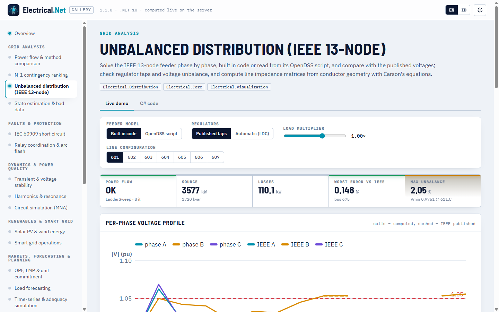

# Distribusi tak seimbang

> Dibuat oleh Gravicode Studios dipimpin oleh Kang Fadhil · [English](../en/distribution.md)

Paket: `Electrical.Distribution` (baru di v1.1, bergantung pada `Electrical.Core` dan `Electrical.PowerFlow`). Paket ini memodelkan penyulang distribusi per fasa,
seperti OpenDSS dan buku Kersting *Distribution System Modeling and Analysis*: saluran tiga, dua, dan satu fasa dengan matriks impedansi
3×3 penuh dari geometri konduktor, beban bintang dan delta dengan model daya / arus / impedansi konstan, hubungan trafo tiga fasa, regulator
tegangan bertingkat dengan kompensasi jatuh tegangan saluran (LDC), dan kapasitor terswitch. Satuan: V, A, kW, kvar, kVA, kV fasa-fasa,
Ω dan µS per mil atau km, pu terhadap basis fasa-netral bus.

| Bagian | Tipe |
|---|---|
| Jaringan | `DistributionNetwork` (`AddBus`, `SetSource`, `AddLine`, `AddSwitch`, `AddTransformer`, `AddRegulator`, `AddWyeLoad`, `AddDeltaLoad`, `AddCapacitor`), `PhaseSet`, `LineCode`, `TransformerConnection`, `LoadModel` |
| Aliran daya | `UnbalancedPowerFlow.Solve`, `DistributionPowerFlowOptions` (`Method` Auto / LadderSweep / CurrentInjection, `ControlMode` Off / Static, `LoadMultiplier`, `Tolerance`), `DistributionPowerFlowResult`, `DistributionBusResult`, `DistributionBranchFlow` |
| Konstanta saluran | `LineConstants.Overhead / ConcentricNeutral / TapeShielded`, `OverheadConfiguration` (`Spacing500`), `ConductorLibrary`, `ConcentricNeutralCable`, `TapeShieldedCable`, `LineImpedance` (`ZOhmPerMile`, `YSiemensPerMile`, `Sequence`, `ToLineCode`) |
| Kendali dan deret waktu | `VoltageRegulatorController`, `OltcController`, `CapacitorController` (tegangan, var, waktu, faktor daya), `DistributionTimeSeries.Run` |
| Data | `DistributionTestCases` (`Ieee13Node`, `Ieee4Node`, `Ieee13NodePublished`, `Ieee13NodeDss`, `Ieee13Config(601..607)`), `OpenDssReader` |
| Interop | `ToBalanced(baseMva)` (`PowerNetwork` urutan positif), `AddDistribution()` / `IDistributionService` |

## Penyulang IEEE 13 node

```csharp
using Electrical.Distribution;

var net = DistributionTestCases.Ieee13Node(automaticRegulator: true);
var r = UnbalancedPowerFlow.Solve(net);       // Auto → ladder sweep (radial); pengendali beriterasi dengan ControlMode.Static
Console.WriteLine($"{r.Method}: {r.Iterations} it, source {r.TotalSourceKva.Real:0.0} kW, losses {r.LossesKw:0.0} kW");

var b675 = r.Bus("675");
for (int p = 0; p < 3; p++) Console.WriteLine($"675.{"ABC"[p]}: {b675.VmPu[p]:0.0000} pu ∠ {b675.VaDeg[p]:0.00}°");
Console.WriteLine($"VUF {b675.VoltageUnbalanceFactor:P2}, NEMA {b675.NemaUnbalance:P2}");
Console.WriteLine($"taps {string.Join("/", r.RegulatorTaps["Reg"])}; lowest {r.MinVoltage.Bus}.{"ABC"[r.MinVoltage.Phase]} {r.MinVoltage.Vpu:0.0000} pu");

var line = r.Branch("650632");
Console.WriteLine($"650632: {line.TotalPowerFromKva.Real:0.0} kW, max {line.MaxCurrentA:0.0} A");
```

```
LadderSweep: 8 it, source 3572.4 kW, losses 110.8 kW
675.A: 0.9832 pu ∠ -5.55°
675.B: 1.0493 pu ∠ -122.54°
675.C: 0.9702 pu ∠ 116.05°
VUF 1.88%, NEMA 1.63%
taps 10/7/10; lowest 611.C 0.9681 pu
650632: 3572.4 kW, max 588.4 A
```

`Ieee13Node()` tanpa argumen menetapkan regulator pada tap terbitan 10/8/11 dan mereproduksi hasil IEEE; dengan `automaticRegulator: true`
setelan LDC terbitan (122 V, pita 2 V, PT 20, CT 700 A, R′ 3 V, X′ 9 V) menggerakkan tap, dan regulator berhenti di 10/7/10, satu langkah
di bawah keadaan akhir terbitan pada fasa B dan C. `DistributionTestCases.Ieee13NodePublished` memuat tegangan IEEE untuk pembanding.

- `DistributionBusResult`: `VoltageV` (fasor fasa-netral), `VmPu`, `VaDeg` (NaN untuk fasa yang tidak ada), `VoltageUnbalanceFactor`
  (|V₂|/|V₁|, IEC 61000-4-30), `NemaUnbalance` (ketidakseimbangan tegangan saluran NEMA MG-1), `LineVoltage(i, j)`.
- `DistributionBranchFlow`: `CurrentFromA/CurrentToA`, `PowerFromKva/PowerToKva` per fasa, `LossesKva`, `MaxCurrentA`.
- `DistributionPowerFlowResult`: `Converged`, `Iterations`, `Method`, `SourcePowerKva` per fasa, `LoadKva`, `LossesKw`, `RegulatorTaps`,
  `MinVoltage`/`MaxVoltage` (bus, fasa, pu), `MaxVoltageUnbalance`, `Warnings`.

**Solver.** `LadderSweep` adalah teknik iteratif ladder Kersting dengan matriks umum a, b, c, d, A, B tiap elemen (penyulang radial).
`CurrentInjection` mengiterasi injeksi arus nodal pada Y-bus kerangka fasa yang sparse dan juga menangani jaringan sedikit mesh; `Auto`
memilih ladder untuk penyulang radial dan injeksi arus untuk lainnya (`NonRadialNetworkException` bila ladder dipaksakan pada mesh).
`LoadMultiplier` menskalakan semua beban.

## Membangun penyulang

```csharp
using System.Numerics;

var net = new DistributionNetwork { Name = "demo feeder", FrequencyHz = 50 };
net.AddBus("src", 20); net.AddBus("n1", 20); net.AddBus("lv", 0.4);
net.SetSource("src", voltagePu: 1.0);
var z = LineConstants.Overhead(OverheadConfiguration.Spacing500(ConductorLibrary.Acsr336_4_26_7, ConductorLibrary.Acsr4_0_6_1), frequencyHz: 50);
net.AddLine("L1", "src", "n1", z.ToLineCode("336ACSR", normalAmps: 530), 3.5, LengthUnit.Kilometer);
net.AddTransformer("T1", "n1", "lv", TransformerConnection.DeltaWyeG, 630, 20, 0.4, 1.0, 4.5);   // kVA, kV, kV, %R, %X
net.AddWyeLoad("L-lv", "lv", LoadModel.ConstantPower, new Complex(150, 50), new Complex(120, 40), new Complex(180, 60));  // kW + j kvar per fasa
net.AddCapacitor("C1", "n1", 100, 100, 100);                                                     // kvar per fasa
var r = UnbalancedPowerFlow.Solve(net);
Console.WriteLine(r);
```

```
LadderSweep: converged=True in 6 it, control rounds 0; source 454.2 kW -136.9 kvar, losses 4.20 kW
src: A 1.0000∠0.00°  B 1.0000∠-120.00°  C 1.0000∠120.00°
n1: A 0.9995∠-0.08°  B 0.9998∠-120.09°  C 0.9995∠119.91°
lv: A 0.9808∠-31.83°  B 0.9849∠-151.46°  C 0.9771∠87.81°
```

Saluran lateral memakai huruf fasa (`AddLine(name, from, to, code, length, unit, "cb")`); `AddSwitch` menambah sakelar hampir ideal;
`AddRegulator(name, from, to, kvLN, phases, taps…)` menambah bank regulator bertingkat satu fasa (±16 langkah 0,625 %). Hubungan trafo
adalah `WyeGWyeG` (juga unit satu fasa), `DeltaWyeG`, `WyeDelta`, `WyeGDelta`, dan `DeltaDelta`; bank Δ–Y dan Y–Δ menggeser sisi tegangan
rendah −30° (ANSI), seperti di atas.

## Konstanta saluran (Carson dan Kron)

```csharp
var oh = LineConstants.Overhead(OverheadConfiguration.Spacing500(ConductorLibrary.Acsr336_4_26_7, ConductorLibrary.Acsr4_0_6_1));
Console.WriteLine(oh);                                   // Kersting Contoh 4.1
Console.WriteLine($"z1 {oh.Sequence.Positive}, z0 {oh.Sequence.Zero} Ω/mile");
Complex[,] y = oh.YSiemensPerMile;                       // admitansi shunt dari koefisien potensial (Contoh 5.1)

var cn = LineConstants.ConcentricNeutral(new ConcentricNeutralCable(ConductorLibrary.Aa250, ConductorLibrary.Cu14, StrandCount: 13, OutsideDiameterInches: 1.29),
    [new(ConductorRole.PhaseA, 0, 0), new(ConductorRole.PhaseB, 0.5, 0), new(ConductorRole.PhaseC, 1.0, 0)]);    // konfigurasi IEEE 606
var ts = LineConstants.TapeShielded(new TapeShieldedCable(ConductorLibrary.Aa1_0, ShieldOutsideDiameterInches: 0.88, TapeThicknessMils: 5),
    [new(ConductorRole.PhaseA, 0, 0)], new ConductorPosition(ConductorRole.Neutral, 1.0 / 12, 0, ConductorLibrary.Cu1_0));   // konfigurasi IEEE 607
var two = LineConstants.Overhead(new OverheadConfiguration("ID-505", [
    new(ConductorRole.PhaseC, 0, 28, ConductorLibrary.Acsr1_0_6_1), new(ConductorRole.PhaseB, 7, 28, ConductorLibrary.Acsr1_0_6_1),
    new(ConductorRole.Neutral, 4, 24, ConductorLibrary.Acsr1_0_6_1)]));                                             // konfigurasi IEEE 603
LineCode sheet = DistributionTestCases.Ieee13Config(601);   // matriks lembar data untuk 601–607
```

```
Z [Ω/mile], phases ABC:
0.4576+j1.0781  0.1560+j0.5017  0.1535+j0.3849
0.1560+j0.5017  0.4666+j1.0482  0.1580+j0.4237
0.1535+j0.3849  0.1580+j0.4237  0.4615+j1.0651
z1 <0.3060699820543037; 0.6270116140021461>, z0 <0.7735134837350859; 1.937286001420575> Ω/mile
```

`Overhead` menyusun matriks primitif dengan persamaan Carson termodifikasi (bawaan 60 Hz dan ρ = 100 Ω·m; keduanya parameter) lalu mereduksi
netral dengan Kron; admitansi shunt dihitung dari koefisien potensial Maxwell dengan konduktor bayangan. Kabel netral konsentris dan
berpelindung pita mengikuti Kersting §4.3–4.4 dan §5.3–5.4. Posisi dalam kaki (`ConductorPosition.Metric` menerima meter);
`ConductorData.FromMetric` menambah konduktor Anda sendiri. `LineImpedance.ToLineCode` mengubah hasil menjadi kode saluran untuk `AddLine`,
dan `ZFull3x3OhmPerMile()` melengkapi lateral menjadi 3×3. Menghitung ulang konfigurasi IEEE 13 node 601–607 dari data konduktor dan
jarak 500, 505, 510, 515, dan 520 menghasilkan matriks lembar data dalam 0,0001 Ω/mil (kalkulator galeri menampilkan tiap matriks di samping
lembar data).

```
$ eln linecode --config 601
IEEE 13-node configuration 601 (3 phases): phase impedance matrix [Ω/mile]
   0.3465+j1.0179    0.1560+j0.5017    0.1580+j0.4236
   0.1560+j0.5017    0.3375+j1.0478    0.1535+j0.3849
   0.1580+j0.4236    0.1535+j0.3849    0.3414+j1.0348
  Computed from conductors + pole spacing with modified Carson and Kron: z_aa =  0.3465+j1.0180 Ω/mile
  Sequence impedances: z1 =  0.1860+j0.5968, z0 =  0.6534+j1.9071 Ω/mile
```

## Skrip OpenDSS

```csharp
var net = OpenDssReader.ParseFile("ieee13.dss");          // atau OpenDssReader.Parse(DistributionTestCases.Ieee13NodeDss)
foreach (var w in net.Warnings) Console.WriteLine($"warning: {w}");
var r = UnbalancedPowerFlow.Solve(net);                    // RegControl menjadi VoltageRegulatorController
```

Pembaca mencakup subset yang dipakai penyulang uji IEEE dan kebanyakan ekspor utilitas: `Clear`, `New Circuit` / `Vsource` (dimodelkan
sebagai sumber ideal, dengan peringatan), `LineCode` (rmatrix/xmatrix/cmatrix atau r1/x1/r0/x0/c1/c0, satuan), `WireData` + `LineGeometry`
(melalui persamaan Carson), `Line` (notasi node `bus.1.2.3`, linecode atau geometri, sakelar, panjang, satuan), `Transformer` dua belitan
(bintang/delta, kVs, kVAs, %R, XHL, tap), `Load` (model 1, 2, dan 5; kW/kvar/pf/kVA), `Capacitor`, `RegControl` (mengubah trafonya menjadi
regulator dengan pengendali), `CapControl`, `Edit`, `Class.Name.Prop=value`, `Set VoltageBases / DefaultBaseFrequency / ControlMode`,
`CalcV`, `Redirect`/`Compile` (path relatif), komentar (`!`, `//`, `/* */`), baris lanjutan (`~`, `more`), dan ekspresi RPN sebaris seperti
`(8 1000 /)`. Objek yang tidak didukung dilewati dengan peringatan di `DistributionNetwork.Warnings`.

```
$ eln dss --file ieee13.dss --auto
warning: Source impedance ignored: the source is modelled as an ideal (infinite) bus.
Unbalanced power flow: converged in 8 it (LadderSweep), source 3573.0 kW / 1727.6 kvar, losses 111.2 kW
  Regulator reg1 taps: 10/0/0
  Regulator reg2 taps: 0/7/0
  Regulator reg3 taps: 0/0/10
  Max voltage unbalance (IEC): 1.88 %
  Bus          A [pu]          B [pu]          C [pu]
  sourcebus 1.0001∠  30.00 1.0001∠ -90.00 1.0001∠ 150.00
  rg60     1.0625∠  -0.00 1.0438∠-120.00 1.0624∠ 119.99
  ...
```

Tegangan penyulang dari skrip sesuai dengan model yang dibangun di kode (`eln dist --auto`) hingga sekitar 0,0001 pu, dan rugi-ruginya juga
sesuai (111,2 kW dibanding 110,8 kW; selisihnya adalah rugi tembaga trafo gardu 115/4,16 kV yang hanya dimodelkan oleh skrip).

## Pengendali dan deret waktu

Pengendali distribusi bertindak per fasa pada model tiga fasa, dengan waktu tunda dalam detik:

| Pengendali | Setelan |
|---|---|
| `VoltageRegulatorController(regulator)` | `VoltageLevel` [V pada basis 120 V], `Bandwidth` [V], `PtRatio`, `CtPrimary` [A], LDC `R`/`X` [V], `TimeDelay` [dtk], `Ganged`, `ControlledPhases` |
| `OltcController(transformer, monitoredBus)` | `TargetPu`, `BandwidthPu`, `StepPu`, `MinTapPu`/`MaxTapPu`, `MonitoredPhase` (−1 = rata-rata), `TimeDelay` |
| `CapacitorController(capacitor, mode)` | `Voltage` [pu], `ReactivePower` [kvar], `Time` [jam] atau `PowerFactor`; `OnSetting`/`OffSetting`, `MonitoredBus`/`MonitoredPhase`/`MonitoredElement`, `OnDelay`/`OffDelay` [dtk] |

```csharp
var net = DistributionTestCases.Ieee13Node();
net.Controllers.Add(new VoltageRegulatorController(net.Regulator("Reg"))
    { VoltageLevel = 122, Bandwidth = 2, PtRatio = 20, CtPrimary = 700, R = 3, X = 9, TimeDelay = 30 });
net.Controllers.Add(new CapacitorController(net.Capacitor("cap611"), CapacitorControlMode.Voltage)
{
    MonitoredBus = "611", MonitoredPhase = 2, OnSetting = 0.98, OffSetting = 1.04, OnDelay = 300, OffDelay = 300,
});
double[] shape = DistributionTimeSeries.DailyLoadShape();   // 24 pengali per jam
var ts = DistributionTimeSeries.Run(net, shape, stepSeconds: 3600);
Console.WriteLine($"Vmin {ts.MinVoltagePu:0.0000}, Vmax {ts.MaxVoltagePu:0.0000}, tap ops {ts.TapOperations}, cap switchings {ts.CapacitorSwitchings}");
Console.WriteLine($"energy {ts.EnergyKwh:0} kWh, losses {ts.LossesKwh:0.0} kWh");
```

```
Vmin 0.9611, Vmax 1.0562, tap ops 25, cap switchings 0
energy 63464 kWh, losses 1507.7 kWh
```

`UnbalancedPowerFlow.Solve` dengan `ControlMode.Static` mengiterasi aliran daya dan pengendali (mengabaikan tunda) sampai tidak ada yang
bertindak; `DistributionTimeSeries.Run` menyimpan keadaan pengendali antarlangkah dan menerapkan tunda, lalu mengembalikan baris
`DistributionTimeStep` per langkah (tegangan, daya sumber, rugi, ketidakseimbangan, tap, status kapasitor) serta `ControllerOperations`.
Kelas-kelas ini bernama sama dengan pengendali QSTS bus-cabang di `Electrical.Simulation`
([Kendali tegangan dalam QSTS](simulasi-hpc-native.md#kendali-tegangan-dalam-qsts-v11)); gunakan alias namespace bila mengimpor keduanya.

## Reduksi seimbang dan DI

```csharp
PowerNetwork balanced = net.ToBalanced(baseMva: 10);    // ekuivalen urutan positif untuk solver bus-cabang

var services = new ServiceCollection();
services.AddElectrical(b => b.AddDistribution());
var dist = services.BuildServiceProvider().GetRequiredService<IDistributionService>();
var r4 = dist.Solve(DistributionTestCases.Ieee4Node(Ieee4NodeConnection.DeltaGrY, unbalanced: true));
```

`ToBalanced` memakai Z₁ untuk saluran tiga fasa dan impedansi sendiri dikurangi mutual untuk lateral, mempertahankan rasio trafo (dan
geser 30° Δ–Y), mengubah regulator menjadi trafo tap tetap dengan tap rata-rata, menjumlahkan beban per bus, dan mengubah kapasitor menjadi
shunt bus; bus sumber menjadi slack. Gunakan untuk menjalankan studi hubung singkat, kontingensi, atau optimasi pada model penyulang.

## CLI

```
$ eln dist
Unbalanced power flow: converged in 8 it (LadderSweep), source 3576.5 kW / 1719.9 kvar, losses 110.1 kW
  Regulator Reg taps: 10/8/11
  Max voltage unbalance (IEC): 2.05 %
  Bus          A [pu]          B [pu]          C [pu]        max |Δ| vs IEEE
  650      1.0000∠   0.00 1.0000∠-120.00 1.0000∠ 120.00    0.000 %
  rg60     1.0625∠  -0.00 1.0500∠-120.00 1.0687∠ 120.00    0.004 %
  632      1.0210∠  -2.49 1.0420∠-121.73 1.0177∠ 117.83    0.027 %
  633      1.0180∠  -2.56 1.0401∠-121.77 1.0151∠ 117.82    0.026 %
  645             -        1.0328∠-121.91 1.0157∠ 117.85    0.019 %
  646             -        1.0311∠-121.98 1.0136∠ 117.90    0.023 %
  670      1.0107∠  -3.40 1.0450∠-121.94 1.0035∠ 117.18
  671      0.9896∠  -5.30 1.0535∠-122.35 0.9791∠ 116.09    0.135 %
  680      0.9896∠  -5.30 1.0535∠-122.35 0.9791∠ 116.09    0.135 %
  684      0.9877∠  -5.32        -        0.9771∠ 115.99    0.134 %
  611             -               -        0.9751∠ 115.84    0.134 %
  652      0.9821∠  -5.24        -               -           0.041 %
  692      0.9896∠  -5.30 1.0535∠-122.35 0.9791∠ 116.09    0.144 %
  675      0.9831∠  -5.55 1.0559∠-122.53 0.9772∠ 116.10    0.144 %
  634      0.9940∠  -3.23 1.0217∠-122.23 0.9962∠ 117.34    0.023 %

$ eln dist --feeder ieee4 --unbalanced
Unbalanced power flow: converged in 26 it (LadderSweep), source 6109.9 kW / 4209.2 kvar, losses 659.9 kW
  Max voltage unbalance (IEC): 6.38 %
  Bus          A [pu]          B [pu]          C [pu]
  1        1.0000∠   0.00 1.0000∠-120.00 1.0000∠ 120.00
  2        0.9950∠  -0.14 0.9876∠-120.18 0.9837∠ 119.26
  3        0.9599∠  -2.26 0.9387∠-123.62 0.9172∠ 114.79
  4        0.9056∠  -4.12 0.8035∠-126.80 0.7630∠ 102.84
```

Opsi: `dist [--feeder ieee13|ieee4] [--auto] [--delta] [--unbalanced]`, `dss --file feeder.dss [--auto]`, `linecode --config 601..607`.
(Node 670 adalah beban terdistribusi yang digumpalkan oleh model sehingga tidak memiliki nilai terbitan; kolom CLI adalah selisih mutlak
dalam pu.)

## Validasi

| Pemeriksaan | Acuan | Hasil |
|---|---|---|
| IEEE 13 node, tap regulator terbitan | Hasil penyulang uji IEEE PES (node 675: 0,9835 / 1,0553 / 0,9758 pu) | 0,9831 / 1,0559 / 0,9772 pu; galat terbesar 0,148 % |
| IEEE 4 node, GrY–GrY dan Δ–GrY, seimbang dan tak seimbang | Hasil IEEE PES 4 node | galat terbesar 0,026 % |
| Saluran udara, ACSR 336.400 pada jarak 500 | Kersting Contoh 4.1: z<sub>aa</sub> = 0,4576 + j1,0780 Ω/mil, z₁ = 0,3061 + j0,6270, z₀ = 0,7735 + j1,9373 | sama hingga 1e-3 |
| Admitansi shunt | Kersting Contoh 5.1 | dalam 0,2 % |
| Kabel netral konsentris | Kersting Contoh 4.2 / 5.2 (konfigurasi IEEE 606) | sama hingga 1,5e-3 Ω/mil, y dalam 0,5 % |
| Kabel berpelindung pita | Kersting Contoh 4.3 | sama hingga 2e-3 Ω/mil |
| Konfigurasi IEEE 13 node 601–607 dari geometri | Lembar data IEEE | dalam 0,0001 Ω/mil |

## Galeri

Demo **Distribusi tak seimbang (IEEE 13 node)** (`distribution`) menyelesaikan penyulang yang dibangun di kode atau dibaca dari skrip
OpenDSS, menggambar profil tegangan per fasa terhadap nilai terbitan, menampilkan tap regulator dan faktor ketidakseimbangan, menampilkan
skrip OpenDSS, dan menghitung ulang matriks impedansi konfigurasi 601–607 mana pun di samping lembar data.



## Batasan

- Sumber bersifat ideal (impedansi sumber OpenDSS diabaikan dengan peringatan); belum ada analisis harmonik, gangguan, atau dinamika pada
  model fasa (gunakan `ToBalanced` dengan modul bus-cabang).
- Pembaca OpenDSS mencakup subset di atas: hanya dua belitan pertama trafo yang dimodelkan, dan objek lain (sistem PV, penyimpanan,
  generator, load shape, …) dilewati dengan peringatan (gunakan pengali `DistributionTimeSeries` untuk load shape).
- Ladder sweep membutuhkan penyulang radial; gunakan `CurrentInjection` untuk jaringan sedikit mesh.

---
*Dibuat oleh Gravicode Studios dipimpin oleh Kang Fadhil · [English](../en/distribution.md)*
