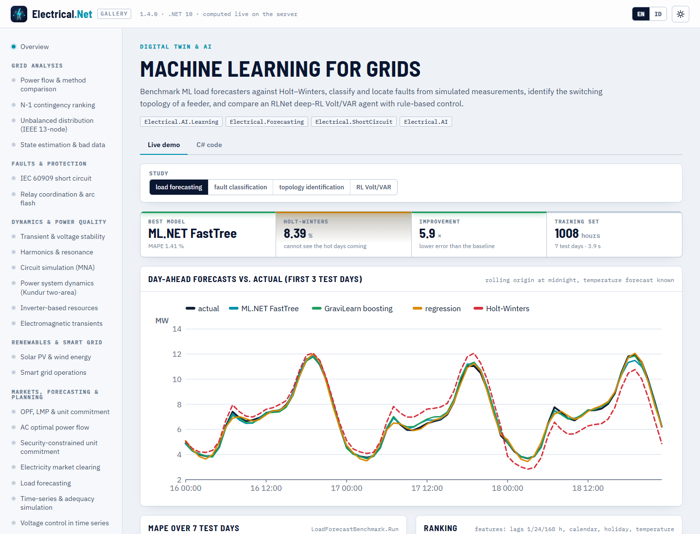

# Pembelajaran mesin untuk jaringan

> Dibuat oleh Gravicode Studios dipimpin oleh Kang Fadhil · [English](../en/machine-learning.md)

Paket: `Electrical.AI.Learning` (v1.4, bergantung pada Core, PowerFlow, Forecasting, ShortCircuit, dan AI). Paket ini membawa model
terlatih ke masalah yang datanya disediakan oleh modul berbasis fisika:

| Tugas | Model | Data |
|---|---|---|
| Peramalan beban | Gradient boosting GraviLearn, FastTree ML.NET (regresi) | lag, kalender, hari libur, suhu |
| Klasifikasi dan lokasi gangguan | Random forest (GraviLearn) atau FastTree ML.NET (multikelas) | simulasi hubung singkat IEC 60909 dengan derau |
| Identifikasi topologi | Random forest + acuan korelasi | snapshot tegangan setiap konfigurasi radial |
| Kendali Volt/VAR | DQN / PPO / A2C Gravicode.RLNet | `VoltVarEnvironment` dari [Electrical.AI](ai-digital-twin.md) |

Pustaka: GravicodeScience **GraviLearn 2.0.0** (ensambel pohon, disimpan sebagai JSON), **ML.NET 6.0.0** dengan FastTree (disimpan sebagai
`.zip` ML.NET), dan **Gravicode.RLNet 0.3.0** (checkpoint). Setiap generator dan pelatih memakai seed, sehingga hasil berulang antar
eksekusi. Paket ini tidak kompatibel AOT (ML.NET memakai reflection); jangan sertakan dalam aplikasi trimmed/AOT.

## Peramalan beban

`LoadFeatureBuilder` mengubah deret beban (dan opsional suhu) menjadi baris berisi beban tertunda (bawaan 1, 24, dan 168 jam), fitur
kalender (harmonik harian dan setengah harian dari jam, hari dalam pekan sebagai sinus/kosinus, akhir pekan, hari libur), serta suhu
dengan derajat pendinginan/pemanasan dan suhu sehari sebelumnya. `MlLoadForecaster` melatih satu regresor dan meramal secara rekursif,
memasukkan prediksinya sendiri sebagai lag. `LoadForecastBenchmark` membandingkan model ML dengan acuan Holt–Winters musim ganda dan,
bila ada suhu, `RegressionForecaster` linear dari `Electrical.Forecasting`, pada uji sehari ke depan yang bergulir.

```csharp
var bench = LoadForecastBenchmark.Run(load, temperature, new LoadForecastBenchmarkOptions { TestDays = 7 });
foreach (var (model, mape) in bench.Mape.OrderBy(kv => kv.Value)) Console.WriteLine($"{model,-30} {mape:0.00} %");

var forecaster = MlLoadForecaster.Train(load, temperature, new MlLoadForecastOptions
{
    Features = new LoadFeatureOptions { Lags = [1, 24, 168], Holidays = [new DateOnly(2026, 1, 1)] },
    Model = new RegressionTrainingOptions { Algorithm = RegressionAlgorithm.GradientBoosting, Trees = 150 },
});
var dayAhead = forecaster.Forecast(load, horizon: 24, temperature);   // recursive, uses the temperature forecast
forecaster.Model.Save("load-gb.json");                                 // tree ensembles as JSON, ML.NET models as .zip
```

Pada profil rumah tangga yang puncaknya naik 3 % per °C di atas 24 °C (49 hari, 7 hari uji, suhu diketahui sebagai ramalan sempurna):

| Model | MAPE |
|---|---|
| FastTree ML.NET | 1,41 % |
| Gradient boosting GraviLearn | 1,43 % |
| Regresi linear (kalender + cuaca) | 2,45 % |
| Holt–Winters (musim harian + mingguan) | 8,39 % |

Holt–Winters hanya dapat mengekstrapolasi musim; ia tidak dapat melihat hari panas yang akan datang. `ModelTrainer.LoadRegressor(path)`
memuat ulang kedua format.

## Klasifikasi dan lokasi gangguan

`FaultDatasetGenerator` menyimulasikan gangguan IEC 60909 dengan `Electrical.ShortCircuit`: gangguan di bus dan pada 25/50/75 % saluran
(saluran dipecah di titik gangguan), kesepuluh kombinasi fasa (AG … ABC), resistansi gangguan hingga 5 Ω, dan derau pengukuran, yang
hanya teramati melalui beberapa tegangan bus terukur (magnitudo fasa) dan arus cabang (magnitudo fasa dan urutan nol). Klasifikasi
memprediksi kode fasa; model kedua memprediksi bus terdekat.

```csharp
var dataset = FaultDatasetGenerator.Generate(new FaultDatasetOptions { Samples = 1600 });   // Case33BW, IEC 60909
var (model, report) = FaultLearning.Train(dataset, new ClassificationTrainingOptions { Trees = 50 });
Console.WriteLine(report);   // code 100.0 %, type 100.0 %, location 53.0 % (±1 bus 95.0 %), …
var (code, type, busId) = model.Predict(dataset.Samples[0].Features);
model.Save("fault-model");

var case14 = FaultDatasetGenerator.Generate(FaultDatasetOptions.Case14() with { Samples = 700 });
var (mlnet, r14) = FaultLearning.Train(case14, new ClassificationTrainingOptions { Algorithm = ClassificationAlgorithm.MlNetFastTree });
```

| Kasus | Model | Kode fasa | Jenis gangguan | Bus terdekat | ±1 bus |
|---|---|---|---|---|---|
| Baran–Wu 33 bus, 7 pengukuran V + 5 I | random forest | 100 % | 100 % | 53 % | 95 % |
| IEEE 14 bus | FastTree ML.NET | 92 % | > 90 % | — | 85 % |

Lokasi tepat dibatasi oleh sedikitnya titik ukur pada penyulang radial yang panjang; bus yang bertetangga tampak hampir sama, karena itu
angka ±1 bus yang berguna.

## Identifikasi topologi

`ReconfigurableFeeders.Case33WithTies()` menambahkan lima saklar penghubung Baran & Wu; `Case33Configurations` memuat delapan keadaan
pensaklaran radial (termasuk kasus dasar, rugi 202,7 kW, dan konfigurasi rugi minimum, 139,5 kW). `TopologyIdentification` menyimulasikan
snapshot setiap konfigurasi pada beban 60–120 % dengan derau per beban dan mempelajari konfigurasi mana yang menghasilkan sekumpulan
tegangan terukur.

```csharp
var options = new TopologySnapshotOptions { SnapshotsPerConfiguration = 50 };
var snapshots = TopologyIdentification.GenerateSnapshots(options);   // 8 radial configurations of Case33 + 5 ties
var (classifier, correlation, report) = TopologyIdentification.Train(snapshots, options);
Console.WriteLine(report);   // classifier 100.0 %, correlation 100.0 % over 8 configurations
string config = classifier.Predict(snapshots[0].Features);
```

Random forest maupun acuan korelasi (kemiripan kosinus tanda jatuh tegangan ternormalisasi, yang hampir tidak bergantung pada tingkat
beban di penyulang radial) mencapai 100 % pada snapshot uji.

## Reinforcement learning untuk kendali Volt/VAR

`VoltVarRlEnvironment` membungkus tugas Volt/VAR dari `Electrical.AI` (pengubah tap dan bank kapasitor di penyulang 33 bus, 24 keputusan
per jam, imbalan = − rugi − pelanggaran tegangan − pensaklaran) sebagai lingkungan RLNet. `VoltVarAgentTrainer` melatih DQN, PPO, atau A2C
dan membandingkannya dengan kebijakan tetap.

```csharp
var cmp = VoltVarAgentTrainer.Compare(options: new VoltVarRlOptions { Algorithm = VoltVarRlAlgorithm.Dqn, Steps = 6_000 });
Console.WriteLine(cmp);      // do-nothing -56.40, voltage rule -25.20, tabular Q -36.51, Dueling DQN -14.49 (trained in 3.4 s)

var ppo = VoltVarAgentTrainer.Train(options: VoltVarRlOptions.Long(VoltVarRlAlgorithm.Ppo));   // 48 000 steps
var episode = ppo.Evaluate();
Console.WriteLine($"{episode.TotalReward:0.0}, {episode.EnergyLossesKwh:0} kWh, {episode.ViolationBusHours} violation bus-hours");
ppo.Save("voltvar-ppo.rlnet");

var services = new ServiceCollection().AddElectrical(b => b.AddLearning());   // ILearningService
```

| Kebijakan | Imbalan episode (makin tinggi makin baik) |
|---|---|
| Tanpa aksi | −56,4 |
| Q-learning tabular (400 episode, seed 1) | −36,5 |
| Aturan tegangan | −25,2 |
| DQN RLNet, 6 000 langkah (≈ 4 s) | −14,5 |
| DQN / PPO RLNet, 48 000 langkah | −13,8 |

## Baris perintah dan galeri

```
$ eln learn forecast
Day-ahead load forecast benchmark (temperature-driven residential load, 7 test days), MAPE:
  ML.NET FastTree                  1.41 %
  GraviLearn gradient boosting     1.43 %
  Regression                       2.45 %
  Holt-Winters                     8.39 %
$ eln learn faults
Fault classification / location on case33bw (random forest): code 100.0 %, type 100.0 %, location 53.0 % (±1 bus 95.0 %), train 1200, test 400
$ eln learn topology
Topology identification on case33bw with 5 tie switches: classifier 100.0 %, correlation 100.0 % over 8 configurations (280 train / 120 test)
$ eln learn voltvar
Volt/VAR control on case33bw, average reward (higher is better): do-nothing -56.40, voltage rule -25.20, tabular Q -36.51, Dueling DQN -14.49 (trained in 3.4 s)
```

Demo galeri **Pembelajaran mesin untuk jaringan** menampilkan keempat studi (ramalan terhadap kurva aktual dengan batang MAPE, matriks
kebingungan gangguan dan histogram galat lokasi, akurasi topologi per konfigurasi, perbandingan imbalan RL dan aksi agen). Setiap studi
dilatih sekali per proses dengan anggaran kecil; aplikasi web memulai pelatihan di latar belakang saat dijalankan.



## Batasan

Dataset bersifat sintetis (disimulasikan dari model jaringan); penerapan nyata memerlukan data terukur dan pelatihan ulang. Ensambel pohon
buruk dalam mengekstrapolasi di luar rentang pelatihan (misalnya suhu rekor). Agen RL mempelajari satu penyulang dan satu bentuk beban;
latih ulang bila salah satunya berubah. Tanpa pelatihan GPU; model kecil dan dilatih dalam hitungan detik di CPU.

---
*Dibuat oleh Gravicode Studios dipimpin oleh Kang Fadhil · [English](../en/machine-learning.md)*
