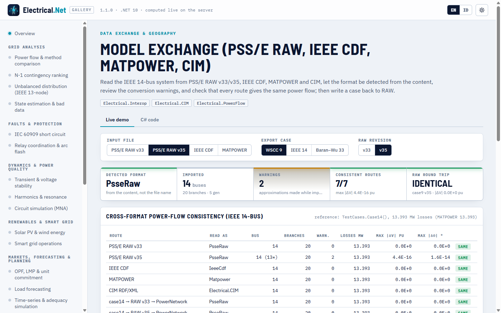

# Pertukaran model (PSS/E RAW, IEEE CDF, MATPOWER, CIM)

> Dibuat oleh Gravicode Studios dipimpin oleh Kang Fadhil · [English](../en/interop.md)

Paket: `Electrical.Interop` (baru di v1.1, bergantung pada `Electrical.Core`). Paket ini membaca dan menulis format yang dipertukarkan oleh
perangkat perencanaan transmisi dan mengubahnya menjadi `PowerNetwork` bus-cabang yang dipakai semua solver. I/O MATPOWER tetap di
`Electrical.Core` (`Matpower`), CIM di [`Electrical.CIM`](scada-iec61850-cim.md#cim--cgmes), dan penyulang OpenDSS di
[`Electrical.Distribution`](distribusi.md#skrip-opendss).

| Format | Baca | Tulis | Tipe |
|---|---|---|---|
| PSS/E RAW revisi 33, 34, 35 (32 dan lebih lama dibaca dengan tata letak v33) | `PsseRaw.Read/Parse/Load` | `PsseRaw.Write/Save(net, 33 \| 35)` | `NetworkFormat.PsseRaw` |
| IEEE Common Data Format (gaya `ieee14cdf.txt`) | `IeeeCdf.Read/Parse` | — | `NetworkFormat.IeeeCdf` |
| MATPOWER `.m` (versi 2) | `Matpower.Parse` (Core) | `Matpower.Write` | `NetworkFormat.Matpower` |
| JSON jaringan Electrical.Cloud | `NetworkFormats.ParseCloudJson` | `NetworkJson.Serialize` (Cloud) | `NetworkFormat.CloudJson` |
| CIM / CGMES RDF/XML | `CimImporter` (CIM) | `CimExporter` | (Electrical.CIM) |

## Deteksi format dan pemuatan

`NetworkFormats.Detect` memeriksa isi, bukan nama berkas: `mpc.bus` berarti MATPOWER, `BUS DATA FOLLOWS` berarti IEEE CDF, rekaman pertama
`IC, SBASE, REV, …` dengan REV antara 20 dan 40 (atau penanda `END OF BUS DATA`) berarti PSS/E RAW, dan `{"buses": …}` berarti kontrak JSON
Cloud. `NetworkFormats.Load(path)` baru memakai ekstensi (`.m`, `.raw`, `.cdf`/`.txt`, `.json`) bila isinya meragukan. Setiap pembaca
mengembalikan `ImportResult(Network, Format, Warnings)`; daftar peringatan memuat setiap pendekatan yang diambil saat memetakan berkas ke model.

```csharp
using Electrical.Interop;
using Electrical.PowerFlow;

var import = NetworkFormats.Load("ieee14_v35.raw");          // deteksi berbasis isi; ekstensi hanya penentu bila ragu
Console.WriteLine($"{import.Format}: {import.Network.BusCount} buses, {import.Network.Branches.Count} branches");
foreach (var w in import.Warnings) Console.WriteLine($"warning: {w}");
var pf = PowerFlowSolver.Solve(import.Network);
Console.WriteLine($"losses {pf.LossesMw:0.000} MW");

NetworkFormat f = NetworkFormats.Detect(InteropSamples.Ieee14Cdf);   // IeeeCdf
var cdf = NetworkFormats.Parse(InteropSamples.Ieee14Cdf);            // sama dengan IeeeCdf.Read(...)
```

Keluaran:

```
PsseRaw: 14 buses, 20 branches
warning: Three-winding transformer 4-9-8 converted to a star equivalent with internal bus 15.
warning: Switched shunt at bus 9 modelled as a fixed shunt at its current value 19 Mvar.
losses 13.393 MW
```

`InteropSamples` menyertakan sistem IEEE 14 bus sebagai `Ieee14RawV33` (trafo dua belitan, seperti MATPOWER), `Ieee14RawV35` (trafo 4-7-8-9
sebagai unit tiga belitan sungguhan, shunt terswitch di bus 9, baris header `@!`, dan nama berkutip yang memuat koma dan garis miring) serta
`Ieee14Cdf`. Ketiganya menghasilkan titik operasi MATPOWER case14 (rugi 13,393 MW); berguna sebagai data uji dan contoh format.

## PSS/E RAW

```csharp
var raw = PsseRaw.Read(InteropSamples.Ieee14RawV33);          // teks, atau path berkas yang ada
PowerNetwork net = PsseRaw.Parse(InteropSamples.Ieee14RawV35, warnings: new List<string>());

var notes = new List<string>();
string v35 = PsseRaw.Write(TestCases.Case9(), version: 35, notes);
PsseRaw.Save(TestCases.Case14(), "case14_v33.raw", version: 33);
var back = PsseRaw.Read(v35).Network;                         // aliran daya sama dengan case9
```

**Membaca.** Identifikasi kasus (SBASE [MVA], BASFRQ [Hz]); bus; beban, dengan bagian P / I / Y konstan dipetakan ke `ZipModel`; shunt tetap
(ke G<sub>s</sub>/B<sub>s</sub> bus); generator; cabang non-trafo, dengan shunt saluran GI/BI/GJ/BJ ditambahkan ke shunt bus; perangkat
pensaklaran sistem v35 (cabang impedansi rendah); trafo dua belitan dengan semua kode tegangan belitan (CW = 1/2/3), impedansi (CZ = 1/2/3)
dan magnetisasi (CM = 1/2), WINDV/NOMV, ANG, dan RATA; trafo tiga belitan diubah menjadi ekuivalen bintang dengan bus internal, seperti
`psse2mpc` milik MATPOWER. Shunt terswitch dibekukan pada nilai awal BINIT. Area, zona, pemilik, dan bagian lain diurai lalu dilewati. Data
pada bagian perangkat yang tidak didukung (DC dua terminal dan VSC, DC multi-terminal, FACTS, GNE, mesin induksi) menghasilkan peringatan.
Pada berkas v35, baris header `@!` menentukan letak field menurut nama, sehingga kolom yang diurutkan ulang atau tambahan tetap terbaca
benar. String berkutip boleh memuat spasi, koma, dan garis miring.

**Menulis.** `Write` menghasilkan berkas yang diterima PSS/E maupun `Read`: shunt bus sebagai shunt tetap, beban dengan pembagian ZIP-nya
sebagai PL/IP/YP, dan setiap trafo sebagai rekaman dua belitan CW = CZ = CM = 1 (WINDV1 = tap, ANG1 = geser fasa). Suseptansi charging pada
trafo ditulis sebagai suseptansi magnetisasi MAG2, disertai peringatan. Keluarannya deterministik, sehingga `Write(Read(Write(net)))`
menghasilkan teks yang sama.

Peringatan yang mungkin muncul: change case (IC = 1) dibaca sebagai kasus lengkap, revisi yang tidak didukung, rekaman yang merujuk bus tak
dikenal, bus duplikat, beban dengan pembagian ZIP berbeda untuk P dan Q, regulasi tegangan jarak jauh (IREG), perangkat pensaklaran, shunt
terswitch, admitansi magnetisasi, dan konversi tiga belitan.

## IEEE Common Data Format

```csharp
var c = IeeeCdf.Read(InteropSamples.Ieee14Cdf);               // atau path ke ieee14cdf.txt / ieee118cdf.txt
Console.WriteLine($"{c.Format}: {c.Network.Name}, {c.Network.BusCount} buses");
```

Pembaca mengikuti format kelompok kerja IEEE 1973: basis MVA dan nama kasus dari kartu judul; kartu bus (tipe 0/1 = PQ, 2 = PV, 3 = swing,
tegangan dan sudut akhir, beban dan pembangkitan, kV dasar, tegangan yang diinginkan, batas Q, shunt G/B); kartu cabang (tipe 0 = saluran,
1–4 = trafo, R/X/B, rating, rasio lilitan akhir, dan sudut fasa). Kolom tetap dipakai bila kartu cukup panjang, selain itu field dipisahkan
spasi, sehingga berkas yang disunting tangan tetap termuat. Bagian loss zone, interchange, dan tie line dilewati. Data trafo pengatur dan
kendali jarak jauh dibekukan pada nilai akhirnya, disertai peringatan.

## Dependency injection

```csharp
var services = new ServiceCollection();
services.AddElectrical(b => b.AddInterop());
var importer = services.BuildServiceProvider().GetRequiredService<INetworkImporter>();
var r = importer.Parse(InteropSamples.Ieee14RawV33);
string text = importer.WriteRaw(r.Network, version: 35);
```

`INetworkImporter` menyediakan `Load`, `Parse`, `Detect`, dan `WriteRaw`.

## CLI

`--file` menerima `.raw` dan `.cdf` (format apa pun yang dikenali `NetworkFormats`) di setiap perintah yang memerlukan jaringan, dan `convert`
menulis RAW:

```
$ eln pf --file ieee14_v35.raw
warning: Three-winding transformer 4-9-8 converted to a star equivalent with internal bus 15.
warning: Switched shunt at bus 9 modelled as a fixed shunt at its current value 19 Mvar.
IEEE 14 BUS TEST CASE (RAW V35): 14 buses, 20 branches, 5 generators, 11 loads (base 100 MVA)
NewtonRaphson: converged in 3 it, mismatch 3.44E-009, gen 272.393 MW, load 259 MW, losses 13.393 MW, Vmin 1.0100 pu @ bus 3

$ eln pf --file ieee14.cdf
IEEE 14 Bus Test Case: 14 buses, 20 branches, 5 generators, 11 loads (base 100 MVA)
NewtonRaphson: converged in 3 it, mismatch 3.44E-009, gen 272.393 MW, load 259 MW, losses 13.393 MW, Vmin 1.0100 pu @ bus 3

$ eln convert --case case9 --out case9.raw --version 35
Saved case9.raw
```

## Validasi

| Pemeriksaan | Acuan | Hasil |
|---|---|---|
| IEEE 14 bus dari RAW v33, RAW v35 (trafo tiga belitan, shunt terswitch), CDF | MATPOWER case14: rugi 13,393 MW | 13,393 MW; semua tegangan bus bersama dalam 1e-9 pu |
| `PsseRaw.Write` → `Read` untuk case9, case14, case33bw (v33 dan v35) | Jaringan asli | aliran daya identik |
| Jalur lintas format MATPOWER → CIM → model | case14 | identik (tabel galeri) |

## Galeri

Demo **Pertukaran model** (`interop`) membaca sistem IEEE 14 bus melalui setiap jalur (RAW v33, RAW v35, CDF, MATPOWER, CIM, dan dua
bolak-balik RAW), menampilkan format terdeteksi, peringatan, dan listing RAW v33/v35, lalu membandingkan hasil aliran daya dalam satu tabel.



## Batasan

- Bagian HVDC, FACTS, GNE, dan mesin induksi diabaikan (dengan peringatan); shunt terswitch dan trafo pengatur dibekukan pada nilai saat
  ini; regulasi tegangan jarak jauh tidak dimodelkan.
- Penulis hanya menghasilkan trafo dua belitan (ekuivalen bintang tetap menjadi tiga cabang dan satu bus internal).
- IEEE CDF hanya dapat dibaca. CIM melalui `Electrical.CIM`, dan skrip distribusi OpenDSS melalui `Electrical.Distribution`.

---
*Dibuat oleh Gravicode Studios dipimpin oleh Kang Fadhil · [English](../en/interop.md)*
