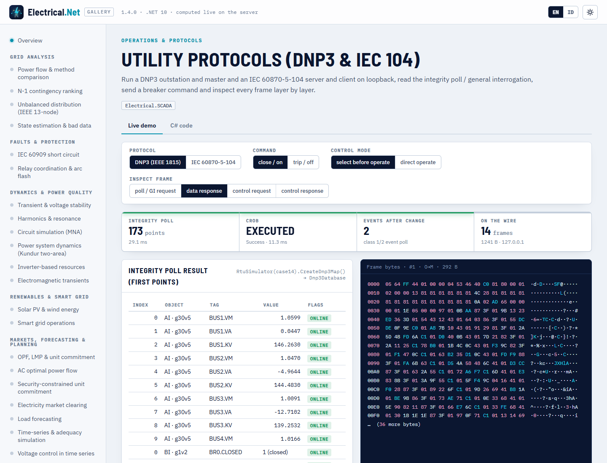

# Protokol utilitas: DNP3 dan IEC 60870-5-104

> Dibuat oleh Gravicode Studios dipimpin oleh Kang Fadhil · [English](../en/protocols.md)

Paket: `Electrical.SCADA` (namespace `Electrical.SCADA.Dnp3` dan `Electrical.SCADA.Iec104`, v1.4). Kedua protokol telekontrol berjalan di
atas TCP dengan implementasi lengkap stasiun terkendali (outstation / server) dan stasiun pengendali (master / klien), dan keduanya
terhubung ke `TagDatabase` yang sama dengan Modbus, alarm, dan historian (lihat [SCADA, IEC 61850 & CIM](scada-iec61850-cim.md)).
`RtuSimulator` menyajikan hasil aliran daya melalui protokol mana pun, sehingga bangku uji SCADA ujung ke ujung cukup beberapa baris kode.

## DNP3 (IEEE 1815-2012)

| Lapisan | Yang diimplementasikan |
|---|---|
| Data link | Frame 0x0564, LEN, kontrol DIR/PRM/FCB/FCV, alamat 16 bit, CRC-16/DNP per blok 16 oktet (`Dnp3Crc`, nilai uji 0xEA82); unconfirmed user data, reset/test link, link status |
| Transport | Segmentasi dan perakitan FIR/FIN/SEQ (`Dnp3Transport`, `Dnp3TransportReassembler`) |
| Aplikasi | Oktet kontrol (FIR/FIN/CON/UNS/SEQ), IIN, qualifier 0x00/01/06/07/08/17/28, respons multi-fragmen dengan konfirmasi |
| Objek | g1v1/2 input biner, g2v1/2 event, g10 status output biner, g12v1 CROB, g30v1/2/5 input analog, g32v1/3/5/7 event, g40 status output analog, g41v1–3 output analog, g50v1 waktu, g52v2 delay, g60 data kelas, g80v1 IIN |
| Fungsi | READ (kelas 0–3 dan rentang), WRITE (waktu, bit restart IIN), SELECT / OPERATE / DIRECT_OPERATE (/NR), ENABLE / DISABLE_UNSOLICITED, DELAY_MEASURE, CONFIRM, respons unsolicited |

### Outstation

```csharp
var rtu = new RtuSimulator(PowerFlowSolver.Solve(TestCases.Case14()));
var tags = new TagDatabase();
rtu.UpdateTags(tags);                                      // BUSn.VM, BRk.PF, BRk.CLOSED, …

var map = rtu.CreateDnp3Map(analogDeadband: 0.001);        // analogs → AI 0…, breaker states → BI k
var db = map.CreateDatabase(tags);
db.AddBinaryOutput(0);                                     // a breaker control point for CROBs
using var link = map.Attach(tags, db);                     // tag changes → DNP3 events (class 1/2)

await using var outstation = new Dnp3Outstation(db, new Dnp3OutstationOptions { LocalAddress = 1024 }, IPAddress.Any, 20000);
outstation.Commanded += c => Console.WriteLine($"{c.Type} {c.Index}: {c.Crob?.OpType} → {c.Status}");
outstation.Start();
```

`Dnp3Database` menyimpan titik dan buffer event per kelas; perubahan melewati deadband titik membuat event yang tetap tersimpan sampai
master mengonfirmasi respons yang membawanya. `Dnp3OutstationOptions` memilih variasi statis dan event (bawaan g1v2, g30v5, g2v2, g32v7),
ukuran fragmen maksimum, batas waktu select, pelaporan unsolicited, dan IIN `NeedTime` saat mulai; handler perintah
(`BinaryCommandHandler`, `AnalogCommandHandler`) menentukan status setiap kendali.

### Master

```csharp
await using var master = new Dnp3Master(localAddress: 1, outstationAddress: 1024);
await master.ConnectAsync("127.0.0.1", 20000);

var poll = await master.IntegrityPollAsync();              // READ class 1, 2, 3, 0
Console.WriteLine($"{poll.Measurements.AnalogInputs.Count} AI, {poll.Measurements.BinaryInputs.Count} BI, IIN {poll.Iin}");
await master.ClearRestartAsync();

var status = await master.OperateBinaryAsync(0, Crob.LatchOn(), selectBeforeOperate: true);   // SELECT + OPERATE
var events = await master.EventPollAsync();                 // class 1–3 events, confirmed automatically
foreach (var e in events.Measurements.Events) Console.WriteLine($"{e.Type} {e.Index} = {e.Value} @ {e.Time:O}");

await master.WriteTimeAsync(DateTimeOffset.UtcNow);
await master.EnableUnsolicitedAsync();
master.UnsolicitedReceived += r => Console.WriteLine($"unsolicited: {r.Measurements.Events.Count} events");
```

OPERATE tanpa SELECT yang cocok (objek sama, dalam batas waktu) mengembalikan `NO_SELECT`; titik yang tidak dikenal mengembalikan
`NOT_SUPPORTED`. `master.Values` mengumpulkan nilai terakhir setiap titik; `map.ApplyTo(tags, master.Values)` menuliskannya kembali ke
basis data tag di sisi master.

## IEC 60870-5-104

| Bagian | Yang diimplementasikan |
|---|---|
| APCI | Format I/S/U, STARTDT / STOPDT / TESTFR act/con, nomor urut kirim dan terima dengan pemeriksaan (N(S) yang salah menutup koneksi) |
| Kendali aliran | Jendela k (I-frame belum dikonfirmasi maks., bawaan 12) dan w (konfirmasi setelah w, bawaan 8) |
| Timer | t0 koneksi, t1 konfirmasi kirim/uji, t2 konfirmasi tanpa data, t3 frame uji saat diam |
| Tipe ASDU | M_SP_NA/TB, M_DP_NA/TB, M_ME_NA/NB/NC (ternormalisasi, berskala, float) dan versi bercap waktu TD/TE/TF, M_EI_NA, C_SC_NA, C_DC_NA, C_SE_NC, C_IC_NA, C_CS_NA |
| Layanan | Interogasi umum dan grup (QOI 20–36), sinkronisasi jam, perintah select-before-operate dan langsung dengan ACTCON / ACTTERM, pelaporan spontan (COT 3) |

```csharp
var rtu = new RtuSimulator(pf);
var tags = new TagDatabase();
rtu.UpdateTags(tags);
var points = rtu.CreateIec104Map();                         // M_ME_NC_1 at IOA 1000+, M_SP_NA_1 at IOA 1+
tags.Add("CB1.CMD");
points.Add(5001, "CB1.CMD", TypeId.C_SC_NA_1, selectBeforeOperate: true);

await using var server = new Iec104Server(tags, points, new Iec104ServerOptions { CommonAddress = 1 }, IPAddress.Any, 2404);
server.Start();

await using var client = new Iec104Client(new Iec104Parameters { K = 12, W = 8 });
await client.ConnectAsync("127.0.0.1", 2404);
await client.StartDataTransferAsync();                      // STARTDT act / con
var gi = await client.GeneralInterrogationAsync();          // C_IC_NA_1, QOI 20
foreach (var (type, io) in gi.Take(3)) Console.WriteLine($"{type} IOA {io.Address}: {io.Value}");

var cmd = await client.SingleCommandAsync(5001, true, selectBeforeOperate: true);   // select, then execute
Console.WriteLine($"confirmed {cmd.Confirmed}, terminated {cmd.Terminated}");
await client.ClockSyncAsync(DateTimeOffset.UtcNow);
client.AsduReceived += a => Console.WriteLine($"{a.Type} {a.Cause}");               // spontaneous data (COT 3)
```

`Iec104PointMap` mengikat IOA ke tag dengan tipe, skala penuh untuk nilai ternormalisasi, grup interogasi, dan flag select-before-operate
untuk titik perintah. Perubahan tag menjadi ASDU spontan; perintah menulis tag perintah (dan server memicu `Commanded`).
`client.ApplyTo(tags, map)` mencerminkan nilai yang diterima ke basis data tag.

## Codec dan vektor acuan

```csharp
Console.WriteLine($"{Dnp3Crc.Compute("123456789"u8):X4}");                          // EA82 (CRC-16/DNP)
var reset = new Dnp3LinkFrame(true, true, (byte)LinkFunction.ResetLinkStates, 1, 1024, []);
Console.WriteLine(Convert.ToHexString(reset.Encode()));                             // 056405C001000004E921

var gi = new Asdu(TypeId.C_IC_NA_1, CauseOfTransmission.Activation, 1, [new InformationObject(0, 20)]);
Console.WriteLine(Convert.ToHexString(Iec104Codec.Encode(Apdu.I(0, 0, gi))));     // 680E0000000064010600010000000014
```

| Pemeriksaan | Acuan | Hasil |
|---|---|---|
| CRC-16/DNP dari "123456789" | Katalog CRC | 0xEA82 |
| RESET_LINK_STATES, master 1024 → outstation 1 | Contoh IEEE 1815 / opendnp3 | `05 64 05 C0 01 00 00 04 E9 21` |
| Permintaan poll integritas (kelas 1, 2, 3, 0), seq 3 | Header objek IEEE 1815 | `C3 01 3C 02 06 3C 03 06 3C 04 06 3C 01 06` |
| APDU interogasi umum | IEC 60870-5-104 | `68 0E 00 00 00 00 64 01 06 00 01 00 00 00 00 14` |
| Ternormalisasi −0,5, perintah ganda OFF QU = 3 | IEC 60870-5-101 | NVA `00 C0`, DCO `0D` |
| 300 analog, fragmen ≤ 249 oktet | konfirmasi multi-fragmen | ≥ 6 fragmen, ke-300 nilai |

Tiga belas uji loopback mencakup poll, event dengan konfirmasi, operasi SBO/langsung dan penolakannya, respons unsolicited,
sinkronisasi waktu, jendela k/w, timer t2/t3, dan jembatan RTU.

## Dependency injection

```csharp
var sp = new ServiceCollection()
    .AddElectrical(b => b.AddDnp3(new Dnp3OutstationOptions { LocalAddress = 10 }).AddIec104(new Iec104ServerOptions { CommonAddress = 7 }))
    .BuildServiceProvider();
var dnp3Points = sp.GetRequiredService<Dnp3PointMap>();     // shared TagDatabase, Dnp3Database, Iec104PointMap
```

## Baris perintah dan galeri

```
$ eln dnp3
DNP3 outstation (RTU for case14) on 127.0.0.1:63036: integrity poll → 152 analog inputs, 20 binary inputs, 2 fragment(s), IIN DeviceRestart
  AI    0: 1.0599
  AI    1: 0.0447
  AI    2: 146.2630
  …
$ eln iec104
IEC 60870-5-104 server (RTU for case14) on 127.0.0.1:63038: general interrogation → 172 information objects
  M_ME_NC_1    IOA   1000: 1.0599 (Good)
  M_ME_NC_1    IOA   1001: 0.0447 (Good)
  …
```

Demo galeri **Protokol utilitas (DNP3 & IEC 104)** menjalankan kedua pasangan di dalam proses melalui tap loopback yang merekam setiap
frame: hasil poll / interogasi, CROB atau perintah tunggal (SBO atau langsung), tabel sesi, dan byte frame terpilih beserta lapisan link,
transport, dan aplikasi (atau APCI dan ASDU) yang terdekode.



## Batasan

Tanpa DNP3 Secure Authentication (SAv5/SAv6), transfer berkas, counter (g20–g23), octet string, atau data set; tanpa lapisan link serial
(RS-232/485) atau IEC 60870-5-101; IEC 104 tanpa TLS (IEC 62351-3) dan tanpa grup redundansi. Gunakan firewall atau VPN bila membuka
server mana pun di luar jaringan uji.

---
*Dibuat oleh Gravicode Studios dipimpin oleh Kang Fadhil · [English](../en/protocols.md)*
