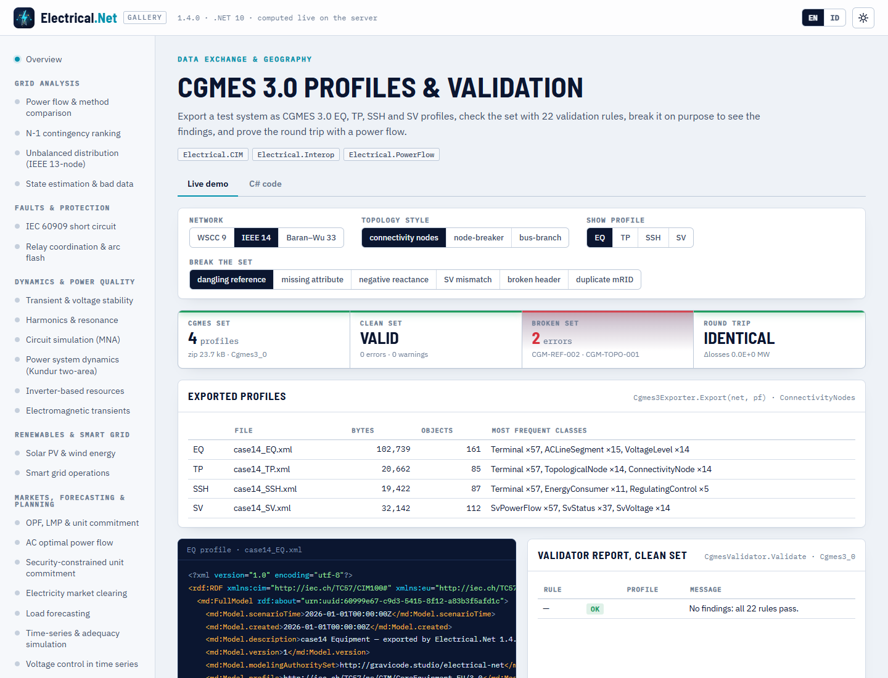

# SCADA, IEC 61850, dan CIM

> Dibuat oleh Gravicode Studios dipimpin oleh Kang Fadhil · [English](../en/scada-iec61850-cim.md)

Paket: `Electrical.SCADA` (namespace `Electrical.SCADA`, `Electrical.SCADA.Modbus`, `Electrical.SCADA.Dnp3`, `Electrical.SCADA.Iec104`),
`Electrical.IEC61850`, dan `Electrical.CIM`. DNP3 serta klien/server IEC 104 memiliki panduan tersendiri: [Protokol utilitas](protokol.md).

## SCADA

### Modbus TCP dan simulator RTU

`ModbusRegisterMap` menyimpan coil, discrete input, holding register, dan input register (dengan helper `SetFloat`/`GetFloat` dan event
`Written`). `ModbusTcpServer` melayani sebuah map; `ModbusTcpClient` membaca dan menulisnya (kode fungsi 1, 2, 3, 4, 5, 6, 15, 16; permintaan
bersamaan pada satu koneksi diserialkan dan dicocokkan dengan transaction id; exception Modbus dilempar sebagai `ModbusException`).
`RtuSimulator` memublikasikan hasil aliran daya sebagai input register Float32 dengan derau pengukuran ber-seed.

```csharp
var pf = PowerFlowSolver.Solve(TestCases.Case14());
var rtu = new RtuSimulator(pf);                                 // BUSn.VM/VA/KV, BRk.PF/QF/PT/QT/LOAD, GENg.P/Q, BRk.CLOSED
await using var server = new ModbusTcpServer(rtu.Map, IPAddress.Loopback, port: 1502);
server.Start();

await using var client = new ModbusTcpClient();
await client.ConnectAsync("127.0.0.1", 1502);
float vm14 = await client.ReadFloatAsync(ModbusTable.InputRegister, rtu.BusAddress(pf.Network.IndexOf(14)));
ushort[] regs = await client.ReadHoldingRegistersAsync(0, 10);

var tags = new TagDatabase();
rtu.RegisterTags(tags);
int scanned = await tags.ScanAsync(client);
Console.WriteLine(tags["BUS14.VM"]);
```

Tata letak register (`RtuOptions`): bus di `BusBaseAddress + 6·i` (VM, VA, KV sebagai pasangan Float32), cabang di `BranchBaseAddress + 10·k`
(default 2000: PF, QF, PT, QT, LOAD), generator di `GeneratorBaseAddress + 4·g` (6000: P, Q), status pemutus sebagai discrete input/coil.
`Refresh()` menggambar ulang derau; `ResetNoise()` memulai ulang urutan deterministik. CLI: `eln rtu --case case14 --port 1502`.

`ModbusPdu` dan `ModbusTcpAdu` adalah codec tanpa state (diuji terhadap contoh Modbus Application Protocol v1.1b3).

### Tag, alarm, dan historian

```csharp
var tags = new TagDatabase();
var alarms = new AlarmManager();
var historian = new Historian(new HistorianTagOptions(CompressionMode.SwingingDoor, Deviation: 0.5));

tags.Add("LINE1.LOAD", "%");
alarms.Define(new AlarmDefinition("LINE1.LOAD", HighHigh: 120, High: 100, Deadband: 2, Priority: AlarmPriority.High));
using var a = alarms.Attach(tags);
using var h = historian.Attach(tags);
alarms.AlarmChanged += e => Console.WriteLine($"{e.Timestamp:T} {e.Tag} {e.State} {e.Limit} {e.Priority}: {e.Message}");

var t0 = DateTimeOffset.UtcNow;
tags.UpdateValue("LINE1.LOAD", 80, t0);
tags.UpdateValue("LINE1.LOAD", 125, t0.AddSeconds(1));    // → HH, prioritas naik menjadi Critical
alarms.Acknowledge("LINE1.LOAD", user: "operator1");
var trend = historian.Resample("LINE1.LOAD", t0, t0.AddMinutes(1), TimeSpan.FromSeconds(10));
```

- `Tag`: nilai mentah, nilai teknik lewat `TagScaling` (linear mentah → EU), `TagQuality` (nilai mentah di luar rentang ditandai), stempel waktu.
  `TagAddress` memetakan tag ke unit/tabel/alamat/tipe data Modbus (Bool, Int16, UInt16, Int32, UInt32, Float32). `Scan` (map in-process) dan
  `ScanAsync` (klien TCP) membaca semua tag yang beralamat. Perubahan memunculkan `TagValueChanged` di event bus.
- `AlarmManager` mengikuti model state ISA-18.2 (normal, belum diakui, diakui, kembali normal belum diakui, di-shelve), batas HH/H/L/LL dengan
  deadband, eskalasi prioritas untuk HH/LL, pengakuan beserta nama pengguna, shelving dengan kedaluwarsa; `AlarmEvent` dipublikasikan di bus.
- `Historian` menyimpan sampel per tag dengan kompresi `None`, `Deadband`, atau `SwingingDoor` (Bristol 1990; interpolasi tetap dalam deviasi),
  heartbeat `MaxInterval`, `Query`, `Interpolate`, `Resample` ke `TimeSeries`, dan `CompressionRatio`.
- DI: `AddScada(historianDefaults)` mendaftarkan `TagDatabase`, `AlarmManager`, dan `Historian` yang terhubung lewat `IGridEventBus`.

### IEC 60870-5-104

```csharp
var asdu = new Asdu(TypeId.M_ME_NC_1, CauseOfTransmission.Spontaneous, CommonAddress: 1,
    [new InformationObject(Address: 16385, Value: 1.5)]);
byte[] frame = Iec104Codec.Encode(Apdu.I(sendSequence: 2, receiveSequence: 1, asdu));
Apdu back = Iec104Codec.Decode(frame);
byte[] startDt = Iec104Codec.Encode(Apdu.U(UFunction.StartDtAct));
```

APDU format I, S, dan U, type id umum untuk pengukuran/perintah (single point, measured float dengan/tanpa CP56Time2a, single command),
stempel waktu `Cp56Time2a`, dan penghitung `Iec104Sequence`. Tes membandingkan frame kendali dan frame measured-float byte per byte. Sejak v1.4 paket
ini juga memiliki stasiun pengendali (`Iec104Client`) dan stasiun terkendali (`Iec104Server`) IEC 104 lengkap dengan STARTDT/STOPDT/TESTFR,
jendela k/w, timer t0–t3, interogasi umum, sinkronisasi jam, dan perintah select-before-operate, serta outstation dan master DNP3; lihat
[Protokol utilitas](protokol.md).

## IEC 61850

### SCL

```csharp
var scl = SclParser.Load("substation.scd");
foreach (var ied in scl.Ieds)
    foreach (var da in scl.DataModel(ied).Take(5))
        Console.WriteLine($"{da.Reference} [{da.BType}] = {da.Value}");
var r = ObjectReference.Parse("IED1LD0/XCBR1.Pos.stVal[ST]");
Console.WriteLine(LogicalNodeCatalog.Describe("XCBR", indonesian: true));
```

`SclDocument` menyediakan IED (access point, logical device, logical node, nilai DAI, dataset, control block GSE/SMV/report), bagian
komunikasi (subnetwork, connected AP, alamat GSE dengan MinTime/MaxTime), dan data type template (LNodeType, DOType, DAType, EnumType).
`DataModel(ied)` meratakan model menjadi `SclDataAttribute` dengan nilai instance yang menimpa default template. `LogicalNodeCatalog`
mendeskripsikan kelas LN umum dalam bahasa Inggris atau Indonesia (`Describe(lnClass, indonesian: true)`).

### GOOSE dan Sampled Values

```csharp
var state = new GoosePublisherState();
state.OnStateChange(DateTimeOffset.UtcNow);                       // stNum++, sqNum = 0
var pdu = state.CreatePdu("IED1CTRL/LLN0$GO$gcbTrip", "IED1CTRL/LLN0$dsTrip",
    [new MmsBoolean(true), MmsBitString.FromDoublePoint(DoublePoint.Off)]);
byte[] frame = GooseCodec.Encode(new GooseFrame { Pdu = pdu, AppId = 0x0001, Vlan = new VlanTag(4, 10) });
GooseFrame decoded = GooseCodec.Decode(frame);
var (intervalMs, tal) = state.NextRetransmission();               // 2, 4, 8 … ms hingga MaxTimeMs

var sv = SampledValuesCodec.Simulate("MU01", smpCnt: 0, samplesPerCycle: 80, iRmsA: 400, vRmsV: 66_395);
byte[] svFrame = SampledValuesCodec.Encode(new SvFrame { Asdus = [sv] });
```

- GOOSE: frame Ethernet lengkap (multicast 01-0C-CD-01-xx-xx, tag 802.1Q opsional, EtherType 0x88B8, APPID, panjang) dengan `goosePdu` ASN.1 BER;
  tipe data MMS (boolean, integer, float, double, string, waktu UTC, bit string termasuk double point dan quality, structure, array).
  `GooseRetransmission` menghasilkan jadwal 2 → 4 → 8 … → MaxTime dan time-allowed-to-live.
- Sampled Values: ASDU IEC 61850-9-2LE (4 arus resolusi 1 mA, 4 tegangan resolusi 10 mV, flag quality), `FromPhysical` dan helper `Simulate`
  tiga fasa; frame multi-ASDU.
- Encoder/decoder `Ber`, `MacAddress`, `VlanTag`, `EthernetFrame`.

Publikasi/langganan raw-socket dan klien/server MMS tidak disertakan; kirim dan tangkap frame dengan pustaka raw Ethernet / packet pilihan Anda.

## CIM / CGMES

```csharp
var net = TestCases.Case14();
string rdf = CimExporter.ExportString(net);                       // EQ + TP + SSH + SV digabung
var profiles = CimExporter.ExportProfiles(net);                   // empat dokumen gaya CGMES
profiles.Equipment.Save("case14_EQ.xml");

var back = CimImporter.Import(rdf);
var detailed = CimImporter.ImportDetailed(profiles.All, new CimImportOptions { BaseMva = 100 });
foreach (var w in detailed.Warnings) Console.WriteLine(w);
Console.WriteLine(PowerFlowSolver.Solve(back).LossesMw);          // 13,393 MW, identik dengan aslinya
```

Pemetaan: bus → ConnectivityNode (+ TopologicalNode, VoltageLevel, Substation, BaseVoltage, Location); saluran → ACLineSegment (r, x dalam Ω,
bch dalam S, panjang); trafo → PowerTransformer dengan dua PowerTransformerEnd (+ RatioTapChanger / PhaseTapChangerLinear); generator →
SynchronousMachine + GeneratingUnit + RegulatingControl (p/q SSH dalam konvensi tanda beban); beban → EnergyConsumer (+
LoadResponseCharacteristic untuk ZIP); shunt → LinearShuntCompensator; rating → OperationalLimitSet/ApparentPowerLimit.

Importer menerima dokumen EQ/TP/SSH/SV yang digabung atau terpisah, menggabungkan ConnectivityNode yang terhubung oleh saklar tertutup (Switch,
Breaker, Disconnector, LoadBreakSwitch, Fuse, Jumper) atau oleh TopologicalNode yang sama, dan mendukung ExternalNetworkInjection, beban
Conform/NonConform, serta SvVoltage. Atribut ekstensi `eln:` opsional (id/tipe bus, base MVA, biaya, inersia) membuat round trip tanpa
kehilangan; tanpa ekstensi, tipe bus diturunkan. Ekspor bersifat deterministik (`ScenarioTime` default 2026-01-01). CLI:
`eln convert --case case14 --out grid.xml`.

Tervalidasi: round trip case14 dan case9 menghasilkan aliran daya identik; case33bw tanpa ekstensi tetap menghasilkan rugi 202,7 kW; cabang
1-2 case14 diekspor dengan r = 3,6907 Ω dan bch = 2,77253e-4 S; pemrosesan topologi menggabungkan breaker tertutup dan memisahkan
disconnector terbuka.

### Profil dan validasi CGMES 3.0 (v1.4)

`Cgmes3Exporter` menulis set instans CGMES 3.0 (IEC 61970-600-1/-2 Ed.2, namespace CIM100): dokumen EQ, TP, SSH, dan SV terpisah,
masing-masing dengan header `md:FullModel` (URI profil, scenarioTime, created, modelingAuthoritySet, rantai DependentOn TP→EQ, SSH→EQ,
SV→TP+SSH). mRID berupa UUID v5 berbasis nama (RFC 4122 §4.3), sehingga jaringan yang sama selalu menghasilkan byte yang sama.
`CgmesTopologyStyle` memilih satu ConnectivityNode per bus (bawaan), node-breaker (setiap ujung cabang di simpul bay sendiri yang terhubung
ke busbar melalui Breaker tertutup), atau bus-branch (hanya TopologicalNode). Dengan hasil aliran daya, profil SV juga membawa SvPowerFlow
per terminal, SvStatus, SvTapStep, dan SvShuntCompensatorSections. `CgmesImporter` mendeteksi 2.4.15 (CIM16) atau 3.0 dan membaca tegangan
SV sebagai nilai awal; `CgmesDocumentSet` membaca dan menulis arsip zip (termasuk zip bersarang).

```csharp
var net = TestCases.Case14();
var pf = PowerFlowSolver.Solve(net);
var set = Cgmes3Exporter.Export(net, pf, new Cgmes3ExportOptions { Topology = CgmesTopologyStyle.NodeBreaker });
foreach (var (file, doc) in set.Files()) Console.WriteLine(file);   // case14_EQ.xml, _TP, _SSH, _SV
File.WriteAllBytes("case14.zip", set.ToZip());                    // reproducible archive
set.Save("case14-cgmes");                                         // or one XML file per profile

var report = CgmesValidator.Validate(set);
Console.WriteLine(report);                                        // CGMES Cgmes3_0: 0 error(s), 0 warning(s)
foreach (var issue in report.Issues) Console.WriteLine($"{issue.RuleId} {issue.Severity} {issue.Profile}: {issue.Message}");

var back = CgmesImporter.ImportZip(File.OpenRead("case14.zip"));  // 2.4.15 and 3.0 are detected
Console.WriteLine($"{back.Version}: {back.Network.BusCount} buses, {back.Warnings.Count} warnings");
```

`CgmesValidator` memeriksa set CGMES 2.4.15 atau 3.0 apa pun (juga dari perangkat lain) dengan semangat aturan QoCDC ENTSO-E dan batasan
SHACL CGMES; `CgmesValidationOptions` mengatur toleransi KCL (bawaan 0,01 MW/Mvar), toleransi ratedU (20 %), dan toleransi perbandingan
tegangan. Setiap temuan melaporkan id aturan, tingkat, profil, pesan, dan objek yang bermasalah.

| Aturan | Tingkat | Memeriksa |
|---|---|---|
| `CGM-HDR-001` | galat | Setiap dokumen memiliki tepat satu header model (md:FullModel atau dcat:Dataset). |
| `CGM-HDR-002` | galat | Header model memiliki Model.profile, Model.scenarioTime, Model.created, dan Model.modelingAuthoritySet. |
| `CGM-HDR-003` | galat | Setiap target Model.DependentOn adalah model dalam set. |
| `CGM-HDR-004` | galat | Semua model (kecuali boundary) memiliki Model.scenarioTime yang sama. |
| `CGM-HDR-005` | peringatan | Dependensi profil: TP dan SSH bergantung pada EQ, SV bergantung pada TP dan SSH. |
| `CGM-HDR-006` | galat | Set tidak mencampur versi CIM (CIM16 vs CIM100). |
| `CGM-ID-001` | galat | Nilai rdf:ID unik di seluruh set. |
| `CGM-ID-002` | galat | CGMES 3.0: IdentifiedObject.mRID ada dan sama dengan rdf:ID tanpa garis bawah di depan. |
| `CGM-REF-001` | galat | Setiap referensi rdf:resource menunjuk objek dalam set. |
| `CGM-REF-002` | galat | Terminal.ConductingEquipment ada dan menunjuk peralatan. |
| `CGM-REF-003` | galat | Terminal menunjuk ConnectivityNode (EQ) atau TopologicalNode (TP), dan simpulnya ada. |
| `CGM-REF-004` | galat | VoltageLevel.BaseVoltage ada dan menunjuk BaseVoltage. |
| `CGM-REF-005` | galat | Objek yang dijelaskan dengan rdf:about dideklarasikan (rdf:ID) di salah satu model. |
| `CGM-MAND-001` | galat | Atribut wajib ada dalam profilnya (EQ, TP, SSH, SV). |
| `CGM-TOPO-001` | galat | Jumlah terminal sesuai kelas peralatan (2 untuk saluran/sakelar, 1 untuk injeksi, sejumlah ujung untuk trafo). |
| `CGM-TOPO-002` | galat | Nomor urut terminal / nomor ujung trafo unik per peralatan, dan trafo memiliki 2 atau 3 ujung. |
| `CGM-VOLT-001` | galat | Kedua terminal ACLineSegment berada pada BaseVoltage-nya. |
| `CGM-VOLT-002` | peringatan | PowerTransformerEnd.ratedU berada dalam toleransi tegangan nominal ujungnya. |
| `CGM-PAR-001` | galat | Impedansi dan tegangan fisis (r, x, r0, x0 ≥ 0 untuk saluran; r ≥ 0 untuk ujung trafo; nominalVoltage, ratedU > 0). |
| `CGM-PAR-002` | peringatan | Saluran memiliki impedansi tak nol dan suseptansi pengisian tak negatif. |
| `CGM-SV-001` | galat | Aliran daya SV memenuhi hukum arus Kirchhoff di setiap TopologicalNode dalam toleransi. |
| `CGM-SV-002` | peringatan | Setiap TopologicalNode memiliki SvVoltage dengan v ≥ 0 bila model SV ada. |

Tervalidasi: round trip case9, case14, dan case33bw pada setiap gaya topologi, dengan dan tanpa ekstensi `eln:`, menghasilkan aliran daya
identik (Δrugi ≤ 5e-14 MW); setiap set yang diekspor bersama aliran daya lolos ke-22 aturan dengan toleransi KCL 1e-6 MW; satu sampel yang
dirusak manual per aturan memicu tepat aturan itu (42 uji). `NetworkFormats` di [Electrical.Interop](pertukaran-model.md) mendeteksi
dokumen dan zip CGMES. CLI: `eln cgmes --out case14.zip`, `eln cgmes --validate case14.zip`. Galeri: **Profil & validasi CGMES 3.0**.



---
*Dibuat oleh Gravicode Studios dipimpin oleh Kang Fadhil · [English](../en/scada-iec61850-cim.md)*
