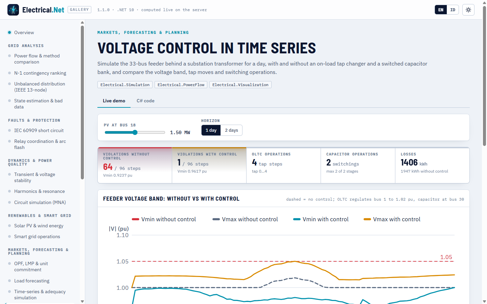

# Simulasi, HPC, dan kernel native

> Dibuat oleh Gravicode Studios dipimpin oleh Kang Fadhil · [English](../en/simulation-hpc-native.md)

Paket: `Electrical.Circuit`, `Electrical.Simulation`, `Electrical.HPC`, dan `Electrical.Native`.

## Simulasi rangkaian

`ElectricCircuit` menyelesaikan rangkaian terpusat dengan analisis nodal termodifikasi. Ground adalah node `"0"` (alias `"gnd"`); satuannya V, A, Ω,
F, H, s, Hz. Tanda arus mengikuti SPICE (sumber yang menyalurkan daya melaporkan arus negatif).

```csharp
var rc = new ElectricCircuit()
    .AddVoltageSource("V1", "in", "0", Waveform.Pulse(0, 1, delayS: 0, riseS: 1e-9))
    .AddResistor("R1", "in", "out", 1e3)
    .AddCapacitor("C1", "out", "0", 1e-6);
var tr = rc.Transient(stopTimeS: 5e-3, stepS: 1e-6);
double vTau = tr.At(tr.Voltage("out"), 1e-3);   // 0,632 V (τ = RC = 1 ms)

var rlc = Netlist.Parse("""
    * series RLC
    V1 in 0 AC 1
    R1 in a 10
    L1 a b 10m
    C1 b 0 1u
    """);
var ac = rlc.AcSweep(100, 100_000, pointsPerDecade: 50);
var bode = ac.Bode("b", "in");                  // resonansi pada 1591,5 Hz, Q = 10

var op = new ElectricCircuit().AddVoltageSource("V1", "a", "0", 10).AddResistor("R1", "a", "o", 1e3).AddResistor("R2", "o", "0", 3e3)
    .OperatingPoint();
Console.WriteLine(op.Voltage("o"));             // 7,5 V
```

- Analisis: `OperatingPoint` (iterasi Newton untuk dioda), `AcAnalysis(frequencies)` / `AcSweep` (`Bode`), `Transient(stop, step,
  IntegrationMethod.Trapezoidal | BackwardEuler, useInitialConditions)`.
- Elemen: R, L (dengan arus awal), C (tegangan awal), induktor terkopel (`AddCoupling`), sumber V/I (`Waveform.Dc/Sine/Pulse/PiecewiseLinear`,
  magnitudo/fasa AC), VCVS, VCCS, saklar yang dikendalikan waktu atau fungsi, dioda Shockley, trafo ideal.
- Netlist: subset SPICE (R, C, L, V, I, D, S, K, E, G, dan kartu `X` untuk trafo ideal, sufiks nilai SPICE, sambungan `+`).
- `ThreePhaseCircuits`: konversi bintang↔segitiga, tegangan line, daya seimbang, beban bintang tak seimbang (dengan impedansi netral dan
  pergeseran netral) dan beban segitiga.

## Deret waktu kuasi-statis (QSTS)

`QstsSimulation` menjalankan jaringan melalui profil beban dan PV dengan Newton–Raphson warm start, sambil menerapkan kejadian berwaktu.

```csharp
var qsts = QstsSimulation.Case33Demo(days: 1, pvMw: 1.5, pvBus: 18);
qsts.Events.Add(new SimulationEvent(TimeSpan.FromHours(18), SimulationEventKind.ShuntSet, Index: 30, Value: 0.6, Description: "Cap 600 kvar on"));
var r = qsts.Run();
Console.WriteLine($"{r.Steps} langkah: beban {r.EnergyLoadMwh:0.00} MWh, PV {r.EnergyPvMwh:0.00} MWh, rugi {r.EnergyLossesMwh:0.000} MWh");

var custom = new QstsSimulation(TestCases.Case33BW())
{
    DefaultLoadProfile = new TimeSeries(DateTimeOffset.UnixEpoch, TimeSpan.FromHours(1), Enumerable.Repeat(1.0, 24).ToArray()),
};
```

- Profil: `DefaultLoadProfile`, `CategoryProfiles` (menurut `Load.Category`), `LoadProfiles` (per bus) sebagai pengali per-unit; `PvSystems`
  dengan MW pengenal, profil per-unit, dan faktor daya.
- Kejadian (`SimulationEventKind`): `BranchOpen`, `BranchClose`, `GeneratorTrip`, `GeneratorReturn`, `LoadScale`, `ShuntSet`.
- `QstsResult`: V<sub>min</sub>/V<sub>max</sub> per langkah (beserta busnya), rugi, pembebanan maksimum, beban, PV, impor jaringan, matriks
  tegangan semua bus, timeline kejadian, total energi, `VoltageViolationSteps`, `ToChartSeries()`.

```
$ eln qsts
QSTS (33-bus, 96 steps of 15 min): converged 96/96
  Energy: load 55.97 MWh, PV 11.24 MWh, losses 1.821 MWh, import 46.55 MWh, export 0.00 MWh
  Voltage band: min 0.9370 pu, max 1.0311 pu, steps outside 0.95–1.05 pu: 36
  00:00  load  1.464 MW  PV  0.000 MW  Vmin 0.9681  losses   27.7 kW
  ...
  12:00  load  2.828 MW  PV  1.476 MW  Vmin 0.9546  losses  131.7 kW
  15:00  load  2.812 MW  PV  0.984 MW  Vmin 0.9489  losses   95.3 kW
  18:00  load  2.861 MW  PV  0.000 MW  Vmin 0.9370  losses  108.5 kW
  21:00  load  2.367 MW  PV  0.000 MW  Vmin 0.9492  losses   71.0 kW
```

`ScenarioManager` menjalankan varian what-if bernama dari sebuah kasus dasar (helper `ScaleLoads`, `AddPv`, `OpenBranch`, `AddCapacitor`) dan
mengembalikan baris `ScenarioSummary`.

## Kendali tegangan dalam QSTS (v1.1)

`QstsSimulation.Controllers` menerima pengendali diskret yang bertindak setelah setiap aliran daya konvergen. Bila ada pengendali yang
bergerak (satu langkah tap atau satu tahap kapasitor), langkah itu diselesaikan ulang dengan warm start dan semua pengendali dievaluasi lagi,
hingga `MaxControlIterations` (10) kali. Pewaktu tunda menghitung langkah berurutan di luar pita, sehingga simpangan singkat tidak mengausi
pengubah tap. Pengendali menyimpan keadaan selama berjalan yang direset di awal setiap `Run`, sehingga simulasi yang sama dapat dijalankan
berulang (satu instans tidak boleh dipakai bersama oleh run yang berjalan serentak).

| Pengendali | Bertindak pada | Setelan |
|---|---|---|
| `OltcController(branchIndex, controlledBusId)` | Rasio trafo `Tap = NominalRatio / (1 + n·TapStepPu)` | `TargetPu`, `BandwidthPu` (lebar pita mati total), `TapStepPu` (0,00625 = 5/8 %), `MinTap`/`MaxTap` (±16), `InitialTap`, `DelaySteps`, `MaxTapsPerOperation` |
| `VoltageRegulatorController` | Sama, mengatur tegangan terkompensasi jatuh saluran \|V<sub>to</sub> − (R + jX)·I\| | `LdcR`, `LdcX` [pu pada basis sistem]; `Create(net, branch, ldcR, ldcX, targetPu)` memakai pita 2 V / 120 V |
| `CapacitorController(busId, stageMvar, stages)` | Shunt bus `Bs` (tahap × Mvar pada 1 pu) | `Mode` `Voltage` (masuk di bawah `OnThreshold` pu, keluar di atas `OffThreshold`) atau `ReactivePower` (masuk di atas / keluar di bawah aliran Mvar pada `MonitoredBranchIndex`), `MonitoredBusId`, `DelaySteps`, `InitialStages` |

```csharp
// Penyulang Baran–Wu 33 bus di belakang trafo gardu 10 MVA (bus slack baru 0, trafo = cabang 32)
var sim = QstsSimulation.Case33ControlDemo(days: 1, withControl: false);
sim.Controllers.Add(new OltcController(branchIndex: 32, controlledBusId: 1)
{
    Name = "OLTC T1", TargetPu = 1.02, BandwidthPu = 0.0125, TapStepPu = 0.00625, MinTap = -16, MaxTap = 16, DelaySteps = 1,
});
sim.Controllers.Add(new CapacitorController(busId: 30, stageMvar: 0.45, stages: 2)
{
    Name = "Cap bus 30", Mode = CapacitorControlMode.Voltage, OnThreshold = 0.97, OffThreshold = 1.03, DelaySteps = 1,
});
var r = sim.Run();
Console.WriteLine($"pelanggaran {r.VoltageViolationSteps()}/{r.Steps}, Vmin {r.VminPu.Min():0.0000}");          // 1/96, 0,9617
Console.WriteLine($"langkah tap {r.TotalOperations("OLTC T1")}, operasi kapasitor {r.TotalOperations("Cap bus 30")}"); // 4, 2
double[] tap = r.ControllerState("OLTC T1");      // posisi tap per langkah
int[,] cumulative = r.ControllerOperations;       // [langkah, pengendali] jumlah operasi berjalan

// Regulator LDC dan bank terkendali var pada penyulang yang sama
var ldc = QstsSimulation.Case33ControlDemo(withControl: false, pvMw: 0);
ldc.Controllers.Add(VoltageRegulatorController.Create(ldc.BaseNetwork, branchIndex: 32, ldcR: 0.01, ldcX: 0.02, targetPu: 1.0));
ldc.Controllers.Add(new CapacitorController(30, 0.9)
    { Mode = CapacitorControlMode.ReactivePower, MonitoredBranchIndex = 32, OnThreshold = 2.0, OffThreshold = 1.0 });
```

`QstsSimulation.Case33ControlDemo(days, withControl, pvMw)` membangun studi tersebut (dengan `withControl: true` kedua pengendali di atas
ditambahkan). Hasil untuk satu hari dengan PV 1,5 MW:

| | Tanpa kendali | Dengan OLTC + kapasitor |
|---|---|---|
| Langkah di luar 0,95–1,05 pu | 64 dari 96 | 1 dari 96 |
| Tegangan terendah | 0,9237 pu | 0,9617 pu |
| Operasi | — | 4 langkah tap, 2 pensaklaran kapasitor |
| Rugi energi | 1,947 MWh | 1,406 MWh |

`QstsResult` kini memiliki `ControllerNames`, `ControllerKinds`, `ControllerStates[langkah, k]`, `ControllerOperations[langkah, k]` (kumulatif),
`ControlIterations[langkah]` (penyelesaian ulang), `ControllerState(nama|indeks)` dan `TotalOperations(nama|indeks)`. Kapasitor menambah
shunt bus yang ada di awal run, sehingga menimpa event `ShuntSet` pada bus yang sama. Demo galeri **Kendali tegangan dalam deret waktu**
(`voltagecontrol`) menggambarkan kedua run; untuk penyulang tiga fasa gunakan pengendali per fasa dari
[`Electrical.Distribution`](distribusi.md#pengendali-dan-deret-waktu).

```
$ eln qsts --control
QSTS (33-bus, 96 steps of 15 min): converged 96/96
  Energy: load 55.97 MWh, PV 11.24 MWh, losses 1.406 MWh, import 46.13 MWh, export 0.00 MWh
  Voltage band: min 0.9617 pu, max 1.0501 pu, steps outside 0.95–1.05 pu: 1
  Controllers: OLTC T1 (4 operations), Cap bus 30 (2 operations)
  00:00  load  1.464 MW  PV  0.000 MW  Vmin 0.9617  losses   29.6 kW
  03:00  load  1.296 MW  PV  0.000 MW  Vmin 0.9985  losses   16.4 kW
  06:00  load  1.974 MW  PV  0.079 MW  Vmin 0.9862  losses   35.4 kW
  09:00  load  2.896 MW  PV  1.093 MW  Vmin 0.9749  losses   78.9 kW
  12:00  load  2.828 MW  PV  1.476 MW  Vmin 0.9810  losses  104.6 kW
  15:00  load  2.812 MW  PV  0.984 MW  Vmin 0.9754  losses   70.6 kW
  18:00  load  2.861 MW  PV  0.000 MW  Vmin 0.9647  losses   83.0 kW
  21:00  load  2.367 MW  PV  0.000 MW  Vmin 0.9792  losses   56.7 kW
```



## Kecukupan pembangkitan

```csharp
var units = Enumerable.Range(1, 5).Select(i => new GeneratingUnit($"U{i}", CapacityMw: 50, MttfHours: 980, MttrHours: 20)).ToArray();
var load = AdequacyAssessment.SyntheticAnnualLoad(peakMw: 200);
var exact = AdequacyAssessment.Analytical(units, load);
var mc = AdequacyAssessment.SequentialMonteCarlo(units, load, maxYears: 400, seed: 99);
Console.WriteLine($"LOLE {exact.LoleHoursPerYear:0.00} vs {mc.LoleHoursPerYear:0.00} jam/thn");
```

`CapacityOutageTable` mereproduksi Billinton & Allan §2.2 (dua unit 50 MW, FOR 2 %: 0,9604 / 0,0392 / 0,0004). Monte-Carlo sekuensial (sampling
state naik/turun, seed deterministik) sesuai dengan LOLE analitis dalam 10 % dan EENS dalam 12 % di tes, serta melaporkan LOLF, koefisien
variasi, dan LOLE berjalan.

## HPC

```csharp
var plf = ProbabilisticLoadFlow.Run(TestCases.Case33BW(), new ProbabilisticLoadFlowOptions
{
    Samples = 1000, LoadStdFraction = 0.10, SystemStdFraction = 0.05, Seed = 2026,
});
Console.WriteLine($"{plf.Converged}/{plf.Samples} [{plf.Backend}] rugi rata-rata {plf.MeanLossesMw * 1000:0.0} kW, P(V<0,95) {plf.ProbabilityAnyUnderVoltage():P1}");
var weakest = plf.Buses.OrderBy(b => b.P05).First();

var sweep = BatchPowerFlow.LoadSweep(TestCases.Case14(), [0.8, 1.0, 1.2, 1.4]);
var scenarios = Enumerable.Range(0, 100).Select(_ => TestCases.Case14()).ToList();
PowerFlowResult[] results = BatchPowerFlow.Run(scenarios, maxDegreeOfParallelism: Environment.ProcessorCount);
var bench = PowerFlowBenchmark.Run([100, 1000, 3000]);
```

- `ProbabilisticLoadFlow`: sampel beban Gaussian (independen `LoadStdFraction` ditambah komponen bersama `SystemStdFraction`), masing-masing
  diselesaikan dengan Newton–Raphson AC secara paralel; statistik per bus (rata-rata, σ, P5, P95, probabilitas tegangan kurang/lebih) dan
  statistik pembebanan per cabang. Sampling memakai SplitMix64 + Box–Muller dari `GridKernels.NormalSamples` (native bila tersedia), sehingga
  hasilnya dapat diulang.
- `BatchPowerFlow.Run` menyelesaikan banyak jaringan independen secara paralel; `LoadSweep` menskalakan semua beban.
- `PowerFlowBenchmark.Run` mengukur waktu Newton–Raphson pada jaringan sintetis (`eln bench`).

```
$ eln plf --case case33bw --samples 500
Probabilistic load flow on case33bw: 500/500 samples converged, backend native (Rust), 490 ms
  Losses mean 0.206 MW, P5..P95 0.17..0.248 MW
  P(any bus < 0.95 pu) = 100.0 %
  Bus 18   mean 0.9125 σ 0.0050 P5 0.9041 P(V<Vmin) 0.8 %
```

(`P(V<Vmin)` memakai `Vmin` masing-masing bus, yaitu 0,9 pu pada data Baran–Wu, sedangkan `P(any bus < 0.95 pu)` memakai batas perencanaan
0,95 pu.)

## Kernel native

Crate Rust `native/electrical-native` mengekspor C ABI (`eln_version`, `eln_fft`, `eln_harmonics`, `eln_thd`, `eln_rms`, `eln_power_injections`,
`eln_normal_samples`). Setiap fungsi mengembalikan 0 bila berhasil atau kode negatif (−1 pointer null, −2 argumen tidak valid); array kompleks
disusun selang-seling `[re, im, …]`. `Electrical.Native.GridKernels` membungkusnya:

```csharp
Console.WriteLine(GridKernels.Backend);                // "native (Rust)" atau "managed"
var x = new Complex[1024];
GridKernels.Fft(x);                                    // in place, panjang pangkat dua
double[] wave = new double[2000];
double[] amps = GridKernels.Harmonics(wave, sampleRateHz: 10_000, fundamentalHz: 50, maxHarmonic: 25);   // amplitudo puncak, [0] = fundamental
double thd = GridKernels.Thd(amps);
var noise = new double[10_000];
GridKernels.NormalSamples(seed: 42, mean: 0, std: 1, noise);   // urutan identik native / managed
GridKernels.PreferNative = false;                      // paksa jalur managed
```

| Kernel | Algoritma |
|---|---|
| `Fft` | FFT kompleks radix-2 iteratif (invers tanpa skala) |
| `Harmonics` | Goertzel per harmonik (eksak untuk sampling koheren) |
| `Thd`, `Rms` | THD dari amplitudo, RMS sebuah sinyal |
| `PowerInjections` | S = V ∘ conj(Y·V) pada matriks kompleks CSR |
| `NormalSamples` | SplitMix64 + Box–Muller |

Pustaka dimuat dari folder aplikasi atau `runtimes/<rid>/native`. Tes memeriksa kesamaan native vs. managed (FFT hingga 1e-9, sampel normal
identik, injeksi daya hingga 1e-12 terhadap `AdmittanceMatrix.Injections`).

Membangun: `pwsh build/build-native.ps1` menjalankan `cargo build --release` dan `cargo test --release` lalu menyalin biner ke
`src/Electrical.Native/runtimes/<rid>/native` (`-Target`/`-Rid` untuk cross build). CI membangun win-x64, linux-x64, linux-arm64, osx-x64, dan
osx-arm64 lalu mengemasnya ke paket NuGet `Electrical.Native`. Crate dibangun dengan `opt-level = 3`, fat LTO, satu codegen unit, dan
`panic = "abort"`.

---
*Dibuat oleh Gravicode Studios dipimpin oleh Kang Fadhil · [English](../en/simulation-hpc-native.md)*
