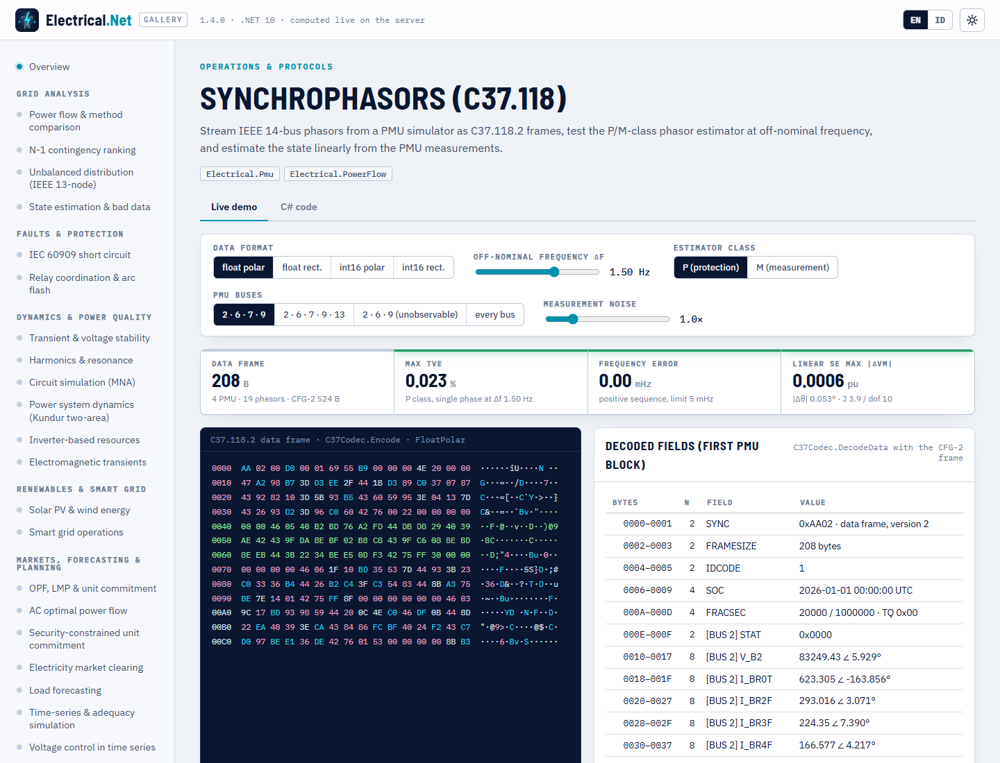

# Sinkrofasor (IEEE C37.118)

> Dibuat oleh Gravicode Studios dipimpin oleh Kang Fadhil · [English](../en/pmu.md)

Paket: `Electrical.Pmu` (v1.4, bergantung pada Core dan PowerFlow). Semua yang dibutuhkan aplikasi pemantauan area luas dari phasor
measurement unit (PMU):

- codec IEEE C37.118.2-2011 untuk frame data, konfigurasi (CFG-1/2/3), header, dan perintah, dengan fasor integer atau float, rektangular
  atau polar, serta pemeriksaan CRC-CCITT;
- transport: server PMU TCP dan klien PDC (pertukaran perintah/konfigurasi/data seperti C37.118.2 §6), publisher dan penerima UDP;
- `PmuSimulator`, yang menerbitkan solusi aliran daya sebagai sinkrofasor pada nominal ± Δf dengan ROCOF dan derau deterministik, serta
  `PmuTimeSeriesSource`, yang memutar ulang simulasi `Electrical.Dynamics`;
- `PhasorEstimator`, estimator acuan C37.118.1 Annex C (kelas P dan M) dengan frekuensi, ROCOF, dan TVE;
- `LinearStateEstimator`, estimator keadaan khusus PMU tanpa iterasi, dan `PdcAlignmentBuffer`, yang menyelaraskan aliran menurut cap waktu.

Satuan: fasor tegangan dalam V RMS fasa-netral, arus dalam A, sudut terhadap kosinus nominal yang tersinkron UTC, frekuensi dalam Hz,
ROCOF dalam Hz/s. Estimator keadaan bekerja dalam per unit pada basis jaringan.

## Dari aliran daya ke frame C37.118

```csharp
var pf = PowerFlowSolver.Solve(TestCases.Case14());
var sim = new PmuSimulator(pf, [2, 6, 7, 9], new PmuSimulatorOptions
{
    FrequencyOffsetHz = 1.5,            // the grid runs 1.5 Hz above nominal
    VoltageNoise = 0.001, CurrentNoise = 0.002, AngleNoiseDeg = 0.05,
});
byte[] cfg2 = C37Codec.Encode(sim.Configuration);                                   // CFG-2, 524 bytes
byte[] frame = C37Codec.Encode(sim.CreateFrame(DateTimeOffset.UtcNow), sim.Configuration);
var data = C37Codec.DecodeData(frame, sim.Configuration);
Console.WriteLine($"{frame.Length} B, {data.Blocks.Count} PMUs, CRC ok: {C37Codec.IsValid(frame)}");
foreach (var (block, pmu) in data.Blocks.Zip(sim.Configuration.Pmus))
    Console.WriteLine($"{pmu.StationName}: |V| {block.Phasors[0].Magnitude / 1000:0.00} kV, f {block.FrequencyHz:0.000} Hz");
```

Setiap bus PMU melaporkan tegangannya dan arus setiap cabang aktif yang terhubung (`IncludeCurrents`). `sim.Bindings` mencatat apa yang
diukur setiap kanal fasor (`PmuChannelBinding`: tegangan bus, atau arus cabang di terminal from/to), yang diperlukan estimator keadaan.
Dengan empat PMU pada sistem IEEE 14 bus, aliran membawa 19 fasor dalam frame float-polar 208 byte (116 byte dalam format integer 16 bit,
di mana `PhasorChannel.ScaleFactor` adalah resolusi PHUNIT dalam 10⁻⁵ V atau A per bit).

| Field | Byte | Isi |
|---|---|---|
| SYNC | 2 | `AA 02`: frame data (bit 6–4 byte kedua memberi tipe: 0 data, 1 header, 2/3/5 CFG-1/2/3, 4 perintah), versi 2 |
| FRAMESIZE, IDCODE | 2 + 2 | Panjang total, id aliran |
| SOC, FRACSEC | 4 + 4 | Detik UTC sejak 1970, pecahan detik (TIME_BASE, bawaan 10⁶) dan byte kualitas waktu |
| per PMU: STAT, PHASORS, FREQ, DFREQ, ANALOG, DIGITAL | | Format per PMU dari frame konfigurasi |
| CHK | 2 | CRC-CCITT (polinom 0x1021, awal 0xFFFF); `CrcCcitt.Compute("123456789")` = 0x29B1 |

## Streaming melalui TCP

```csharp
var sim = new PmuSimulator(pf, [2, 6, 7, 9]);
await using var server = new PmuServer(sim, IPAddress.Loopback, port: 4712);
server.Start();

await using var pdc = new PdcClient(idCode: 1);
await pdc.ConnectAsync("127.0.0.1", 4712);
var config = await pdc.RequestConfigurationAsync();          // CFG-2
await pdc.StartDataAsync();                                   // DATA ON command
await foreach (var f in pdc.ReadDataFramesAsync())
{
    Console.WriteLine($"{f.Time.ToDateTime():HH:mm:ss.fff} {f.Blocks[0].FrequencyHz:0.000} Hz");
    break;
}
```

`PmuServer` menjawab perintah C37.118.2 Tabel 15 (data on/off, kirim header, CFG-1/2/3) dan mengatur laju frame data sesuai reporting
rate (`PmuServerOptions.Paced = false` mengalirkan secepat mungkin, berguna untuk pengujian). `PmuUdpPublisher` / `PdcUdpReceiver`
membawa frame data melalui UDP. PDC yang menggabungkan beberapa aliran menyelaraskannya menurut cap waktu:

```csharp
var align = new PdcAlignmentBuffer(expectedIdCodes: [1, 2, 3], waitTime: TimeSpan.FromMilliseconds(50));
foreach (var set in align.Add(f, DateTimeOffset.UtcNow))   // complete sets, or incomplete ones after the wait time
    Console.WriteLine($"{set.Time.ToDateTime():HH:mm:ss.fff}: {set.Frames.Count} streams, missing {string.Join(",", set.Missing)}");

var services = new ServiceCollection().AddElectrical(b => b.AddPmu(new PmuOptions { PdcStreams = [1, 2, 3] }));
```

## Estimasi fasor (kelas P dan M)

`PhasorEstimator` mengimplementasikan model acuan C37.118.1-2011 Annex C: demodulasi kuadratur pada f₀ diikuti filter lolos-rendah FIR
simetris. Kelas P memakai segitiga dua siklus W(k) = 1 − 2|k|/(N+2) dengan N = 2(f<sub>s</sub>/f₀ − 1); kelas M memakai sinc berjendela
Hamming dengan frekuensi filter (≈ 0,1365·F<sub>s</sub>) dan orde sesuai Tabel C.1. Frekuensi dan ROCOF berasal dari selisih pertama dan kedua
sudut fasor pada ± setengah siklus; magnitudo dikompensasi terhadap penguatan filter pada Δf terestimasi.

```csharp
var est = new PhasorEstimator(new PhasorEstimatorOptions
{
    NominalFrequencyHz = 50, SampleRateHz = 1000, ReportingRate = 50, Class = PmuClass.P,
});
var x = Complex.FromPolarCoordinates(1.0, 0.3);                     // 1 pu RMS at 17.2°
double[] samples = PhasorEstimator.Sinusoid(x, 52, 1000, 600);     // 52 Hz: +2 Hz off-nominal
foreach (var e in est.Estimate(samples, t0S: 0))
{
    var reference = x * Complex.FromPolarCoordinates(1, 2 * Math.PI * 2 * e.TimeS);   // rotates at 2π·Δf
    Console.WriteLine($"{e.TimeS * 1000,5:0} ms  |X| {e.Magnitude:0.0000}  f {e.FrequencyHz:0.000} Hz  " +
                      $"TVE {PhasorEstimator.Tve(e.Phasor, reference):P3}");
}
```

`EstimatePositiveSequence(a, b, c, t0)` mengestimasi X₁ = (X<sub>a</sub> + a·X<sub>b</sub> + a²·X<sub>c</sub>)/3, yang menghilangkan riak 2f₀
yang muncul pada estimasi satu fasa di luar frekuensi nominal.

| Uji (50 Hz, sampling 1 kHz, F<sub>s</sub> 50/s) | Batas C37.118.1 | Electrical.Net |
|---|---|---|
| Kelas P, Δf = ±2 Hz, satu fasa | TVE ≤ 1 % | TVE maks 0,043 %, FE 0,0017 Hz |
| Kelas P, Δf = ±2 Hz, urutan positif | TVE ≤ 1 %, FE ≤ 0,005 Hz | TVE ≈ 0, FE < 0,005 Hz |
| Kelas M, Δf = ±5 Hz | TVE ≤ 1 % | TVE maks 0,066 % |
| Kelas P tanpa kompensasi penguatan, Δf = 2 Hz | (penurunan sinc²) | TVE ≈ 0,5 % (penguatan 0,9947) |
| Step magnitudo 5 %, kelas P | waktu respons ≤ 1,7/f₀, overshoot ≤ 5 % | ≈ 0,72/f₀ (14,4 ms), tanpa overshoot |
| Ramp frekuensi 1 Hz/s dari 49 Hz, urutan positif | uji ramp | f dalam 0,005 Hz dari 49 + t, ROCOF 0,95–1,05 Hz/s |

## Estimasi keadaan linear

Dengan fasor tegangan V<sub>i</sub> dan arus cabang I = Y<sub>ff</sub>·V<sub>f</sub> + Y<sub>ft</sub>·V<sub>t</sub>, model pengukuran z = H·V linear
terhadap tegangan bus kompleks, sehingga estimasi kuadrat terkecil berbobot x̂ = (HᴴWH)⁻¹HᴴWz cukup satu penyelesaian tanpa iterasi.
Setiap bus harus teramati: diukur langsung, atau dijangkau lewat arus terukur dari bus yang terukur.

```csharp
var z = LinearStateEstimator.FromFrame(pf.Network, frame, sim.Bindings);   // V [V] and I [A] → pu
if (!LinearStateEstimator.IsObservable(pf.Network, z)) throw new InvalidOperationException("add PMUs");
var se = LinearStateEstimator.Estimate(pf.Network, z);                      // x̂ = (HᴴWH)⁻¹HᴴWz, no iterations
var v = se.Referenced(referenceBusId: 1, referenceAngleDeg: 0);            // PMU angles are UTC-referenced
Console.WriteLine($"J = {se.Objective:0.0} with {se.DegreesOfFreedom} degrees of freedom");
```

Pada sistem IEEE 14 bus, PMU di bus 2, 6, 7, dan 9 (dengan arus cabang) mengamati seluruh jaringan: pengukuran tanpa derau memulihkan
keadaan aliran daya hingga 1e-9; dengan σ<sub>V</sub> = 0,002 pu dan σ<sub>I</sub> = 0,004 pu galat terbesar 0,0016 pu pada magnitudo dan 0,08° pada
sudut, dan J tetap dalam pita χ² dengan 2(m − n) derajat kebebasan. `FromPowerFlow(pf, buses, …)` menyintesis pengukuran tanpa melalui
frame. Untuk estimasi gabungan SCADA + PMU, gunakan tipe pengukuran PMU di [Electrical.StateEstimation](estimasi-keadaan.md).

## Baris perintah dan galeri

```
$ eln pmu --case case14 --buses 2,6,7,9 --offnominal 1.5
IEEE C37.118.2 data frame from 4 PMUs on case14: 208 bytes, CRC-CCITT 0xFFDC
  AA0200D000016AF9668000000000000047A29DD7BDB21971441B364FC04324D8…
Phasor estimation at 61.5 Hz (+1.5 Hz off-nominal), 1200 Hz sampling:
  P class: |V| 1.0000, f 61.4999 Hz, TVE 0.016 %
  M class: |V| 0.9997, f 61.5010 Hz, TVE 0.039 %
Linear PMU state estimation (19 phasor measurements): max |ΔV| 0.0010 pu, J 6.96 (10 dof)
```

Demo galeri **Sinkrofasor (C37.118)** menampilkan frame sebagai hex dump dengan field terdekode, TVE kelas terpilih terhadap waktu dan
terhadap Δf, serta estimasi linear untuk empat penempatan PMU (salah satunya tak teramati).



## Batasan

Estimator adalah model acuan Annex C (tanpa algoritme adaptif atau DFT terinterpolasi); simulator menghasilkan fasor tunak ditambah derau
dan ROCOF konstan (gunakan `PmuTimeSeriesSource` dengan simulasi dinamik untuk transien). Tanpa keamanan IEEE C37.118 (IEC 62351) atau
sampled values IEC 61850-90-5 yang dirutekan. Estimator linear tidak memiliki uji bad data; saring residu sendiri atau gunakan estimator WLS.

---
*Dibuat oleh Gravicode Studios dipimpin oleh Kang Fadhil · [English](../en/pmu.md)*
