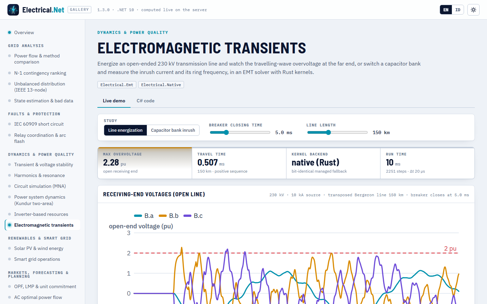

# Transien elektromagnetik (EMT)

> Dibuat oleh Gravicode Studios dipimpin oleh Kang Fadhil · [English](../en/emt.md)

Paket: `Electrical.Emt` (v1.3, bergantung pada Core dan Native). Simulasi nilai sesaat (tipe EMTP) jaringan dalam satuan SI (V, A, Ω, H, F,
s): R/L/C terpusat, sakelar berwaktu dan pemutus yang membuka saat arus nol, dioda dan tiristor, sumber tegangan dan arus, transformator
ideal dengan reaktansi bocor, seksi π terkopel, dan saluran Bergeron (gelombang berjalan) tiga fasa tertransposisi. Loop inti berjalan di
kernel Rust dengan cadangan managed yang identik bit.

Gunakan untuk hal yang tidak terlihat oleh alat fasor: tegangan lebih switching, arus inrush kapasitor, gelombang berjalan, pemotongan arus,
bentuk gelombang penyearah. Untuk dinamika elektromekanis dalam orde detik, gunakan [Electrical.Dynamics](dinamika.md).

## Mulai cepat

```csharp
using Electrical.Emt;

var net = new EmtNetwork();
net.AddVoltageSource("V", "s", EmtWaveform.Dc(10));                        // node "0" adalah tanah
net.AddSeriesRLC("rlc", "s", "0", ohms: 2, henries: 1e-3, farads: 10e-6);
var r = EmtSimulation.Simulate(net, new EmtOptions { TimeStep = 1e-6, StopTime = 3e-3 });

EmtChannel i = r.Current("rlc");
var zc = i.ZeroCrossings(1e-4);
double fRing = (zc.Count - 1) / (2 * (zc[^1] - zc[0]));
Console.WriteLine($"puncak {i.Peak():0.000} A pada {i.TimeOfPeak() * 1e3:0.000} ms, osilasi {fRing:0} Hz [{r.Backend}]");
// puncak 0,863 A pada 0,148 ms, osilasi 1584 Hz [native (Rust)]
```

## Elemen jaringan

| Metode | Elemen |
|---|---|
| `AddResistor`, `AddInductor` (arus awal), `AddCapacitor` (tegangan awal), `AddSeriesRL`, `AddSeriesRLC` | Cabang terpusat |
| `AddSwitch(name, a, b, closeTime, openTime, initiallyClosed, openAtCurrentZero, ron, roff)` | Sakelar berwaktu; dengan `openAtCurrentZero` memutus pada arus nol berikutnya (tanpa pemotongan arus) |
| `AddDiode`, `AddThyristor(…, gate: t => …)` | Perangkat dua keadaan (R<sub>on</sub>/R<sub>off</sub>); hidup saat bias maju, mati saat arus berbalik; tiristor hanya dapat hidup selama gerbangnya bernilai true |
| `AddVoltageSource(name, node, waveform, r, l)`, `AddCurrentSource` | `EmtWaveform.Dc`, `Step`, `Cosine`, `Sine`, `Ramp`, `Custom` |
| `AddTransformer(name, p1, p2, s1, s2, ratio, r, l)` | Transformator ideal dengan reaktansi bocor dirujuk ke sekunder |
| `AddBergeronLine`, `Add(BergeronLine.SinglePhase(…))` | Saluran gelombang berjalan tanpa rugi dengan rugi terpusat (R/4, R/2, R/4) |
| `AddPiSection(name, from[], to[], R, L, C)` | Seksi π n-fasa terkopel dari matriks |
| `AddThreePhaseSource`, `AddThreePhaseLoad`, `AddThreePhaseSeries`, `AddThreePhaseCapacitorBank`, `AddThreePhaseSwitch` (waktu per kutub), `AddThreePhaseLine` (Bergeron tertransposisi dari data urutan), `AddThreePhasePiSection`, `AddThreePhaseTransformer` (YNyn, YNd) | Pembantu tiga fasa: bus `B` menjadi node `B.a`, `B.b`, `B.c`; elemen bernama `name.a`, … |

## Energisasi saluran

```csharp
double vpk = 230e3 * Math.Sqrt(2.0 / 3.0);                                 // puncak fasa (V)
var net = new EmtNetwork();
net.AddThreePhaseSource("Grid", "S", lineVoltageRms: 230e3, frequencyHz: 50, l: 0.0423);      // level hubung singkat ≈ 10 kA
net.AddThreePhaseSwitch("CB", "S", "A", closeTime: 0.005);
net.AddThreePhaseLine("Line", "A", "B", 0.03, 0.93e-3, 12.3e-9, 0.30, 3.0e-3, 7.9e-9, lengthKm: 150);   // R1, L1, C1, R0, L0, C0 per km

var r = EmtSimulation.Simulate(net, new EmtOptions { TimeStep = 20e-6, StopTime = 0.045 });
foreach (var ph in new[] { "a", "b", "c" })
{
    EmtChannel v = r.Voltage($"B.{ph}");                                    // bus tiga fasa menjadi B.a, B.b, B.c
    Console.WriteLine($"B.{ph}: {v.Peak() / vpk:0.00} pu pada {v.TimeOfPeak() * 1e3:0.00} ms");
}
```

```
B.a: 1.17 pu pada 9.58 ms
B.b: 2.28 pu pada 6.60 ms
B.c: 2.20 pu pada 12.94 ms
2251 steps, 2 factorizations, native (Rust), 10 ms
```

Pada 5 ms fasa a melewati nol sementara b dan c berada di ±0,87 pu, sehingga b dan c melihat gelombang berjalan yang berlipat dua di ujung
terbuka (τ = 0,507 ms untuk 150 km) dan mencapai sekitar 2,2–2,3 pu. Geser saat penutupan ke puncak suatu fasa untuk melihat kasus
terburuk fasa tersebut.



## Switching kapasitor

Switching back-to-back dua bank 10 µF melalui 50 µH (Greenwood bab 6): puncak inrush V₀·√(C<sub>eq</sub>/L) dan frekuensi osilasi
1/(2π√(L·C<sub>eq</sub>)) dengan C<sub>eq</sub> = C/2.

```csharp
const double v0 = 10e3, c = 10e-6, l = 50e-6;                               // bank 1 bermuatan 10 kV, 50 µH di antara bank
var net = new EmtNetwork();
net.AddCapacitor("C1", "a", "0", c, initialVoltage: v0);
net.AddSwitch("brk", "a", "x", closeTime: 10e-6);
net.AddSeriesRL("L", "x", "b", 0.01, l);
net.AddCapacitor("C2", "b", "0", c);
var r = EmtSimulation.Simulate(net, new EmtOptions { TimeStep = 0.2e-6, StopTime = 0.4e-3 });

var i = r.Current("L");
double ceq = c / 2, theory = v0 * Math.Sqrt(ceq / l), f0 = 1 / (2 * Math.PI * Math.Sqrt(l * ceq));
var zc = i.ZeroCrossings(20e-6);
Console.WriteLine($"inrush {i.Peak():0} A (teori {theory:0} A), osilasi {(zc.Count - 1) / (2 * (zc[^1] - zc[0])):0.0} Hz (teori {f0:0.0} Hz)");
// inrush 3154 A (teori 3162 A), osilasi 10065,7 Hz (teori 10065,8 Hz)
```

Versi tiga fasa (bus 11 kV yang memberi energi bank wye-grounded) adalah `eln emt --case capbank` dan tampilan kapasitor di demo galeri.

## Sakelar, elektronika daya, dan transformator

```csharp
var net = new EmtNetwork();
net.AddVoltageSource("V", "s", EmtWaveform.Cosine(10e3, 50));
net.AddSwitch("cb", "s", "x", initiallyClosed: true, openTime: 0.0123, openAtCurrentZero: true);   // menunggu arus nol
net.AddSeriesRL("load", "x", "0", 5, 0.05);
net.AddDiode("D", "s", "rect");                                              // penyearah setengah gelombang
net.AddResistor("Rdc", "rect", "0", 100);
net.AddThyristor("T", "s", "ctl", gate: t => (t * 50 % 1.0) * 360 is >= 60 and < 90);   // dipicu pada α = 60°
net.AddResistor("Rt", "ctl", "0", 100);
net.AddTransformer("TR", "s", "0", "lv", "0", ratio: 10, r: 0.01, l: 1e-4);  // 10:1, reaktansi bocor dirujuk ke sekunder
net.AddResistor("Rlv", "lv", "0", 10);
var r = EmtSimulation.Simulate(net, new EmtOptions { TimeStep = 10e-6, StopTime = 0.06 });
```

Setiap perubahan topologi (status sakelar, dioda, atau tiristor) memfaktorkan ulang matriks jaringan (`Factorizations`); status dioda
diiterasi dalam satu langkah hingga konsisten (`MaxSwitchIterations`).

## Solver

- **Model pendamping**: setiap cabang diganti konduktansi dan sumber arus riwayat (aturan trapesium), persamaan nodal G·v = i difaktorkan
  sekali dengan `SparseLU` Core (pengurutan minimum-degree) dan hanya difaktorkan ulang setelah perubahan topologi.
- **Saluran Bergeron**: dekomposisi modal (transformasi Clarke untuk saluran tertransposisi), riwayat waktu tempuh terinterpolasi, rugi
  terpusat.
- **Critical damping adjustment** (`CriticalDampingAdjustment`, aktif secara bawaan, Marti & Lin): setelah setiap perubahan topologi
  solver mengambil dua setengah langkah backward-Euler, yang menjaga matriks tetap dan menghilangkan osilasi ±(2L/Δt)·I aturan trapesium
  setelah pemutusan arus.
- **Keluaran**: tegangan node selalu, arus cabang kecuali `RecordCurrents = false`; `RecordEvery` menjarangkan sampel. `EmtChannel`
  menyediakan `At`, `Window`, `Peak`, `TimeOfPeak`, `Rms`, `RmsLastCycles`, `ZeroCrossings`, `Max`, `Min`, dan pengurangan kanal.

## Kernel native

Dua loop dalam, yaitu pembaruan arus riwayat semua cabang R-L-C dan substitusi maju/mundur dengan LU sparse yang sudah difaktorkan,
adalah fungsi Rust `eln_emt_branch_update` dan `eln_emt_lu_solve` (pustaka dengan `eln_version` ≥ 10300). `Electrical.Native.EmtKernels`
memanggilnya bila tersedia dan bila tidak, menjalankan kode managed yang melakukan operasi floating-point yang sama dengan urutan yang sama,
sehingga hasilnya identik bit (sebuah tes menjalankan jaringan yang sama dengan kedua cara dan membandingkan setiap sampel).

```csharp
Console.WriteLine(EmtKernels.Backend);               // "native (Rust)" atau "managed"
EmtKernels.PreferNative = false;                      // paksa kode managed untuk seluruh proses
var opts = new EmtOptions { PreferNative = false, RecordEvery = 10, RecordCurrents = false };   // atau per simulasi
```

Lihat [Simulasi, HPC & native](simulasi-hpc-native.md#kernel-native) untuk membangun pustaka Rust.

## Dependency injection

```csharp
var sp = new ServiceCollection().AddElectrical(b => b.AddEmt()).BuildServiceProvider();
IEmtService emt = sp.GetRequiredService<IEmtService>();   // Simulate(network, options)
```

## CLI

```
$ eln emt
Line energization: 230 kV, 150 km open-ended line, breaker closes at 5 ms (Δt 50 µs, 1201 steps, native (Rust), 136 ms)
  Open end phase a: peak 1.17 pu at 9.60 ms
  Open end phase b: peak 2.23 pu at 6.60 ms
  Open end phase c: peak 2.15 pu at 12.90 ms

$ eln emt --case capbank
Capacitor bank energization: 5 Mvar at 11 kV, S"k 250 MVA (Δt 50 µs, native (Rust))
  Inrush peak 3043 A = 8.2 × rated peak; ring frequency ≈ 354 Hz
  Bus overvoltage peak 1.97 pu
```

(CLI memakai Δt = 50 µs; simulasi 20 µs di atas menangkap muka gelombang sedikit lebih baik. Eksekusi pertama termasuk waktu JIT.)

## Validasi

| Pemeriksaan | Acuan | Hasil |
|---|---|---|
| Respons RL / RC / RLC | Eksponensial dan sinusoida teredam bentuk tertutup | galat < 0,2 % (RL, RC), < 1,5 % dari puncak (RLC); periode osilasi hingga 0,1 % |
| Energisasi RL dengan offset DC | i = I<sub>m</sub>(cos ωt − e<sup>−t/τ</sup>) | galat < 1 % dari I<sub>m</sub> |
| Energisasi bank kapasitor | Greenwood: V√(C/L), 1/(2π√(LC)) | puncak 0,95–1,12 × nilai surja, frekuensi dalam 1 % |
| Switching kapasitor back-to-back | 3162 A, 10065,8 Hz | 3154 A, 10065,7 Hz; muatan kekal |
| Saluran Bergeron, tangga ke ujung terbuka | Berlipat dua setelah τ, kisi Bewley | eksak hingga 1e-9 (juga untuk τ/Δt tak bulat) |
| Koefisien pantul Γ = (R − Z<sub>c</sub>)/(R + Z<sub>c</sub>) | Γ = 0; 0,5; −1 | hingga 1e-5 |
| Energisasi saluran 230 kV 150 km | ≈ 2 pu di ujung terbuka (Greenwood bab 9) | 1,7–2,3 pu |
| Pemutusan arus induktif | Osilasi trapesium ±(2L/Δt)·I; CDA menghilangkannya | sisa < 1e-3 dari lonjakan dengan CDA |
| Keadaan tunak tiga fasa | Solusi fasor ABCD saluran panjang; analisis AC Electrical.Circuit (π) | 0,0007 % (Bergeron), < 0,5 % (π) |
| Native vs managed | Jaringan sama dengan kedua cara | bentuk gelombang identik bit |

## Batasan

Parameter saluran tidak bergantung frekuensi (tanpa model saluran J. Marti / universal), hanya saluran tiga fasa tertransposisi,
transformator linear (tanpa saturasi atau histeresis), tanpa arester surja atau ekuivalen jaringan bergantung frekuensi, langkah waktu
tetap. Kejadian sakelar dan dioda terjadi pada grid langkah (pembukaan saat arus nol berlaku pada langkah pertama setelah arus berganti
tanda).

---
*Dibuat oleh Gravicode Studios dipimpin oleh Kang Fadhil · [English](../en/emt.md)*
